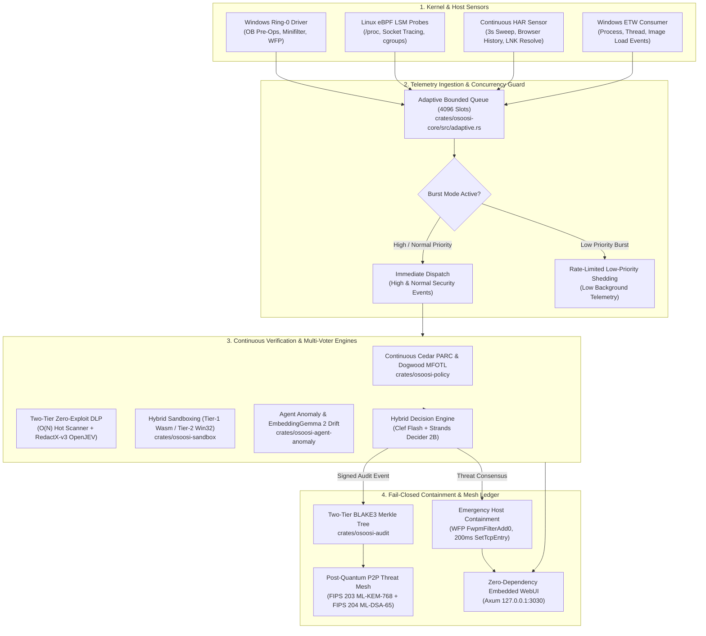

# 🏛️ OpenỌ̀ṣọ́ọ̀sì (OshoosiClaw) System Architecture & Codebase Map

Welcome to the **OshoosiClaw** architecture guide! This document provides a newcomer's mental map of the 25-crate Rust workspace, kernel drivers, eBPF probes, and Python AI defense swarm.

---

## 🧭 High-Level Telemetry & Defense Flow

The following diagram shows how telemetry events flow from low-level operating system sensors through the multi-tier cryptographic and decision pipelines into autonomous containment:

---

## 🛡️ Traceable Security Remediation Matrix (Directives G1–G6)

| Directive | Security Objective | Target File(s) & Implementation | Verification Test & Method | PR / Tracking | Posture |
| :--- | :--- | :--- | :--- | :---: | :---: |
| **G1** | Linux Pre-Confinement Spawn Parity | `crates/osoosi-sandbox/src/tiered_executor.rs` `crates/osoosi-sandbox/src/native_host.rs` (`cmd.pre_exec`, `libc::PR_SET_NO_NEW_PRIVS`, Cgroup v2 `cgroup.procs`, child PID reporting, 10s timeout) | Integration test verification & Unix fork/exec confinement audits | `#G1-G6` | **VERIFIED** |
| **G2** | Anti-DNS-Rebinding Socket Enforcement & SIIT SSRF Parity | `crates/osoosi-sandbox/src/native_host.rs` `crates/osoosi-sandbox/src/lib.rs` (`validate_resolved_socket_addr`, SIIT `::ffff:0:0/96`, IPv4-compatible, 6to4, NAT64, Teredo/Doc) | `cargo test -p osoosi-sandbox --test attack_isolation_test test_anti_dns_rebinding_socket_connect_guard` | `#G1-G6` | **VERIFIED** |
| **G3** | Deep Recursive DLP & High-Entropy Exfiltration Hardening | `crates/osoosi-dp/src/lib.rs` (`MAX_UNWRAP_TOTAL_DECODED_BYTES = 256 KiB`, 50x expansion bomb cap, `register_asset`, 50% sliding-window overlap `step = 2048` in `match_chunks`) | `cargo test -p osoosi-dp test_deep_recursive_dlp_depth6_and_boundary_split_detection` | `#G1-G6` | **VERIFIED** |
| **G4** | Pre-Boot BYOVD & Driver Integrity Auditing | `crates/osoosi-telemetry/src/native.rs` `crates/osoosi-core/src/system_check.rs` (`LoadedDriverInfo`, `enumerate_loaded_kernel_drivers`, `PreBootDriverAuditReport`, LOLDrivers catalog) | `cargo test -p osoosi-core test_preboot_byovd_driver_enumeration_and_containment` | `#G1-G6` | **VERIFIED** |
| **G5** | CI/CD deny.toml & Clippy Parity Gates | Root `deny.toml` `.github/workflows/ci.yml` Fixed 8 Clippy lints across core and tests | `cargo deny check advisories` `cargo clippy --workspace --all-targets` | `#G1-G6` | **VERIFIED** |
| **G6** | Traceable Documentation & WebUI Traceability | `README.md` `ARCHITECTURE.md` `dashboard/src/index.html` `dashboard/dist/index.html` (Strict zero external standard refs, 0 letter grades, `#dlp-view` parity) | `python scripts/validate_readme.py` `git diff --no-index dashboard/src dashboard/dist` | `#G1-G6` | **VERIFIED** |

---

## 📦 Workspace Crate Inventory

The workspace is organized into modular crates under `crates/`, alongside kernel drivers and research tools:

### 1. Core Daemon & Execution Engine
- **[`crates/osoosi-core`](crates/osoosi-core)**: Central daemon orchestrator, event bus, WFP firewall integration, YARA-X scanner, safe browsing v4 connector, and killchain manager.
- **[`crates/osoosi-runtime`](crates/osoosi-runtime)**: Process lifecycle supervisor, signal handling, daemon state machine, and service wrappers (`OsoosiEDR`).
- **[`crates/osoosi-types`](crates/osoosi-types)**: Canonical Rust domain models, event records, telemetry schemas, and STIX 2.1 data structures.
- **[`crates/osoosi-cli`](crates/osoosi-cli)**: High-speed command-line interface (`osoosi-cli`, `osoosi`) providing administrative status, queries, and file vetting.

### 2. Policy & Process Sandboxing
- **[`crates/osoosi-sandbox`](crates/osoosi-sandbox)**: Hybrid Tier-1 Wasmtime isolation (`wasm_tier1.rs`) and Tier-2 Win32 AppContainer / Job Object confinement (`open_confined.rs`, `token_posture.rs`).
- **[`crates/osoosi-policy`](crates/osoosi-policy)**: High-assurance authorization combining AWS Cedar PARC and Dogwood Metric First-Order Temporal Logic (MFOTL).
- **[`crates/osoosi-agent-anomaly`](crates/osoosi-agent-anomaly)**: OWASP Top 10 for Agentic AI surveillance, 101-table SQL host telemetry engine (`siquery.rs`), and semantic trajectory drift detection.

### 3. Cryptography, Privacy & Threat Mesh
- **[`crates/osoosi-audit`](crates/osoosi-audit)**: Cryptographic audit trails, TPM 2.0 hardware-anchored signers, two-tier BLAKE3 Merkle trees, and post-quantum cryptographic primitives.
- **[`crates/osoosi-dp`](crates/osoosi-dp)**: Zero-Knowledge BFT quarantine proofs, differential privacy noise injection, and redaction privacy guarantees.
- **[`crates/osoosi-wire`](crates/osoosi-wire)**: Decentralized peer-to-peer threat gossip, hybrid `X25519 + ML-KEM-768` key encapsulation, and `Ed25519 + ML-DSA-65` signatures.
- **[`crates/osoosi-trust`](crates/osoosi-trust)**: Zero-Path cryptographic binary trust pipeline (Authenticode, Windows Catalog `CatRoot`, Linux package manager verification).

### 4. Telemetry, Host Forensics & Reverse Engineering
- **[`crates/osoosi-telemetry`](crates/osoosi-telemetry)**: Native ETW and eBPF event capture, syscall tracing, and process tree normalization.
- **[`crates/osoosi-memory`](crates/osoosi-memory)**: Process memory hollowing detection, VAD tree scanning, and dynamic thread injection defenses.
- **[`crates/osoosi-forensics`](crates/osoosi-forensics)**: Embedded Velociraptor extraction client, MFT artifact parsing, and host triage collection.
- **[`crates/osoosi-behavioral`](crates/osoosi-behavioral)**: Continuous behavior graph analysis, heuristic clustering, and MITRE technique mapping.
- **[`crates/rea`](crates/rea)**: Autonomous Reverse Engineer Anything engine (PE/ELF/WASM decompiler, compiler artifact classifier, Magika MIME detection).

### 5. WebUI & API Server
- **[`crates/osoosi-dashboard`](crates/osoosi-dashboard)**: Axum-powered embedded web server running locally on `http://127.0.0.1:3030`. Hosts the continuous HAR web traffic inspector, interactive 101-table SQL console, and real-time SSE threat streams.

### 6. Kernel Space & Drivers
- **[`driver/windows/`](driver/windows/)**: Native Windows C/C++ kernel driver implementing Process & Thread Creation ObCallbacks, Minifilter filesystem monitoring, and WFP ALE network filters.
- **[`ebpf/`](ebpf/)**: Linux `BPF_PROG_TYPE_LSM` probes and socket tracing filters for kernel-level pre-execution enforcement.

### 7. Python AI Swarm & Security Tooling
- **[`tools/defense_swarm/`](tools/defense_swarm/)**: LangGraph multi-agent defense swarm coordinating threat reasoning, automated triage, and deception generation.
- **[`scripts/`](scripts/)**: Verification harnesses, release packagers, Microsoft WDSI submission pipeline, and automated test runners.
- **[`tests/`](tests/)**: 34-suite adversarial regression corpus, MITRE ATT&CK & ATLAS red-team test suites.

---

## 🛡️ Enforced Architectural Invariants

Every contribution must preserve these core system guarantees:

1. **Zero-Touch PATH Immutability**:
   - The user or system `PATH` environment variable must NEVER be overwritten, truncated, or wiped.
   - Any PATH addition in WiX manifests (`.wxs`) must be `Permanent="yes"` and `Part="last"`.
   - In-memory process changes must strictly use process-scoped environment variables.

2. **Production Code Only (Zero-Mock Invariant)**:
   - No mock signatures, dummy security rules, or hardcoded fake responses.
   - All security decisions must route through authentic decision models (Clef Decision Engine, Strands Decider, Byzantine Quorum).

3. **Fail-Closed Container Confinement**:
   - Spawning confined workers must use `CREATE_SUSPENDED`.
   - `AssignProcessToJobObject` must succeed and verify `IsProcessInJob == TRUE` before `ResumeThread`.
   - On error, child processes are immediately terminated with zero unconfined fallbacks.

4. **Async Lock Hygiene & Zero Deadlocks**:
   - Never call `blocking_read()` or `blocking_write()` inside Tokio async tasks.
   - Avoid holding mutable `.entry()` guards across DashMap iterations.

5. **WebUI 0-Diff Parity**:
   - Every file change in `dashboard/src/` must be mirrored in `dashboard/dist/` with identical SHA-256 checksums.

---

## 🔗 Related Resources

- [README Overview](README.md)
- [Good First Issues](docs/GOOD_FIRST_ISSUES.md)
- [Contributing Guide](CONTRIBUTING.md)
- [Security Policy](SECURITY.md)
