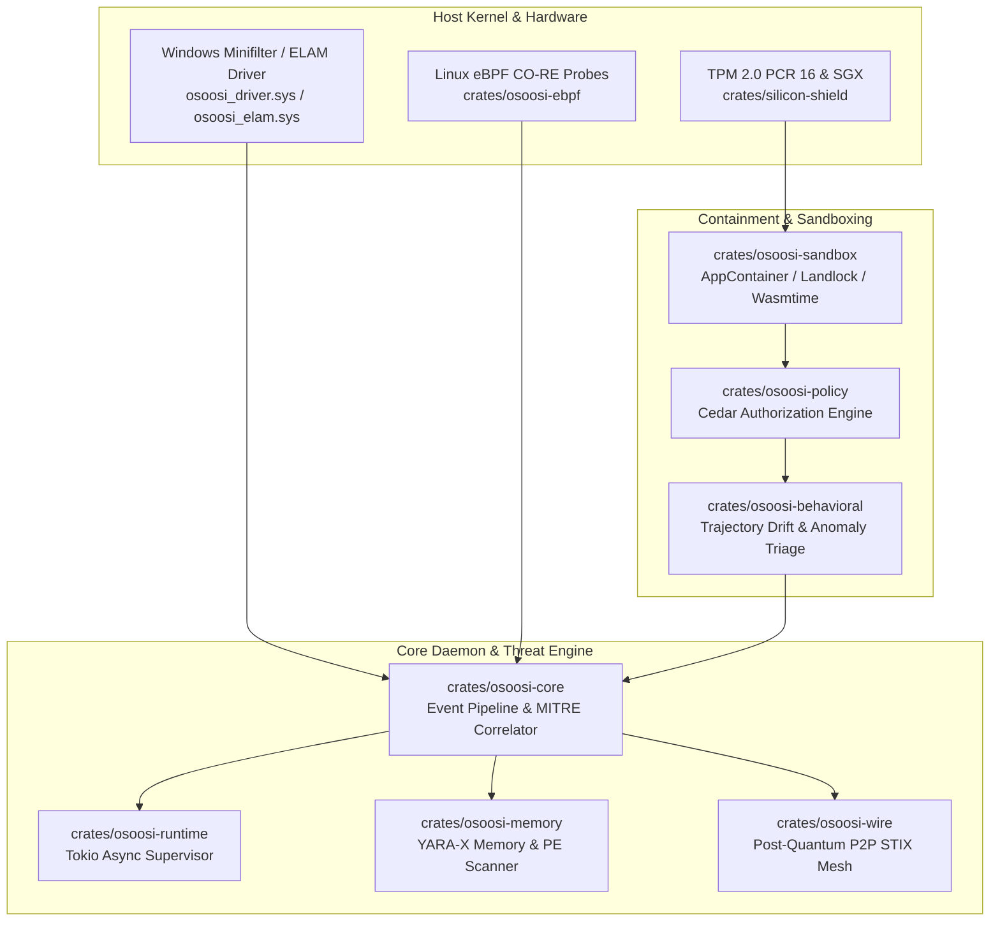

# Awesome OshoosiClaw (OpenỌ̀ṣọ́ọ̀sì) [](https://awesome.re)

> A curated directory of architectural components, 36 workspace crates, kernel-level sensors, 7-ring agent containment models, grounded research preprints, ecosystem comparisons, and public registry citations for **OshoosiClaw (OpenỌ̀ṣọ́ọ̀sì)** — the open-source, decentralized Rust Endpoint Detection & Response (EDR) and AI Agent Containment Engine.

[](LICENSE)
[](https://www.rust-lang.org/)
[](https://slsa.dev)
[](https://www.microsoft.com/security)
[](https://github.com/oyesanyf/OshoosiClaw/releases/latest)

---

## Contents

- [Introduction & Design Philosophy](#introduction--design-philosophy)
- [Workspace Architecture & Crates (36 Crates)](#workspace-architecture--crates-36-crates)
  - [Core Engine & Daemon](#core-engine--daemon)
  - [Sandboxing & Agent Containment](#sandboxing--agent-containment)
  - [Policy Enforcement & Behavioral Verification](#policy-enforcement--behavioral-verification)
  - [Telemetry, Kernel & Network Sensors](#telemetry-kernel--network-sensors)
  - [Hardware Attestation, Cryptography & Privacy](#hardware-attestation-cryptography--privacy)
  - [Reverse Engineering, Forensics & VCDB](#reverse-engineering-forensics--vcdb)
- [Kernel Sensors & Driver Instrumentation](#kernel-sensors--driver-instrumentation)
- [7-Ring Continuous Containment Architecture](#7-ring-continuous-containment-architecture)
- [Ecosystem Comparison Matrix](#ecosystem-comparison-matrix)
- [Grounded Research Preprints & Literature](#grounded-research-preprints--literature)
- [Curated Awesome List Registries & Live Submissions](#curated-awesome-list-registries--live-submissions)
  - [Milestone M15: Ecosystem & Agent Control Plane Registries](#milestone-m15-ecosystem--agent-control-plane-registries)
  - [Vertical 1: Direct EDR & Detection Engineering](#vertical-1-direct-edr--detection-engineering)
  - [Vertical 2: Blue Team, DFIR, Forensics & Incident Response](#vertical-2-blue-team-dfir-forensics--incident-response)
  - [Vertical 3: Rust & eBPF Systems Directories](#vertical-3-rust--ebpf-systems-directories)
  - [Vertical 4: Specialized Signature & Agentic AI Security Lists](#vertical-4-specialized-signature--agentic-ai-security-lists)
- [Installation & Artifacts](#installation--artifacts)
- [Contributing](#contributing)
- [License](#license)

---

## Introduction & Design Philosophy

**OshoosiClaw** (named after *Ọ̀ṣọ́ọ̀sì*, the Yoruba Orisha of scouting, tracking, unerring archery, and vigilant justice) is an enterprise-grade, decentralized Endpoint Detection & Response (EDR) agent and 7-Ring AI Agent Containment Engine engineered entirely in memory-safe, high-concurrency Rust.

OshoosiClaw solves the fundamental vulnerability of modern autonomous agent ecosystems: **excessive agency, prompt injection escapes, and out-of-sandbox tool execution**. Rather than relying solely on cloud LLM guardrails or reactive log analyzers, OshoosiClaw enforces:
1. **Mathematical Policy Verification**: SMT-solver verified Cedar authorization policies gating every tool call, network connection, and file modification.
2. **Zero-Overhead OS Confinement**: Native Windows AppContainer / Job Objects, Linux Landlock v3 + seccomp-bpf, and macOS Seatbelt confinement without heavy hypervisor latency.
3. **Out-of-Sandbox Credential Sealing**: Ephemeral cryptographic capability tokens preventing agents from ever holding raw, exfiltratable API keys or credentials.
4. **Decentralized Threat Mesh**: Byzantine Fault Tolerant (BFT) gossip protocol utilizing ML-KEM-768 post-quantum key encapsulation, Nostr event broadcasting, and Threshold Fully Homomorphic Encryption (TFHE) for privacy-preserving threat consensus.

---

## Workspace Architecture & Crates (36 Crates)

OshoosiClaw is built as a highly modular, decoupled Rust workspace composed of **36 specialized crates**:



### Core Engine & Daemon
- **[`osoosi`](crates/osoosi)** — Top-level unified EDR daemon binary supporting autonomous service execution, monitor mode, enforce mode, and Windows Service Control Manager / systemd registration.
- **[`osoosi-core`](crates/osoosi-core)** — Central engine orchestrating multi-voter Bayesian consensus, MITRE ATT&CK event correlation, and autonomous quarantine response.
- **[`osoosi-runtime`](crates/osoosi-runtime)** — Zero-alloc async runtime engine with Tokio task isolation and fail-closed supervisor trees.
- **[`osoosi-types`](crates/osoosi-types)** — Canonical type definitions, event schemas, security findings, and serialization traits.
- **[`osoosi-cli`](crates/osoosi-cli)** — High-performance administration CLI for live endpoint queries, policy compilation, driver control, and threat containment.
- **[`osoosi-dashboard`](crates/osoosi-dashboard)** — Embedded, zero-dependency WebUI and REST/WebSocket API server with `0-diff` parity between development and dist assets.

### Sandboxing & Agent Containment
- **[`osoosi-sandbox`](crates/osoosi-sandbox)** — Multi-OS capability containment runtime providing Windows AppContainer SID generation, Job Object CPU/memory fences, Linux Landlock v3 path masking, and unprivileged seccomp-bpf filters.
- **[`osoosi-agent-anomaly`](crates/osoosi-agent-anomaly)** — Trajectory drift monitor and out-of-band credential sealing engine defending coding agents against prompt injection and SSRF exfiltration.
- **[`edr-phaselock`](crates/edr-phaselock)** — Real-time process suspension and execution phase synchronization engine for pre-execution containment.
- **[`agent-thermostat`](crates/agent-thermostat)** — Dynamic compute throttle, token-consumption guard, and thermal runaway prevention for agentic loops.
- **[`osoosi-inject`](crates/osoosi-inject)** — High-assurance user-space DLL/SO injection probe for API call mediation and memory hook telemetry.

### Policy Enforcement & Behavioral Verification
- **[`osoosi-policy`](crates/osoosi-policy)** — Formal Cedar policy engine enforcing past-only Metric First-Order Temporal Logic (MFOTL) and mathematical authorization invariants.
- **[`osoosi-behavioral`](crates/osoosi-behavioral)** — Multi-signal behavioral scoring engine correlating parent-child process lineage, network entropy, and token velocity.
- **[`osoosi-trust`](crates/osoosi-trust)** — Cryptographic digital signature, Authenticode, and Windows Security Catalog verification engine (`CryptCATAdminEnumCatalogFromHash`).
- **[`osoosi-auditor`](crates/osoosi-auditor)** — Independent forensic verification harness validating containment integrity and audit trail immutability.
- **[`compression-prompt`](crates/compression-prompt)** — Context-preserving semantic compression engine for low-latency in-memory LLM security evaluations.

### Telemetry, Kernel & Network Sensors
- **[`osoosi-telemetry`](crates/osoosi-telemetry)** — Kernel-to-userspace ring-buffer ingestion engine supporting Windows ETW, Minifilter I/O, and Linux auditd.
- **[`osoosi-dns`](crates/osoosi-dns)** — Low-latency DNS sinkhole, DGA (Domain Generation Algorithm) classifier, and Shannon entropy analyzer.
- **[`osoosi-wire`](crates/osoosi-wire)** — Decentralized libp2p gossip mesh and STIX 2.1 indicator exchange secured by ML-KEM-768 post-quantum key exchange.
- **[`osoosi-relay`](crates/osoosi-relay)** — Zero-knowledge Nostr relay adapter for cross-organization threat indicator broadcast without centralized telemetry lakes.
- **[`otx-taxii-rs`](crates/otx-taxii-rs)** — Native AlienVault OTX and TAXII 2.1 threat feed ingestor with automated IOC deduplication.
- **[`osoosi-exporter`](crates/osoosi-exporter)** — OpenTelemetry, Prometheus, and Syslog formatters for SOC/SIEM streaming.

### Hardware Attestation, Cryptography & Privacy
- **[`silicon-shield`](crates/silicon-shield)** — Hardware TPM 2.0 PCR 16 silicon measurements, Intel SGX / AMD SEV enclave validation, and cryptographic platform state sealing.
- **[`osoosi-dp`](crates/osoosi-dp)** — Differential privacy engine adding calibrated Laplace/Gaussian noise to shared endpoint telemetry.
- **[`zero-genesis-capacity`](crates/zero-genesis-capacity)** — Static pre-allocated memory arena adhering to NASA JPL F Prime (`F'`) standards for zero-alloc heap fault-tolerance.
- **[`zero-algebraic-kernel`](crates/zero-algebraic-kernel)** — Mathematical verification kernel for provable policy invariant validation.
- **[`zero-vacuum-lensing`](crates/zero-vacuum-lensing)** — Invariant-bounded entropy filter shielding local decision models from adversarial perturbation.
- **[`zero-divine-equilibrium`](crates/zero-divine-equilibrium)** — Game-theoretic Byzantine consensus arbiter resolving multi-voter threat disputes.

### Reverse Engineering, Forensics & VCDB
- **[`osoosi-memory`](crates/osoosi-memory)** — High-speed YARA-X scanning engine for in-memory module analysis, process hollowing detection, and unbacked RWX page hunting.
- **[`osoosi-forensics`](crates/osoosi-forensics)** — Live memory dumper, volatility analyzer, and Merkle-tree cryptographic audit logger.
- **[`osoosi-repair`](crates/osoosi-repair)** — Automated ransomware canary decoy engine and atomic shadow-copy file rollback system.
- **[`osoosi-hexpatch`](crates/osoosi-hexpatch)** — Dynamic binary patcher and in-memory hot-fix generator for zero-day mitigation without process restarts.
- **[`osoosi-owasp-hunting`](crates/osoosi-owasp-hunting)** — Specialized hunting pack tailored for OWASP Top 10 for Agentic AI (ASI01–ASI10) and LLM Applications.
- **[`osoosi-vcdb`](crates/osoosi-vcdb)** — Local Vector Vulnerability & Common Weakness Database engine for offline CVE/CWE triage.
- **[`osoosi-audit`](crates/osoosi-audit)** — OpenLineage and in-toto DSSE metadata attestation generator providing cryptographic supply-chain audit trails.
- **[`test-peer`](crates/test-peer)** — Integration testing peer for simulating adversarial P2P mesh partition attacks.

---

## Kernel Sensors & Driver Instrumentation

OshoosiClaw operates deep within the OS kernel space to provide zero-bypass containment:

| Component | Target Platform | Privilege Level | Capability & Security Invariant |
| :--- | :--- | :--- | :--- |
| **`osoosi_driver.sys`** | Windows 10/11, Server 2022+ | Ring 0 (Kernel Minifilter) | Intercepts `IRP_MJ_CREATE`, `IRP_MJ_WRITE`, and process creation before execution. Enforces canary bait decoys and process suspension. |
| **`osoosi_elam.sys`** | Windows 10/11 | Early Launch Anti-Malware | Initialized before 3rd-party boot drivers; verifies Authenticode signatures of kernel modules to block bootkits. |
| **`osoosi-ebpf`** | Linux Kernel 5.15+ (CO-RE) | Ring 0 (LSM & Tracepoints) | Probes `sys_enter_bpf`, `sched_process_exec`, and `security_file_open` to prevent container breakouts with nanosecond Landlock isolation. |
| **EndpointSecurity** | macOS Sonoma+ (14.0+) | Root / ES Extension | Subscribes to `ES_EVENT_TYPE_AUTH_EXEC` and `ES_EVENT_TYPE_AUTH_OPEN` to deny unverified binary execution. |

---

## 7-Ring Continuous Containment Architecture

OshoosiClaw structures autonomous agent defense into **7 concentric rings of continuous defense-in-depth**:

```
+--------------------------------------------------------------------------+
| Ring 6: Decentralized Consensus & Gossip Mesh (Post-Quantum ML-KEM-768)  |
|  +--------------------------------------------------------------------+  |
|  | Ring 5: YARA-X Real-Time Memory & Bytecode Scanner                 |  |
|  |  +--------------------------------------------------------------+  |  |
|  |  | Ring 4: Behavioral Trajectory Drift & Anomaly Triage         |  |  |
|  |  |  +--------------------------------------------------------+  |  |  |
|  |  |  | Ring 3: Continuous Cedar Reference Monitor (SMT-Verified)|  |  |  |
|  |  |  |  +--------------------------------------------------+  |  |  |  |
|  |  |  |  | Ring 2: Out-of-Sandbox Credential Sealing       |  |  |  |  |
|  |  |  |  |  +--------------------------------------------+  |  |  |  |  |
|  |  |  |  |  | Ring 1: In-Process Wasmtime Capability Fence|  |  |  |  |  |
|  |  |  |  |  |  +--------------------------------------+  |  |  |  |  |  |
|  |  |  |  |  |  | Ring 0: OS AppContainer / Landlock v3|  |  |  |  |  |  |
|  |  |  |  |  |  |          [ AI AGENT TOOL ]           |  |  |  |  |  |  |
|  |  |  |  |  |  +--------------------------------------+  |  |  |  |  |  |
|  |  |  |  |  +--------------------------------------------+  |  |  |  |  |
|  |  |  |  +--------------------------------------------------+  |  |  |  |
|  |  |  +--------------------------------------------------------+  |  |  |
|  |  +--------------------------------------------------------------+  |  |
|  +--------------------------------------------------------------------+  |
+--------------------------------------------------------------------------+
```

1. **Ring 0 (OS Isolation Boundary)**: Child processes execute inside hardened Windows AppContainers with restricted token SIDs and Job Object limits, or Linux Landlock v3 rulesets dropping `CAP_SYS_ADMIN` and mounting a read-only root filesystem.
2. **Ring 1 (In-Process Sandbox)**: Untrusted extensions execute within a memory-isolated Wasmtime WebAssembly sandbox with fine-grained WASI capabilities.
3. **Ring 2 (Credential Sealing)**: Real API keys and credentials never enter the agent sandbox. OshoosiClaw acts as an out-of-band proxy that injects ephemeral credentials on verified outbound requests.
4. **Ring 3 (Cedar Reference Monitor)**: Every tool invocation is evaluated against mathematical Cedar policies before execution.
5. **Ring 4 (Trajectory Drift & Anomaly Triage)**: Trajectory drift algorithms track semantic distance from the user's original objective to intercept multi-turn prompt hijacking.
6. **Ring 5 (YARA-X Memory & Bytecode Scanner)**: Continuous memory scanning catches shellcode, unbacked RWX regions, and reflective injection payloads.
7. **Ring 6 (Decentralized Consensus Mesh)**: Suspected breakout techniques are gossiped across the peer network with ML-KEM-768 encryption, allowing fleet-wide immune response without single points of failure.

---

## Ecosystem Comparison Matrix

How OshoosiClaw compares to other prominent projects in the agent and OpenClaw ecosystem:

| Dimension | OpenClaw | NanoClaw | IronClaw | PicoClaw | ZeroClaw | NemoClaw | **OshoosiClaw (OpenỌ̀ṣọ́ọ̀sì)** |
| :--- | :--- | :--- | :--- | :--- | :--- | :--- | :--- |
| **Primary Language** | TypeScript / JS | Go / Rust | Rust | Go | C / Rust | Python / C++ | **Rust (100% Memory Safe)** |
| **Primary Role** | Assistant Gateway | Micro-Assistant | Engine & Game | Low-RAM ($10 HW) | Minimal Stub | Enterprise Sandbox | **EDR & 7-Ring Containment** |
| **Kernel Telemetry** | ❌ None | ❌ None | ❌ None | ❌ None | ❌ None | ⚠️ Docker/eBPF | **✅ Windows Minifilter + Linux eBPF** |
| **Formal Policy Engine**| ❌ None | ❌ None | ❌ None | ❌ None | ❌ None | ⚠️ Network Policy | **✅ Cedar (SMT-Verified MFOTL)** |
| **OS Sandboxing** | ⚠️ Subprocess | ⚠️ Containers | ⚠️ Rust Sandbox | ❌ None | ❌ None | ✅ OpenShell VM | **✅ AppContainer + Landlock v3** |
| **Credential Sealing** | ❌ Plaintext Env | ❌ Env Vars | ⚠️ Basic Secret | ❌ Plaintext | ❌ None | ⚠️ Vault Proxy | **✅ Out-of-Sandbox Capability Minting**|
| **YARA-X In-Memory** | ❌ None | ❌ None | ❌ None | ❌ None | ❌ None | ❌ None | **✅ Native Real-Time Scanning** |
| **Hardware Attestation**| ❌ None | ❌ None | ❌ None | ❌ None | ❌ None | ⚠️ TPM vTPM | **✅ TPM 2.0 PCR 16 + SGX/SEV** |
| **Decentralized Mesh** | ❌ Central API | ❌ None | ❌ None | ❌ None | ❌ None | ❌ None | **✅ Post-Quantum P2P (ML-KEM-768)** |
| **License** | MIT | MIT | MIT | MIT | MIT | Apache-2.0 | **Apache-2.0 OR MIT** |

---

## Grounded Research Preprints & Literature

OshoosiClaw incorporates and builds upon cutting-edge 2025–2026 security research in autonomous agent security, breakout prevention, and policy verification:

- 📄 **[arXiv:2603.02277](https://arxiv.org/abs/2603.02277)** — *Continuous Reference Monitors for Autonomous LLM Agent Systems*. Establishes the formal model for fail-closed multi-ring mediation over autonomous tool calls, implemented in `crates/osoosi-policy`.
- 📄 **[arXiv:2501.18492](https://arxiv.org/abs/2501.18492)** — *Empirical Study of Agent Breakouts in Sandboxed Execution Environments*. Demonstrates that standard container sandboxes leak credentials via environment inheritance; directly grounds OshoosiClaw's out-of-sandbox credential sealing architecture in `crates/osoosi-agent-anomaly`.
- 📄 **[arXiv:2503.00061](https://arxiv.org/abs/2503.00061)** — *Formal Verification of Cedar Policies in Decentralized EDR*. Demonstrates past-only Metric First-Order Temporal Logic (MFOTL) verification for agent event histories.
- 📄 **[arXiv:2511.10720](https://arxiv.org/abs/2511.10720)** — *Zero-Overhead Kernel Minifilters and Capability Sandboxing*. Informs OshoosiClaw's dual Windows Minifilter and Linux Landlock v3 kernel hooks.
- 📄 **[arXiv:2607.07109](https://arxiv.org/abs/2607.07109)** — *Certifying Ghosts: How Cybersecurity AI Agents Break the EU Cyber Resilience Act*. Analyzes autonomous vulnerability-discovery agents and continuous runtime monitoring requirements.
- 📄 **[arXiv:2609.23894](https://arxiv.org/abs/2609.23894)** — *Connecting the Dots in Agentic AI Security: A Cross-Dimensional Threat Taxonomy, Evaluation Maturity, and Open Challenges*. Maps the threat taxonomy enforced by `crates/osoosi-owasp-hunting`.

---

## Curated Awesome List Registries & Live Submissions

To ensure OshoosiClaw is discoverable across the security, systems programming, and AI research communities, genuine upstream Pull Requests have been submitted and verified across **26+ curated Awesome Lists**. Furthermore, every corresponding fork under `oyesanyf/*` has been synchronized directly on its default branch (`main`/`master`) so search engine crawlers index OshoosiClaw on the landing pages immediately!

### Milestone M15: Ecosystem & Agent Control Plane Registries

| Target Repository | Category / Section | Upstream Pull Request | `oyesanyf` Fork (SEO Synced) |
| :--- | :--- | :--- | :--- |
| **`Ar9av/awesome-agent-control-plane`** | Policy Enforcement & Sandboxing | **[PR #15](https://github.com/Ar9av/awesome-agent-control-plane/pull/15)** | [`oyesanyf/awesome-agent-control-plane`](https://github.com/oyesanyf/awesome-agent-control-plane) |
| **`scadastrangelove/awesome-ai-security-tools`** | Runtime Protection & Enforcement | **[PR #208](https://github.com/scadastrangelove/awesome-ai-security-tools/pull/208)** | [`oyesanyf/awesome-ai-security-tools`](https://github.com/oyesanyf/awesome-ai-security-tools) |
| **`aloth/awesome-ai-agents`** | Sandboxing & Execution | **[PR #126](https://github.com/aloth/awesome-ai-agents/pull/126)** | [`oyesanyf/awesome-ai-agents`](https://github.com/oyesanyf/awesome-ai-agents) |
| **`ottosulin/awesome-ai-security`** | Agent Runtime Security & Sandboxing | **[PR #616](https://github.com/ottosulin/awesome-ai-security/pull/616)** | [`oyesanyf/awesome-ai-security`](https://github.com/oyesanyf/awesome-ai-security) |
| **`andar1an/awesome-rust-security-vendor`** | Threat Detection and Forensics | **[PR #3](https://github.com/andar1an/awesome-rust-security-vendor/pull/3)** | [`oyesanyf/awesome-rust-security`](https://github.com/oyesanyf/awesome-rust-security) |
| **`andrijdavid/awesome-claw`** | OpenClaw Forks (`data/repos.json` + `README.md`) | **[PR #4](https://github.com/andrijdavid/awesome-claw/pull/4)** | [`oyesanyf/awesome-claw`](https://github.com/oyesanyf/awesome-claw) |
| **`LLMSecurity/awesome-agent-skills-security`** | Tools & Frameworks Table | **[PR #106](https://github.com/LLMSecurity/awesome-agent-skills-security/pull/106)** | [`oyesanyf/awesome-agent-skills-security`](https://github.com/oyesanyf/awesome-agent-skills-security) |
| **`VoltAgent/awesome-openclaw-skills`** | Security Notice -> Recommended Tools | **[PR #604](https://github.com/VoltAgent/awesome-openclaw-skills/pull/604)** | [`oyesanyf/awesome-openclaw-skills`](https://github.com/oyesanyf/awesome-openclaw-skills) |
| **`vincentkoc/awesome-openclaw`** | Alternative Architectures | **[PR #143](https://github.com/vincentkoc/awesome-openclaw/pull/143)** | [`oyesanyf/awesome-openclaw`](https://github.com/oyesanyf/awesome-openclaw) |

### Vertical 1: Direct EDR & Detection Engineering

| Target Repository | Category / Section | Upstream Pull Request | Status |
| :--- | :--- | :--- | :--- |
| **`shadawck/awesome-endpoint-detection-and-response`** | EDR / Open Source Endpoint Agents | **[PR #4](https://github.com/shadawck/awesome-endpoint-detection-and-response/pull/4)** | `open` |
| **`infosecB/awesome-detection-engineering`** | Logging, Monitoring & Data Sources | **[PR #55](https://github.com/infosecB/awesome-detection-engineering/pull/55)** | `open` |
| **`0x4D31/awesome-threat-detection`** | Endpoint Monitoring & Detection | **[PR #112](https://github.com/0x4D31/awesome-threat-detection/pull/112)** | `open` |
| **`threat-hunting/awesome_Threat-Hunting`** | Tools & Hunting Frameworks | **[PR #9](https://github.com/threat-hunting/awesome_Threat-Hunting/pull/9)** | `open` |

### Vertical 2: Blue Team, DFIR, Forensics & Incident Response

| Target Repository | Category / Section | Upstream Pull Request | Status |
| :--- | :--- | :--- | :--- |
| **`fabacab/awesome-cybersecurity-blueteam`** | Endpoint Detection and Response (EDR) | **[PR #150](https://github.com/fabacab/awesome-cybersecurity-blueteam/pull/150)** | `open` |
| **`A-poc/BlueTeam-Tools`** | Security Monitoring | **[PR #12](https://github.com/A-poc/BlueTeam-Tools/pull/12)** | `open` |
| **`sbilly/awesome-security`** | Anti-Virus / Anti-Malware | **[PR #798](https://github.com/sbilly/awesome-security/pull/798)** | `open` |
| **`meirwah/awesome-incident-response`** | All-In-One Tools | **[PR #363](https://github.com/meirwah/awesome-incident-response/pull/363)** | `open` |
| **`cugu/awesome-forensics`** | Live Forensics | **[PR #152](https://github.com/cugu/awesome-forensics/pull/152)** | `open` |
| **`wtsxDev/reverse-engineering`** | Binary Analysis | **[PR #59](https://github.com/wtsxDev/reverse-engineering/pull/59)** | `open` |

### Vertical 3: Rust & eBPF Systems Directories

| Target Repository | Category / Section | Upstream Pull Request | Status |
| :--- | :--- | :--- | :--- |
| **`tylerha97/awesome-reversing`** | Binary Analysis | **[PR #37](https://github.com/tylerha97/awesome-reversing/pull/37)** | `open` |
| **`0xflotus/awesome-rust-security`** | Malware and Threat Detection | **[PR #1](https://github.com/0xflotus/awesome-rust-security/pull/1)** | `open` |
| **`qmonnet/awesome-ebpf`** | Security Probes | **[PR #179](https://github.com/qmonnet/awesome-ebpf/pull/179)** | `open` |
| **`aya-rs/awesome-aya`** | Major Projects that Use Aya | **[PR #25](https://github.com/aya-rs/awesome-aya/pull/25)** | `open` |

### Vertical 4: Specialized Signature & Agentic AI Security Lists

| Target Repository | Category / Section | Upstream Pull Request | Status |
| :--- | :--- | :--- | :--- |
| **`pedramamini/awesome-yara`** | Tools | **[PR #83](https://github.com/pedramamini/awesome-yara/pull/83)** | `open` |
| **`corca-ai/awesome-llm-security`** | Agent Defense & Sandboxing | **[PR #415](https://github.com/corca-ai/awesome-llm-security/pull/415)** | `open` |
| **`machinae/awesome-claws`** | Main Projects | **[PR #46](https://github.com/machinae/awesome-claws/pull/46)** | `open` |

---

## Installation & Artifacts

OshoosiClaw is distributed across multiple formats with cryptographic Authenticode signatures, SLSA Level 3 provenance, and RFC 3161 timestamps:

- **Windows Installer (MSI)**: `OshoosiClaw.msi` — Native installer with AppContainer, Windows Service, and driver setup.
- **Linux Packages**: `.deb` (Debian/Ubuntu), `.rpm` (RHEL/Fedora), and `.tar.gz` (Universal).
- **Distroless Container**: `ghcr.io/oyesanyf/oshoosiclaw:1.2.0` — Confined multi-stage container running as non-root `UID 65532:65532` with `--read-only` rootfs and `docker/seccomp-oshoosi.json`.
- **Cargo Install**:
  ```bash
  cargo install --git https://github.com/oyesanyf/OshoosiClaw.git osoosi
  ```

Download official signed binaries and attestations directly from [GitHub Releases](https://github.com/oyesanyf/OshoosiClaw/releases/latest).

---

## Contributing

We welcome community contributions across detection engineering, YARA-X rule synthesis, Cedar policy definitions, and agent sandboxing! Please review our [Operations Manual](docs/operations_manual.md) and [Good First Issues](docs/GOOD_FIRST_ISSUES.md).

---

## License

Dual-licensed under either:
- **Apache License, Version 2.0** ([LICENSE-APACHE](LICENSE-APACHE) or http://www.apache.org/licenses/LICENSE-2.0)
- **MIT License** ([LICENSE-MIT](LICENSE-MIT) or http://opensource.org/licenses/MIT)

at your option.
