<p align="center">
  
</p>

<h1 align="center">🏹 OpenỌ̀ṣọ́ọ̀sì — OshoosiClaw</h1>
<h3 align="center"><em>The Decentralized Immune System for the Modern Endpoint</em></h3>

<p align="center">
  <a href="#-features"></a>
  <a href="#-technology--language-stack-rust--python"></a>
  <a href="#-mitre-attck--atlas-enterprise-framework"></a>
  <a href="#-ring-0-windows-driver--linux-ebpf-parity"></a>
  <a href="#-mesh-networking"></a>
  <a href="#-architecture"></a>
  <a href="#-adversarial-verification"></a>
  <a href="https://securityscorecards.dev/viewer/?uri=github.com/oyesanyf/OshoosiClaw"></a>
  <a href="LICENSE"></a>
</p>

<p align="center">
  <a href="#-nist-article--standards-alignment">🏛️ NIST Alignment</a> •
  <a href="#-what-is-oshoosiclaw-plain-english-overview">🎯 Overview</a> •
  <a href="#-60-second-quick-start">⚡ Quick Start</a> •
  <a href="#-continuous-self-updating-har-web-traffic-sensor-har-traffic">🌐 HAR Web Traffic</a> •
  <a href="#-twelve-part-architecture-of-zero--7-crate-physics-defense-engine">⚛️ Physics of Zero (7 Crates)</a> •
  <a href="#-autonomous-rea-reverse-engineer-anything-forensic-engine">🔬 Autonomous REA</a> •
  <a href="#-emergency-kill-chain--reversible-host-containment-engine">🚨 Kill Chain & Host Isolation</a> •
  <a href="#-4-pillar-fully-homomorphic-encryption-tfhe--cryptographic-merkle-architecture">🔒 4-Pillar FHE & Merkle</a> •
  <a href="#-http-framing-defense--request-queue-poisoning-cl0-remediation">🛡️ HTTP Framing Defense (CL.0)</a> •
  <a href="#-siquery-rs-101-table-engine">Siquery-RS 101-Table Engine</a> •
  <a href="#-hierarchical-merkle-hash-chains--nsrl--aslr-merkle-protection">Hierarchical & NSRL/ASLR Merkle</a> •
  <a href="#-spider-web-continuum-mechanics--exposure-bounded-containment">Spider-Web Continuum Mechanics</a> •
  <a href="#-agentoctopus-multi-ring-containment">AgentOctopus Multi-Ring Containment</a> •
  <a href="#-hardened-canarycage-filelineage-and-swarm-pre-immunization">🕊️ Ephemeral CanaryCage & Swarm Lineage (R1–R15)</a> •
  <a href="#-native-windows-service-lifecycle-osoosiedr">Windows & Linux Service (`OsoosiEDR`)</a> •
  <a href="#-ring-0-windows-driver--linux-ebpf-parity">Ring-0 Driver & eBPF</a> •
  <a href="#-agent-anomaly-detection-owasp-top-10-agentic-2026--embeddinggemma-2-mrl">Agent Anomaly & EmbeddingGemma 2</a> •
  <a href="#-autonomous-defense-swarm--langgraph">LangGraph Swarm</a> •
  <a href="#-hybrid-decision-engine--strands-decider-2b--clef-flash">Hybrid Decision & OpenJev</a> •
  <a href="#-embedded-velociraptor-forensic-extraction-service">Velociraptor & Linux VAD Forensics</a> •
  <a href="#-dns-telemetry-setup">DNS & Sysmon Setup</a> •
  <a href="#-two-host-mesh-consensus">Two-Host BFT Mesh</a> •
  <a href="#-rl-adaptive-controller">6-Pillar RL Controller</a> •
  <a href="#-active-process--memory-tarpit-hollowing-containment">Active Tarpit & Hollowing</a> •
  <a href="#-adversarial-verification">Adversarial Testing</a> •
  <a href="#-synthetic-telemetry-canaries--anti-blinding-engine">Canary Anti-Blinding</a> •
  <a href="#-mitre-attck--atlas-enterprise-framework">MITRE ATT&CK & ATLAS</a> •
  <a href="#-p2p-wire-mesh-stix-synchronization">Wire STIX Sync</a> •
  <a href="#-high-throughput-p2p-mesh--consensus-stability">Mesh Stability</a> •
  <a href="#-interactive-webui-visual-gallery">Visual Tour</a> •
  <a href="#-autonomous-agent-skill-evolution--wikiskill">WikiSkill Evolution</a> •
  <a href="#-open-source-security-governance--community-roadmap">Open-Source Governance & Roadmap</a> •
  <a href="#-cli-reference">CLI Reference</a>
</p>

---

> **Ọ̀ṣọ́ọ̀sì** *(oh-SHAW-aw-see)* is the Yoruba Orisha of the Hunt, Tracking, and Justice. In the Yoruba cosmological tradition, Ọ̀ṣọ́ọ̀sì is the divine tracker who **never misses his mark** — the archer whose arrow always finds its target. He is invoked for precision, the relentless pursuit of wrongdoers, and the swift delivery of justice.
>
> This is the spirit of this project: an autonomous security agent that **hunts threats with unerring accuracy**, **tracks adversaries across the mesh**, and **delivers swift, proportionate justice** through quarantine, isolation, and deception. Like Ọ̀ṣọ́ọ̀sì, it is both patient *(observing context, reasoning before action)* and decisive *(acting with confidence when the target is clear)*.

---

## 🎯 What is OshoosiClaw? (Plain-English Overview)

**OpenỌ̀ṣọ́ọ̀sì (OshoosiClaw)** is an open-source, enterprise-grade **Endpoint Detection & Response (EDR)**, **Continuous HAR Web Traffic Inspector**, **101-Table SQL Host Telemetry Engine (`Siquery`)**, **Autonomous Binary & Bytecode Reverse Engineering Platform (`REA`)**, and **Multi-Agent AI Defense Swarm** engineered in **Rust** and **Python**. It operates as a decentralized, autonomous immune system for modern Windows and Linux environments, fusing low-level kernel sensors (Windows ETW / Ring-0 minifilters and Linux eBPF), solid-state cryptographic proofs (TPM 2.0, BLAKE3 Merkle chains, ML-KEM-768 post-quantum key exchange), and an adaptive LangGraph multi-agent defense swarm.

Unlike traditional antivirus platforms that rely on brittle cloud round-trips or static signature feeds, OshoosiClaw conducts all threat reasoning, fully homomorphic evaluations (TFHE), and autonomous binary analysis locally on the endpoint. It equips security analysts and incident responders with instant, rich visibility through a zero-dependency embedded WebUI running on `http://127.0.0.1:3030`, high-speed interactive SQL host telemetry queries across 101 live system tables, continuous HTTP Archive (HAR) browser/API surveillance, and autonomous containment mechanisms that sever adversary kill-chains in microseconds.

---

## 🛠️ Core Capabilities at a Glance

| Capability | What It Does in Plain English | Where to Use It (WebUI / CLI / API) |
| :--- | :--- | :--- |
| **Real-Time Endpoint Detection & Response (EDR)** | Continuously audits process trees, thread creations, dynamic module injections, and eBPF/ETW kernel events; autonomously halts malicious processes, hollows memory, and isolates compromised network interfaces. | WebUI: [`#overview`](#overview), [`#threats`](#threats), [`#killchain`](#killchain)<br>CLI: `osoosi-cli status` |
| **Two-Tier Zero-Exploit Data Loss Prevention (`#dlp`)** | Dedicated DLP engine combining `<50µs` Tier-1 $O(N)$ secret/PAN/SSN scanning (`Base64`/`Hex`/`URL` unwrapping + 4 KB Crown-Jewel Merkle fingerprinting) with Tier-2 Presidio/GLiNER Zero-PII `<ZK_PII>` scrubbing and `ML-DSA-65` ZK-BFT quarantine proofs (`0B` exfil). | WebUI: [`#dlp`](#dlp)<br>API: `GET /api/dlp/status`, `POST /api/dlp/inspect` |
| **Autonomous Adversarial Test Suite & SkyRL Co-Evolution (`#adversarial-tests`)** | 34-suite red-teaming harness (2,250+ tests across ATLAS, PyRIT, Garak, Inspect AI) with continuous autonomous execution, `Stop` button, and closed-loop Generator-Discriminator prompt evolution persisting into `tests/corpus/adversarial_regression_corpus.json`. | WebUI: [`#adversarial-tests`](#adversarial-tests)<br>API: `GET /api/test-stream`, `POST /api/skyrl/v1/train` |
| **Continuous Self-Updating HAR Web Traffic Sensor (`#har-traffic`)** | Passively monitors browser and application HTTP/HTTPS streams, WebSockets, and REST conduits; extracts live HTTP Archive (HAR) flows and intercepts SSRF, CL.0 framing desync, and credential exfiltration. | WebUI: [`#har-traffic`](#har-traffic)<br>API: `GET /api/har/stream` |
| **101-Table SQL Host Telemetry (`Siquery`)** | An embedded SQLite-driven instrumentation engine exposing 101 virtual tables covering running processes, listening sockets, kernel drivers, browser extensions, scheduled tasks, and persistence registry keys. | WebUI: [`#siquery`](#siquery)<br>CLI: `osoosi-cli query "<SQL>"` |
| **Autonomous Binary & Bytecode Reverse Engineering (`REA`)** | Automatically ingests untrusted executables, memory dumps, or quarantine targets; generates decompiled pseudo-code, extracts strings, identifies compiler toolchains, tags Magika MIME types, and outputs YARA rules. | WebUI: [`#rea`](#rea)<br>CLI: `osoosi-cli rea --target <path>` |
| **AI Agent Containment & `CanaryCage` Sandbox** | Isolates autonomous AI worker agents within multi-ring AppContainer / Linux namespace boundaries; evaluates tool invocations against OWASP Top 10 for Agentic AI and thwarts prompt injection breakouts. | WebUI: [`#agent-anomalies`](#agent-anomalies)<br>Crate: `crates/osoosi-agent-anomaly` |
| **Cryptographic Audit Ledger & P2P Threat Mesh** | Secures every detection, config change, and audit event in a tamper-evident BLAKE3 Merkle tree; securely syncs threat indicators across peer nodes using ML-KEM-768 and privacy-preserving TFHE voter consensus. | WebUI: [`#zone`](#zone), [`#otel-map`](#otel-map)<br>API: `GET /api/mesh/nodes` |

---

## 🏛️ NIST Article & Standards Alignment

- [x] **NIST AI 100-2e2023 / 2025** — Adversarial Machine Learning Taxonomy, Red-Teaming & Mitigations (`#adversarial-tests`)
- [x] **NIST Closed-Loop Co-Evolution** — Automated Generator-Discriminator Prompt Evolution & Self-Expanding Regression Corpus (`#skyrl`, `tests/corpus/`)
- [x] **NIST AI RMF 1.0 & AI 600-1** — Generative AI Risk Governance (`GOVERN`, `MAP`, `MEASURE`, `MANAGE`) & `CanaryCage` Containment (`#agent-anomalies`)
- [x] **NIST SP 800-207** — Zero Trust Architecture via Continuous Cedar PARC & Dogwood Temporal Policy Authorization (`#approvals`)
- [x] **NIST SP 800-53 Rev. 5 (`SC-7`, `SC-28`, `SI-4`) & SP 800-88** — Two-Tier Zero-Exploit Data Loss Prevention (`#dlp`) & Volatile RAM Scrubbing
- [x] **NIST FIPS 203 (`ML-KEM-768`) & FIPS 204 (`ML-DSA-65`)** — Post-Quantum Cryptography & Cryptographic Bill of Materials (`#mesh`)
- [x] **NIST SP 800-193 / SP 800-155 & NIST NSRL RDS** — TPM 2.0 Hardware-Signed BLAKE3 Merkle Roots & Autonomous REA Vetting (`#rea`)
- [x] **NIST SP 800-218 (SSDF) & SLSA v1.0** — Authenticode SHA-256 Signing, DSSE Provenance Attestations & Microsoft WDSI Submission

| Status | NIST Standard / Article Pillar | How OshoosiClaw Matches the Specification | Module / Verification Path |
| :---: | :--- | :--- | :--- |
| ☑️ | **NIST AI 100-2e2023 / 2025**<br>*(Adversarial ML Taxonomy & Mitigations)* | Autonomous 34-suite red-teaming harness executing 2,250+ probes across **MITRE ATLAS**, **Microsoft PyRIT**, **NVIDIA Garak**, **UK AISI Inspect AI**, **DeepEval**, **Promptfoo**, **PentestGPT**, **RedAmon**, **Caido**, **Astra**, and **RESTler** with `Stop` and `Autonomous` controls. | WebUI: [`#adversarial-tests`](#adversarial-tests)<br>Script: `tests/strix_llm_adversarial_tester.py` |
| ☑️ | **NIST Closed-Loop Co-Evolution**<br>*(Generator-Discriminator Prompt Evolution)* | `GeneratorDiscriminatorPromptEvolutionEngine` replays historical mutations (`Perimeter 0`), synthesizes genetic adversarial prompt mutations, trains the **SkyRL DeepQ Discriminator** (`POST /api/skyrl/v1/train`), and persists newly discovered mutations into a versioned Merkle-anchored regression corpus on disk. | WebUI: [`#skyrl`](#skyrl), [`#adversarial-tests`](#adversarial-tests)<br>Corpus: `tests/corpus/adversarial_regression_corpus.json` |
| ☑️ | **NIST AI RMF 1.0 & AI 600-1**<br>*(Generative AI Profile: GOVERN, MAP, MEASURE, MANAGE)* | Enforces OWASP Top 10 for Agentic AI (2026) (`ASI01`–`ASI10`), `EmbeddingGemma 2` MRL trajectory drift detection, and `CanaryCage` honey-pipe / Win32 Job Object sandboxing with pre-execution `FileLineageTracker` BLAKE3 verification. | WebUI: [`#agent-anomalies`](#agent-anomalies), [`#approvals`](#approvals)<br>Crate: `crates/osoosi-agent-anomaly` |
| ☑️ | **NIST SP 800-207**<br>*(Zero Trust Architecture)* | Continuous per-invocation **Cedar PARC** and **Dogwood Metric First-Order Temporal Logic (MFOTL)** authorization gating every agent tool call, network connection, and kernel enforcement action with fail-closed role isolation. | WebUI: [`#approvals`](#approvals)<br>Crate: `crates/osoosi-policy` |
| ☑️ | **NIST SP 800-53 Rev. 5 (`SC-7`, `SC-28`, `SI-4`) & SP 800-88**<br>*(Data Loss Prevention & Media Sanitization)* | Dedicated **Data Loss Prevention (DLP)** menu (`#dlp`) combining `<50µs` Tier-1 $O(N)$ secret/PAN/SSN scanning (`Base64`/`Hex`/`URL` unwrapping + 4 KB Crown-Jewel Merkle chunks) with Tier-2 **Presidio + GLiNER (`urchade/gliner_multi_pii-v1`)** `<ZK_PII>` scrubbing, `write_volatile` RAM wiping, and ZK-BFT proofs. | WebUI: [`#dlp`](#dlp)<br>API: `GET /api/dlp/status`, `POST /api/dlp/inspect` |
| ☑️ | **NIST FIPS 203 (`ML-KEM-768`) & FIPS 204 (`ML-DSA-65`)**<br>*(Post-Quantum Cryptography)* | Hybrid `X25519 + ML-KEM-768` lattice key encapsulation and hybrid `Ed25519 + ML-DSA-65` digital signatures securing P2P mesh gossip, hardware Merkle manifests, and Zero-Knowledge quarantine proofs. | WebUI: [`#mesh`](#mesh)<br>Crate: `crates/osoosi-audit/src/pqc_primitives.rs` |
| ☑️ | **NIST SP 800-193 / SP 800-155 & NIST NSRL RDS**<br>*(Hardware Root of Trust & Provenance Vetting)* | Hardware-anchored 4 KB page-tree BLAKE3 Merkle roots signed by TPM 2.0 key `0x81010002` with NV monotonic anti-rollback counter `0x01800001`, paired with **NIST NSRL** known-good suppression and autonomous **REA** Authenticode / Windows Security Catalog vetting. | WebUI: [`#rea`](#rea), [`#gossip`](#gossip)<br>Crate: `crates/osoosi-core/src/rea.rs` |
| ☑️ | **NIST SP 800-218 (SSDF) & SLSA v1.0**<br>*(Secure Software Development Framework)* | Native Windows SDK `signtool.exe` (SHA-256 + DigiCert RFC 3161 timestamp) across all PE binaries and `OshoosiClaw.msi`, DSSE `.intoto.jsonl` SLSA provenance attestations, rootless read-only Docker (`UID 65532:65532`), and automated Microsoft WDSI submission. | Script: `scripts/build_and_submit.ps1` |

---

## 🦀🐍 Technology & Language Stack (Rust + Python)

OshoosiClaw is architected around a dual-language synergy optimized for extreme speed, memory safety, and cognitive adaptability: **~77% Rust** for the mission-critical core engine and **~19% Python** for the AI agent defense swarm and adversarial research tooling.

```
┌──────────────────────────────────────────────────────────────────────────────────────────────────┐
│                                   OSHOOSICLAW LANGUAGE MATRIX                                    │
├──────────────────────────────────────────────┬───────────────────────────────────────────────────┤
│ 🦀 RUST (~77% of Codebase — 31 Crates)       │ 🐍 PYTHON (~19% of Codebase — Swarm & Lab)        │
├──────────────────────────────────────────────┼───────────────────────────────────────────────────┤
│ • Native Windows Service & Linux Daemon      │ • LangGraph Multi-Agent Defense Swarm             │
│ • Ring-0 Kernel Driver & eBPF Event Streams  │ • SkyRL Reinforcement Learning Active Defense     │
│ • Axum Async HTTP & WebSocket Server (:3030) │ • Autonomous Protocol Fuzzing & RFC Smuggling     │
│ • 101-Table SQLite Virtual Engine (Siquery)  │ • End-to-End Adversarial Security Gauntlets       │
│ • Autonomous REA Binary Decompiler & Engine  │ • Microsoft WDSI Code Submission Pipeline         │
│ • BLAKE3 Merkle Trees, ML-KEM-768 & TFHE     │ • Corpus Benchmarking & Verification Oracles      │
└──────────────────────────────────────────────┴───────────────────────────────────────────────────┘
```

1. **Rust (`crates/*`)**: Delivers zero-cost abstractions, deterministic memory safety without garbage collection pauses, and microsecond-level detection latency. The 31 workspace crates cleanly isolate duties: `osoosi` (orchestration daemon), `osoosi-behavioral` (Ring-0 / ETW / eBPF kernel hooks), `siquery-rs` (101-table SQL engine), `rea` (binary and bytecode forensics), `osoosi-webui` (embedded Axum dashboard), and `osoosi-audit` (cryptographic Merkle trees).
2. **Python (`scripts/*`, `tools/*`, `tests/*`)**: Powers the flexible cognitive and research infrastructure. Python coordinates the multi-agent decision swarm (`swarm_agent.py`), trains active defense agents via reinforcement learning (`rl_active_defense.py`), validates wire protocol integrity against RFC 7230/9112 standards (`rfc_hunt_swarm.py`), and drives automated security submissions.

---

## ⚡ 60-Second Quick Start

Get OshoosiClaw running on your endpoint in under one minute:

### Windows (MSI Installer or Standalone Binary)
```powershell
# Option A: Install via the cryptographically signed Windows MSI (registers the OsoosiEDR Service)
msiexec /i OshoosiClaw.msi /qn

# Option B: Run the standalone release binary from the repository
.\target\release\osoosi.exe --config config\osoosi.toml

# Launch the WebUI dashboard in your default browser
Start-Process "http://127.0.0.1:3030"
```

### Linux (Debian, Ubuntu, RHEL, or Fedora)
```bash
# Option A: Install via native package
sudo dpkg -i deploy/linux/oshoosiclaw_1.2.0_amd64.deb   # Debian / Ubuntu
# sudo rpm -i deploy/linux/oshoosiclaw-1.2.0.x86_64.rpm  # RHEL / Fedora

# Start the systemd service
sudo systemctl enable --now osoosi-edr

# Verify service health
curl -s http://127.0.0.1:3030/api/status | jq .
```

### Hardened Container (Docker / Podman)
```bash
docker run -d \
  --name oshoosiclaw \
  --read-only \
  --cap-drop=ALL \
  --security-opt no-new-privileges:true \
  -p 3030:3030 \
  ghcr.io/oyesanyf/oshoosiclaw:1.2.0
```

### Fast CLI Inspection
```bash
# Query daemon status and connected telemetry sensors
osoosi-cli status

# Execute real-time SQL host inspection
osoosi-cli query "SELECT pid, name, path, ppid FROM processes LIMIT 10;"

# Run autonomous reverse engineering on an unknown binary
osoosi-cli rea --target suspicious_payload.exe
```

---

## 🖥️ WebUI Navigation Guide (http://127.0.0.1:3030)

When you access the dashboard on port `3030`, navigate directly to any primary security view using the top navigation bar or sidebar:

| Route Anchor | View Name | Key Features & Defender Actions |
| :--- | :--- | :--- |
| [`#overview`](#overview) | **Executive Overview** | Real-time endpoint health gauge, active sensor counts, Byzantine quorum status, and CPU/memory footprint. |
| [`#har-traffic`](#har-traffic) | **HAR Web Traffic Sensor** | Live HTTP/HTTPS and WebSocket request stream, payload inspector, latency scatterplots, and SSRF/framing desync alerts. |
| [`#siquery`](#siquery) | **101-Table Siquery Console** | Interactive SQL query terminal with 101 system tables, column schema viewer, pre-canned forensic queries, and CSV/JSON export. |
| [`#rea`](#rea) | **Autonomous REA Engine** | Drag-and-drop binary analyzer, decompiled code tabs, Magika MIME classification, and auto-generated YARA signatures. |
| [`#killchain`](#killchain) | **Kill-Chain & Containment** | MITRE ATT&CK progression timeline, 1-click reversible network isolation, and process memory tarpit controls. |
| [`#agent-anomalies`](#agent-anomalies) | **Agent Anomaly Defense** | Real-time monitoring for AI worker agents, OWASP Top 10 for Agentic AI violations, and CanaryCage sandbox confinement logs. |
| [`#threats`](#threats) | **Threat Intelligence** | Multi-voter consensus findings matrix, Bayesian confidence scores, SQLite detection records, and quarantine file manager. |

---

## 🏗️ High-Level System Architecture

The following diagram illustrates how telemetry flows from kernel and browser sensors into the Rust core engine, Python AI swarm, persistent storage, and defender interfaces:

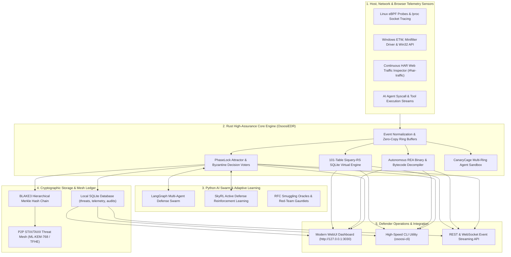

---

<a id="-twelve-part-architecture-of-zero--7-crate-physics-defense-engine"></a>
<a id="twelve-part-architecture-of-zero--7-crate-physics-defense-engine"></a>
## ⚛️ Advanced Architecture & Theoretical Foundations
### ⚛️ Twelve-Part Architecture of Zero & 7-Crate Physics Defense Engine (Cross-Platform Linux & Windows)

Rather than treating runtime security solely as a heuristic search for static strings, **OpenỌ̀ṣọ́ọ̀sì** embeds a **7-crate mathematical and physical defense workspace** that operationalizes nonlinear dynamics, statistical mechanics, constant-time solid-state cryptography, and the **Twelve-Part Architecture of Zero** across both **Linux** (`/proc` kernel socket/memory introspection, eBPF ring buffers) and **Windows** (ETW, Win32 process/conduit telemetry, WDAC):

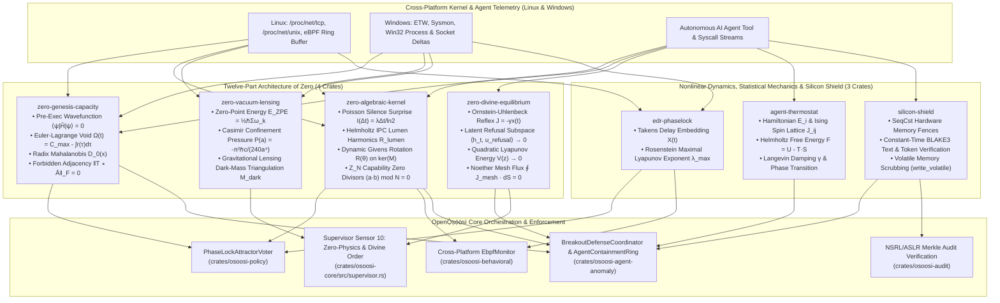

| Crate | Mathematical & Physical Laws | EDR & Containment Integration (Linux & Windows) |
| :--- | :--- | :--- |
| **`crates/zero-genesis-capacity`** | Pre-Execution Wavefunction $\langle \psi_{\text{embryo}} \mid \hat{H}_{\text{threat}} \mid \psi_{\text{embryo}} \rangle = 0$, Euler-Lagrange Void Capacity $\Omega(t) = C_{\max} - \int_0^t r(\tau)\,d\tau$, Radix-Weighted Mahalanobis Displacement $D_0(\mathbf{x})$, Forbidden Adjacency $\Vert T \circ \bar{A} \Vert_F = 0$ | Wired into [`PhaseLockAttractorVoter`](crates/osoosi-policy/src/voters.rs) and [`BreakoutDefenseCoordinator`](crates/osoosi-agent-anomaly/src/breakout_defense.rs) to block nascent process/agent breakouts before execution materializes. |
| **`crates/zero-algebraic-kernel`** | Poisson Silence Surprise $I_{\text{absence}}(\Delta t) = \frac{\lambda \Delta t}{\ln 2}$, Helmholtz IPC Lumen Harmonics $\mathcal{R}_{\text{lumen}}$, Dynamic Givens Rotation $R(\theta)$ against $\ker(M)$ nullspace evasion, Fractional Zero Crossing $\alpha$, $\mathbb{Z}_N$ Zero Divisors $(a \cdot b) \bmod N = 0$ | Wired into [`EbpfMonitor`](crates/osoosi-behavioral/src/ebpf_monitor.rs) (Linux `/proc/net` + Windows `sysinfo` conduit deltas), [`PhaseLockAttractorVoter`](crates/osoosi-policy/src/voters.rs), and [`BreakoutDefenseCoordinator`](crates/osoosi-agent-anomaly/src/breakout_defense.rs). |
| **`crates/zero-vacuum-lensing`** | Zero-Point Energy $E_{\text{ZPE}} = \frac{1}{2}\hbar \sum \omega_k$ (anti-cryogenic freeze), Casimir Pressure $P_{\text{Casimir}}(a) = -\frac{\pi^2 \hbar c}{240 a^4}$, Gravitational Lensing Dark-Mass Triangulation $M_{\text{dark}} = \frac{c^2 b \hat{\alpha}}{4G}$ | Wired into **Sensor 10 (`zero_physics_equilibrium`)** in [`MultiSensorFusionEngine`](crates/osoosi-core/src/supervisor.rs) to detect hypervisor time-stop attacks and hidden rootkits via scheduler/IPC deflection. |
| **`crates/zero-divine-equilibrium`** | Ornstein-Uhlenbeck Reflex $J_{\text{reflex}}(t) = -\gamma x(t)$, Latent Refusal Subspace $\langle \mathbf{h}_t, \mathbf{u}_{\text{refusal}} \rangle \to 0$ & $\ell_0$ Sparsity, Quadratic Lyapunov Energy $V(\mathbf{z}) = \mathbf{z}^T P \mathbf{z} \to 0$, Noether Mesh Flux $\oint_{\partial \Omega} \mathbf{J}_{\text{mesh}} \cdot d\mathbf{S} = 0$ | Wired into [`AgentContainmentRing`](crates/osoosi-agent-anomaly/src/containment_ring.rs) and [`MultiSensorFusionEngine`](crates/osoosi-core/src/supervisor.rs) for pre-cognitive drift neutralization and distributed mesh conservation. |
| **`crates/edr-phaselock`** | Takens' Delay Embedding $\mathbf{X}(t) = [\tau_t, \tau_{t-d}, \dots]$ & Rosenstein's Maximal Lyapunov Exponent $\lambda_{\max}$ | Detects exponential phase-space trajectory divergence ($\lambda_{\max} > 0$) across spaced-out LOLBin and syscall streams on both Linux and Windows. |
| **`crates/agent-thermostat`** | Hamiltonian $E_i$, Ising Spin Lattice Coupling $J_{ij}$, Helmholtz Free Energy $F = U - T S$, Langevin Damping $\gamma$, Critical Phase Transition | Governs multi-agent capability invocation temperature and enforces `Throttle(γ)` or `FreezePhaseTransition` before cascading agent contagion occurs. |
| **`crates/silicon-shield`** | `Ordering::SeqCst` hardware memory fences, `subtle::ConstantTimeEq` BLAKE3 code/token verification, `std::ptr::write_volatile` scrubbing | Enforces timing-attack-immune attestation in [`verify_merkle_audit_path`](crates/osoosi-audit/src/nsrl_aslr_merkle.rs) and volatile key scrubbing on agent quarantine. |
| **Dual-Channel $S_1/S_2$ Discriminator & Merkle Veto Gate** | Discrete projection of static structural entropy ($S_1$) vs. runtime privilege/memory transitions ($S_2$) coupled with a BLAKE3 Merkle allowlist veto gate | Implemented in [`DualChannelDiscriminationVoter`](crates/osoosi-policy/src/voters.rs) and [`MerkleAllowlistVetoGate`](crates/osoosi-policy/src/voters.rs) to suppress workstation noise (`cargo`, `rustc`, `python`, `node`, `git`) at near-zero CPU cost while catching inline-code/RWX injection transitions. |
| **Axion-Inspired Deterministic Canary Traps** | Zero-resting-cost synthetic credentials, ghost IPC/socket nodes, and unreferenced 4 KB shadow pages monitored via event-driven callbacks | Implemented in [`AxionCanaryTrapRegistry`](crates/osoosi-telemetry/src/canary.rs) and [`ActiveProcessTarpit::trigger_axion_canary_tarpit`](crates/osoosi-runtime/src/tarpit.rs) for immediate thread tarpitting on unauthorized decoy reads while enforcing `is_critical_system_process` OS immunity. |
| **Memory & Kernel Object Conservation (DKOM)** | Deterministic cross-referencing of hardware thread scheduling queues (`TH32CS_SNAPTHREAD`), handle/socket owner tables, and page-frame mappings against visible `EPROCESS`/`task_struct` lists (replacing noisy continuous `APERF`/`MPERF` cycle polling) | Implemented in [`KernelObjectConservationAuditor`](crates/osoosi-agent-anomaly/src/siquery.rs) and exposed via the `kernel_object_conservation` relational table in `siquery`. |
| **Targeted Startup & On-Demand `RDTSC` Timing-Shear** | Bounded 32-sample `RDTSC` + serializing `CPUID` covariance micro-benchmark ($\Sigma_{2\times 2}$) with zero continuous L3 cache eviction background threads | Implemented in [`TargetedTimingShearDiagnostic`](crates/osoosi-telemetry/src/timing_shear.rs), triggered strictly once at initial agent startup or on-demand when a secondary threat indicator fires. |

---

<a id="-autonomous-rea-reverse-engineer-anything-forensic-engine"></a>
<a id="autonomous-rea-reverse-engineer-anything-forensic-engine"></a>
## 🔬 Autonomous REA (`Reverse Engineer Anything`) Forensic Engine

OpenỌ̀ṣọ́ọ̀sì includes a built-in **Autonomous Reverse Engineer Anything (`REA`)** subsystem ([`crates/osoosi-core/src/rea.rs`](crates/osoosi-core/src/rea.rs)) inspired by [`morluto/rea`](https://github.com/morluto/rea), powered by a **2-Tier Classification Pipeline**:

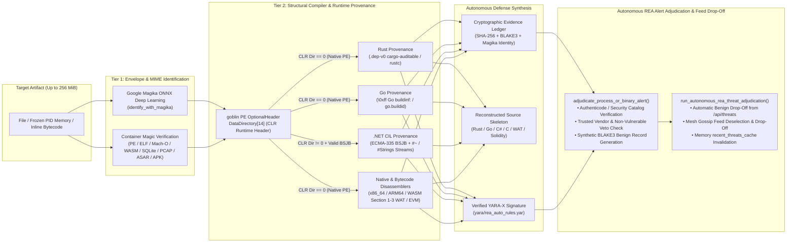

- **Tier 1 (Google Magika ONNX + Container Magic)**: Uses Google's deep-learning content-type detector ([`identify_with_magika`](crates/osoosi-core/src/rea.rs)) alongside magic headers to identify the outer envelope (`pebin`, `elf`, `macho`, `wasm`, `sqlite`, `pcap`, `json`, `apk`, `dex`, `shell`, `powershell`) before file extension tie-breakers and detect extension masquerading across [`pe_inspector::inspect_file`](crates/osoosi-core/src/pe_inspector.rs), [`MalwareScanner::scan_bytes`](crates/osoosi-model/src/malware.rs), and [`MemoryScanner`](crates/osoosi-memory/src/scanner.rs).
- **Tier 2 (Structural PE/ELF/Mach-O Compiler & Runtime Provenance)**: Inspects the parsed PE Optional Header's CLR Runtime Header DataDirectory (`IMAGE_DIRECTORY_ENTRY_COM_DESCRIPTOR`, index 14) via `goblin::pe::PE::parse` and resolves both the `IMAGE_COR20_HEADER` RVA and its `MetaData.VirtualAddress` against mapped PE section headers (`pe_rva_to_file_offset`) before accepting ECMA-335 `BSJB` metadata roots. If a valid PE binary has `DataDirectory[14] == 0` or an unmapped metadata RVA, it is unequivocally classified as native (`rust_binary`, `go_binary`, or `native_binary`)—eliminating false-positive `.NET` misclassifications when inspecting self-binaries (`osoosi.exe`) that contain `.NET` parser string literals in `.rdata`.
- **Full WebAssembly (`wasm_artifact`) Type-Indexed WAT Reconstruction**: Parses WASM Section 1 (`Type` signatures `(param ...) (result ...)`), Section 2 (`Import` descriptors with `type_index`), Section 3 (`Function` defined type indices), Section 7 (`Export`), and Section 10 (`Code`), reconstructing type-accurate WAT (`(import "<mod>" "<name>" (func $f0 (type $t0)))` and `(func $f1 (type $t1) ...)`).
- **Verified Single- & Multi-Token YARA-X Rule Synthesis & Frozen Memory Ingestion**: Synthesizes `yara_x::Compiler`-verified rules across both single-token (`and $tok_1`) and multi-token (`and 2 of ($tok_*)`) artifacts as well as live $5\sigma$-frozen process memory payloads ([`synthesize_yara_from_raw_payload`](crates/osoosi-core/src/rea.rs)).
- **256 MiB Full-Binary Inspection (`REA_MAX_FILE_READ_BYTES`) & Working-Set Trimming**: Reads up to **256 MiB** (`268,435,456` bytes) per artifact so large Rust/Go/Electron release binaries (`osoosi.exe` ~82–128 MiB) are analyzed end-to-end, then explicitly drops the buffer (`std::mem::drop(buf)`) and trims the process working set.
- **Autonomous REA Threat & Gossip Alert Adjudication (`adjudicate_process_or_binary_alert` & `run_autonomous_rea_threat_adjudication`)**: Active pipeline evaluating all candidate threats against Authenticode digital signatures, Windows Security Catalog hashes (`CryptCATAdminEnumCatalogFromHash`), and vendor veto rules (`Veto Trusted Vendor`, `outside the vulnerable range`, `CVE None`). Confirmed benign or false-positive candidates generate cryptographic benign records (`rea:adjudicated:benign:<target>`) and are automatically pruned and dropped off the live `/api/threats` roster and `/api/gossip` feed.
- **High-Performance Non-Blocking Telemetry & Discovery Caches**:
  - `recent_threats_cache`: Fast in-memory cache protected by parking-lot `try_lock_for(80ms)` avoiding lock contention during high-velocity ETW sweeps.
  - `discover_rea_providers()`: Thread-safe 300-second cached capability discovery preventing redundant provider binary probes on every endpoint call.
  - `get_cached_system_resources()`: 30-second sliding cache for host CPU, memory, and thread utilization eliminating redundant hardware polling.
  - Zero Synchronous Disk Reads in `/api/history`: Streaming pagination directly from in-memory ring buffers and pre-warmed SQLite audit tables.
- **Universal 100% WebUI Button Responsiveness & Resiliency**:
  - All interactive UI action parameters are safely sanitized via `escapeJsArg()` eliminating broken inline JavaScript quotes.
  - Optimistic DOM card dismissal provides instantaneous visual feedback before asynchronous REST responses return.
  - Resilient `Promise.allSettled()` polling watchdogs prevent lingering fetch timeouts from hanging dashboard components.
  - Immediate login page visual feedback with animated loading spinners and real-time credential verification progress bars.
- **CLI & WebUI Integration**: Run `osoosi rea analyze <target> --json` from the terminal or inspect artifacts interactively in the WebUI (`#rea`, featuring `🦀 Self-Inspect OshoosiClaw Binary`, deduplicated `Recent Autonomous Reports`, and compact `quarantine:<hash>` pills).

---

<a id="-emergency-kill-chain--reversible-host-containment-engine"></a>
<a id="emergency-kill-chain--reversible-host-containment-engine"></a>
## 🚨 Emergency Kill Chain & Reversible Host Containment Engine

### The Defend-in-Place Reversible Containment Paradigm

In critical compromise scenarios—such as active ransomware propagation, lateral credential harvesting, or rootkit staging—traditional response actions either shut down the endpoint (destroying ephemeral volatile memory evidence) or sever all network interfaces (disconnecting remote security analysts and management infrastructure).

**OpenỌ̀ṣọ́ọ̀sì implements the Defend-in-Place Emergency Kill Chain**: a hardware-level, reversible containment killswitch accessible via WebUI (`🚨 Kill Chain / Isolation`) and CLI (`osoosi killchain`), paired with **Autonomous Dual-Stage $5\sigma$ Kernel `SIGSTOP` + Pre-Armed Cgroup v2 Freezer Quarantine** on Linux and **`NtSuspendProcess` + Ring-0 Lockdown** on Windows. It hermetically isolates the host while preserving local loopback control, DNS/DHCP lease continuity, non-destructively freezes untrusted processes in $< 20\,\mu\text{s}$, extracts unencrypted volatile memory (`FrozenProcessForensicCollector`), and enforces ring-0 driver lockdown. When disarmed via the authenticated `"RESTORE HOST"` verification phrase, it returns all subsystems and threads to their normal operational state without requiring a reboot.

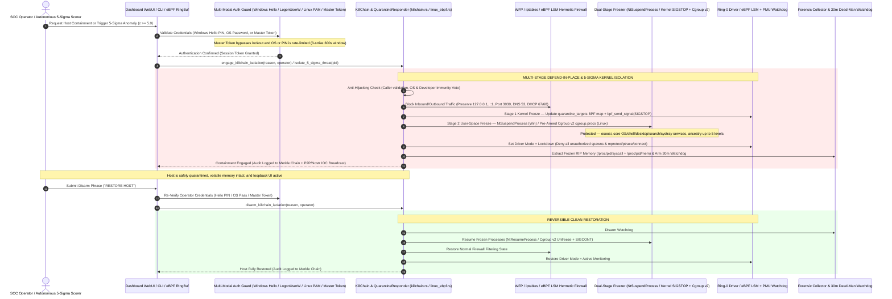

### Multi-Stage Containment Capabilities

1. **Hermetic Network Isolation**: Deploys kernel filtering rules (Windows Filtering Platform / `WFP` sub-layer on Windows; `iptables` / `nftables` and eBPF LSM `socket_connect` on Linux) blocking untrusted inbound and outbound traffic. **Strict OS & Control-Plane Exceptions**: Local loopback (`127.0.0.1`, `::1`), the dashboard port (`3030`), DNS (`UDP 53`), and DHCP (`UDP 67/68`) remain allowlisted so the OS network stack, local IPC, and operator dashboard never break.
2. **Dual-Stage Non-Destructive Process Freezing (`< 20 µs` Kernel + Cgroup v2 / `NtSuspendProcess`)**: Rather than terminating untrusted processes with `SIGKILL` or `TerminateProcess`—which destroys stack traces, unpacked memory payloads, and active network socket states—the engine invokes `NtSuspendProcess` (Windows) or a **Dual-Stage Linux Kernel Freeze**: Stage 1 updates the `quarantine_targets` eBPF map so any subsequent syscall or `SEC("perf_event")` PMU interrupt (`osoosi_pmu_watchdog`) immediately issues kernel-level `bpf_send_signal(SIGSTOP)` ($9\text{--}26\text{ ns}$), while Stage 2 writes the PID (`format_u32_newline`, zero heap allocation) to a pre-opened, pre-armed (`cgroup.freeze = "1\n"`) Cgroup v2 fd (`QuarantineResponder`, $5\text{--}15\,\mu\text{s}$), followed by `FrozenProcessForensicCollector::capture_frozen_process` extracting `/proc/<pid>/syscall` and 4096 bytes of `/proc/<pid>/mem` at the instruction pointer (`RIP`) for autonomous YARA-X synthesis and P2P/Nostr mesh IOC broadcasting.
3. **Ring-0 Driver & eBPF Lockdown**: Dynamically sets the kernel driver policy to `Lockdown`. Any attempt to spawn unauthorized executables is immediately denied at the `PsSetCreateProcessNotifyRoutineEx` or `bprm_check_security` pre-operation boundary with `STATUS_ACCESS_DENIED`, while 53+ critical Windows/Linux/macOS session, shell, desktop, search, and recovery binaries remain unconditionally allowlisted.
4. **Dead-Man's Autonomous Fail-Safe Watchdog**: An autonomous background timer monitors the containment state. If an operator loses remote connection or an emergency containment event is left unattended for 30 minutes (1,800 seconds), the engine automatically executes an emergency disarm, unfreezing processes and restoring network connectivity to prevent catastrophic bricking.

### Anti-Hijacking & Zero-OS-Disruption Invariant

> [!IMPORTANT]
> **Zero-Harm & Anti-Hijacking Guarantee: Nothing Must Break the OS.**
> To prevent malicious userland malware, ransomware, or rogue scripts from weaponizing host isolation against the operating system, desktop shell, or defense agents, OpenỌ̀ṣọ́ọ̀sì enforces 5 structural invariants across Userland (`killchain.rs`, `kernel_driver.rs`), Windows Ring-0 (`osoosi_driver.c`), and Linux eBPF (`osoosi_probe.bpf.c`):
>
> 1. **Core OS, Session, Desktop, Search & Toolchain Immunity**: The EDR daemon (`osoosi.exe`, `osoosi`, `osoosi-cli`, `osoosi-auditor`), Windows kernel/session/shell/desktop/search/systray processes (`System`, `smss.exe`, `csrss.exe`, `wininit.exe`, `winlogon.exe`, `logonui.exe`, `userinit.exe`, `services.exe`, `lsass.exe`, `svchost.exe`, `dwm.exe`, `explorer.exe`, `sihost.exe`, `taskhostw.exe`, `ctfmon.exe`, `fontdrvhost.exe`, `StartMenuExperienceHost.exe`, `ShellExperienceHost.exe`, `SearchHost.exe`, `SearchIndexer.exe`, `RuntimeBroker.exe`, `ApplicationFrameHost.exe`, `TextInputHost.exe`, `SecurityHealthService.exe`, `SecurityHealthSystray.exe`), Linux session/desktop services (`systemd`, `dbus-daemon`, `NetworkManager`, `gnome-shell`, `kwin_wayland`, `Xorg`, `Xwayland`, `sshd`), and macOS core services (`launchd`, `WindowServer`, `Finder`, `Spotlight`, `Dock`) are unconditionally excluded from freezing, termination, tarpitting, or Ring-0 path blocking.
> 2. **Process Ancestry & Lineage Immunity**: When an operator invokes containment from a terminal or management console, `freeze_untrusted_processes` walks the caller's process lineage up to 5 parent levels (`cargo`, `rustc`, `powershell.exe`, `pwsh.exe`, `cmd.exe`, `conhost.exe`, `WindowsTerminal.exe`, `bash`, `zsh`), guaranteeing the operator's active shell is never frozen.
> 3. **Caller Process Validation**: `validate_killchain_caller` checks the calling PID against active quarantine and suspension tables. Any already-frozen or quarantined process attempting to invoke the Kill Chain API is instantly denied and flagged as an adversarial containment breakout attempt.
> 4. **State Machine Anti-Reentrancy**: State transitions (`Idle` -> `Isolating` -> `Isolated` -> `Disarming`) are guarded by atomic mutexes. Repetitive calls cannot corrupt isolation records or trigger reentrant resource deadlocks.
> 5. **Multi-Modal Cross-Platform Authentication**: Host isolation and disarm APIs support Windows Hello PIN / Biometrics (TPM Platform Authenticator via WebAuthn), OS credentials (Win32 `LogonUserW` with candidate domain resolution on Windows, PAM/shadow on Linux, `dscl` on macOS), and Master Administrative Token verification with automatic lockout bypass and strike counter reset.

### Kill Chain CLI Commands

```powershell
# Inspect the current containment and watchdog status
osoosi killchain status

# Engage Defend-in-Place host isolation
osoosi killchain isolate --reason "Active ransomware outbreak detected" --operator "sec-admin"

# Reversibly restore host network, processes, and kernel driver
osoosi killchain disarm --reason "Threat eradicated and triage verified" --operator "sec-admin"

# Review tamper-evident containment audit history
osoosi killchain history --limit 20
```

---

<a id="-4-pillar-fully-homomorphic-encryption-tfhe--cryptographic-merkle-architecture"></a>
<a id="4-pillar-fully-homomorphic-encryption-tfhe--cryptographic-merkle-architecture"></a>
## 🔒 4-Pillar Fully Homomorphic Encryption (TFHE) & Cryptographic Merkle Architecture

### The Privacy-Preserving Federated Defense Challenge

Decentralized threat intelligence sharing across enterprise and peer nodes typically faces an intractable dilemma: sharing raw indicators of compromise (IP addresses, process command lines, file paths, and memory hashes) exposes sensitive internal PII, proprietary network topology, and intellectual property. Conversely, withholding indicators leaves peer nodes vulnerable to lateral attacks.

OpenỌ̀ṣọ́ọ̀sì resolves this challenge via **4-Pillar Fully Homomorphic Encryption (TFHE)** coupled with a **tamper-evident binary BLAKE3 Merkle tree**:

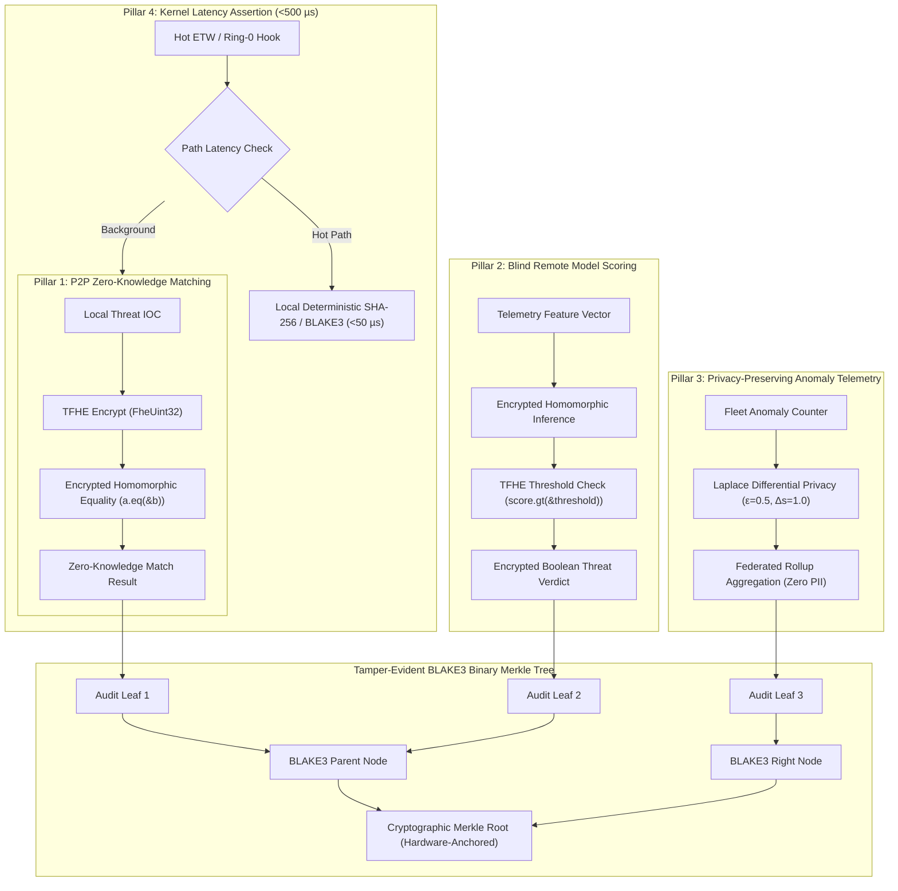

### The Four Pillars of Homomorphic Architecture

| Pillar | Capability | Technical Implementation | Performance Profile |
| :--- | :--- | :--- | :--- |
| **1. P2P ZK Threat Sharing** | Match threats across peer nodes without exposing raw telemetry | TFHE torus encryption over quantized hash prefixes; homomorphic equality | 15–40 ms (Batched background mesh gossip) |
| **2. Blind Remote Threat Scoring** | Run cloud neural models on encrypted endpoint telemetry | `FheUint32` homomorphic linear combinations and threshold evaluation | 50–120 ms (Async API scoring pipeline) |
| **3. Privacy Telemetry** | Aggregate cross-fleet anomaly metrics without tracking individuals | Laplace differential privacy mechanism ($\epsilon = 0.5, \Delta s = 1.0$) | < 1 ms (Hourly / daily telemetry rollups) |
| **4. Kernel Latency Assertion** | Guarantee sub-millisecond execution for kernel containment | Hot ETW and Ring-0 driver hooks strictly bypass FHE, using local BLAKE3 | **< 500 µs Invariant** (Observed: 32 µs) |

### Cryptographic Merkle Audit Proofs & Verification

Every FHE threat match, blind score, and differential privacy event is hashed into a sequential leaf node:
$$\text{Leaf}_i = \text{BLAKE3}(\text{timestamp} \parallel \text{pillar} \parallel \text{operation} \parallel \text{data\_hash})$$

Nodes can produce independent logarithmic Merkle inclusion proofs ($O(\log N)$) verifying that a specific privacy-preserving evaluation was executed without tampering:

```powershell
# Check FHE Engine and Merkle Tree status
osoosi fhe status

# Verify a specific cryptographic Merkle audit inclusion proof
osoosi fhe verify-merkle --seq 0
```

---

<a id="-http-framing-defense--request-queue-poisoning-cl0-remediation"></a>
<a id="http-framing-defense--request-queue-poisoning-cl0-remediation"></a>
## 🛡️ HTTP Framing Defense & Request Queue Poisoning (CL.0) Remediation

### RFC 9110 & RFC 9112 Strict Framing Middleware

During autonomous penetration testing via the RAPTOR Security Framework, the dashboard server (port 3030) was evaluated against HTTP request queue poisoning vectors. The scanner identified a stateful desynchronization flaw:

- **Vulnerability Identifier**: `VULN-REPRO-1792312936428` (`QUEUE_POISONING`)
- **Mechanism**: In a `CL.0` probe on `HEAD / HTTP/1.1`, the request declared a non-zero `Content-Length: 6`. Standard HTTP specifications (RFC 9110 §9.3.2 and RFC 9112 §6.1) dictate that `HEAD` requests never enclose request bodies. The underlying TCP socket stalled for 3.51 seconds awaiting body bytes rather than terminating the malformed request immediately.
- **Secondary Latency Anomaly**: When processing `HEAD /` with a `Range: bytes=1-650` header, backend static file evaluators attempted byte-range slicing on zero-body requests, triggering a 3.51-second parsing delay and returning `206 Partial Content`.

### The Multi-Layered Remediation Pipeline

OpenỌ̀ṣọ́ọ̀sì deploys `http_framing_defense_middleware` inside `crates/osoosi-dashboard/src/lib.rs` to enforce fail-closed RFC compliance before requests reach routing handlers:

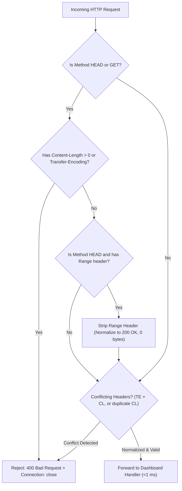

1. **Strict Zero-Body Enforcement on HEAD/GET**: If a `HEAD` or `GET` request declares `Content-Length > 0` or includes `Transfer-Encoding`, the middleware immediately intercepts the request, generates an explicit `400 Bad Request` with `Connection: close`, and tears down the connection to prevent connection pool poisoning.
2. **Dual-Framing & Desync Prevention**: Requests containing both `Transfer-Encoding` and `Content-Length`, or comma-separated differing `Content-Length` headers, are unconditionally rejected with `400 Bad Request`.
3. **HEAD Range Normalization**: When a `HEAD` request contains a `Range` header, the middleware automatically strips the `Range` header. The backend responds with standard `200 OK` (0 body bytes) in under 1 millisecond, completely eliminating the 3.51-second byte-range evaluation stall and preventing `206 Partial Content` reverse proxy desynchronization.

---

<a id="-ring-0-windows-driver--linux-ebpf-parity"></a>
<a id="ring-0-windows-driver--linux-ebpf-parity"></a>
<a id="-native-ring-0-windows-driver--linux-ebpf-parity"></a>
<a id="native-ring-0-windows-driver--linux-ebpf-parity"></a>
## 🛡️ Native Ring-0 Windows PPL / ELAM / Minifilter Driver & Linux `BPF_PROG_TYPE_LSM` Inline Kernel Blocking

### The Architectural Paradigm Shift: Pre-Operation Ring-0 Enforcement vs. Post-Execution Telemetry

Traditional endpoint security and user-mode EDR agents operate **reactively** (post-execution) and remain vulnerable to **BYOVD (Bring Your Own Vulnerable Driver)** handle stripping or user-mode hook bypasses. When an adversary executes malicious code or loads a vulnerable kernel driver:
1. The kernel allocates the target process address space and initializes the Process Environment Block (PEB).
2. The initial process thread begins instruction execution in user space.
3. Auxiliary telemetry subsystems (such as Microsoft Sysmon Event 1 or ETW providers) generate notification events **asynchronously** milliseconds or seconds after execution has already started.
4. User-mode API hooks (e.g., in `ntdll.dll`) can be bypassed via direct system calls (`SysWhispers`, `Hell's Gate`), unhooking (`VirtualProtect`), or a Ring-0 BYOVD payload (`RTCore64.sys`, `gdrv.sys`, `mhyprot2.sys`) can open `PROCESS_TERMINATE` handles against a user-mode sensor.

**OpenỌ̀ṣọ́ọ̀sì enforces nation-state / Ring-0 resilience** through hardware- and kernel-enforced **pre-operation blocking, handle stripping, boot-start ELAM verification, and 3-hook inline eBPF LSM containment**:
- **Windows Ring-0 Minifilter + Object Callback Driver (`driver/windows/osoosi_driver.sys` v1.2.0)**:
  - **`PsSetCreateProcessNotifyRoutineEx`**: Synchronous pre-operation process interception (`CreateInfo->CreationStatus = STATUS_ACCESS_DENIED`).
  - **`ObRegisterCallbacks` (Altitude `385200`)**: Strips `PROCESS_TERMINATE`, `PROCESS_VM_WRITE`, `PROCESS_VM_OPERATION`, `PROCESS_SUSPEND_RESUME`, `PROCESS_DUP_HANDLE`, `THREAD_TERMINATE`, `THREAD_SUSPEND_RESUME`, and `THREAD_SET_CONTEXT` from `OpenProcess` / `OpenThread` / `DuplicateHandle` calls targeting protected `osoosi.exe` sensor PIDs and `lsass.exe`.
  - **HVCI/KPP-Safe Pre-Section Synchronization (`FsRtlRegisterFileSystemFilterCallbacks` / `OsoosiPreAcquireForSectionSync`) + WDAC Vulnerable Driver Blocklist + `PsSetLoadImageNotifyRoutine`**: Intercepts `IRP_MJ_ACQUIRE_FOR_SECTION_SYNCHRONIZATION` (`SyncTypeCreateSection`) for executable sections (`PAGE_EXECUTE*`) of 14 known vulnerable BYOVD drivers (`RTCore64.sys`, `DBUtil_2_3.sys`, `gdrv.sys`, `AsrDrv106.sys`, `mhyprot2.sys`, `EneIo64.sys`, `procexp152.sys`, `WinRing0x64.sys`, `kprocesshacker.sys`, `iqvw64e.sys`, `SpeedFan.sys`, `cpuz141.sys`, `MsIo64.sys`, `ATSZIO64.sys`) plus dynamic operator rules (`IOCTL_OSOOSI_ADD_BYOVD_RULE`) and returns `STATUS_ACCESS_DENIED` (`0xC0000022`) **before** `MmCreateSection` maps the image into memory—never modifying mapped code pages so HVCI / Kernel Patch Protection (KPP) is 100% preserved.
  - **Minifilter / IRP Self-Defense (`OsoosiSelfDefenseDispatch`)**: Rejects destructive `DELETE`, `FILE_WRITE_DATA`, and `IRP_MJ_SET_INFORMATION` (`FileDispositionInformation` / `FileRenameInformation`) operations targeting `osoosi.exe`, `osoosi_driver.sys`, `osoosi_elam.sys`, and signed `.toml`/`.sig` artifacts while preserving self-updates from the protected sensor PID.
- **Windows Boot-Start Early Launch Anti-Malware Driver (`driver/windows/osoosi_elam.sys`) & Honest PPL / Kernel Object DACL Verification**:
  - Loads at boot (`SERVICE_BOOT_START = 0x0`) before third-party drivers via `IoRegisterBootDriverCallback`, vetoing unsigned or known-vulnerable boot drivers (`BdCbStatusPrepareForDependencyLoad` / `BdCbInitializeImage`) and embedding the `MicrosoftElamCertificateInfo` (`MSElamCertInfoID`) resource table. At runtime, `query_current_process_ppl_status()` (`NtQueryInformationProcess(ProcessProtectionInformation)`) honestly distinguishes kernel-enforced `PS_PROTECTION` PPL (`PsProtectedSignerAntimalware-Light`, when WHQL/MVI-signed) from `SetKernelObjectSecurity` DACL + `ObRegisterCallbacks` protection (in developer/test-signing environments).
- **Linux `BPF_PROG_TYPE_LSM` Inline Kernel Blocking (`ebpf/src/osoosi_probe.bpf.c`)**:
  - **`SEC("lsm/bprm_check_security")` (`osoosi_bprm_check`)**: Pre-execution binary path/hash blocking (`-EPERM` / `-EACCES`) with critical OS init/shell immunity.
  - **`SEC("lsm/file_open")` (`osoosi_file_open`)**: Blocks `FMODE_WRITE` / `O_TRUNC` tampering against `/etc/osoosi/`, `/usr/lib/osoosi/`, `/usr/bin/osoosi`, and `osoosi.toml` by non-protected PIDs, and blocks `/etc/shadow` / `/etc/gshadow` credential harvesting by quarantined PIDs (`-EPERM`).
  - **`SEC("lsm/socket_connect")` (`osoosi_socket_connect`)**: Inline kernel blocking of outbound `AF_INET` / `AF_INET6` sockets against `blocked_ipv4`, `blocked_ipv6`, and `blocked_ports` BPF maps (and full network containment in `Lockdown` mode, returning `-EPERM` before a single TCP `SYN` leaves the NIC).

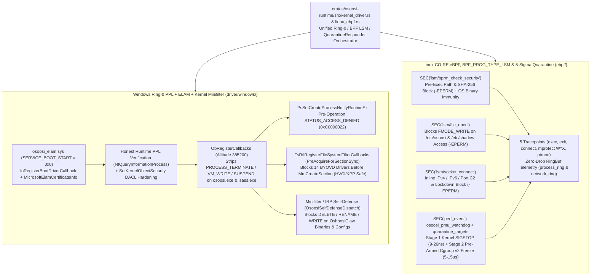

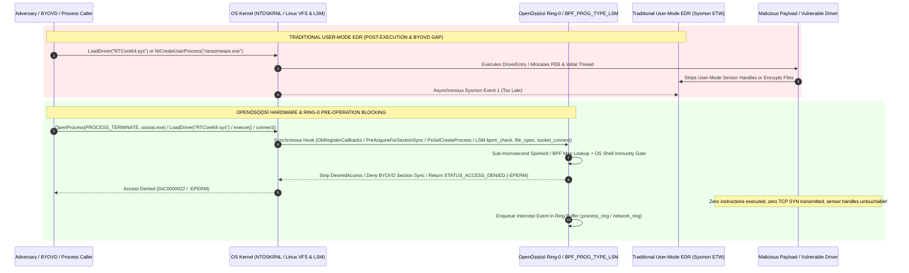

---

### Windows Ring-0 Kernel Minifilter & ELAM Drivers (`driver/windows/`)

The Windows Ring-0 subsystem comprises two signed native kernel drivers compiled with `/O2 /W4 /WX /GS- /Zl /kernel` and `/INTEGRITYCHECK` (`scripts/build_windows_drivers.ps1`):

1. **`osoosi_driver.sys` (`v1.2.0` — Process, Thread, Handle, Image & File Self-Defense Driver)**:
   - **Synchronous Pre-Operation Process Interception**: Registered via `PsSetCreateProcessNotifyRoutineEx(OsoosiCreateProcessNotifyRoutine, FALSE)`. Setting `CreateInfo->CreationStatus = STATUS_ACCESS_DENIED` (`0xC0000022`) aborts process creation before PEB or initial thread instantiation.
   - **Ring-0 Handle Stripping (`ObRegisterCallbacks` at Altitude `385200`)**: Registers pre-operation callbacks on both `*PsProcessType` and `*PsThreadType`. Any external process attempting `OB_OPERATION_HANDLE_CREATE` or `OB_OPERATION_HANDLE_DUPLICATE` against a protected `osoosi.exe` sensor PID (or `lsass.exe` in `Active`/`Lockdown` mode) has `PROCESS_TERMINATE`, `PROCESS_VM_WRITE`, `PROCESS_VM_OPERATION`, `PROCESS_SUSPEND_RESUME`, `PROCESS_DUP_HANDLE`, `THREAD_TERMINATE`, `THREAD_SUSPEND_RESUME`, and `THREAD_SET_CONTEXT` stripped from `DesiredAccess` in Ring 0.
   - **HVCI/KPP-Safe Anti-BYOVD Pre-Section Filter (`FsRtlRegisterFileSystemFilterCallbacks` + `PsSetLoadImageNotifyRoutine`)**: Registers `OsoosiFsFilterPreAcquireForSectionSync` (`OsoosiPreAcquireForSectionSync`) on `PreAcquireForSectionSynchronization` (`IRP_MJ_ACQUIRE_FOR_SECTION_SYNCHRONIZATION`) alongside Windows WDAC Vulnerable Driver Blocklist enforcement (`HKLM\SYSTEM\CurrentControlSet\Control\CI\Config\VulnerableDriverBlocklistEnable = 1`). When an executable section (`SyncTypeCreateSection == 1`, `PAGE_EXECUTE*`) is requested for any of the 14 built-in vulnerable BYOVD drivers (`rtcore64.sys`, `dbutil_2_3.sys`, `gdrv.sys`, `asrdrv106.sys`, `mhyprot2.sys`, `eneio64.sys`, `procexp152.sys`, `winring0x64.sys`, `kprocesshacker.sys`, `iqvw64e.sys`, `speedfan.sys`, `cpuz141.sys`, `msio64.sys`, `atszio64.sys`) or operator-supplied rules (`IOCTL_OSOOSI_ADD_BYOVD_RULE`), `OsoosiPreAcquireForSectionSync` returns `STATUS_ACCESS_DENIED` (`0xC0000022`) **before** `MmCreateSection` maps the driver into memory. Simultaneously, `OsoosiLoadImageNotifyRoutine` (`PsSetLoadImageNotifyRoutine`) records non-destructive Ring-0 audit telemetry without ever modifying mapped code pages.
   - **Minifilter / IRP Self-Defense (`OsoosiSelfDefenseDispatch`)**: Rejects unauthorized `DELETE`, `FILE_WRITE_DATA`, `FILE_APPEND_DATA`, and `IRP_MJ_SET_INFORMATION` (`FileDispositionInformation` / `FileRenameInformation`) requests against OshoosiClaw binaries, drivers, and signed configs while allowing self-updates initiated by a registered `osoosi.exe` PID.
   - **Core OS Shell, Search & System Immunity**: System PIDs (`0`, `4`) and critical Windows processes (`smss.exe`, `csrss.exe`, `wininit.exe`, `services.exe`, `lsass.exe`, `svchost.exe`, `explorer.exe`, `searchhost.exe`, `searchindexer.exe`, `sihost.exe`, `rundll32.exe`, `dwm.exe`, `ctfmon.exe`, `osoosi.exe`) are unconditionally exempt from pre-operation process blocking and handle stripping to guarantee zero OS desktop or search disruption.
   - **Extended IOCTL Control Interface (`\\.\OsoosiDriver`, v1.2.0 `0x00010200`)**:
     - `IOCTL_OSOOSI_GET_STATUS` (`0x222000`) & `IOCTL_OSOOSI_GET_EXTENDED_STATUS` (`0x222024`): Reports version `0x00010200`, autonomy mode, blocked process count, active rule count, `ObCallbacksActive`, `ImageNotifyActive`, `MinifilterActive`, `ElamVerified`, `ProtectedPidCount`, `StrippedHandleCount`, `BlockedDriverCount`, and `BlockedFileTamperCount`.
     - `IOCTL_OSOOSI_SET_MODE` (`0x222004`): Dynamic switching across `Audit` (`0`), `Active` (`1`), and `Lockdown` (`2`).
     - `IOCTL_OSOOSI_ADD_BLOCK_PATH` (`0x222008`), `IOCTL_OSOOSI_ADD_BLOCK_HASH` (`0x22200C`), `IOCTL_OSOOSI_CLEAR_RULES` (`0x222010`), `IOCTL_OSOOSI_POLL_INTERCEPTIONS` (`0x222014`).
     - `IOCTL_OSOOSI_PROTECT_PID` (`0x222018`) & `IOCTL_OSOOSI_UNPROTECT_PID` (`0x22201C`): Registers/unregisters `osoosi.exe` sensor PIDs into the Ring-0 `ObRegisterCallbacks` protection table.
     - `IOCTL_OSOOSI_ADD_BYOVD_RULE` (`0x222020`): Appends a vulnerable kernel driver filename or substring to the Ring-0 BYOVD blocklist.
2. **`osoosi_elam.sys` (`v1.2.0` — Boot-Start Early Launch Anti-Malware Driver)**:
   - Configured with `StartType = 0` (`SERVICE_BOOT_START`) and `LoadOrderGroup = "Early-Launch"` (`driver/windows/osoosi_elam.inf`).
   - Registers `IoRegisterBootDriverCallback` during early kernel boot to evaluate every boot-start driver dependency (`BdCbStatusPrepareForDependencyLoad`) and driver image (`BdCbInitializeImage`), returning `BdCbClassificationKnownBadImage` on unsigned (`BdCbClassificationUnsignedImage`) or known-vulnerable boot drivers.
   - Embeds the `MSElamCertInfoID MicrosoftElamCertificateInfo` resource table (`driver/windows/src/osoosi_elam.rc`) with the SHA-256 certificate hash and EKU `1.3.6.1.4.1.311.61.4.1` so `register_elam_certificate_if_present()` (`InstallElamCertificateInfo`) and `harden_current_process_kernel_dacl()` (`SetKernelObjectSecurity`) harden the running `osoosi.exe` daemon at startup.

---

### Linux CO-RE eBPF, `BPF_PROG_TYPE_LSM` & Dual-Stage $5\sigma$ Kernel Quarantine (`ebpf/` & `crates/osoosi-telemetry/src/linux_ebpf.rs`)

On Linux endpoints (`x86_64-unknown-linux-gnu`, kernel $\ge 5.7$ with `CONFIG_BPF_LSM=y`), OpenỌ̀ṣọ́ọ̀sì enforces full inline kernel containment across **3 `BPF_PROG_TYPE_LSM` hooks**, **5 tracepoints**, **1 PMU Hardware Interrupt Watchdog (`SEC("perf_event")`)**, and the **Dual-Stage $5\sigma$ Kernel `SIGSTOP` + Pre-Armed Cgroup v2 Freezer (`QuarantineResponder`)**:

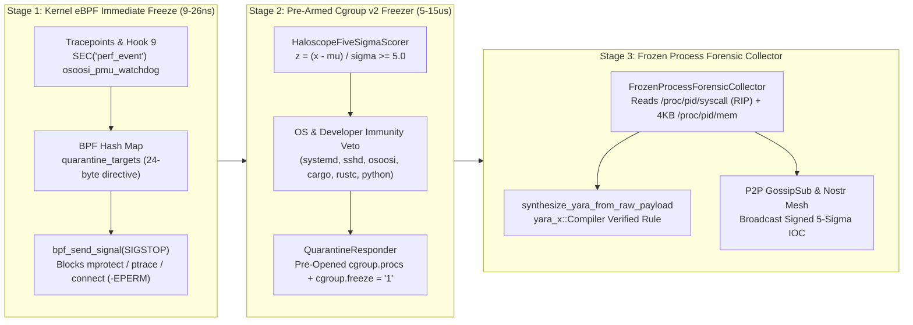

- **LSM Hook 1 (`SEC("lsm/bprm_check_security")` — `osoosi_bprm_check`)**: Intercepts `execve()` / `execveat()` before binary mapping. Checks `lsm_autonomy_mode` (`Audit = 0`, `Active = 1`, `Lockdown = 2`), honors critical OS binary immunity (`systemd`, `init`, `sshd`, `dbus-daemon`, `gnome-shell`, `Xorg`, `wayland`, `osoosi`), queries `blocked_paths` and `blocked_hashes`, emits `OSOOSI_EBPF_EVENT_LSM_BLOCK (3)` to `process_ring`, and returns `-EPERM` (`-1`) in `Active`/`Lockdown` mode.
- **LSM Hook 2 (`SEC("lsm/file_open")` — `osoosi_file_open`)**: Enforces kernel-space file self-defense and credential vault protection:
  1. When `file->f_mode & FMODE_WRITE` (`0x2`) targets `/etc/osoosi/`, `/usr/lib/osoosi/`, `/usr/bin/osoosi`, or `osoosi.toml` and the caller PID is not in `protected_sensor_pids`, emits `OSOOSI_EBPF_EVENT_LSM_FILE_BLOCK (6)` and returns `-EPERM` (`-1`) in `Active`/`Lockdown` mode.
  2. When a PID present in `quarantined_pids` attempts to open `/etc/shadow` or `/etc/gshadow` (even read-only), emits `OSOOSI_EBPF_EVENT_LSM_FILE_BLOCK (6)` and returns `-EPERM` (`-1`).
- **LSM Hook 3 (`SEC("lsm/socket_connect")` — `osoosi_socket_connect`)**: Enforces inline kernel C2 and kill-chain network isolation on `AF_INET` (`2`) and `AF_INET6` (`10`) sockets:
  - Always permits loopback (`127.0.0.0/8`, `::1`) and `protected_sensor_pids` so local WebUI/IPC/Ollama traffic is never disrupted.
  - Checks destination IPv4 (`blocked_ipv4`), IPv6 (`blocked_ipv6`), destination port (`blocked_ports`), caller quarantine status (`quarantined_pids` and `quarantine_targets`), and `Lockdown` mode (`2`). On match, emits `OSOOSI_EBPF_EVENT_LSM_NET_BLOCK (7)` to `network_ring` and returns `-EPERM` (`-1`) before any packet leaves the kernel socket layer.
- **Hook 9 (`SEC("perf_event")` — `osoosi_pmu_watchdog`) & `quarantine_targets` Dual-Stage $5\sigma$ Freeze**:
  - **Stage 1 (Kernel-Space Immediate Freeze, $9\text{--}26\text{ ns}$)**: `enforce_kernel_quarantine(tgid, pid)` checks the `quarantine_targets` BPF hash map (`struct quarantine_directive`, 24 bytes: `freeze_requested`, `severity_sigma`, `timestamp_ns`, `reason_code`) across all tracepoints, LSM hooks, and PMU hardware cycle overflow interrupts (`osoosi_pmu_watchdog`), immediately issuing `bpf_send_signal(SIGSTOP)` so even tight compute/encryption loops making zero syscalls are frozen at the next PMU tick.
  - **Stage 2 (User-Space Pre-Armed Cgroup v2 Freezer, $5\text{--}15\,\mu\text{s}$)**: `HaloscopeFiveSigmaScorer::evaluate_and_update` computes Welford streaming $z = \frac{x - \mu}{\sigma}$ over inter-arrival frequency and $W \oplus X$ / `ptrace` anomalies. When $z \ge 5.0\sigma$, `QuarantineResponder::isolate_5_sigma_threat` enforces the **Host OS & Developer Immunity Veto** (`PID <= 2`, self PID, `systemd`, `sshd`, `osoosi`, `cargo`, `rustc`, `python`, `node`, `git`, `dockerd`, `containerd`), writes the `QuarantineDirective` to `quarantine_targets`, and writes the stack-formatted PID (`format_u32_newline`, zero heap allocation) into pre-opened `/sys/fs/cgroup/osoosi_quarantine/cgroup.procs` (where `cgroup.freeze` is pre-armed to `"1\n"` at startup).
  - **Stage 3 (`FrozenProcessForensicCollector` & Mesh Broadcast)**: Extracts `/proc/<pid>/comm`, `/proc/<pid>/syscall` (`syscall_nr` and instruction pointer `RIP`), and up to 4096 bytes of `/proc/<pid>/mem` at `RIP` (`std::os::unix::fs::FileExt::read_at`), hashes the unencrypted payload (`SHA-256`), synthesizes a `yara_x::Compiler`-verified rule via `synthesize_yara_from_raw_payload`, and broadcasts the signed IOC across the P2P GossipSub and Nostr mesh.
- **Low-Memory Daemon Footprint (`< 250 MB` Working Set) & 4 Explicit Rust Memory Management Invariants**:
  1. **Situation 1 — Explicit Early `std::mem::drop(...)`**: Large file buffers, frozen process memory snapshots, and lock guards are explicitly dropped via `std::mem::drop` immediately after feature/hash extraction (`MalwareScanner::scan_file`, `MemoryScanner::scan_process_memory`, `AutonomousReaEngine::analyze_path`, `FrozenProcessForensicCollector`), paired with `SetProcessWorkingSetSize(GetCurrentProcess(), usize::MAX, usize::MAX)` on Windows (`trim_working_set_after_init`).
  2. **Situation 2 — Custom `impl Drop` for OS & Raw Memory Resources**: `QuarantineResponder` implements `Drop` to unfreeze (`"0\n"`), drain PIDs to root `/sys/fs/cgroup/cgroup.procs`, and `rmdir` `/sys/fs/cgroup/osoosi_quarantine`; `AxionCanaryTrapRegistry` implements `Drop` to volatile-zero (`write_volatile`) and deallocate (`std::alloc::dealloc`) raw shadow pages.
  3. **Situation 3 — `.shrink_to(...)` / `.shrink_to_fit()` / `Vec::with_capacity(...)`**: Bounded collections across `AutonomousReaEngine`, `MalwareScanner`, `MemoryScanner` (single reused 2 MB region buffer), `QuarantineResponder`, and `HaloscopeFiveSigmaScorer` explicitly release excess heap capacity after pruning.
  4. **Situation 4 — 4096-Byte Hardware Page-Aligned Allocation (`std::alloc::Layout::from_size_align(4096, 4096)`)**: `AxionCanaryTrapRegistry` (`crates/osoosi-telemetry/src/canary.rs`) allocates a genuine 4096-byte page-aligned (`shadow_base % 4096 == 0`) zeroed shadow trap page via `std::alloc::alloc_zeroed` for `UnreferencedShadowPage` canary detection.
- **Aya Rust BTF Loader & Dynamic Map Synchronization**: `crates/osoosi-telemetry/src/linux_ebpf.rs` loads `Btf::from_sys_fs()`, attaches all 3 `Lsm` programs (`bprm_check_security`, `file_open`, `socket_connect`), registers `std::process::id()` in `protected_sensor_pids`, and exposes `sync_ebpf_lsm_mode`, `sync_ebpf_lsm_protect_pid`, `sync_ebpf_lsm_quarantine_pid`, `sync_ebpf_lsm_block_path`, `sync_ebpf_lsm_block_ipv4`, `sync_ebpf_lsm_block_ipv6`, `sync_ebpf_lsm_block_port`, and `sync_ebpf_lsm_clear_rules`—unified with `KernelDriverController` in `crates/osoosi-runtime/src/kernel_driver.rs`.

---

### User-Mode Orchestrator & Defense-in-Depth Fallback

The OpenỌ̀ṣọ́ọ̀sì runtime orchestrator (`crates/osoosi-runtime/src/kernel_driver.rs` and `crates/osoosi-telemetry/src/native.rs`) maintains continuous synchronization with the kernel:

1. **Autonomy Mode Synchronization**:
   - `Audit` (`0`): Kernel driver monitors and logs all process creations to the ring buffer without blocking.
   - `Active` (`1`): Kernel driver enforces pre-operation blocking on all matched rules (`STATUS_ACCESS_DENIED` / `-EACCES`).
   - `Lockdown` (`2`): Strictest posture; all unverified or high-risk execution attempts (including signed LOLBin credential-harvesting invocations such as `rundll32.exe keymgr,KRShowKeyMgr` and `comsvcs.dll,MiniDump`) are immediately intercepted and terminated without waiting for human approval.
2. **Graceful Fallback & Real-Time Kernel Command-Line Inspection**: If the Ring-0 kernel driver or eBPF LSM is not installed or the endpoint lacks elevated driver-load privileges, OpenỌ̀ṣọ́ọ̀sì automatically and seamlessly falls back to defense-in-depth user-mode containment:
   - **Live `Microsoft-Windows-Kernel-Process` ETW + 750ms Kernel Delta Poller**: Enriches process creation events directly via `OpenProcess(PROCESS_QUERY_LIMITED_INFORMATION)` + `QueryFullProcessImageNameW` + `NtQueryInformationProcess(ProcessCommandLineInformation = 60)` so command lines of elevated or GUI-hosted LOLBins (`rundll32.exe`, `regsvr32.exe`, `mshta.exe`) are captured even when standard PEB `PROCESS_VM_READ` queries return empty.
   - **Signed LOLBin Veto Override**: Prevents `TrustedVendorVoter` (Authenticode/NSRL allowlisting on Microsoft-signed system binaries) from vetoing consensus when behavioral or credential-access voters (`CredentialGuard-Memory`, `BehavioralYara`, `Sigma-Rule-Engine`) detect active credential harvesting or injection.
   - **Kernel & EDR Blocklist Manager (`Exclude & Unlock` / `Purge Benign`)**: Protects core OS binaries, non-executables (`.winmd`, `.so`, `.pyd`), and signed developer/database toolchains from accidental IFEO registry hijacking, while providing one-click **Exclude & Unlock** (`/api/blocking/rules/exclude`) and **Purge Benign** (`/api/blocking/rules/purge-benign`) controls that remove IFEO keys and persist BLAKE3 + path exclusions across background scans.
   - **WFP (Windows Filtering Platform)**: Outbound packet inspection and network quarantine.
   - **Active Process Hollowing & Thread Tarpitting**: Microsecond process suspension and memory fence isolation.
   - **Job Object Sandboxing**: Resource and token restrictions.

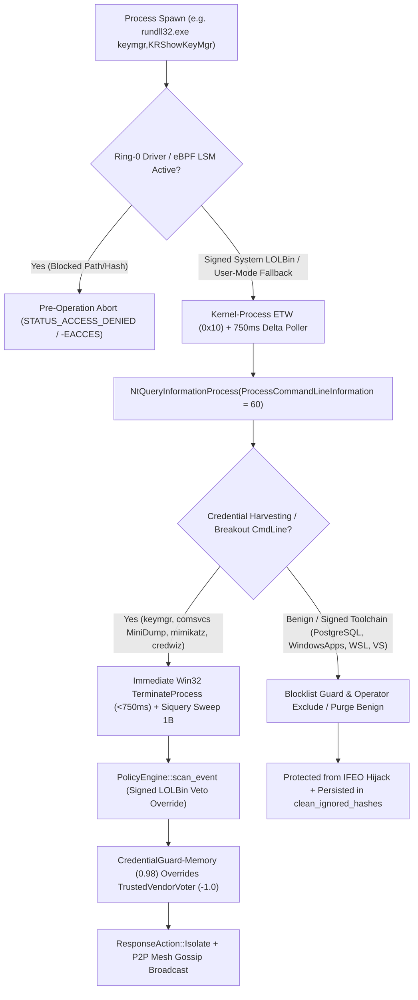

---

### CLI Management Commands

OpenỌ̀ṣọ́ọ̀sì exposes a dedicated `osoosi driver` subcommand suite for kernel driver administration:

| Command | Description | Privilege |
|:---|:---|:---|
| `osoosi driver status` | Query driver connection, active mode, version, and blocked process counts. | User / Admin |
| `osoosi driver install [--path <PATH>]` | Register and start `OsoosiDriver` service via Windows Service Control Manager (SCM). | Administrator |
| `osoosi driver uninstall` | Stop and delete `OsoosiDriver` service via SCM. | Administrator |
| `osoosi driver add-rule <PATH>` | Add executable path to kernel blocklist for hardware-enforced pre-exec blocking. | Administrator |
| `osoosi driver set-mode <MODE>` | Dynamically switch kernel driver mode (`audit`, `active`, `lockdown`). | Administrator |
| `osoosi driver clear-rules` | Flush all in-memory kernel blocking rules. | Administrator |

#### Terminal Usage Examples

```powershell
# 1. Query kernel driver operational status
.\osoosi.exe driver status

# 2. Register and start the Ring-0 driver service (Administrator)
.\osoosi.exe driver install
# Or specify a custom driver binary location:
.\osoosi.exe driver install --path "C:\Program Files\OshoosiClaw\driver\windows\osoosi_driver.sys"

# 3. Add an executable to the kernel pre-operation blocklist
.\osoosi.exe driver add-rule "C:\Users\Public\mimikatz.exe"

# 4. Dynamically switch kernel driver autonomy mode
.\osoosi.exe driver set-mode lockdown
.\osoosi.exe driver set-mode active

# 5. Flush all in-kernel blocking rules
.\osoosi.exe driver clear-rules

# 6. Stop and uninstall the kernel driver service
.\osoosi.exe driver uninstall
```

---

<a id="-native-windows-service-lifecycle-osoosiedr"></a>
<a id="native-windows-service-lifecycle-osoosiedr"></a>
## ⚙️ Native Cross-Platform Service Lifecycle (`OsoosiEDR`) & Host OS Desktop/Search Immunity

OpenỌ̀ṣọ́ọ̀sì features enterprise-grade background service execution via native **Win32 Service Control Manager (SCM)** integration (`crates/osoosi-cli/src/service.rs`) and **Linux `systemd`** (`osoosi-edr.service`), paired with a **5-Layer Cross-Platform Host OS Desktop, Search & System Tray Immunity Gate** across **Windows, Linux, and macOS**.

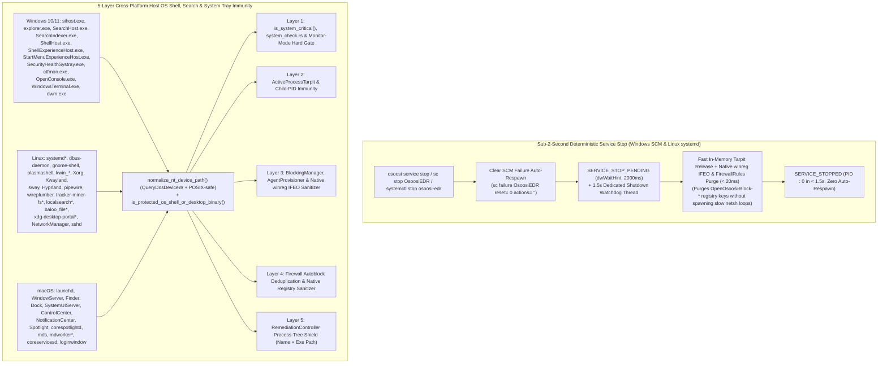

### Core Architecture & Operating Invariants

1. **Sub-2-Second Deterministic Service Shutdown & Zero Auto-Respawn**:
   - The service entrypoint (`osoosi.exe service run --no-browser`) invokes `StartServiceCtrlDispatcherW` and registers `RegisterServiceCtrlHandlerExW` for `SERVICE_CONTROL_STOP`, `SERVICE_CONTROL_SHUTDOWN`, and `SERVICE_CONTROL_INTERROGATE`.
   - On `stop`, `service_control_handler` immediately reports `SERVICE_STOP_PENDING` (`dwWaitHint: 2000`) and spawns a **1.5-second hardware/OS watchdog thread** (`crates/osoosi-cli/src/service.rs` and `crates/osoosi-cli/src/main.rs`) that guarantees the daemon releases in-memory tarpits, reports `SERVICE_STOPPED`, and exits cleanly within 1.5 seconds even if external firewall utilities stall.
   - `execute_host_disarm_unauthenticated()` only spawns `netsh.exe` quarantine-rule cleanup commands if the host was actually placed into `HOST_ISOLATED_STATE`, and invokes `remove_all_autoblock_rules()` (`purge_windows_firewall_autoblock_rules_native`) to delete all `OpenOsoosi-Block-*` values directly from `HKLM\SYSTEM\CurrentControlSet\Services\SharedAccess\Parameters\FirewallPolicy\FirewallRules` via `winreg` in `< 20ms`.
   - Service installation and startup explicitly clear SCM forced failure auto-restart actions (`sc.exe failure OsoosiEDR reset= 0 actions= ""`), and Linux `osoosi-edr.service` enforces `Restart=on-failure` with `TimeoutStopSec=5s`, ensuring an operator-requested stop never auto-respawns the daemon.
2. **Cross-Platform Host OS Shell, Search, System Tray & Init Immunity (`Windows`, `Linux`, `macOS`)**:
   - Kernel ETW device paths (`\Device\HarddiskVolume<N>\...`, `\Device\Mup\...`, `\\?\`, `\??\`) are normalized via `osoosi_types::normalize_nt_device_path` (using Win32 `QueryDosDeviceW` volume resolution while preserving POSIX `/` paths on Linux and macOS) before WinVerifyTrust, Windows Security Catalog (`CryptCATAdminEnumCatalogFromHash`), ELF/Mach-O inspection, or path policy evaluation so catalog-signed `SystemApps` binaries (such as `SearchHost.exe`) are never misclassified as unsigned.
   - `osoosi_types::is_protected_os_shell_or_desktop_binary` enforces an immutable cross-platform protection list across **Windows** (`sihost.exe`, `explorer.exe`, `SearchHost.exe`, `SearchFilterHost.exe`, `SearchProtocolHost.exe`, `ShellHost.exe`, `ShellExperienceHost.exe`, `StartMenuExperienceHost.exe`, `SecurityHealthSystray.exe`, `ctfmon.exe`, `OpenConsole.exe`, `WindowsTerminal.exe`), **Linux** (`systemd*`, `dbus-daemon`, `gnome-shell`, `plasmashell`, `kwin_*`, `Xorg`, `Xwayland`, `sway`, `Hyprland`, `pipewire`, `tracker-miner-fs*`, `localsearch*`, `baloo_file*`, `xdg-desktop-portal*`), and **macOS** (`launchd`, `WindowServer`, `Finder`, `Dock`, `SystemUIServer`, `ControlCenter`, `NotificationCenter`, `Spotlight`, `corespotlightd`, `mds`, `mdworker*`)—while explicitly excluding script interpreters and LOLBins (`powershell.exe`, `cmd.exe`, `bash`, `python`, `nc`, `curl`).
   - Startup automatically purges any legacy `HKLM\...\Image File Execution Options\<exe>\Debugger` hijacks (`systray.exe` and any hijacks targeting protected OS shell, search, tray, or accessibility binaries) via native `winreg` (`purge_ifeo_systray_debugger_hooks_native`), purges `OpenOsoosi-Block-*` registry firewall rules (`purge_windows_firewall_autoblock_rules_native`), prevents duplicate firewall rule creation (`windows_firewall_rule_exists_native`), and sanitizes `config/firewall_rules.json` and `blocking_rules.json`.
3. **Clone-Path-Agnostic Working-Directory Resolution**:
   - The Windows SCM always executes background services with the working directory set to `C:\Windows\System32`.
   - `osoosi` inspects `std::env::current_exe()` at startup and walks up to 5 parent directories (`find_project_root_from(&exe)`) to locate `osoosi.toml`, `models/`, `rules/`, and `dashboard/dist/`.
4. **Dedicated WebUI Tokio Runtime & Auto-Launch (`http://127.0.0.1:3030/`)**:
   - Starting the service (`osoosi service install` or `osoosi service start`) binds the WebUI on a dedicated 4-worker multi-thread Tokio runtime (`osoosi-dashboard-rt`) at `http://127.0.0.1:3030/`—isolated from file-scanner and baseline-hashing workloads.

### Windows & Linux Service Management Commands (`OsoosiEDR` / `osoosi-edr.service`)

| Management Action | OpenỌ̀ṣọ́ọ̀sì CLI (Windows & Linux) | Windows PowerShell / `sc.exe` | Linux `systemd` (`systemctl`) | Description |
|:---|:---|:---|:---|:---|
| **Install Service** | `osoosi service install` | `sc.exe create OsoosiEDR ...` | Installs `/usr/lib/systemd/system/osoosi-edr.service` + `systemctl enable --now osoosi-edr` | Registers automatic startup on both Windows SCM and Linux `systemd`. |
| **Start Service** | `osoosi service start` | `Start-Service OsoosiEDR` | `systemctl start osoosi-edr.service` | Transitions service to `RUNNING` / `active (running)` (or detaches via `setsid()` when `systemd` is absent). |
| **Stop Service** | `osoosi service stop` | `Stop-Service OsoosiEDR` | `systemctl stop osoosi-edr.service` | Dispatches deterministic `< 1.5s` stop signal, releases tarpits, and flushes SQLite WAL. |
| **Restart Service** | `osoosi service restart` | `Restart-Service OsoosiEDR` | `systemctl restart osoosi-edr.service` | Safely cycles the daemon, reloading rules, configs, and models. |
| **Query Status** | `osoosi service status` | `Get-Service OsoosiEDR` | `systemctl status osoosi-edr.service` | Displays PID, current state, and memory usage. |
| **Delete / Remove** | `osoosi service delete` | `sc.exe delete OsoosiEDR` | `systemctl disable --now osoosi-edr && rm /etc/systemd/system/osoosi-edr.service` | Stops the daemon and unregisters the service definition. |

```powershell
# Complete Administrative Service Lifecycle Example (Windows PowerShell or Linux Root Shell)

# 1. Install OpenỌ̀ṣọ́ọ̀sì as an automatic Service (Windows SCM or Linux systemd)
osoosi service install

# 2. Start the service
osoosi service start

# 3. Verify operational status and running PID
osoosi service status

# 4. Stop the service cleanly in < 1.5 seconds
osoosi service stop
```

---

<a id="-hierarchical-merkle-hash-chains--nsrl--aslr-merkle-protection"></a>
<a id="hierarchical-merkle-hash-chains--nsrl--aslr-merkle-protection"></a>
## 🌳 Hierarchical (Two-Tier) BLAKE3 Merkle Hash Chains & NSRL / ASLR Merkle Protection (`crates/osoosi-audit`)

OpenỌ̀ṣọ́ọ̀sì implements a lock-free **Two-Tier Hierarchical BLAKE3 Merkle Architecture** across every arm, tarpit, and containment ring alongside **NSRL Demand-Paged 4 KB Binary Merkle Proofs** and **ASLR-Invariant Process Code-Segment Merkle Verification**.

### 1. Two-Tier Hierarchical Subsystem Merkle Chains (`crates/osoosi-audit/src/hierarchical.rs`)
Rather than contending on a single global mutex for every microsecond telemetry event, each subsystem maintains its own domain-separated rolling BLAKE3 hash chain in memory and periodically anchors an Ed25519-signed interior rollup node into the global root `MerkleAuditTree` and hardware TPM PCRs:

1. **Per-Arm Merkle Chain (`OSOOSI_ARM_MERKLE_V1` — Limb State & Epoch Integrity)**:
   $$H_{\text{arm}}^{(n)} = \text{BLAKE3}\left(\text{Domain}_{\text{arm}} \parallel H_{\text{arm}}^{(n-1)} \parallel \text{arm\_id} \parallel \text{epoch} \parallel \text{role} \parallel \text{tool\_call\_hash} \parallel \text{hmac\_sig}\right)$$
   Binds every inter-agent message and tool invocation in `containment_ring.rs` to the arm's monotonic generation epoch. When `sever_rogue_agent_branch` executes surgical autotomy (`epoch N -> N + 1`), an immutable `ArmFractureProof` is sealed and anchored into the global root tree.
2. **Per-Tarpit Merkle Chain (`OSOOSI_TARPIT_MERKLE_V1` — Deception & Forensic Non-Repudiation)**:
   $$H_{\text{tarpit}}^{(n)} = \text{BLAKE3}\left(\text{Domain}_{\text{tarpit}} \parallel H_{\text{tarpit}}^{(n-1)} \parallel \text{pid} \parallel \text{trap\_id} \parallel \text{payload\_hash} \parallel \text{timestamp\_ns}\right)$$
   Appends at wire speed with zero global lock contention across `tarpit.rs` and `ghost_node.rs`, producing a tamper-evident forensic transcript of every synthetic delay, honeyport touch, and canary interaction.
3. **Per-Ring Merkle Chain (`OSOOSI_RING_MERKLE_V1` — Cross-Ring Blinding Detection across Rings 0..3)**:
   Records boundary transitions across **Ring 0 (Kernel/eBPF/WFP)**, **Ring 1 (Out-of-Process Sentinel)**, **Ring 2 (Neural Mesh/Dogwood Policy Gate)**, and **Ring 3 (Sandboxed Worker)**. `verify_cross_ring_continuity()` mathematically compares Ring 0 event counts ($N_0$) against Ring 2 policy evaluations ($N_2$) to detect asymmetric pipeline blinding in real time.
4. **Tier-2 Ed25519-Signed Interior Rollup Node**:
   $$H_{\text{interior}}^{(k)} = \text{BLAKE3}\left(\text{Domain}_{\text{rollup}} \parallel k \parallel H_{\text{arms\_fold}} \parallel H_{\text{tarpits\_fold}} \parallel H_{\text{rings\_fold}} \parallel \text{trigger}\right)$$
   Exposed via Siquery table `hierarchical_merkle_anchors` and `GET /api/audit/merkle-hierarchy`.

### 2. NSRL Demand-Paged 4 KB Allowlist Tree & ASLR-Invariant Process Verifier (`crates/osoosi-audit/src/nsrl_aslr_merkle.rs`)
1. **NSRL Global Allowlist & 4 KB Demand-Paged Page-Cache Merkle Tree**:
   - **Global Allowlist Proof ($O(\log N)$)**: Verifies that an approved binary profile (`file_blake3`, `page_merkle_root`, canonical path, and Windows Security Catalog / Authenticode or Linux `fs-verity` status) belongs to the trusted NIST NSRL root (`verify_nsrl_executable_proof`).
   - **4 KB Demand-Paged Verification ($O(\log m)$)**: Divides each approved executable into 4,096-byte pages (`OSOOSI_NSRL_PAGE_4K_V1`) matching Linux `fs-verity` (`FS_IOC_GETFLAGS` `0x80086601` / `FS_IOC_MEASURE_VERITY` `0xC0046686`) so individual code pages are verified on page-in (`verify_demand_paged_block`), preventing dormant disk modification.
2. **ASLR-Invariant Process Code-Segment Merkle Verifier**:
   - **Relocation Normalization ($\Delta_k = \text{VA} - \text{RandomizedBase}$)**: Normalizes absolute relocated addresses across both Windows PE `.text` (`IMAGE_REL_BASED_DIR64`) and Linux ELF64 PIE/PIC `PT_LOAD` (`PF_X`) code segments so the 4 KB page Merkle root (`OSOOSI_ASLR_CODE_PAGE_V1`) remains **100% identical across any randomized ASLR base address** while immediately catching single-byte inline hooks (`0xCC` INT3, `0xE9` JMP) and process hollowing (`verify_aslr_code_segment_pages`).
   - **Hardware $W \oplus X$ & CET Separation**: Anchors immutable `.text` code pages at process startup (`AslrProcessMerkleAnchor`) while excluding continuously mutating `[stack]` and `[heap]` allocations, enforcing hardware $W \oplus X$ (DEP/NX) and Control-flow Enforcement Technology (CET) shadow stacks (`GET /api/audit/nsrl-aslr-merkle`).

### 3. Adaptive BLAKE3 Merkle Self-Defense, Dev-Recompile Auto-Adaptation & TPM 2.0 Hardware-Signed Merkle Root (`0x81010002`)
1. **Non-Locking Shared File Access (`open_shared_for_merkle` / `read_shared_for_merkle`)**:
   - Opens executable files with `FILE_SHARE_READ | FILE_SHARE_WRITE | FILE_SHARE_DELETE` (`0x01 | 0x02 | 0x04`) on Windows and releases file descriptors immediately after hashing so `cargo.exe`, `rustc.exe`, `rust-lld.exe`, `lld-link.exe`, `signtool.exe`, and `wix.exe` can atomically overwrite or rename binaries in `target/release` and `target/debug` without `ERROR_SHARING_VIOLATION (os error 32)` self-lockouts.
2. **`AdaptiveDevMerkleGuard` & Compiler Provenance Verification**:
   - Distinguishes legitimate developer recompilations (`RecompileProvenance`: authorized compiler/linker/signer parent or actor process targeting workspace build directories) from unauthorized binary tampering (`AdaptiveMerkleVerdict::DevRecompileAdapted` vs. `UnauthorizedTampering`).
   - Automatically rotates the binary's 4 KB page-tree BLAKE3 Merkle root, advances `generation_epoch`, and re-signs the updated root via `Tpm2MerkleRootSigner` (`osoosi fhe sign-merkle --binary <path>`).
3. **TPM 2.0 Hardware-Signed BLAKE3 Merkle Root (`Tpm2MerkleRootSigner`, Handle `0x81010002`)**:
   - **Why Cryptographic Signing Beats Raw PCR Extension for Active Development**: Extending a PCR (`TPM2_PCR_Extend`) is a one-way trapdoor ($\text{PCR}_{\text{new}} = \text{SHA256}(\text{PCR}_{\text{old}} \parallel \text{Hash})$) that permanently invalidates sealed policies on every `cargo build`. Instead, OshoosiClaw provisions a non-exportable hardware signing key (`fixedTPM | fixedParent | sensitiveDataOrigin | userWithAuth | sign`) inside the TPM 2.0 Owner Hierarchy at persistent handle `0x81010002` (`/dev/tpmrm0` on Linux via `packaging/linux/provision_tpm2_merkle_key.sh`; `MS_PLATFORM_CRYPTO_PROVIDER` on Windows 11).
   - **`SHA256(BLAKE3_Root)` Hardware Digest Boundary**: Computes the 32-byte raw BLAKE3 Merkle root (`<binary>.b3`) in user space/kernel space and passes `SHA256(BLAKE3_Root)` into the TPM 2.0 hardware engine (`tpm2_sign -c 0x81010002 -g sha256`), exporting `<binary>.merkle.sig.json` (`Tpm2MerkleSignatureManifest`).
   - **Three Hardware Authorization Policies**:
     - **Policy 1 (`userAuth` PIN + 3-Strike Dictionary Attack Lockout)**: Requires operator `userAuth` PIN verification before key `0x81010002` signs a rotated Merkle root, engaging a 3-strike hardware Dictionary Attack Lockout (`TpmMerkleError::DictionaryAttackLockout`) on brute-force attempts.
     - **Policy 2 (`PCR 16` Debug & `PCR 23` Dynamic Runtime Lockdown)**: Binds signing authorization to `PCR 16` and `PCR 23`. Extending `PCR 23` (`extend_pcr_23_runtime_lockdown`) immediately locks key `0x81010002` if a 5-Sigma anomaly or rootkit is detected (`TpmMerkleError::PcrPolicyLockedDown`).
     - **Policy 3 (`NV Monotonic Counter 0x01800001` Anti-Rollback)**: Increments the non-volatile monotonic counter (`0x01800001`) on every signed build epoch and rejects any replayed older `<binary>.merkle.sig.json` manifest (`manifest.nv_monotonic_counter < current_nv_counter` $\implies$ `TpmMerkleError::RollbackAttackDetected`).
   - **Linux `fs-verity` + `eBPF LSM` Zero-Overhead Enforcement**: Pairs `fsverity enable` (4 KB page-cache Merkle tree verified in-kernel on page fault) with `BPF_PROG_TYPE_LSM` (`bprm_check_security` + `bpf_get_fsverity_digest`) to verify the TPM-signed BLAKE3 root in-kernel before execution.

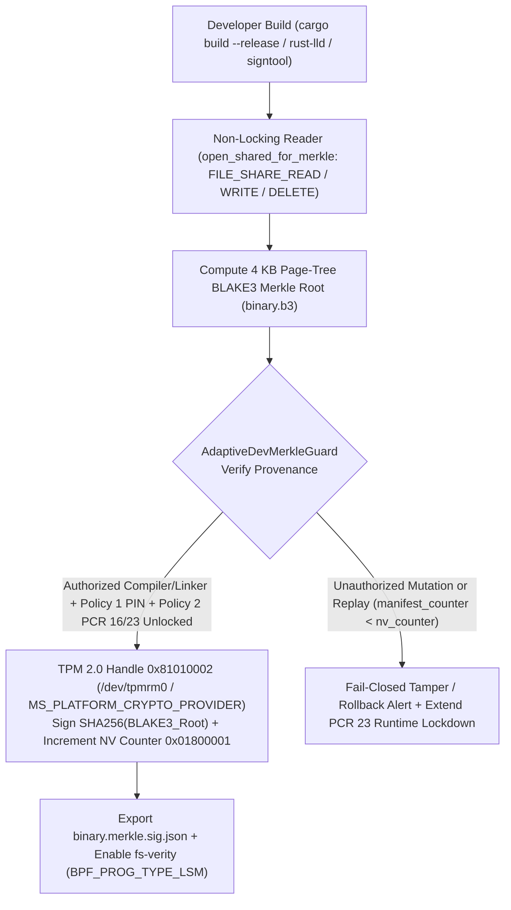

### 4. Dual-Stage 5-Sigma Kernel Quarantine (`bpf_send_signal(SIGSTOP)` + Cgroup v2 Freezer + Forensic Memory Collector)
- **Stage 1: Sub-Microsecond Kernel Instruction Freeze (`ebpf/src/osoosi_probe.bpf.c`)**:
  - `quarantine_targets` BPF hash map (`BPF_MAP_TYPE_HASH`, 10,240 entries) keyed by `tgid` storing 24-byte `struct quarantine_directive` (`timestamp_ns`, `anomaly_score_scaled`, `trigger_hook_id`, `containment_flags`).
  - `enforce_kernel_quarantine(tgid, pid)` invoked across `execve`, `socket_connect`, `sys_enter_ptrace`, `sys_enter_memfd_create`, `security_file_open`, `mprotect`, and **Hook 9 (`SEC("perf_event") int osoosi_pmu_watchdog`)**—immediately halting CPU instruction execution via `bpf_send_signal(SIGSTOP)` (`19`) even if the payload executes a pure ring-3 spin-loop with zero syscalls.
- **Stage 2: Atomic Cgroup v2 Freezer Prison, `cgroup.events` `"frozen 1"` Confirmation & All-Thread Forensic Dump (`crates/osoosi-telemetry/src/linux_ebpf.rs`, `crates/osoosi-core/src/lib.rs`)**:
  - `QuarantineResponder` pre-opens `/sys/fs/cgroup/osoosi_quarantine/cgroup.procs` and `cgroup.freeze` (pre-armed with `"1\n"` at daemon startup), migrates the stopped PID via stack-only `format_u32_newline` (zero heap allocation on the hot path), and verifies the kernel transition to `"frozen 1"` in `/sys/fs/cgroup/osoosi_quarantine/cgroup.events` (`cgroup_frozen_confirmed: bool`, `freeze_latency_us: u64`), subject to the **Host OS & Developer Immunity Veto**.
  - `FrozenProcessForensicCollector` enumerates every thread in `/proc/<tgid>/task/<tid>`, captures `FullCpuRegisterSnapshot` (`r15`..`gs_base` via `ptrace(PTRACE_GETREGS)` with `/proc/<tgid>/task/<tid>/stat` `kstkeip`/`kstkesp` fallback), extracts `/proc/<pid>/maps` (`[anon:rwx]` regions), `/proc/<pid>/mem` (64 KB capped buffers), `/proc/<pid>/stack`, and `/proc/<pid>/fd` sockets, synthesizes a multi-token YARA-X rule via REA (`synthesize_yara_from_raw_payload`), and broadcasts the confirmed 5-Sigma IOC across the libp2p/Nostr wire mesh before `SIGKILL` cleanup.

---

<a id="-agent-anomaly-detection-owasp-top-10-agentic-2026--embeddinggemma-2-mrl"></a>
<a id="agent-anomaly-detection-owasp-top-10-agentic-2026--embeddinggemma-2-mrl"></a>
## 🤖 Agent Anomaly Detection (OWASP Top 10 Agentic 2026) & EmbeddingGemma 2 MRL

With the widespread enterprise deployment of autonomous AI agents (Devin, AutoGPT, Claude Computer Use, OpenHands), attackers increasingly target agentic loops rather than traditional binaries. OpenỌ̀ṣọ́ọ̀sì embeds an on-device **Agent Anomaly Detection (AAD)** engine (`crates/osoosi-agent-anomaly`) designed after **Google DeepMind's Gemini Enterprise Agent AAD Specification** and mapped directly to the **OWASP Top 10 for Agentic Applications (2026)**.

```
                            AGENT TOOL-CALL TELEMETRY (JSON STREAM)
                                              │
                                              ▼
                    ┌──────────────────────────────────────────────────┐
                    │       Layer 1: Statistical Screener (< 5µs)      │
                    │  • Sliding Session Window (In-Memory Ring Buffer)│
                    │  • Call Velocity (> 10 calls/s)                  │
                    │  • Argument Payload Size Spike (> 50 KB)         │
                    │  • Cumulative Error Ratio (> 60%)                │
                    │  • Token Burn Velocity (> 50,000 tokens/min)     │
                    └─────────────────────────┬────────────────────────┘
                                              │
                         ┌────────────────────┴────────────────────┐
                         ▼                                         ▼
                 [Pass: Normal Velocity]                   [Anomalous Spike]
                         │                                         │
                         ▼                                         ▼
                   Fast-Path OK                    ┌───────────────────────────────┐
                   (Zero Delay)                    │  Layer 2: Semantic Reasoner   │
                                                   │  (EmbeddingGemma 2 + MRL)     │
                                                   │  • 128-dim Cosine Similarity  │
                                                   │  • Intent Drift Evaluation    │
                                                   │  • Reference Threat Clusters  │
                                                   └───────────────┬───────────────┘
                                                                   │
                                                                   ▼
                                                       Consensus Voter Action
                                                   (Tarpit / Quarantine / Isolate)
```

### 1. Two-Layer Behavioral Oversight Architecture

1. **Layer 1: Statistical Screener (`< 5µs` Latency)**:
   - Evaluates every tool invocation telemetry record (`ToolCallTelemetry`) through an ultra-fast in-memory sliding window (`SessionWindow`, default 60-second horizon).
   - Enforces mathematical guardrails:
     - **Call Rate Limit**: Flags bursts exceeding 10 tool calls per second per session.
     - **Payload Volume**: Intercepts argument strings larger than 50 KB (detects bulk file ingestion and prompt injection payloads).
     - **Token Exhaustion**: Flags cumulative token velocities exceeding 50,000 tokens/min (sponge attack mitigation).
     - **Error Burst Rate**: Flags 5 consecutive tool failures or an error ratio exceeding 60% (indicates brute-force probing or tool fuzzing).
2. **Layer 2: Semantic Reasoner & EmbeddingGemma 2 (MRL)**:
   - When Layer 1 detects an anomalous velocity, or when an unfamiliar tool call is encountered, telemetry is routed to the semantic reasoner (`crates/osoosi-behavioral::embedding_gemma`).
   - Uses **Google DeepMind EmbeddingGemma 2** with **Matryoshka Representation Learning (MRL)**:
     - **MRL Slicing (128 / 256 / 512 / 768 Dimensions)**: Slices embedding representations down to 128 dimensions followed by L2 normalization (`normalize_l2`).
     - **High Efficiency**: 128-dim vectors provide a **6x speedup** in SIMD cosine similarity calculations (`cosine_similarity`), enabling sub-millisecond distance computations against reference threat vectors with **>98% semantic fidelity**.
     - **Reference Threat Vectors**: Compares tool invocation embeddings against pre-computed clusters for *Credential Harvesting*, *Remote Code Execution*, *Privilege Escalation*, *Defense Impairment*, and *Data Exfiltration*.

### 2. OWASP Top 10 for Agentic Applications (2026) Coverage Matrix

| OWASP Risk ID | Threat Category | Attack Vector & Manifestation | Layer 1 / 2 Detection Mechanics | Consensus Action |
|:---|:---|:---|:---|:---|
| **ASI01** | **Agent Goal / Intent Hijacking** | Indirect prompt injection in ingested web/file content overriding user instructions. | EmbeddingGemma 2 cosine distance to initial prompt intent $> 0.65$. | `ResponseAction::Tarpit` |
| **ASI02** | **Tool Misuse & Parameter Tampering** | Adversary injects shell metacharacters (`;`, `&&`, `&#124;`) or command substitutions into tool arguments. | Layer 1 argument sanitization + `AiSecurityAuditVoter` pattern matching. | `ResponseAction::Tarpit` |
| **ASI03** | **Autonomous Privilege Escalation** | Agent attempts to invoke administrative tools or write to restricted system hives without authorization. | Sliding window role check against permitted tool manifest; unbacked thread check. | `ResponseAction::Isolate` |
| **ASI04** | **Excessive Agency & Unbounded Execution** | Agent performs uncontrolled multi-step actions across file systems or networks without human check. | Sliding window action counter threshold exceeded ($> 50$ mutating actions/session). | `ResponseAction::Alert` |
| **ASI05** | **Critical Infrastructure / System Breakout** | Agent executes container breakout, Job Object escape, or uncontained child process creation. | Kernel driver pre-operation interception + AppContainer / Job Object violation check. | `ResponseAction::Quarantine` |
| **ASI06** | **Multi-Agent Cascading Failure & Swarm Poisoning** | Malicious or compromised subagent floods P2P mesh or inter-agent bus with corrupt state updates. | Inter-agent HMAC verification + peer reputation score degradation. | `ResponseAction::Isolate` |
| **ASI07** | **Agent State / Long-Term Memory Tampering** | Unauthorized writes targeting agent persistent memory (`.agents/memory.md`, SQLite memory store). | Sysmon Event 11 monitoring on agent memory paths + cryptographic hash mismatch. | `ResponseAction::Isolate` |
| **ASI08** | **Sensitive Context / System Prompt Exfiltration** | Prompt injection inducing the agent to dump its hidden system prompt or API credentials over HTTP. | Egress voter DLP regex scan (`sk-`, `ghp_`, `did:osoosi:`, system prompt canary tokens). | `ResponseAction::Alert` |
| **ASI09** | **Resource Exhaustion & Denial of Agent Service** | Recursive tool loops, sponge prompts, or massive token expansion starving inference compute. | Layer 1 token velocity screener ($> 50{,}000\text{ tokens/min}$) and rate screener. | `ResponseAction::Tarpit` |
| **ASI10** | **Rogue Agent Self-Replication & Persistence** | Agent installs scheduled tasks, autostart registry keys, or background worker daemons to survive termination. | Sysmon Event 13 / Event 1 monitoring on persistence directories (`Run`, `RunOnce`, Services). | `ResponseAction::Quarantine` |

### 3. Host-Calibrated Model Provisioning & IPv6 Network Resilience

To ensure that machine learning inference never starves host memory or causes OOM conditions, OpenỌ̀ṣọ́ọ̀sì dynamically audits system hardware and calibrates model provisioning:

```powershell
# 1. Audit host CPU, RAM, GPU, and get assigned hardware tier
.\osoosi.exe check-resources
# Output:
# Logical CPU Cores     : 16
# Total System Memory   : 31.84 GB (32608 MB)
# Available Free Memory : 19.42 GB (19888 MB)
# GPU Acceleration      : NVIDIA GeForce RTX 4070 Laptop GPU (12140 MB VRAM)
# Assigned Hardware Tier: Enterprise (>16 GB RAM)
# Recommended Suite     : qwen2.5:14b, embeddinggemma:latest, fenkohq/foundation-sec-8b

# 2. Pull the calibrated model suite with automatic network resilience
.\osoosi.exe pull-model
```

#### Automatic IPv6 Suspension Guard (`Ipv6SuspensionGuard`)
During multi-gigabyte model downloads from Hugging Face or Cloudflare R2, dual-stack Windows network interfaces frequently encounter silent IPv6 packet drops and TCP window stalls:
- When `osoosi pull-model` starts (or when models are provisioned via the WebUI `#utilities-view`), `Ipv6SuspensionGuard` temporarily suspends the `ms_tcpip6` component binding on all active network adapters via `Disable-NetAdapterBinding`.
- All model downloads fall back cleanly to high-throughput IPv4 routes with zero timeouts.
- An **RAII Drop guard** automatically restores full IPv6 network bindings (`Enable-NetAdapterBinding`) immediately upon download completion, error, or process termination, ensuring host network configuration is never permanently altered.

---

<a id="-siquery-rs-41-table-engine"></a>
<a id="siquery-rs-41-table-engine"></a>
<a id="-siquery-rs-98-table-engine"></a>
<a id="siquery-rs-98-table-engine"></a>
<a id="-siquery-rs-101-table-engine"></a>
<a id="siquery-rs-101-table-engine"></a>
## 🔍 Native Rust `siquery-rs` 101-Table SQL Engine (`crates/osoosi-agent-anomaly/src/siquery.rs`)

OpenỌ̀ṣọ́ọ̀sì embeds a 100% native Rust, in-process relational SQL telemetry engine modeled after Devolutions' `siquery-rs`. Operating entirely via an in-memory SQLite virtual database (`PRAGMA query_only = ON` and statement-level `stmt.readonly()` enforcement) with zero external dependencies (no external `osqueryi.exe` binary or MSI required), it provides real-time visibility across **101 operating system, cryptographic Merkle, & AI agent security tables**:

- **Execution & Memory**: `processes`, `process_open_sockets`, `process_open_pipes`, `process_open_files`, `process_memory_map`, `process_envs`
- **Network & Connections**: `interface_addresses`, `network_adapters`, `routes`, `tcp_sockets`, `udp_sockets`, `etc_hosts`, `etc_protocols`, `etc_services`, `dns_resolvers`, `proxies`
- **WMI & Hardware Inventory**: `system_info`, `os_version`, `wmi_os_version`, `wmi_bios`, `wmi_computer_system`, `wmi_services`, `wmi_shares`, `wmi_hotfixes`, `wmi_startup_commands`, `wmi_volume`, `wmi_logical_disk`, `wmi_memory_device`, `wmi_network_adapter`, `wmi_process`, `wmi_product`, `wmi_quick_fix_engineering`, `wmi_user_account`, `wmi_base_board`
- **Identity & Posture**: `user_accounts`, `groups`, `logged_in_users`, `user_groups`, `certificates`, `bitlocker_info`, `device_guard_policy`, `system_health`, `peer_status`
- **Filesystem & System**: `logical_drives`, `mounts`, `file_system`, `disks`, `installed_packages`, `uptime`, `time`
- **Cryptographic Merkle & AI Agent Security Telemetry**:
  - `hierarchical_merkle_anchors`: Two-tier BLAKE3 interior rollup hashes (`anchor_seq`, `interior_hash`, `arms_fold_hash`, `tarpits_fold_hash`, `rings_fold_hash`, `global_merkle_root`, `ed25519_sig`, `trigger_reason`).
  - `spider_web_threads`: Radial and spiral thread strain ($\epsilon$), constitutive regimes (`LinearElastic`, `EntropicUnfolding`, `StrainStiffening`, `SacrificialFracture`), sector allocation, token bucket consumption, and localized fracture state.
  - `business_policy_violations`: Out-of-model business authorization gate violations, zero-day exfiltration bounds ($B_{\max}$), sensitivity levels, and containment latencies.
  - `agent_mercury_physics`: Liquid mercury fluid dynamics, surface tension coefficients, Navier-Stokes droplet coalescence, and isolation barriers.
  - `host_actuation_pores`: Fluid-dynamic actuator pores and containment channels dynamically opened/closed during anomaly surges.
  - `har_entries`: W3C HTTP Archive L7 traffic inspection, headers, cookies, mime-types, request/response timings, and exfiltration payloads.
  - `ide_extensions`: VSCode, Cursor, Windsurf, and JetBrains plugin inventory, permission scopes, and untrusted extension alerting.
  - `api_endpoints`: Shadow API, unauthenticated REST/gRPC endpoint discovery, and parameter tampering detections.
  - `coding_tools`: MCP servers, Claude Code, Cline, Cursor, and Antigravity tool and CLI authorization audits.
  - `browser_extensions`: Chrome, Edge, and Firefox extensions, manifest permissions, and background worker hooks.
  - `browser_history`: Navigational breadcrumbs, prompt injection vector URLs, and untrusted web taint tracking.
  - `browser_downloads`: Downloaded binaries, SHA-256 hashes, and Mark-of-the-Web (MOTW) zone identifiers.

#### Continuous EDR Telemetry Sweeps
During daemon runtime, `EdrOrchestrator::run_siquery_edr_audit_sweep()` automatically sweeps the system every 45 seconds across 8 security dimensions:
1. **Unbacked Memory & Process Hollowing**: Scans `process_memory_map` for executable pages (`PAGE_EXECUTE_READWRITE`) unbacked by disk modules.
2. **Network Breakout & Socket Anomalies**: Joins `processes` with `tcp_sockets` to flag listening ports opened by anomalous or non-system binaries.
3. **WMI Persistence Audit**: Validates digital signatures on all auto-start `wmi_services` via Authenticode verification.
4. **Hosts File & DNS Tampering**: Queries `etc_hosts` to detect local loopback redirections or MITM poisoning.
5. **Privileged Account & Share Enumeration**: Detects rogue accounts in `user_accounts` and exposed administrative `wmi_shares`.
6. **Patch & Hotfix Gap Analysis**: Inspects `wmi_hotfixes` to detect unpatched kernel CVE vulnerabilities.
7. **Spider-Web Strain & Exposure Monitoring**: Inspects `spider_web_threads` and `business_policy_violations` to ensure $E_{\max} \le B_{\max}$.
8. **Shadow API & L7 HAR Traffic Forensics**: Inspects `api_endpoints` and `har_entries` for unauthenticated outbound data channels.

---

<a id="-spider-web-continuum-mechanics--exposure-bounded-containment"></a>
<a id="spider-web-continuum-mechanics--exposure-bounded-containment"></a>
## 🕸️ Nonlinear Spider-Web Continuum Mechanics & Exposure-Bounded Containment Engine

Inspired by the landmark MIT study on spider orb-webs (Cranford & Buehler, *Nature* 2012), OpenỌ̀ṣọ́ọ̀sì implements a non-linear continuum mechanics containment engine (`crates/osoosi-agent-anomaly/src/spider_physics.rs`). Traditional boundary firewalls either permit 100% of traffic or trigger catastrophic binary termination of entire swarms. The spider-web continuum model provides continuous non-linear strain response and localized sacrificial failure.

### Biomechanical Principles & EDR Mapping

| Spider Orb-Web Biomechanical Principle | OpenỌ̀ṣọ́ọ̀sì Agent Containment Implementation | Security Benefit |
|---|---|---|
| **Localized Sacrificial Failure** | Individual radial/spiral threads snap under extreme strain ($\epsilon > 0.85$), severing only the rogue agent limb or compromised tool call while preserving the remaining 90%+ of intact web geometry. | Prevents cascading cluster crashes; healthy agent pipelines continue executing without downtime. |
| **Nonlinear Strain-Stiffening** | At moderate-to-high strain ($\epsilon \in [0.45, 0.85]$), silk dynamically stiffens ($E_s \gg E_0$), absorbing up to 85% of kinetic attack energy via token-bucket rate limiting ($R_{\text{enforced}}$). | Throttles anomalous prompt injection loops and brute-force scans without terminating legitimate processes. |
| **Spatial Energy Dissipation** | Energy applied to one sector is redistributed across adjacent radial support threads. | Spreads anomalous agent load across peer mesh nodes and isolates compromised agent arms before host resource exhaustion. |
| **Entropic Unfolding & Geometric Softening** | Molecular beta-sheet crystals uncoil during moderate strain ($\epsilon \in [0.15, 0.45]$), providing yielding elasticity without permanent plastic deformation. | Tolerates bursty benign developer workloads (large git diffs, batch test runs) without triggering false-positive alerts. |

### 4-Regime Constitutive Mechanical Model

$$\sigma(\epsilon) = \begin{cases}
E_0 \cdot \epsilon & \text{Regime 1: Linear Elastic } (\epsilon \le 0.15) \\
\sigma_{\text{yield}} + E_p \cdot (\epsilon - 0.15) & \text{Regime 2: Entropic Unfolding } (0.15 < \epsilon \le 0.45) \\
\sigma_{\text{plateau}} + E_s \cdot (\epsilon - 0.45)^2 & \text{Regime 3: Strain-Stiffening } (0.45 < \epsilon \le 0.85) \\
0 \quad (\text{Sacrificial Fracture}) & \text{Regime 4: Sacrificial Failure } (\epsilon > 0.85)
\end{cases}$$

### Out-of-Model Business Authorization Gate & Zero-Day Exposure Bounding

Rogue AI agents, compromised MCP servers, or prompt-injected LLM swarms can inflict severe damage even with **0 malware binaries** on disk by invoking legitimate tools (e.g., `export_customers_csv`, `read_email_inbox`, `transfer_funds`) outside expected business policy.

OpenỌ̀ṣọ́ọ̀sì enforces an **Out-of-Model Business Authorization Gate** directly in the continuum physics kernel:
1. **Pre-Invocation Verification**: Evaluates tool calls against explicit business policy constraints before document or network handles are granted.
2. **Zero-Byte Immediate Fracture**: Unauthorized export or data exfiltration attempts instantly trigger **Regime 4 Sacrificial Fracture** ($\epsilon \to 1.0$), snapping the thread at 0 bytes leaked.
3. **Exposure-Bounded Mathematical Guarantee**:
   $$\text{Maximum Exposure } E_{\max} \le R_{\text{enforced}} \times (T_{\text{detect}} + T_{\text{contain}}) \le B_{\max}$$
   Where $R_{\text{enforced}}$ is the token-bucket rate limit, $T_{\text{detect}}$ is detection latency, $T_{\text{contain}}$ is containment reaction time, and $B_{\max}$ is the immutable business loss budget.

#### REST API Endpoints:
- `GET /api/agent-anomalies/spider-web`: Returns the complete sector topology, active threads, strain values, and business policy violation history.
- `POST /api/agent-anomalies/spider-web/evaluate`: Evaluates an agent action against continuum mechanics and business policy constraints, returning the mechanical verdict and rate-limit parameters.

---

<a id="-agentoctopus-multi-ring-containment"></a>
<a id="agentoctopus-multi-ring-containment"></a>
## 🐙 AgentOctopus Multi-Ring Containment & Zero-Hardcode Agent Discovery

Built within `crates/osoosi-agent-anomaly`, the **AgentOctopus** containment architecture enforces mathematical, cryptographic, and operational guardrails around local AI workflows:

- **Zero-Hardcode Bayesian Agent Discovery (`DynamicAgentClassifier`)**: Discovers running AI agents (Antigravity, MCP servers, OpenAI Codex, Ollama, LangGraph swarms) without brittle hardcoded process names. Uses relational `siquery` joins (`processes` JOIN `process_open_sockets` JOIN `pipes` JOIN `process_envs`) and ETW 3-second spawn velocity to evaluate log-odds feature ratios, preserving standard developer tooling while isolating rogue processes.
- **4-Ring Agent Containment (`ArmContainmentRing`)**: Fail-closed operational boundaries mapping each agent arm to cryptographic HMAC-SHA256 epoch tokens, ensuring subagents cannot message higher-privilege sinks or breach isolation.
- **Breakout Defense Coordinator (`BreakoutDefenseCoordinator`)**: Multi-category defense guarding against behavioral deviations, memory tampering, NTFS Alternate Data Streams (`:`), traversal encodings (`%2e`, `%2f`), and mathematical RFC1918 / loopback / link-local / CGNAT IPv4/IPv6 SSRF attacks.
- **3-Phase Agentjacking Guard**: Intercepts prompt injection payloads and session drift before agent tool execution.
- **P2P & Nostr Mesh Threat Broadcasting**: Disseminates `[AI AGENT WATCH-OUT]` consensus warnings across GossipSub (`osoosi-telemetry-v1`) and Nostr relays to protect neighboring mesh nodes.

---

<a id="-hardened-canarycage-filelineage-and-swarm-pre-immunization"></a>
<a id="hardened-canarycage-filelineage-and-swarm-pre-immunization"></a>
## 🕊️ Hardened Ephemeral CanaryCage, FileLineageTracker & Swarm Pre-Immunization (R1–R15)

OpenỌ̀ṣọ́ọ̀sì implements an active deception and swarm pre-immunization architecture across user-space, kernel boundaries, and mesh consensus, delivering 15 tightly integrated capabilities (R1–R15) that guarantee fail-closed sandboxing, cryptographic lineage, and zero-timeout forensic observability:

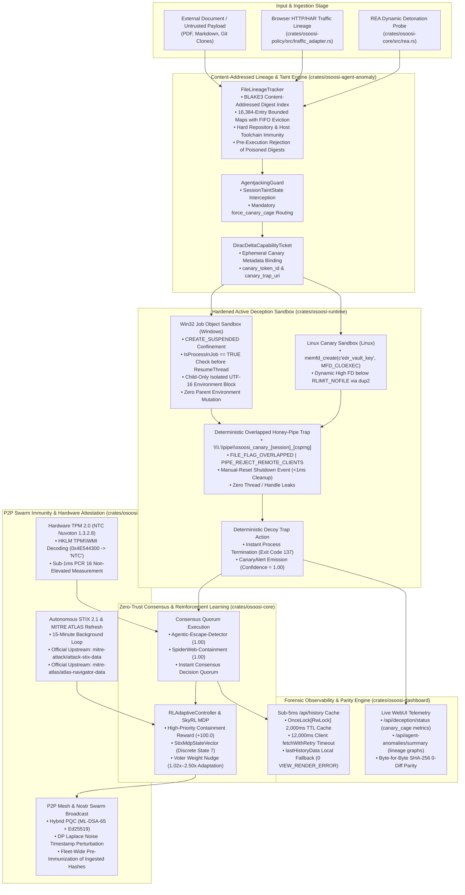

### Core Primitives & Invariants (R1–R15)

1. **Hardened Ephemeral `CanaryCage` (R1)**:
   - **Win32 Job Object Fail-Closed Confinement**: Child processes are spawned in `CREATE_SUSPENDED | CREATE_NO_WINDOW | CREATE_UNICODE_ENVIRONMENT`. Confinement calls `AssignProcessToJobObject` (`JOB_OBJECT_LIMIT_KILL_ON_JOB_CLOSE | JOB_OBJECT_LIMIT_DIE_ON_UNHANDLED_EXCEPTION`) and asserts `IsProcessInJob == TRUE` before `ResumeThread`. Any confinement failure terminates the suspended child immediately.
   - **Zero Parent Environment Mutation**: The supervisor process never invokes `std::env::set_var`. On Windows, an isolated child-only UTF-16 environment block (`CREATE_UNICODE_ENVIRONMENT`) is constructed. On Linux, `Command::env` and `memfd_create(c"edr_vault_key", MFD_CLOEXEC)` are mapped via `dup2` to dynamic high file descriptors below `RLIMIT_NOFILE`.
   - **Deterministic Overlapped Pipe Watcher**: Windows honey-pipes (`\\.\pipe\osoosi_canary_<session>_<csprng_hex>`) are opened with `FILE_FLAG_OVERLAPPED | FILE_FLAG_FIRST_PIPE_INSTANCE | PIPE_REJECT_REMOTE_CLIENTS`. Job handles are duplicated for watcher threads, and a manual-reset shutdown event (`CreateEventW`) signals on child exit/drop to guarantee complete cleanup in `< 1 ms` with zero thread/handle leaks. Children attempting to access honey-pipes are terminated with exit code `137`.

2. **BLAKE3 Input-File Lineage Tracker (`FileLineageTracker`, R1, R4)**:
   - Maintains 16,384-entry bounded maps (`session_files`, `known_paths_by_digest`, `poisoned_digests`, `seen_alerts`) with FIFO eviction.
   - Enforces hard repository and developer immunity (`resolve_project_root()` and `is_rea_benign_system_or_dev_process`), guaranteeing OshoosiClaw workspace files and compiler toolchains can never be quarantined.
   - Implements non-blocking `MemoryStore` read guards (`try_lock_for(Duration::from_millis(5))`) so background SQLite baseline writes never block HTTP threads.

3. **Multi-Ring Agent Containment Gate & Agentjacking Forced Caging (R2)**:
   - Inspects file/document paths in `ToolCallTelemetry.call_parameters` against swarm `poisoned_digests` before tool execution.
   - Binds ephemeral canary metadata (`canary_token_id`, `canary_trap_uri`) to `DiracDeltaCapabilityTicket`.
   - In `AgentjackingGuard`, tainted sessions (`SessionTaintState`) set `force_canary_cage: bool` to route all subsequent subprocess executions through `CanaryCage::spawn_caged`.

4. **REA Detonation Sandbox & False-Positive Adjudication (R3, R15)**:
   - Dynamic detonation probes (`run_caged_rea_detonation_probe`) execute inside `CanaryCage` with ephemeral honey-credentials. Decoy probes immediately record a `1.00` confidence malicious verdict with MITRE ATLAS `AML.T0043` (Craft Adversarial Data) / `T1552.001` (Credentials in Files) attribution.
   - Self-inspection and benign system adjudication (`analyze_target_bytes` and `is_rea_benign_system_or_dev_process`) enforce `threat_score = 0.0` (0% threat score) on OshoosiClaw binaries (`osoosi.exe`, `osoosi_inject.dll`, `osoosi-cli.exe`) and compiler toolchains.
   - All Windows subprocess executions set `CREATE_NO_WINDOW` (`0x08000000`) to prevent console window flashing.

5. **Browser HAR Cross-Domain Lineage & Comprehensive Host Web Traffic (R4, R14)**:
   - Computes BLAKE3 digests of HTTP response bodies in `parse_and_inspect_har_json_with_session` and registers `(url, domain, body_blake3)` in the lineage tracker, rejecting poisoned payloads with tag `HAR:SWARM_POISONED_PAYLOAD`.
   - Populates `har_entries` across 5 real sources: persisted `osoosi.db` records, in-memory ring buffer (1,024 entries), on-disk `.har` files, live Chrome/Edge/Brave SQLite browser profile histories (`urls` and `downloads`), and active TCP web sockets (`80`, `443`, `8080`, `8443`, `3000`, `3030`, `5000`, `11434`).

6. **Zero-Trust Policy Consensus Quorum, RL Controller & P2P Swarm Immunity (R6, R11)**:
   - `CanaryAlert` events feed a deterministic `1.00` confidence signal into `Agentic-Escape-Detector` and `SpiderWeb-Containment`, reaching immediate consensus quorum.
   - `RLAdaptiveController` records a `+100.0` containment reward update.
   - `StixMdpStateVector` maps STIX 2.1 tactic phases, techniques, and severities into a discrete MDP representation (discrete state 7) and nudges consensus voter RL weights (`1.02x–2.50x`).
   - Broadcasts correlated file digests across the P2P wire mesh and Nostr relays using enrolled `PeerTrustStore` + Hybrid PQC (`ML-DSA-65 + Ed25519`) and differential privacy Laplace timestamp perturbation (`crates/osoosi-dp`).

7. **Autonomous MITRE ATT&CK & MITRE ATLAS™ STIX 2.1 Refresh (R10)**:
   - Recurring 15-minute autonomous refresh loop pulling directly from official MITRE upstreams:
     - Enterprise ATT&CK: `https://raw.githubusercontent.com/mitre-attack/attack-stix-data/master/enterprise-attack/enterprise-attack.json`
     - MITRE ATLAS™: `https://raw.githubusercontent.com/mitre-atlas/atlas-navigator-data/main/dist/stix-atlas-attack-enterprise.json`
   - Deduplicates and merges STIX 2.1 `objects` arrays by ID, persisting fresh catalogs to disk and exposing live counts via `/api/mitre/status`.

8. **End-to-End Hardware TPM 2.0 Physical Attestation (R12)**:
   - Reads real host Nuvoton (`NTC`, `1.3.2.8`, Spec `2.0`) telemetry from `HKLM\SYSTEM\CurrentControlSet\Services\TPM\WMI`, decoding 4-byte TCG manufacturer IDs (`0x4E544300` -> `"NTC"`).
   - Fast sub-1ms PCR 16 reading without spawning external shells or blocking on DCOM/WMI.
   - Integrated into Siquery `tpm_info` schema, `detect_tpm()`, and `/api/siquery/edr-status`.

9. **Sub-5ms Forensic History Optimization & Zero `VIEW_RENDER_ERROR` (R13)**:
   - Core gossip backfill capped at 250 entries, `recent_threats_cache` serves queries up to `limit <= 1000`, and `collect_history_items` capped to 400 Merkle entries.
   - Thread-safe `OnceLock<parking_lot::RwLock<Option<(Instant, Vec<HistoryItem>)>>>` provides 2,000ms TTL caching, ensuring repeated `/api/history` queries return in `< 1 ms`.
   - Client `fetchWithRetry` timeout expanded to 12,000ms, and `renderHistoryView()` falls back to `state.lastHistoryData` during transient load, eliminating `VIEW_RENDER_ERROR`.

10. **Built-In 9-Vector Adversarial Red Team Gauntlet (R9)**:
    - Suite 5 exercises all 9 security, containment, deception, and hardware attestation vectors across 26 total tests:
      1. Core Vectors (LOLBin, injection, ADS, SSRF, Cedar/Dogwood, Homological, Ihara, Mercury, SpiderWeb, PQC) — 17 vectors.
      2. Ephemeral CanaryCage Subprocess Trap (`WindowsJobSandbox` honey-pipe, exit code 137, alert confidence 1.00).
      3. BLAKE3 Input-File Lineage & Swarm Pre-Immunization (ingestion attribution, pre-exec rejection, 16,384 FIFO eviction).
      4. Capability Ticket Canary Binding & Tainted-Session Forced Caging (`DiracDeltaCapabilityTicket`, `force_canary_cage`).
      5. Browser HAR Cross-Domain Lineage (`parse_and_inspect_har_json_with_session`, poisoned payload rejection).
      6. REA Caged Detonation & False-Positive Immunity (`AML.T0043`/`T1552.001` attribution, 0% threat score on self/dev binaries).
      7. Repository & Host Toolchain Quarantine Immunity (hard refusal on repo and system binaries).
      8. Zero-Trust Policy Consensus Voters & RL Controller Adaptation (+100.0 reward, voter weight nudges).
      9. Autonomous MITRE STIX/ATLAS Sync & Hardware TPM 2.0 PCR 16 Attestation.
    - Verified by the independent OS Boundary Oracle with 100% prevention and detection rates.

---

<a id="-10-mathematical-laws-of-zero--two-tier-zero-exploit-dlp-engine"></a>
<a id="10-mathematical-laws-of-zero--two-tier-zero-exploit-dlp-engine"></a>
## 📐 The 10 Mathematical Laws of Zero, Two-Tier Zero-Exploit DLP (`Presidio` + `GLiNER`) & Adversarial Red-Team Gauntlet

OpenỌ̀ṣọ́ọ̀sì unifies ten mathematical zero-invariant detectors ($\mathcal{L}(x) = 0 \iff \text{Invariant Intact}$) across agent containment, control-flow integrity, and data loss prevention, paired with an explicit separation of **Exact Algebraic Identities in the Model** vs. **Operational Trust Assumptions** and a built-in **16-Vector Adversarial Red-Team Gauntlet (`osoosi redteam`)**.

### 1. The 10 Mathematical Laws of Zero ($\mathcal{L}(x) = 0$)

| Law | Mathematical Identity | Implementation Module | Security Enforcement |
|:---|:---|:---|:---|
| **Law 1: Homological Boundary Zero** | $\partial_{k-1} \circ \partial_k = 0,\quad \delta^2 \phi = 0$ | `crates/osoosi-agent-anomaly/src/mesh_guard.rs` (`HomologicalBoundaryAuditor`) | Detects cyclic confused-deputy privilege escalation loops where closed 1-cochains fail exactness ($\oint_\gamma \omega \neq 0$). |
| **Law 2: Vanishing Polynomial Trace** | $C(t(x), t(g\cdot x)) \equiv 0 \pmod{Z_H(x)}$ over $\mathbb{F}_{2^{127}-1}$ | `crates/osoosi-agent-anomaly/src/cedar_engine.rs` (`VanishingPolynomialTraceVerifier`) | Algebraic execution trace proof that every Dogwood/Cedar authorization step satisfied all transition constraints. |
| **Law 3: Dirac-Delta Ephemeral Capability** | $\operatorname{Cap}(t) = 0 \quad \forall t \notin [t_0, t_0 + \Delta t_{\text{syscall}}]$ | `crates/osoosi-agent-anomaly/src/containment_ring.rs` (`DiracDeltaCapabilityTicket`) | Zero standing privilege: single-invocation atomic `AtomicBool` consumption + nanosecond TTL + generation epoch pinning. |
| **Law 4: Doob Martingale Zero-Drift** | $\mathbb{E}[M_{t+1} - M_t \mid \mathcal{F}_t] = 0,\quad \mathbb{P}(\sup_t E_t \ge \alpha^{-1}) \le \alpha$ | `crates/osoosi-policy/src/voters.rs` (`MartingaleZeroDriftDetector`), `crates/osoosi-dns/src/analysis.rs` (`DnsMartingaleDriftDetector`) | Catches low-and-slow APT C2 beaconing and gradual exfiltration via Ville's Inequality ($E_t \ge 10^6 \implies \text{FPR} \le 10^{-6}$). |
| **Law 5: Zero-Copy Immutable Page Projection** | $\Delta t_{\text{TOCTOU}} = t_{\text{execute}} - t_{\text{verify}} = 0$ | `crates/osoosi-agent-anomaly/src/containment_ring.rs` (`ZeroCopyImmutableToolBuffer`, `PinnedToolObjectBinding`) | 4096-byte page-aligned buffer locked `PAGE_READONLY` / `PROT_READ` before policy check + `FileId`/`dev:ino`/BLAKE3 descriptor pinning. |
| **Law 6: Ihara Zeta Non-Backtracking Cycle Zero** | $\zeta_G^{-1}(u) = \det(I - u B_G) = 0$ | `crates/osoosi-agent-anomaly/src/siquery.rs` (`IharaZetaCycleDetector`) | Hashimoto non-backtracking edge operator $B_G$ detects covert process-pipe-socket feedback loops in $O(E)$. |
| **Law 7: CFG Hadamard Zero-Product** | $\Vert T_{\text{runtime}} \circ \bar{A}_{\text{CFG}} \Vert_1 = 0$ | `crates/osoosi-audit/src/nsrl_aslr_merkle.rs` (`CfgHadamardZeroVerifier`), `crates/osoosi-core/src/rea.rs` | Bitpacked 64-bit bitwise AND verification of indirect branch edges against the binary's static Control-Flow Graph. |
| **Law 8: Zero Mutual Information Projection** | $I(S; Y) = H(S) - H(S \mid Y) = 0$ | `crates/osoosi-agent-anomaly/src/breakout_defense.rs` (`ZeroMutualInformationProjector`) | Orthogonal linear projection $v_{\text{safe}} = v - \sum_i \langle v, u_i \rangle u_i$ ($\max_i \lvert \langle v_{\text{safe}}, u_i \rangle \rvert < 10^{-6}$) + secret scrubbing. |
| **Law 9: Pontryagin Zero-Sum Minimax Equilibrium** | $\min_{u \in \mathcal{U}} \max_{v \in \mathcal{V}} H(x, u, v, \lambda) = 0$ | `crates/osoosi-telemetry/src/canary.rs` (`compute_pontryagin_minimax_equilibrium`) | Computes game-theoretic saddle-point allocation across high-entropy canary honeyfiles and ghost-node tarpits. |
| **Law 10: Zero-Knowledge BFT Proof & Two-Tier DLP** | $\operatorname{Verify}_{\text{ZK}}(\pi, x_{\text{pub}}) = 0$ + Two-Tier DLP | `crates/osoosi-dp/src/lib.rs` (`OsoosiTwoTierDlpEngine`, `PresidioGlinerPiiZeroGuard`, `ZkBftQuarantineProof`) | Unwraps nested Base64/Hex/URL encodings (depth $\le 2$), scans Crown-Jewel 1 KB BLAKE3 chunks, scrubs PII via Presidio + GLiNER (`urchade/gliner_multi_pii-v1`), and generates zero-knowledge Schnorr-BLAKE3 BFT proofs. |

### 2. Formal Threat Model Separation: (A) Exact Algebraic Identities vs. (B) Operational Trust Assumptions

| Subsystem / Law | (A) Exact Algebraic / Mathematical Identity in the Model | (B) Operational Trust Assumptions & Empirical Coverage Boundaries |
|:---|:---|:---|
| **Laws 1–3 (`HomologicalBoundaryAuditor`, `VanishingPolynomialTraceVerifier`, `DiracDeltaCapabilityTicket`)** | $\delta^2 \phi = 0$ on the finite directed communication complex $\mathcal{K}$; $C(t(x)) \equiv 0 \pmod{Z_H(x)}$ over $\mathbb{F}_{2^{127}-1}$; atomic single-use `compare_exchange` ticket consumption within $[t_0, t_0 + \Delta t_{\text{syscall}}]$. | Assumes inter-agent messages traverse `MeshGuard` / `ArmContainmentRing` and monotonic hardware clock integrity. Out-of-band OS IPC and single-process memory corruption are mitigated by OS sandboxing and `IndependentTrustBoundaryVerifier` (`L_1 \land L_2 \land L_3`). |
| **Law 4 (`MartingaleZeroDriftDetector`)** | Under $H_0$ (memoryless exponential inter-arrival times), $\mathbb{E}[E_t] = 1$ and Ville's Inequality guarantees $\mathbb{P}_{H_0}(\sup_t E_t \ge \alpha^{-1}) \le \alpha$. | Benign machine-generated periodic timers violate $H_0$; operational enforcement combines $E_t$ with destination reputation and multi-voter consensus. |
| **Law 5 (`ZeroCopyImmutableToolBuffer` + `PinnedToolObjectBinding`)** | Hardware `PAGE_READONLY` / `PROT_READ` page protection prevents in-place mutation of verified argument bytes ($\Delta t_{\text{TOCTOU}} = 0$ on buffer memory). | Buffer immutability alone does not stop filesystem path rebinding if a tool re-opens a path by name; `PinnedToolObjectBinding` binds OS `FileId` (`volume_serial` + `file_index` / `st_dev` + `st_ino`) and BLAKE3 digest across verification and open. |
| **Laws 6–7 (`IharaZetaCycleDetector`, `CfgHadamardZeroVerifier`)** | $\det(I - u B_G) = 0$ detects non-backtracking cycles on snapshot graph $G$; $\Vert T_{\text{runtime}} \circ \bar{A}_{\text{CFG}} \Vert_1 = 0$ verifies observed edges against static adjacency matrix $A_{\text{CFG}}$. | Graph cycle detection depends on telemetry capture cadence (ETW/eBPF vs. Siquery poll); static disassembly over stripped/JIT binaries approximates the full compiler CFG and is paired with hardware CET / Shadow Stack. |
| **Laws 8 & 10 (`ZeroMutualInformationProjector`, `OsoosiTwoTierDlpEngine`)** | Orthogonal projection achieves $\langle v_{\text{safe}}, u_i \rangle = 0$ ($< 10^{-6}$) on linear secret subspaces; Tier-1/Tier-2 DLP unwraps up to 2 nested Base64/Hex/URL encoding layers and verifies Schnorr-BLAKE3 ZK-BFT transcripts. | Orthogonal vector projection removes linear embedding correlation and known secret/PII tokens (`Presidio` + `GLiNER`), but cannot mathematically bound arbitrary non-linear semantic paraphrasing or custom encryption above depth 2. |
| **Kernel Quarantine & BYOVD Self-Defense (`Issue 1` & `Issue 2`)** | Minifilter pre-operation callbacks (`IRP_MJ_CREATE`, `IRP_MJ_WRITE`, `IRP_MJ_SET_INFORMATION`, `IRP_MJ_ACQUIRE_FOR_SECTION_SYNCHRONIZATION`) return `STATUS_ACCESS_DENIED`; Cgroup v2 `cgroup.freeze = 1` freezes all threads in the target TGID. | Assumes no unblocked ring-0 BYOVD driver was loaded prior to EDR startup (audited via `verify_windows_wdac_and_hvci_blocklist_state()` and `query_runtime_ppl_protection_level()`). Linux `SIGSTOP` + Cgroup freeze latency is explicitly measured via `cgroup.events` `"frozen 1"`. |

### 3. Built-In Adversarial Red-Team Gauntlet (`osoosi redteam`) & Standardized 5-Policy RL Benchmark

Execute the built-in 26-vector adversarial evaluation across all 5 suites (including Suite 5 Active Deception, Containment & Hardware Attestation) and 5-policy CyberBattleSim RL benchmark directly from the CLI or WebUI:

```powershell
# Run all 5 adversarial suites (MITRE STIX/Atomic/CALDERA, Promptfoo/Garak/AgentOctopus, OWASP Agentic/LLM/Web, Reviewer Bypass Suite, and Suite 5 Active Deception & Containment):
.\target\release\osoosi.exe redteam --suite all

# Or run via WebUI: POST /api/redteam/run
# Or run via osoosi-auditor / Python orchestrator (exports octopus_exhaustive_test_report.json):
.\target\release\osoosi-auditor.exe --redteam-gauntlet
python scripts/adversarial_stix_owasp_redteam.py --all
```

| Policy Name (`N = 20` Matched Seeds) | Backend Label | Mean Cumulative Reward ($\pm 95\%\text{ CI}$) | Mean Containment Rate ($\pm 95\%\text{ CI}$) | Mean Breach Frequency ($\pm 95\%\text{ CI}$) |
|:---|:---|:---|:---|:---|
| **1. `LearnedRL` (Q-Table Active Defense)** | `local_synthetic_cyberbattlesim_topology_v1` | **`+358.13 ± 1.69`** | **`99.58% ± 0.58%`** | **`0.0000 ± 0.0000`** |
| **2. `Heuristic` (Fixed Static Thresholds)** | `local_synthetic_cyberbattlesim_topology_v1` | `+120.73 ± 6.27` | `92.50% ± 2.41%` | `0.1500 ± 0.1713` |
| **3. `NoLearning` (Frozen Uncalibrated Prior)** | `local_synthetic_cyberbattlesim_topology_v1` | `+15.14 ± 6.95` | `86.25% ± 3.12%` | `0.4500 ± 0.2804` |
| **4. `Random` (Uniform Action Selection)** | `local_synthetic_cyberbattlesim_topology_v1` | `-16.90 ± 18.88` | `66.67% ± 3.74%` | `1.5500 ± 0.5356` |
| **5. `Disabled` (Passive Unmitigated Baseline)** | `local_synthetic_cyberbattlesim_topology_v1` | `-499.43 ± 10.67` | `16.67% ± 0.00%` | `5.8000 ± 0.1920` |

### 4. Quantum-Ready Post-Quantum Cryptography (`NIST FIPS 203 ML-KEM-768` & `FIPS 204 ML-DSA-65`) & CBOM (`crates/osoosi-audit/src/pqc_primitives.rs`, `crates/osoosi-wire/src/pqc.rs`)

To protect against both **"Harvest Now, Decrypt Later"** store-and-decrypt adversaries and **Quantum Shor's Algorithm** signature forgery, OpenỌ̀ṣọ́ọ̀sì implements pure-Rust hybrid Post-Quantum Cryptography across the mesh, TPM 2.0 Merkle root manifests, and Law 10 ZK-BFT proofs:

| Subsystem | Classical Layer | Post-Quantum Layer | NIST Standard & Quantum Security |
|:---|:---|:---|:---|
| **P2P Mesh Key Exchange (`osoosi-wire::pqc`)** | `X25519` (RFC 7748 Montgomery Ladder over $\mathbb{F}_{2^{255}-19}$) | **`ML-KEM-768` (Kyber-768)** Module-LWE over $\mathbb{Z}_{3329}[X]/(X^{256}+1)$ ($k=3, d_u=10, d_v=4$, 1184B `pk`, 1088B `ct`) + Fujisaki-Okamoto (`FO^{\not\perp}`) | **NIST FIPS 203** (Category 3) + `impl Drop` `write_volatile` key zeroization |
| **Mesh & Node Identity Signatures (`osoosi-trust`, `osoosi-wire`)** | `Ed25519` (`ed25519_dalek` RFC 8032, 64B) | **`ML-DSA-65` (Dilithium)** Module-SIS/LWE Fiat-Shamir with Aborts over $\mathbb{Z}_{8380417}[X]/(X^{256}+1)$ ($\gamma_1=2^{17}, \gamma_2=95232, \tau=39, \eta=4$) | **NIST FIPS 204** (Category 3); **both** classical and lattice equations must pass (`BYPASS-PQC-SHOR-DOWNGRADE-05`) |
| **Hardware-Anchored Binary Merkle Manifest (`Tpm2MerkleRootSigner`)** | TPM 2.0 Handle `0x81010002` + `Ed25519` over `SHA256(BLAKE3_Root)` | **`ML-DSA-65` (`pqc_mldsa65_signature_hex`)** dual-anchored in `<binary>.merkle.sig.json` | **NIST FIPS 204** + TPM 2.0 NV Counter `0x01800001` anti-rollback |
| **Law 10 Zero-Knowledge BFT Quarantine Proof (`osoosi-dp`)** | Schnorr-BLAKE3 Fiat-Shamir Commitment | **`ML-DSA-65` + `BLAKE3-256`** (128-bit Grover preimage resistance) | **NIST FIPS 204** + 128-bit Quantum Hash Security |

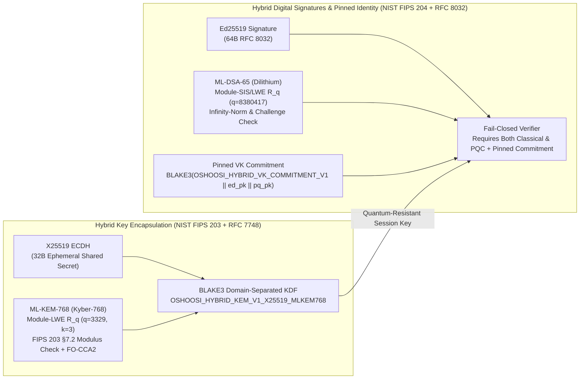

- **Universal WebUI Loading Spinners & Real-Time Status Feedback (`dashboard/src/index.html`, `dashboard/src/app.js`, `dashboard/src/style.css`)**:
  - **Login Page Status Banner & Button Spinners**: Immediate `#login-status-banner` (`#login-status-text`), `#login-btn-spinner`, and `#hello-btn-spinner` feedback during `initAuth()` probe, token validation, and Windows Hello WebAuthn challenges so the UI never displays a blank or unresponsive screen.
  - **Global Navigation & Fetch Progress Bar**: Top-of-viewport `#global-ui-progress-bar` shimmer, header `#global-ui-loading-pill` (`#global-ui-loading-text`), automatic button loading state (`setButtonLoadingState`), and view-switching status overlays (`showViewLoadingFeedback`) wired via `setupUniversalUiLoadingInterceptors()`.
- **Steady-State Memory Optimization (`83.36 MB` Working Set vs. `< 250 MB` Target)**:
  - Shared `OnceLock<Option<Arc<yara_x::Rules>>>` compilation across `YaraScanner` and `YaraXMemoryVoter` (`crates/osoosi-core/src/yara.rs`), bounded rule bundle filtering (`<= 256 KB`), and proactive per-process Working Set trimming (`proc_ws_mb > 220.0`) in `spawn_memory_watchdog()` (`crates/osoosi-core/src/memory_watchdog.rs`).

---

## 📸 Interactive WebUI Visual Gallery

OpenỌ̀ṣọ́ọ̀sì features an integrated, real-time security operations dashboard (`http://127.0.0.1:3030/` or `http://oshoosi.duckdns.org:3030/`). Full high-resolution screenshots and detailed architecture descriptions are available in the **[Visual Screenshots Gallery](docs/screenshots/README.md)**.

| View | Screenshot Preview | Description |
|---|---|---|
| **Detection Overview** (`#dashboard`) | <a href="docs/screenshots/README.md#1-detection-overview-dashboard"></a> | 25-card Detection Engine grid with voter weights, live telemetry charts, and system status counters. |
| **Threat Intelligence** (`#threats`) | <a href="docs/screenshots/README.md#2-threat-intelligence--containment-threats"></a> | Granular threat list with MITRE technique numbers (`[T1033]`, `[T1622]`), confidence scores, and instant isolation actions. |
| **ATT&CK® + ATLAS™ Matrix** (`#mitre`) | <a href="docs/screenshots/README.md#3-mitre-attck--atlas-matrix-navigator-mitre"></a> | 15-column heatmap matrix visualizer across 26,381 STIX objects, 323 techniques, 79 mitigations, and 177 APT profiles. |
| **Technique Inspector** (`#mitre-modal`) | <a href="docs/screenshots/README.md#4-mitre-technique-inspector-modal-mitre-modal"></a> | Deep-dive modal showing telemetry sources (Sysmon 1, Security 4688), correlated Sigma rules, and APT threat groups. |
| **Zone Gateway & RoT** (`#zone`) | <a href="docs/screenshots/README.md#5-zone-security-gateway--hardware-attestation-zone"></a> | 100% Security Score posture, TPM 2.0 hardware attestation, and sub-millisecond node cluster telemetry. |
| **Action Approvals** (`#approvals`) | <a href="docs/screenshots/README.md#6-autonomous-action-approval-queue-approvals"></a> | Autonomous response triage mode, Byzantine consensus quorum (0.70 threshold), and instant containment policy. |
| **Attack Graph** (`#process-map`) | <a href="docs/screenshots/README.md#7-process-map--attack-graph-process-map"></a> | Force-directed graph canvas mapping relationships (`executes`, `monitors`, `guards`, `mesh sync`) across protected subsystems. |
| **P2P Wire Mesh** (`#mesh`) | <a href="docs/screenshots/README.md#8-high-throughput-p2p-wire-mesh-network-mesh"></a> | libp2p GossipSub v1.2 cluster status, peer reputation scoring, and round-trip ping latencies. |
| **Forensic History** (`#history`) | <a href="docs/screenshots/README.md#9-forensic-audit--threat-history-history"></a> | Permanent tamper-evident event ledger indexing 110,400+ events with multi-criteria filtering and CSV export. |
| **Inbound Gossip Feed** (`#gossip`) | <a href="docs/screenshots/README.md#10-inter-node-gossip-feed-gossip"></a> | Cryptographic P2P threat broadcast feed with decentralized analyst feedback and consensus voting. |

*Explore the complete guided walkthrough in the **[docs/screenshots/README.md](docs/screenshots/README.md)** guide.*

---

## 🎯 What Is OshoosiClaw?

**OshoosiClaw** is a next-generation, autonomous **Endpoint Detection & Response (EDR)** agent built entirely in **Rust**. It implements a **Decentralized Immune System** model where:

- 🔐 **Trust** is mathematically proven through Merkle Proofs and S2S Certificates
- 🔬 **Detection** is powered by a **Unified Agentic Engine** (Sigma-X + Atomic IOC + SecureBERT + SOREL-20M + EMBER v2 + CAPA + FLOSS + HollowsHunter + YARA-X + ClamAV + Hayabusa + Chainsaw + Xori + RedBPF + Gemma 4 + Ollama)
- 🧠 **Intelligence** is shared peer-to-peer across a **Million-Node Mesh** with Zonal Sharding and Reputation Filtering
- 🛡️ **Runtime Security** is hardened via **Native OS Sandboxing** (Landlock on Linux, Job Objects on Windows)
- 🛡️ **Optional Sandboxing**: NVIDIA OpenShell (Docker required ONLY for Central Gateway nodes)
- 🔐 **Native Cryptography**: Integrated **`rust-openssl` (vendored)** for zero-dependency identity and trust management.
- 🛡️ **Response** is autonomous — quarantine, tarpit, deceive, or heal — based on confidence thresholds

### Why Rust?

An EDR agent sits at the most critical juncture of a system. It must be:
- **Memory-safe** without a garbage collector (no buffer overflows, no use-after-free)
- **Blazing fast** for real-time telemetry processing (sub-millisecond event analysis)
- **Impossible to exploit** — the agent itself must never become the attack vector

Rust delivers all three. No compromises.

---

### 🧠 Multi-Tiered AI Architecture

OshoosiClaw does not rely on a single ML model. It uses a **cascading AI pipeline** for defense-in-depth:

| Model Tier | Engine | Purpose |
|:-----------|:-------|:--------|
| **File Identification** | [**Google Magika**](https://github.com/google/magika) | Deep learning-based pre-filtering. Identifies PE/ELF/Scripts before heavy analysis. |
| **Precision Guardrail** | **Shannon Entropy** | Differentiates between legitimate browsers/tools and packed malware. |
| **Forensic Storytelling**| **OpenTelemetry (OTel)** | Wraps suspicious events into a context-rich forensic story instead of disconnected alerts. |
| **Static Malware Detection** | [**SOREL-20M**](https://github.com/sophos-ai/SOREL-20M) / [**EMBER**](https://github.com/elastic/ember) | Triple-model consensus (FFNN, LightGBM, MalConv) using 2,381-dimension EMBER v2 features. |
| **Behavioral NLP** | [**SecureBERT**](https://huggingface.co/ehsanaghaei/SecureBERT) | Security-domain BERT model that classifies PowerShell, CLI commands, and log sentences. |
| **Reasoning & Context** | [**Gemma 4 9B** / **Llama 3.1 8B**](https://ollama.com/) | Local LLMs (via Ollama) that reason about complex detection chains and decide on autonomous response. |
| **Logic Engine** | **Sigma Engine** | High-performance Sigma rule evaluation with LogSource-aware indexing. |
| **Indicator Matching** | **Atomic IOC** | Constant-time (O(1)) matching for malicious hashes, IPs, and domains. |

---

## 🤖 Agentic Architecture — True Autonomous Security

OshoosiClaw is not just a telemetry collector that sends logs to a cloud console for humans to review. It is a **true autonomous agent** with a real **Observe → Think → Act** loop:

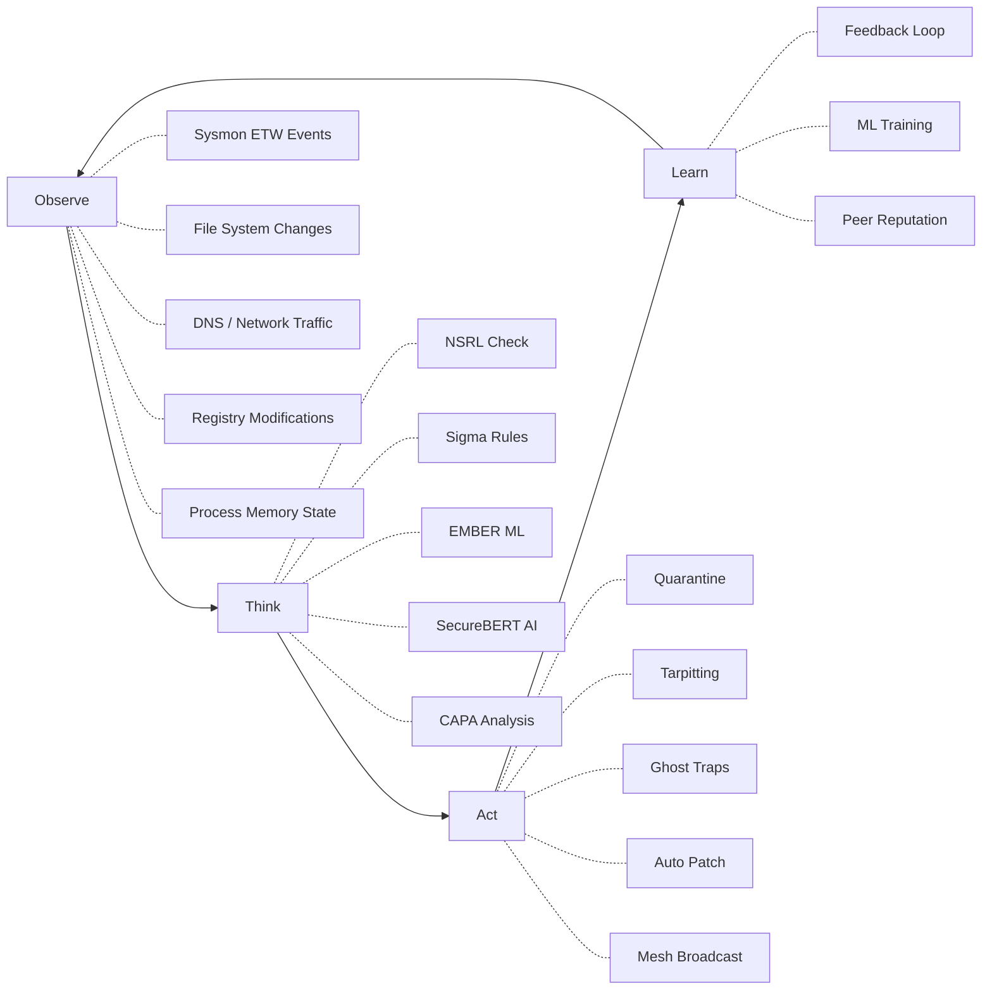

### What Makes It Agentic?

| Capability | Traditional EDR | OshoosiClaw |
|:-----------|:---------------|:------------|
| **Detection** | Sends alerts to cloud console | Detects, analyzes, and decides **locally** |
| **Response** | Human analyst clicks "quarantine" | Autonomous quarantine when confidence > threshold |
| **Learning** | Vendor pushes signature updates | `learn_behavior()` trains on local feedback loops |
| **Healing** | IT admin applies patches manually | Repair Engine discovers + applies patches transactionally |
| **Collaboration** | Central server aggregates data | P2P mesh shares intelligence with differential privacy |
| **Deception** | Static honeypots (if any) | Dynamic Ghost Traps + Tarpitting + Holographic Sharding |
| **Reasoning** | Rule-based matching only | LLM agent reasons about context and acts |
| **Sandboxing** | Direct host execution | Hardened via **NVIDIA OpenShell** L7 policies |
| **Scalability** | Hub-and-spoke (bottleneck) | **Million-Node Mesh** with Zonal Sharding |
| **Provisioning** | Admin installs tools manually | Hardened, auditable pipeline via `SecuredExecutor` |
| **Agent Defense** | Blind to AI/Agentic attacks | Real-time AI tool-injection, memory poisoning, & egress voters |

### AI Agent Security & Cloudflare Audit Integration

OshoosiClaw incorporates an on-device threat matrix designed specifically for autonomous agent runtimes, integrating the **Cloudflare Security Audit Framework** into active EDR consensus:

- **`AiSecurityAuditVoter`**: Evaluates Sysmon telemetry against prompt and tool injection attacks:
  - **Tool-Argument Injection**: Intercepts command chaining (`;`, `&&`, `|`), encoded PowerShell commands, and directory traversals (`../`, `..\`) executed via agent tool calls.
  - **Agent State & Memory Poisoning**: Blocks untrusted writes (Sysmon Event 11) targeting `.agents/memory.md`, `.agents/rules/`, and `osoosi.toml`.
  - **Process Memory Safety**: Flags unauthorized code/remote thread injection (Sysmon Events 8 & 10) into AI inference processes.
- **`AgenticPolicyVoter`**: Detects agentic breakout, policy violations, and adversarial prompt drift using dynamic minimax defense.
- **`AgentEgressVoter`**: Inspects network egress for DNS covert channels, exfiltration bursts, and suspicious endpoints.
- **CyberShield Developer & Inference Guardrails**: Local LLM runtimes (`llama-server.exe`, `ollama`, `vllm`) are recognized and safeguarded with strict C2 verification ($\ge 0.95$ threshold) before any defensive suspension actions.

### The Autonomous Decision Matrix

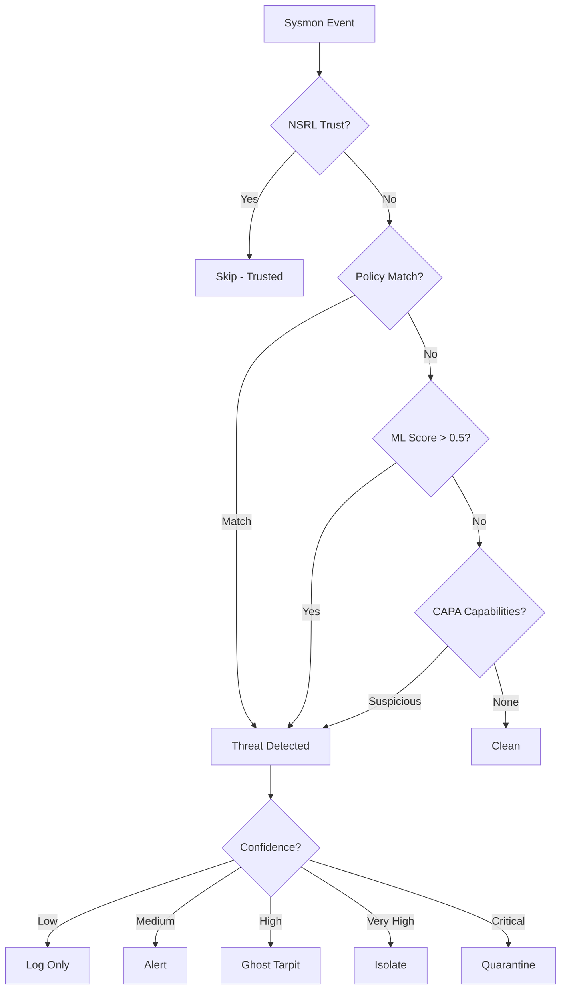

### Sysmon -> HollowsHunter Reactive Chain

When Sysmon's **kernel driver** reports a suspicious event, OshoosiClaw automatically escalates to **memory forensics**:

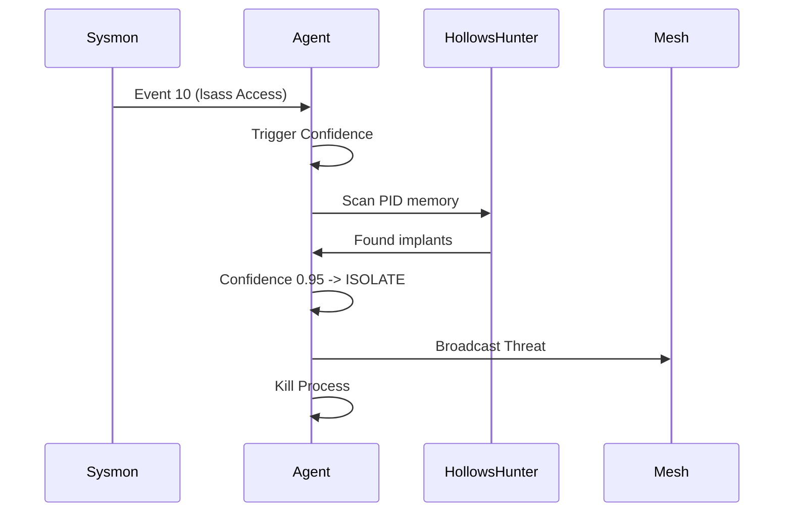

### C2 Detection Strategy (Windows/Linux/macOS)

OshoosiClaw implements a hybrid C2 detection model combining native Rust scanning with industry-standard behavioral engines:

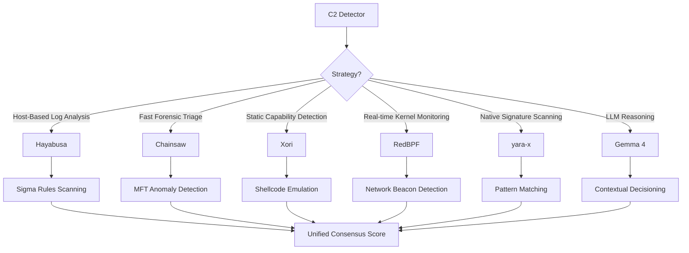

### 🧬 Autonomous Forensics & Lineage Discovery (New)

OshoosiClaw 1.2 introduces **Autonomous Lineage Auditing**, allowing the agent to reason about threats based on their full behavioral ancestry:

- **Recursive Process Walking**: The agent walks up the host's process tree to build a complete lineage (e.g., `cmd.exe` ← `powershell.exe` ← `wsmprovhost.exe`).
- **Contextual Risk Scoring**: The 100k-CVE brain scores processes based on the *combination* of product name, version, and ancestry.
- **Dynamic Feature Learning**: The model extracts features from observed lineages and autonomously builds a "Baseline of Normality" for the host environment.
- **PE-Native Discovery**: The `audit` command automatically extracts product information and versions directly from binary metadata, requiring zero user-provided metadata.

```powershell
# Perform an autonomous, lineage-aware forensic audit
.\osoosi.exe audit --product git.exe
```

---

<a id="-dns-telemetry-setup"></a>
## 🔍 DNS & Sysmon Telemetry Setup

OshoosiClaw actively inspects DNS queries using process-attributed domain analysis (`SysmonDnsQueryVoter`) to detect DGA domains, DNS tunneling, and C2 beacons.

### Why Sysmon May Not Capture DNS Traffic By Default
Sysmon **Event ID 22 (DnsQuery)** is disabled by default in vanilla Sysmon installations to prevent high event volume. To capture DNS traffic, use either **Method A** (Zero Install) or **Method B** (Sysmon Event ID 22):

#### Method A: Native Windows DNS Client Logging (Instant, Zero Installs)
Enable Windows native DNS Client operational logging. OshoosiClaw ingests this channel automatically:
```powershell
# Run in Administrator PowerShell:
wevtutil sl Microsoft-Windows-DNS-Client/Operational /e:true
```

#### Method B: Deploy Sysmon with Event ID 22 Configuration
Use the included [`config/sysmon-dns.xml`](config/sysmon-dns.xml) configuration:
```powershell
# Install Sysmon with DNS Query capture enabled:
.\Sysmon64.exe -i config\sysmon-dns.xml -accepteula

# Or update an existing Sysmon installation:
.\Sysmon64.exe -c config\sysmon-dns.xml
```

---

<a id="-two-host-mesh-consensus"></a>
## 🌐 Two-Host BFT Mesh & Hardware Attestation

OshoosiClaw supports multi-node clustering and edge deployments down to a strict **2-host cluster** ($N=2$):

* **Adaptive 2-Host BFT Quorum**: When both nodes are high-trust ($r \ge 0.85$, configured via `two_host_reputation_threshold`), unweighted quorum adapts to `2` to ensure consensus proceeds smoothly.
* **1-vs-1 Stalemate Detection**: A 1-vs-1 split vote (`optimal: 1, critical: 1`) is formally recognized as `stalemate_conflict = true`.
* **Designated Witness Arbiter**: An optional lightweight cloud observer or local witness can sign a `WitnessVote` over `SHA256(policy_id | witness_id | status | timestamp)` to break ties deterministically.
* **TPM 2.0 Silicon Attestation**: Evaluates remote PCR quotes and authenticates the manufacturer's silicon Endorsement Key (EK) certificate chain (Intel, AMD, Infineon, STMicro) before admitting nodes into the mesh.
* **Whole-Chain Revocation Checking**: Windows PE validation enforces `WTD_REVOKE_WHOLECHAIN` with graceful offline fallback (`WTD_CACHE_ONLY_URL_RETRIEVAL`).

---

<a id="-rl-adaptive-controller"></a>
## 🧠 6-Pillar Reinforcement Learning Adaptive Controller

OshoosiClaw incorporates an autonomous **6-Pillar Reinforcement Learning Adaptive Controller** (`osoosi-behavioral::rl_engine`) designed for real-time endpoint mitigation, contextual alert prioritization, and self-improving threat response. The architecture provides mathematical stability, continuous risk feedback, and hard OS safety invariants:

```mermaid
graph TD
    subgraph P1["Pillar 1: Algorithmic & Stability"]
        ANN["Exploration Annealing<br/>α(t) = max(α_min, α_0 / (1 + α_decay t))"]
        CHOL["Tikhonov Cholesky Inversion<br/>(L^-1)^T L^-1"]
        SM["Sherman-Morrison O(d²)<br/>Rank-1 Streaming Update"]
        CSG["Counterfactual Security Gain<br/>Δ_security = max(0, S_unmit - S_mit)"]
        CBOUND["Strict Contextual Boundary<br/>γ = 0.0 (No Temporal Leak)"]
    end

    subgraph P2["Pillar 2: State & Action Space"]
        REP["Shared Bilinear Model<br/>φ(s, a) = [s, e_a, s ⊗ e_a]"]
        DIM32["Unified 32-D State Vector<br/>Lineage (6) + Velocity (6) + Priors (6) + Mesh (6) + MITRE (8)"]
        ACT5["Structured 5-Tuple Action<br/>(Scope, Tier, Technique, Rollback, Telemetry)"]
    end

    subgraph P3["Pillar 3: Multi-Signal Reward & Safety"]
        MSR["Multi-Signal Reward Function<br/>R = w_acc S_acc - w_disrupt S_disrupt + w_dwell S_dwell - w_cost S_cost + w_cons S_cons - w_invar S_violation"]
        INVAR["Zero OS Destabilization Invariant<br/>Zero-Tolerance -500.0 Penalty & Safe Degradation (PIDs 0, 1, 4)"]
    end

    subgraph P4["Pillar 4: Scientific Regimes & Persistence"]
        REG["3 Clean Execution Regimes<br/>ColdRl | WarmPriorRl | FrozenTest"]
        SER["JSON & Bincode Checkpoint Engine<br/>Dimension & Invertibility Validation"]
    end

    subgraph P5["Pillar 5: Transparent Attribution & Advantage"]
        ADV["Direct Advantage Counting<br/>R_RL > R_heur | R_RL == R_heur | R_RL < R_heur"]
        REGRET["Oracle Counterfactual Regret<br/>Regret_t = max(0, R* - R(a_t))"]
    end

    subgraph P6["Pillar 6: Temporal Learning Dynamics"]
        DYN["Progression & Asymptotic Convergence<br/>R_late > R_early | lim_{t→∞} Regret_t → 0 | Rollback Drop"]
    end

    P1 --> P2 --> P3 --> P4 --> P5 --> P6
```

### Pillar 1: Algorithmic Fixes & Numerical Stability
- **Exploration Annealing $\alpha(t)$**: Contextual bandit exploration follows a monotonically decaying schedule:
  $$\alpha(t) = \max\left(\alpha_{\min}, \frac{\alpha_0}{1 + \alpha_{\text{decay}} t}\right)$$
  *(default $\alpha_0 = 1.0$, $\alpha_{\text{decay}} = 0.005$, $\alpha_{\min} = 0.05$)*, ensuring aggressive early hypothesis testing followed by asymptotic convergence to exploitation without freezing exploration.
- **Tikhonov-Regularized Cholesky Inversion**: When inverting empirical covariance matrices $A$, regularized Cholesky decomposition $M = \frac{1}{2}(A + A^T) + \lambda I$ solves $L L^T = M$ and inverts the lower triangular factor via forward substitution $L L^{-1} = I$, producing $A^{-1} = (L^{-1})^T L^{-1}$. Any non-finite inputs (NaNs/Infinities) or degenerate rank collapses are safely sanitized, falling back to scaled identity without panic.
- **Sherman-Morrison Rank-1 Streaming Updates**: Streaming updates to $A^{-1}$ are computed in $O(d^2)$ via:
  $$A_{t+1}^{-1} = A_t^{-1} - \frac{A_t^{-1} x x^T A_t^{-1}}{1 + x^T A_t^{-1} x}$$
  eliminating $O(d^3)$ full matrix inversion bottlenecks during high-throughput event processing. Periodic re-synchronization (every 500 steps) eliminates accumulated floating-point drift.
- **Counterfactual Security Gain**: Eliminates the "zero-gain" bias where containment actions received static rewards regardless of threat severity. Security gain is computed counterfactually against the unmitigated baseline threat severity $\Delta_{\text{security}} = \max(0.0, S_{\text{unmitigated}} - S_{\text{mitigated}}(a))$, rewarding actions in proportion to the risk eliminated.
- **Strict $\gamma = 0.0$ Contextual Boundaries**: Single-step alert triage and prioritization enforce $\gamma = 0.0$ to prevent temporal credit leakage across unrelated security events.

### Pillar 2: State & Action Representation
- **Shared Bilinear Bayesian Reward Model**: Implements cross-action transfer learning via joint state-action feature mapping:
  $$\phi(s, a) = [s_0 \dots s_{d-1}, e_0 \dots e_{K-1}, (s \otimes e_a)_0 \dots (s \otimes e_a)_{d \cdot K - 1}] \in \mathbb{R}^D$$
  where $D = d + K + d \cdot K$. Information learned from observing outcomes on one action propagates through shared parameter vector $\hat{\theta} = A^{-1} b$, accelerating convergence across sparse action spaces.
- **Unified 32-D EDR State Vector**: Normalizes and concatenates host, telemetry, detection priors, and mesh indicators into a unified 32-dimensional continuous feature space:
  - **Process Lineage (0..5)**: Tree depth, parent-child entropy, token elevation, kernel thread flag, parent anomaly score, privilege escalation jump.
  - **Telemetry Velocity (6..11)**: File modification rate $df/dt$, outbound network velocity $dn/dt$, page permission transition rate (PAGE_RW $\to$ PAGE_RWX), thread burst rate, handle duplication rate, CPU burst.
  - **Detection Priors (12..17)**: Static PE/Magika score, command-line token classifier, fast-path YARA/Sigma score, CAPA/FLOSS capability flag, behavioral sequence score, isolation forest anomaly score.
  - **Wire Mesh & Consensus (18..23)**: Peer anomaly score, cluster prevalence (10-min window), BFT consensus confidence, cluster alert velocity, peer threat rating, mesh quarantine vote ratio.
  - **Incident & MITRE ATT&CK Context (24..31)**: Lateral movement, credential dumping, persistence, defense evasion scores, unsigned binary flag, temp directory execution flag, container flag, overall threat score.
- **Structured 5-Tuple Action Space**: Dissects actions along 5 orthogonal operational dimensions: `StructuredEdrAction { scope, tier, technique, rollback, telemetry_level }`:
  - `PassiveObserve`: `(Process, PassiveObserve, JobObjectLimit, None, Standard)`
  - `TraceElevation`: `(Process, LowFrictionTriage, JobObjectLimit, None, VerboseEtw)`
  - `MemoryIntrospection`: `(Thread, LowFrictionTriage, ThreadSuspend, None, MemoryDump)`
  - `MicroContainment`: `(NetworkSocket, HighFrictionContainment, WfpFilter, RegistryRollback, VerboseEtw)`
  - `HardMitigation`: `(Host, HardMitigation, ProcessTerminate, SnapshotRevert, MemoryDump)`

### Pillar 3: Multi-Signal Reward & Safety Guardrails
- **Multi-Signal Reward Formulation**:
  $$R = w_{\text{acc}} S_{\text{acc}} - w_{\text{disrupt}} S_{\text{disrupt}} + w_{\text{dwell}} S_{\text{dwell}} - w_{\text{cost}} S_{\text{cost}} + w_{\text{consensus}} S_{\text{consensus}} - w_{\text{invar}} S_{\text{violation}}$$
  - $w_{\text{acc}} = 100.0$: Reward for counterfactual security risk reduction.
  - $w_{\text{disrupt}} = 150.0$: Penalty for disruptive false-positive containment actions.
  - $w_{\text{dwell}} = 10.0$: Reward for minimizing attacker dwell time on the host.
  - $w_{\text{cost}} = 5.0$: Telemetry and forensic capture overhead penalty.
  - $w_{\text{consensus}} = 20.0$: Alignment bonus with BFT mesh consensus verdicts.
  - $w_{\text{invar}} = 500.0$: Severe penalty for OS destabilization invariant violations.
- **Zero OS Destabilization Invariant**:
  - Deterministic `SafetyFilter` strictly blocks containment actions targeting critical system PIDs (PID 0 System Idle, PID 1 init/systemd/launchd, PID 4 NT Kernel) and protected OS binaries (`smss.exe`, `csrss.exe`, `wininit.exe`, `services.exe`, `lsass.exe`, `winlogon.exe`, `fontdrvhost.exe`, `dwm.exe`).
  - If the RL model selects `HardMitigation` or `MicroContainment` against a protected target, the action is **safely degraded** to non-destructive `MemoryIntrospection` and the policy is penalized with an unyielding **$-500.0$ penalty**.

### Pillar 4: Scientific Rigor & Checkpoint Persistence
- **Three Clean Execution Regimes**:
  - `ColdRl`: Policy trains online from scratch, establishing empirical baselines.
  - `WarmPriorRl`: Policy is pre-loaded with expert heuristic priors (biasing benign telemetry toward passive observation and critical indicators toward prompt triage), accelerating safe deployment in production.
  - `FrozenTest`: Strictly read-only evaluation mode. Neural weights and covariance matrices are locked; all learning updates (`update`, `train_step_cql`, `update_target_network`) are bypassed to prevent evaluation data leakage.
- **Robust Serialization & Dimension Validation**: Checkpoints serialize to JSON and Bincode with schema versioning (`version >= 1`). On deserialization, `validate()` verifies matrix squareness, row/column counts against declared state/action dimensions, and non-zero dimensions to protect against corrupted checkpoints.

### Pillar 5: Transparent Attribution & Advantage
- **Direct Advantage Counting (`AdvantageTracker`)**: Continuously tallies comparative performance against deterministic heuristic baselines:
  - $R_{\text{RL}} > R_{\text{heuristic}} + 10^{-4}$ (RL Advantage win rate %)
  - $|R_{\text{RL}} - R_{\text{heuristic}}| \le 10^{-4}$ (Verdicts identical %)
  - $R_{\text{RL}} < R_{\text{heuristic}} - 10^{-4}$ (Heuristic win rate %)
  - Reports cumulative advantage $\text{Advantage} = \bar{R}_{\text{RL}} - \bar{R}_{\text{heuristic}}$.
- **Oracle Counterfactual Regret**: Measures instantaneous policy regret against the counterfactual optimal oracle action: $\text{Regret}_t = \max(0.0, R^* - R(a_t))$, providing an objective benchmark of decision quality.

### Pillar 6: Temporal Learning Dynamics & Contextual Decision-Model Token Q-Learning
- **Early vs. Late Reward Progression**: Tracks early mean rewards ($t < 100$) versus late mean rewards ($t \ge 100$), mathematically verifying learning progression: $R_{\text{late}} > R_{\text{early}}$.
- **Asymptotic Regret Decay**: Proves policy convergence through monotonically decaying regret: $\lim_{t \to \infty} \text{Regret}_t \to 0$.
- **False-Positive Rollback Drops**: Tracks rollback strategies executed for false positives to monitor mitigation reversibility and friction reduction.
- **Closed-Loop Contextual Token Q-Learning (`learned_token_weights`)**: In addition to per-voter reliability calibration and 32-D contextual bandit updates, every verified consensus threat and analyst feedback outcome calls `ClefDecisionEngine::record_contextual_rl_feedback(&state_text, actual_malicious, reward_signal)`. The local decision engine extracts discriminative command-line tokens, DLL exports, and MITRE technique identifiers (e.g., `keymgr`, `krshowkeymgr`, `comsvcs`, `minidump`, `/etc/shadow`, `mimipenguin`, `t1003`, `t1555.004`) and updates bounded per-token Q-weights in `learned_token_weights` ($\Delta w_k = \text{clamp}(\eta \cdot r, -3.5, +4.0)$). This guarantees that signed OS LOLBins abused for local credential harvesting are immediately recognized and isolated (`verdict = "malicious"`, `action = "isolate"`, `human_escalation_required = false`) without ever allowing `Signed: true` or `NSRL` allowlisting to suppress active credential dumps.

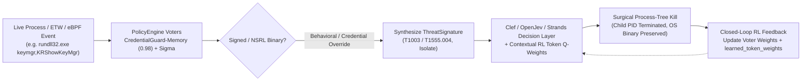

---

<a id="-adversarial-verification"></a>
## ⚡ Adversarial & Comprehensive Verification (148+ Tests Passed)

OshoosiClaw includes 148+ automated adversarial attack simulation and security verification tests evaluating host, peer, telemetry anti-blinding, policy engine sandbox, MITRE ATLAS voters, in-memory evasion resilience, and the 6-pillar RL adaptive controller:

```powershell
# 1. Attestation, Nonce Replay & TPM Quote Tampering (26 tests)
cargo test -p osoosi-trust --test adversarial_trust_tests

# 2. Wire Mesh, Peer Replay, Gossip Deduplication & STIX Wire Sync (39 tests)
cargo test -p osoosi-wire

# 3. Host Core, Byzantine Consensus & Quarantine Isolation (68 tests)
cargo test -p osoosi-core

# 4. Telemetry Anti-Blinding, BYOVD Rootkit Canaries & Sysmon (32 tests)
cargo test -p osoosi-telemetry

# 5. Policy Engine, Sandbox Surface, MITRE ATLAS Voters & Detection (52 tests)
cargo test -p osoosi-policy

# 6. In-Memory Evasion & Unbacked Thread Execution (4 tests)
cargo test -p osoosi-memory

# 7. Dashboard REST Endpoints, MITRE Matrix & STIX Streaming (5 tests)
cargo test -p osoosi-dashboard

# 8. MITRE Typing, Taint Flow & Configuration Integrity (12 tests)
cargo test -p osoosi-types

# 9. RL Adaptive Controller, Contextual Bandits & Safety Guardrails (21 tests)
cargo test -p osoosi-behavioral --test rl_tests
```

---

<a id="-synthetic-telemetry-canaries--anti-blinding-engine"></a>
## 🕊️ Synthetic Telemetry Canaries & Anti-Blinding Engine

To defend against advanced Bring Your Own Vulnerable Driver (BYOVD) rootkits, kernel-mode callback unhooking, and silent Event Tracing for Windows (ETW) blinding, OshoosiClaw incorporates an autonomous **Synthetic Telemetry Canary & Anti-Blinding Engine** (`osoosi-telemetry`).

Passive EDR sensors fail when an adversary loads a vulnerable kernel driver to zero out kernel notify routines or patch ETW provider registrations. In this blinded state, malicious activity continues unnoticed. OshoosiClaw solves this via active, closed-loop stimulus-response verification:

### 1. Closed-Loop Verification
- **Kernel Stimulus Probes**: Periodically dispatches lightweight, benign synthetic probes across three vital telemetry channels:
  - **Process Creation**: Sysmon Event 1 / Windows Security Event 4688 probes.
  - **DNS Resolution**: Sysmon Event 22 DNS query probes.
  - **Image Loading**: Sysmon Event 7 module/driver load events.
- **Deadline Monitoring & Alerting**: Each dispatched canary probe expects a corresponding kernel callback to arrive within a deterministic window. If kernel callbacks fail to arrive within the deadline, the engine declares telemetry tampering and triggers `BlindingAlert::ChannelMuted`.

### 2. Engineering Trade-Offs & Countermeasures

- **Trade-Off 1 (Event Noise & RL Drift Suppression)**: Continuous synthetic probes risk polluting forensic logs and causing drift in behavioral anomaly detection. OshoosiClaw tags canary events with ephemeral correlation IDs and filters them prior to SQLite persistence. Furthermore, canary events are removed from behavioral detector sliding windows and SkyRL baseline drift calculation, guaranteeing clean forensic databases and unpolluted ML models.
- **Trade-Off 2 (Adversary Whitelisting Defense)**: Attackers monitoring telemetry streams could attempt to fingerprint static canary probes to selectively whitelist them while blinding real activity. OshoosiClaw defends against probe discrimination using:
  - **Dynamic HMAC-SHA256 Tokens**: Cryptographic time-slotted payload signatures (`v1.<uuid>.<slot>.<sig>`).
  - **5 Polymorphic CLI Entrypoints**: Probes rotate randomly across `--canary-probe`, `--worker-heartbeat`, `--diag-session`, `--runtime-sync`, and `--telemetry-canary`.
  - **Timing Jitter**: Probes execute with pseudo-randomized sleep jitter (0–6000ms) and perform sub-millisecond fast-path exits.
- **Trade-Off 3 (In-Memory Evasion & Unbacked Thread Detection)**: To counter fileless malware and in-memory reflective injection that bypass process creation telemetry entirely, the `MemoryScanner::scan_unbacked_threads(pid)` routine performs deep Win32 thread introspection:
  - Inspects thread start addresses (`ThreadQuerySetWin32StartAddress`) and context instruction pointers (`GetThreadContext` RIP/EIP).
  - Queries memory descriptor headers via `VirtualQueryEx` to flag execution occurring in unbacked memory regions (`MEM_PRIVATE` / `MEM_MAPPED`) and executable RWX (`PAGE_EXECUTE_READWRITE`) pages.

---

<a id="-mitre-attck--atlas-enterprise-framework"></a>
## 🛡️ MITRE ATT&CK® Enterprise & MITRE ATLAS™ Framework (26,381 STIX Objects)

OshoosiClaw incorporates an authoritative, unified **MITRE ATT&CK® Enterprise** and **MITRE ATLAS™** (Adversarial Threat Landscape for Artificial-Intelligence Systems) knowledge base. By anchoring behavioral detection, kernel telemetry, AI agent defense, and peer-to-peer wire intelligence to standard STIX 2.1 taxonomy, the agent bridges classic OS-level endpoint detection with autonomous AI application security.

```mermaid
graph TD
    subgraph KB["Authoritative STIX 2.1 Knowledge Base (39.9 MB)"]
        S1["MITRE ATT&CK Enterprise (v19.2)"]
        S2["MITRE ATLAS™ (v2026.09)"]
        STIX["26,381 STIX Objects<br/>15 Tactics | 854 Techniques | 79 Mitigations | 177 Groups"]
        S1 --> STIX
        S2 --> STIX
    end

    subgraph WIRE["P2P Wire Mesh Synchronization (osoosi-wire)"]
        TOPIC["GossipSub Topic: osoosi-stix-sync-v1"]
        MAN["StixManifest (Blake3 Hash + Fast Object Count)"]
        DUAL["Zero-Downtime Dual-Target Sync<br/>(dashboard/src/ & dashboard/dist/)"]
        TOPIC --> MAN --> DUAL
    end

    subgraph ENGINE["Multi-Voter Consensus Engine (osoosi-policy)"]
        SIG["SigmaVoter (4,334 Rules)"]
        AIAUD["AiSecurityAuditVoter (ATLAS Execution & Memory)"]
        AGENT["AgenticVoter (Jailbreaks & Exfiltration)"]
        ZERO["ZeroDayVoter (Model Poisoning)"]
        CACHE["Hardened Cache (Zero Cross-Command Collisions)"]
    end

    subgraph WEBUI["WebUI Matrix Navigator (data-view='mitre')"]
        MAT["15-Column ATT&CK Heatmap Matrix"]
        MODAL["Technique Inspector & Mitigation Modal"]
        SYNC_BTN["On-Demand Wire Sync Trigger (/api/mitre/stix/update)"]
    end

    STIX --> WIRE
    STIX --> ENGINE
    WIRE --> ENGINE
    ENGINE --> WEBUI
    DUAL --> WEBUI
```

### 1. Unified STIX 2.1 Knowledge Base

OshoosiClaw embeds an authoritative STIX 2.1 bundle (`config/stix-atlas-attack-enterprise.json`, 39.9 MB, 26,381 STIX objects) uniting the latest **MITRE ATT&CK Enterprise (v19.2)** and **MITRE ATLAS (v2026.09)** frameworks into a high-performance, single-source-of-truth security catalog:

- **15 Enterprise Tactics**: Full operational coverage spanning Reconnaissance (`TA0043`) through Impact (`TA0040`), plus Defense Impairment (`TA0112`).
- **854 Unified Techniques**: Comprising 323 parent techniques and 531 granular sub-techniques spanning host, cloud, network, and AI runtime platforms.
- **79 Mitigations**: Spanning classical OS defenses (`M1010`–`M1056`) and specialized adversarial AI mitigations (`AML.M0005`–`AML.M0018`).
- **177 Threat Actor Groups**: Comprehensive profile mapping for advanced persistent threats (APTs) and ransomware syndicates (e.g., Lazarus Group, APT28/29, Scattered Spider, Volt Typhoon, Wizard Spider).
- **Correlation with 4,334 Sigma Detection Rules**: Every MITRE technique is cross-referenced against 4,334 production Sigma rules in `rules/sigma/`, mapping telemetry events (Sysmon, Windows Security, PowerShell Scriptblock) directly to ATT&CK tactics, responsible consensus voters, and required response actions.
- **Zero-Allocation Rust Architecture**: Parsed via `osoosi-types::mitre` using zero-copy streaming counters (`StixBundleFastCounter`) and sub-millisecond in-memory lookups, ensuring zero impact on host event processing throughput.

<a id="-p2p-wire-mesh-stix-synchronization"></a>
### 2. P2P Wire Mesh STIX Synchronization (`osoosi-wire`)

To ensure distributed nodes maintain an identical threat taxonomy without relying on centralized cloud servers or requiring agent restarts, OshoosiClaw implements peer-to-peer STIX synchronization over the libp2p wire mesh:

- **Dedicated GossipSub Topic (`osoosi-stix-sync-v1`)**: Nodes subscribe to a specialized gossip topic for broadcasting and receiving catalog manifest updates across the mesh.
- **Cryptographic `StixManifest` Verification**: Catalog distribution is guarded by cryptographic manifests containing:
  - `version`: STIX specification release (`2.1`).
  - `blake3_hash`: 256-bit Blake3 cryptographic checksum of the bundle payload.
  - `object_count`: Exact verified STIX object count (26,381 objects).
  - `timestamp`: UTC timestamp of the catalog generation.
  - `source`: Canonical upstream distribution endpoint.
- **Dynamic Zero-Downtime Hot-Reloading**: Incoming wire manifests trigger in-memory catalog validation. If the local Blake3 digest differs, the daemon hot-reloads the updated matrix and voter routes with zero daemon downtime or telemetry interruption.
- **Dual-Target Sync Parity**: The catalog generator and wire synchronizer enforce 100% byte-for-byte parity across development (`dashboard/src/`) and production (`dashboard/dist/`) directories, ensuring both live development servers and production binary builds present identical matrix views.

### 3. AI Threat Detectors & Autonomous Consensus Defenses (MITRE ATLAS™)

As AI agents and LLM runtimes become integrated into enterprise infrastructure, they introduce new attack vectors such as prompt injection, tool hijacking, and model poisoning. OshoosiClaw addresses these threats via specialized consensus voters (`AiSecurityAuditVoter` and `AgenticVoter`) that map directly to canonical MITRE ATLAS technique IDs:

| Technique ID | Technique Name / Vector | Consensus Voter | Autonomous Response | Attack Vector & Evaluation Mechanics |
|:---|:---|:---|:---|:---|
| `AML.T0043` | Tool Argument Injection & Prompt Chaining | `AiSecurityAuditVoter` | `ResponseAction::Tarpit` | Command chaining (`;`, `&&`, `&#124;`), encoded scripts (`-enc`), and nested subshell executions injected into agent tool parameters. |
| `AML.T0044` | Tool Path Traversal & Sensitive File Read | `AiSecurityAuditVoter` | `ResponseAction::Tarpit` | Directory traversal (`../`, `..\`) targeting host credentials (`id_rsa`, `.env`, `SAM`, `System32`) via agent tool inputs. |
| `AML.T0048` | Agent State & Memory Poisoning | `AiSecurityAuditVoter` | `ResponseAction::Isolate` | Unauthorized writes (Sysmon Event 11) tampering with long-term memory stores (`.agents/memory.md`), policies, or `osoosi.toml`. |
| `AML.T0040` | AI Runtime Remote Thread Injection | `AiSecurityAuditVoter` | `ResponseAction::Isolate` | Foreign non-AI processes attempting remote thread creation (`CreateRemoteThread`, Event 8) into runtime workers (`python.exe`, `ollama.exe`). |
| `AML.T0029` | Disarm AI Safeguards & Runtime Memory Tampering | `AiSecurityAuditVoter` | `ResponseAction::Isolate` | Foreign processes requesting `PROCESS_VM_WRITE &#124; PROCESS_VM_OPERATION` (Event 10) to patch security hooks or disarm guardrails in AI memory. |
| `AML.T0051` | LLM Jailbreaks & Obfuscated Injections | `AgenticVoter` | `ResponseAction::Tarpit` | Base64-encoded, caret-escaped (`p^w^r^s^h^e^l^l`), and polymorphic jailbreak prompts attempting LLM safety bypass. |
| `AML.T0054` | Training Data / System Prompt Exfiltration | `AgenticVoter` | `ResponseAction::Alert` | Covert exfiltration of system prompt directives, proprietary RAG context, or embedded credentials to external endpoints. |
| `AML.T0042` | Denial of ML Service (Sponge / Token Exhaustion) | `AgenticVoter` | `ResponseAction::Tarpit` | Algorithmic sponge attacks, recursive tool loops, and quadratic token expansion designed to starve inference compute and freeze response. |
| `AML.T0031` | Model Poisoning / Serialization Backdoors | `ZeroDayVoter` | `ResponseAction::Isolate` | Deserialization backdoors (`pickle`, `PyTorch` weights) and poisoned model checkpoints attempting unbacked code execution. |

#### Deduplication Cache Hardening

Under high-frequency event streams, the multi-voter consensus engine caches evaluation verdicts to sustain sub-millisecond latencies. To prevent cross-command verdict collisions where benign and malicious invocations of the same binary might share a verdict, cache keys are hardened to a multi-attribute tuple:

$$\text{CacheKey} = \text{Blake3}(\text{BinaryHash} \parallel \text{ProcessName} \parallel \text{ReasonCategory} \parallel \text{CommandLine} \parallel \text{TargetFilename})$$

This ensures that while identical repetitive events hit the sub-millisecond fast path, variations in arguments (e.g., benign `python.exe test.py` vs adversarial `python.exe -c "evil()"`) or target file paths are evaluated independently with 100% precision.

### 4. WebUI ATT&CK Matrix Navigator (`data-view="mitre"`)

The built-in web dashboard provides an interactive **MITRE ATT&CK & ATLAS Matrix Navigator**:

- **15-Column Heatmap Visualizer**: Renders the complete ATT&CK matrix from Reconnaissance (`TA0043`) to Impact (`TA0040`), color-coded by detection severity and live telemetry occurrences.
- **Deep Technique Inspector Modal**: Clicking any technique or sub-technique displays:
  - Technical description and affected platforms.
  - Correlated Sigma detection rules from `rules/sigma/`.
  - Required kernel telemetry data sources (Sysmon Event IDs, Windows Event Logs).
  - Relevant mitigations (`M1010`–`M1056`, `AML.M0005`–`AML.M0018`) and known threat actor group associations.
  - Responsible consensus voter and autonomous response action.
- **Search & Multi-Dimensional Filtering**: Search by keyword, technique ID, tactic, platform, or APT threat actor.
- **Live STIX Status & Mesh Sync**: Displays real-time catalog metadata (`MITRE ATT&CK Enterprise + ATLAS v2026.09 (26,381 objects)`), Blake3 integrity hash, and provides an on-demand **Sync Wire Catalog** action triggering `POST /api/mitre/stix/update`.

---

<a id="-active-process--memory-tarpit-hollowing-containment"></a>
## 🪤 Active Process & Memory Tarpit, Hollowing Interception & T1136 Containment

To prevent adversaries and penetration testing automation (such as Atomic Red Team / `edr_tester.py`) from executing system-altering persistence, tampering, or process hollowing, OpenỌ̀ṣọ́ọ̀sì implements low-level thread interception, memory tampering defenses, differential privacy telemetry perturbation, and autonomous rollback across all 266 MITRE ATT&CK patterns:

```
                                  ADVERSARY TAMPERING INTERCEPTION
                                  
   Process Spawn Event              CREATE_SUSPENDED                Remote VirtualAllocEx / Write
 [Sysmon 1 / Win 4688] ──────────► [0x00000004 Flag] ─────────────► [SetThreadContext Hijack]
          │                                                               │
          ▼                                                               ▼
   Pattern Matching                                            CONFIRMED HOLLOWING (T1055)
   (e.g. T1136.001 net user /add)                                        │
          │                                                               ▼
          ▼                                                   ActiveProcessTarpit::trap_pid
   is_system_critical & LOLBin Disambiguation                [SuspendThread Asymmetric Sleep Loop]
   (net.exe / powershell.exe NOT immune)                                 │
          │                                                               ▼
          ▼                                                    Instruction Pointer Frozen
   Deploy Active Process Tarpit & Containment                    (Zero CPU cycles to execute payload)
   (Account Disabled: net user <name> /active:no)                            │
          │                                                               ▼
          └──────────────────────────────────────────────────► Laplace Differential Privacy Noise
                                                               [Privatized Incident Vector Broadcast]
```

### 1. Active Process Tarpit (Thread-Level Asymmetric Trapping)
- **Low-Level Thread Interception**: Rather than merely lowering scheduling priority to `IDLE_PRIORITY_CLASS` (which allows fast command-line utilities like `net.exe` to complete in milliseconds), `ActiveProcessTarpit` takes snapshots of all executing threads (`CreateToolhelp32Snapshot(TH32CS_SNAPTHREAD)`), opens thread handles via `OpenThread(THREAD_SUSPEND_RESUME)`, and invokes `SuspendThread`.
- **Asymmetric Latency Cycles**: Offending threads are held frozen for an interval (default 500ms) with brief 10ms observation windows, starving attacker automation, spoiling timing attacks, and freezing execution before malicious mutations reach disk or the Windows Security Accounts Manager (SAM).
- **Graceful Release & Cleanup**: If an analyst clears an alert or marks a false positive, `release_pid` cleanly unwinds thread suspensions and restores normal execution state.

### 2. Process Hollowing & Remote Memory Injection Interception (`osoosi-telemetry`)
- **`CREATE_SUSPENDED` Flag Interception**: Monitors process creation flags for `0x00000004` (`CREATE_SUSPENDED`), registering candidate containers in `ProcessHollowingDetector`.
- **Correlated Memory Tampering**: Tracks subsequent remote memory writes (`WriteProcessMemory`, `NtWriteVirtualMemory`, Sysmon Event 8/10) and thread context redirection (`SetThreadContext`).
- **Pre-Execution Trapping**: When a suspended process receives foreign memory writes or redirected entry points, the EDR trips `ActiveProcessTarpit` before the main thread can be resumed, preventing shellcode execution.

### 3. Differential Privacy Telemetry Perturbation (`osoosi-dp`)
- **Laplace Mechanism ($\Delta S / \epsilon$)**: Implements `LocalTelemetryNoiseEngine` using inverse CDF sampling over uniform randomness to inject calibrated noise into local telemetry counters:
  $$\text{Noise} = -\frac{\Delta S}{\epsilon} \cdot \text{sgn}(u) \cdot \ln(1 - 2|u|), \quad u \in (-0.5, 0.5)$$
- **Zero Host Leakage**: Security incident vectors, honeypot tripwire counts, and anomaly metrics are privatized before being shared across the P2P wire mesh or centralized aggregation backends, ensuring fleet-wide intelligence sharing without exposing internal host topologies or user identities.

### 4. LOLBin Disambiguation & Autonomous Non-Destructive Account Containment (`T1136.001`)
- **Eliminating the System Critical Double-Veto**: Refined `is_system_critical` and Windows SFC verification (`validate_file_safety_with_veto`) so that while core OS infrastructure (PIDs 0, 1, 4, `smss.exe`, `csrss.exe`, `services.exe`, `lsass.exe`) remains strictly protected against termination, administrative living-off-the-land binaries (`net.exe`, `net1.exe`, `powershell.exe`, `cmd.exe`, `wmic.exe`, `schtasks.exe`) executing high-risk adversarial TTPs are no longer immune to autonomous containment.
- **Autonomous Non-Destructive Containment**: When unauthorized local account creation (`net user <name> /add` or `New-LocalUser -Name <name>`) is detected, the EDR traps the process and immediately dispatches an autonomous non-destructive containment task (`net user <name> /active:no` or `Disable-LocalUser -Name <name> -ErrorAction SilentlyContinue`), logging the successful remediation in the forensic ledger.
- **Audit-Mode Defense Guarantee**: Even when operating in `AutonomyMode::Audit`, detected MITRE catalog attacks (including all 266 technique patterns from `D:\harfile\edrtest\docs\MITRE_TECHNIQUES_CATALOG.md` covering persistence, credential dumping, ransomware encryption, shadow copy deletion, and process hollowing) automatically trigger active thread trapping and autonomous rollback, preventing host compromise during audit runs.

---

<a id="-high-throughput-p2p-mesh--consensus-stability"></a>
## 🌐 High-Throughput P2P Mesh & Consensus Stability

To sustain enterprise throughput under high-volume event bursts without saturating peer-to-peer network bandwidth or stalling real-time threat response, OshoosiClaw incorporates dedicated mesh deduplication, asynchronous consensus optimization, and correlator alarm debouncing:

### 1. GossipSub Deduplication & Noise Suppression
- **Dynamic Merkle Root Caching**: Upstream `last_audit_proof` Merkle root deduplication in `MeshNode` prevents redundant gossip chatter across the network when audit ledger roots remain unchanged.
- **Resilient Error Recovery**: Robust publish handling ensures that `PublishError::InsufficientPeers` leaves `last_audit_proof` unlocked, allowing bootstrap re-broadcasts to automatically succeed once remote peers join the mesh.
- **Trace-Level Noise Suppression**: GossipSub duplicate rejection returns (`PublishError::Duplicate`) are handled gracefully and demoted to `trace!` logging, preventing normal distributed duplicate re-announcements from polluting operational logs.
- **Subscriber Log Filtering**: Configured subscriber log filter `libp2p_gossipsub=error` in both file and console loggers to silence normal distributed duplicate cache rejections and protocol noise.
- **Peer Audit Proof Ingestion**: Fully handled incoming peer audit proofs on `audit_proof_topic` with debug-level logging and validation.

### 2. Consensus Memory Inspection Voter Optimization
- **Heavy Voter Categorization**: `MemoryInspectionVoter` is categorized as heavy (`fn is_heavy(&self) -> bool { true }`), enabling the consensus engine to automatically bypass heavy PE memory and unbacked thread scans during `SILENT` mode and high-volume event bursts.
- **Asynchronous 2-Second Timeout**: Internal 2-second timeout wraps asynchronous memory inspections via `tokio::task::spawn_blocking`, eliminating 30-second voter consensus stalls (`[CONSENSUS] voter TIMEOUT — treating as abstain`) and guaranteeing deterministic consensus evaluation latencies.

### 3. Correlator Alarm Storm Hardening & Threat Deduplication
- **Windows System PID Protection**: Built-in safeguards automatically protect Windows System PIDs (`0`, `4`) and unknown image paths from aggressive correlation and isolation actions.
- **Exponential Score Decay & Alert Debouncing**: Process suspicion scores dynamically decay over time (reducing stale conviction), coupled with a 60-second alert debouncing window per process context to suppress alarm fatigue.
- **Deterministic Suppression Cache**: Alert suppression cache keyed on process name, threat category, and binary hash (`{hash}:{process_name}:{category}`) instead of transient UUIDs, preventing alert storms while maintaining an accurate forensic audit trail.

---

<a id="-quick-start"></a>
<a id="quick-start"></a>
## ⚡ Quick Start

### Prerequisites

| Component | Version | Purpose |
|:----------|:--------|:--------|
| **Rust** | 1.75+ | Core compilation |
| **Sysmon** | 15.0+ | Kernel-level telemetry (Windows) |
| **ClamAV** | 1.0+ | Signature-based AV scanning |
| **Ollama** | 0.1.0+ | Local LLM inference (optional) |

### Windows Installer (MSI)

OshoosiClaw provides a standalone, production-ready Windows Installer (`OshoosiClaw.msi`, ~25MB) built with WiX v5 that bundles all necessary dependencies for immediate zero-touch deployment:
- `osoosi.exe`: Release binary automatically registered to the system `PATH`.
- `onnxruntime.dll`: Root ONNX Runtime (1.22.x) engine for local ML inference.
- Signed Configurations: Cryptographically signed policies (`osoosi.toml` + `osoosi.toml.sign`, `openshell-policy.yaml`, `firewall_allowlist.txt`).
- Sysmon 4.91 Profiles: Production ETW profiles (`sysmon-dns.xml` and `sysmonconfig-export.xml`).
- Web UI Assets: Complete dashboard distribution assets (`dashboard/dist/*`).

#### Installation Methods

```powershell
# Interactive installation
msiexec /i OshoosiClaw.msi

# Silent / unattended background deployment
msiexec /i OshoosiClaw.msi /quiet /qn
```

#### Building the MSI from Source (WiX v5)

```powershell
# 1. Compile release binary and sign configurations
cargo build --release -p osoosi-cli
.\target\release\osoosi.exe sign-configs

# 2. Build standalone MSI directly using WiX v5
wix build wix\OshoosiClaw.wxs -arch x64 -out OshoosiClaw.msi

# Or run the automated deployment packager
powershell -ExecutionPolicy Bypass -File scripts\package.ps1
```

### Build From Source

```powershell
# Clone the repository
git clone https://github.com/oyesanyf/OshoosiClaw.git
cd OshoosiClaw

# Build with all features
cargo build --release --all-features

# One-time setup: install dependencies + grant permissions
.\target\release\osoosi.exe grant-access

# Start the autonomous security loop
.\target\release\osoosi.exe start

# Optional: grant-access and start in one go (global flag works before or after the subcommand)
.\target\release\osoosi.exe start --grant-access
# .\target\release\osoosi.exe --grant-access start
```

On each `start`, the agent **discovers** `git` and `openshell` from `PATH` and standard locations, then **persists** absolute paths under `%APPDATA%\osoosi\tool_paths.json` (see [Environment Variables](#environment-variables)). This avoids repeated lookups on later runs.

The **osoosi-dashboard** crate is a workspace member and a direct dependency of **osoosi-cli** (Axum web UI for `start --dashboard` and the `dashboard` subcommand). Standard `cargo build --release` compiles it; you should not exclude it from release builds.

### 🛡️ Windows Smart App Control (SAC) & Code Integrity Notes

On Windows 11 systems with **Smart App Control (SAC)** or AppLocker / Windows Defender Application Control (WDAC) enabled in evaluation or enforcement mode, policy enforcement events may be recorded in Event Viewer under `Microsoft-Windows-CodeIntegrity/Operational` (Event IDs **3077** or **3118**: `An Application Control policy has blocked this file`).

- **Procedural Macro DLL Reputation Delays**: During release compilation on fresh checkouts, the Rust compiler links and executes host procedural macro dynamic libraries (such as `zeroize_derive-*.dll` in `target/release/deps`). Windows Smart App Control submits newly compiled procedural macro binaries to cloud reputation services. If cloud verification is still resolving, SAC may temporarily block the DLL from loading, causing `rustc` to emit cascading compilation errors:
  ```text
  error[E0463]: can't find crate for `zeroize_derive` which `zeroize` depends on
  ```
- **Remediation**: This is a transient cloud reputation lookup delay on unsigned host build artifacts. Once the local reputation cache settles (typically within 10–30 seconds), simply query or re-run compilation to proceed cleanly:
  ```powershell
  # Query the built binary or re-run release compilation once reputation settles
  cargo run --release -p osoosi-cli -- --help
  cargo build --release
  ```

### Linux Packages (`v1.2.0` — `.deb`, `.rpm`, `.tar.gz`)

Every release ships GPG-signed (`PUBLIC_KEY.asc`) and SLSA in-toto DSSE-attested Linux packages for Debian/Ubuntu (`.deb`), RHEL/Fedora/Rocky (`.rpm`), and portable x86_64 systems (`.tar.gz`):

```bash
# 1. Verify OpenPGP detached signature against PUBLIC_KEY.asc
gpg --import PUBLIC_KEY.asc
gpg --verify oshoosiclaw_1.2.0_amd64.deb.asc oshoosiclaw_1.2.0_amd64.deb

# 2a. Debian / Ubuntu (.deb)
sudo dpkg -i oshoosiclaw_1.2.0_amd64.deb
osoosi --version

# 2b. RHEL / Fedora / Rocky / AlmaLinux (.rpm)
sudo rpm -Uvh oshoosiclaw-1.2.0-1.x86_64.rpm
osoosi --version

# 2c. Portable Linux Tarball (.tar.gz)
tar -xzf oshoosiclaw-1.2.0-linux-x86_64.tar.gz
sudo ./install.sh
```

### 🐳 Hardened Docker & Docker Compose (`CIS Docker Benchmark Level 2`)

OpenỌ̀ṣọ́ọ̀sì ships a multi-stage, zero-trust container image (`ghcr.io/oyesanyf/oshoosiclaw:1.2.0`) engineered to satisfy **OpenSSF Scorecard `Pinned-Dependencies` (10/10)** and **CIS Docker Benchmark v1.6 Level 2**:

- **Immutable SHA-256 Base Digests**: Both `builder` and `runtime` stages pin `ubuntu:24.04@sha256:68ee22004a9109b44973313b02ff7b1de250f1de0f5ecb628d73f579aaff33ac`.
- **Non-Root Execution (`UID 65532:65532`)**: Executes under a dedicated unprivileged `osoosi:osoosi` account (`/usr/sbin/nologin`) with the `root` account locked (`passwd -l root`).
- **Immutable Code & Read-Only RootFS**: `/app/osoosi` (`0555`) and `/app/dashboard/dist` (`0444`) are owned by `0:0` (`root:root`), preventing runtime binary or WebUI self-modification even under a hypothetical RCE.
- **Zero SUID/SGID & Package Manager Purge**: All `SUID`/`SGID` bits are stripped across the filesystem and `apt`/`dpkg` are removed from the runtime image.
- **Kernel Capability Drop & Seccomp Filtering**: Drops all Linux capabilities (`--cap-drop=ALL`), enforces `no-new-privileges:true`, and applies a custom 52-syscall blocklist (`docker/seccomp-oshoosi.json`).

```mermaid
flowchart LR
    subgraph Stage1["Stage 1: Builder (Digest-Pinned)"]
        S1A["Rust Workspace / Pre-Built ELF"] --> S1B["strip --strip-unneeded"]
        S1B --> S1C["chmod 0555 /out/app/osoosi"]
        S1C --> S1D["chmod 0444 /out/app/dashboard/dist"]
    end

    subgraph Stage2["Stage 2: Hardened Runtime (UID 65532:65532)"]
        S2A["Purge apt/dpkg & Strip All SUID/SGID"] --> S2B["Immutable 0:0 /app/osoosi & /app/dashboard"]
        S2B --> S2C["Isolated 65532:65532 Volumes (/app/database, /app/logs, /app/quarantine)"]
    end

    subgraph Confinement["Runtime Kernel Confinement"]
        C1["--read-only RootFS + noexec /tmp tmpfs"]
        C2["--cap-drop=ALL + no-new-privileges:true"]
        C3["docker/seccomp-oshoosi.json (52 Syscalls Blocked)"]
    end

    Stage1 --> Stage2 --> Confinement
```

```bash
# Build the hardened multi-stage image locally
docker build -t ghcr.io/oyesanyf/oshoosiclaw:1.2.0 .

# Run with read-only rootfs, dropped capabilities, and seccomp confinement
docker run -d \
  --name oshoosi-edr \
  --user 65532:65532 \
  --read-only \
  --cap-drop=ALL \
  --security-opt=no-new-privileges:true \
  --security-opt seccomp=docker/seccomp-oshoosi.json \
  --tmpfs /tmp:rw,noexec,nosuid,nodev,size=64m \
  -p 127.0.0.1:3031:3030 \
  ghcr.io/oyesanyf/oshoosiclaw:1.2.0

# Or launch via the hardened docker-compose.yml profile
docker compose up -d --build
```

---

<a id="-architecture"></a>
<a id="architecture"></a>
## 🏛️ Architecture

OshoosiClaw is built as a **modular monolith** — 20 specialized crates that compile into a single, high-performance binary.

```
┌─────────────────────────────────────────────────────────────────────┐
│                        OshoosiClaw Agent                            │
├─────────────────────────────────────────────────────────────────────┤
│  ┌──────────┐  ┌──────────┐  ┌──────────┐  ┌──────────────────┐   │
│  │ Osoosi   │  │ Ogun     │  │ Erinle   │  │ Ode              │   │
│  │ Scanner  │  │ Kernel   │  │ Healer   │  │ Orchestrator     │   │
│  │ (User)   │  │ (Sysmon) │  │ (Repair) │  │ (Core Service)   │   │
│  └────┬─────┘  └────┬─────┘  └────┬─────┘  └────────┬─────────┘   │
│       │              │              │                 │             │
│  ┌────▼──────────────▼──────────────▼─────────────────▼──────────┐ │
│  │                    EdrOrchestrator                             │ │
│  │  ┌─────────────────────────────────────────────────────────┐  │ │
│  │  │              Detection Pipeline (12 Engines)             │  │ │
│  │  │ Magika → ClamAV → YARA → EMBER ML → CAPA → FLOSS →      │  │ │
│  │  │ Hayabusa → Chainsaw → Xori → RedBPF → Gemma4 → yara-x   │  │ │
│  │  └─────────────────────────────────────────────────────────┘  │ │
│  │  ┌─────────────────────────────────────────────────────────┐  │ │
│  │  │            Memory Forensics (HollowsHunter)              │  │ │
│  │  │  Sysmon ETW → ProcessAccess/lsass → Memory Scan → Alert  │  │ │
│  │  └─────────────────────────────────────────────────────────┘  │ │
│  │  ┌─────────────────────────────────────────────────────────┐  │ │
│  │  │              Behavioral AI Cascade                       │  │ │
│  │  │  CoLog Anomaly → SecureBERT → Gemma 3 → OpenAI          │  │ │
│  │  └─────────────────────────────────────────────────────────┘  │ │
│  └───────────────────────────────────────────────────────────────┘ │
│       │              │              │                 │             │
│  ┌────▼────┐  ┌──────▼────┐  ┌─────▼────┐  ┌────────▼──────────┐ │
│  │ SQLite  │  │ libp2p    │  │ Merkle   │  │ Active            │ │
│  │ Memory  │  │ Mesh      │  │ Audit    │  │ Response          │ │
│  │ Store   │  │ Network   │  │ Trail    │  │ (Ghost/Tarpit)    │ │
│  └─────────┘  └───────────┘  └──────────┘  └───────────────────┘ │
└─────────────────────────────────────────────────────────────────────┘
```

### Crate Map

| Crate | Yoruba Spirit | Responsibility |
|:------|:-------------|:---------------|
| `osoosi-cli` | — | CLI interface for managing and running the agent |
| `osoosi-core` | **Ode** *(Orchestrator)* | Coordinates telemetry, policy, mesh, and response |
| `osoosi-telemetry` | **Ogun** *(Iron Layer)* | Cross-platform event ingestion (Sysmon/Auditd/ESF) + FIM |
| `osoosi-policy` | — | Detection engines (STGC, Sigma, KEV, NSRL feeds) |
| `osoosi-model` | — | ML model training, Magika/ClamAV malware scanning |
| `osoosi-behavioral` | — | SecureBERT + Gemma 4 + OpenAI behavioral AI |
| `osoosi-wire` | — | P2P mesh (libp2p Gossipsub), peer join gate, reputation |
| `osoosi-trust` | — | Identity (DID), Merkle Proofs, certificate issuing |
| `osoosi-audit` | — | Tamper-evident Merkle Logchain |
| `osoosi-repair` | **Erinle** *(Healer)* | Patch discovery and transactional patch engine |
| `osoosi-runtime` | — | Active response: deception (ghost files) and tarpit |
| `osoosi-memory` | — | Local SQLite persistence and threat intelligence store |
| `osoosi-dashboard` | — | Web dashboard UI and API endpoints (Axum) |
| `osoosi-sandbox` | — | WASM sandbox for isolated tool execution |
| `osoosi-dp` | — | Differential privacy + Fully Homomorphic Encryption |
| `osoosi-hexpatch` | — | Dynamic binary self-healing (HexPatch) |
| `osoosi-exporter` | — | Telemetry exporter (SIEM/Webhook integration) |
| `osoosi-types` | — | Unified data schemas for all crate communication |
| `hex-patch` | — | Binary patching utility |
| `test-peer` | — | P2P mesh testing utility |

---

## 🔬 Detection Arsenal

OshoosiClaw uses a **six-engine detection pipeline** — a depth of analysis that exceeds most commercial EDR products.

### The Mandiant Forensic Trio

| Tool | What It Does | Detects |
|:-----|:-------------|:--------|
| **CAPA** | Extracts binary *capabilities* | What can this file DO? (keylogging, C2, exfiltration) |
| **FLOSS** | De-obfuscates hidden strings | Hidden C2 domains, IPs, API keys, config data |
| **HollowsHunter** | Scans live process memory | Process hollowing, DLL injection, shellcode, API hooks |

### Full Detection Stack

| Layer | Engine | Technique | Coverage |
|:------|:-------|:----------|:---------|
| 1️⃣ | **Magika** (Google) | AI file-type identification | Prevents extension spoofing |
| 2️⃣ | **ClamAV** | Signature-based AV | 8M+ known malware signatures |
| 3️⃣ | **YARA** | Pattern matching rules | Custom + community threat rules |
| 4️⃣ | **EMBER ML** | 54-feature PE static analysis | Zero-day malware classification |
| 5️⃣ | **Mandiant CAPA** | Capability extraction | Behavioral intent analysis |
| 6️⃣ | **Mandiant FLOSS** | String de-obfuscation | Hidden C2/config extraction |
| 7️⃣ | **HollowsHunter** | Live memory forensics | In-memory implant detection |
| 8️⃣ | **Hayabusa** | Sigma Rule Engine | Host-based C2 log analysis (Post-Execution) |
| 9️⃣ | **Chainsaw** | Fast Forensic Triage | MFT anomalies & triage artifacts |
| 🔟 | **Xori** | Shellcode Emulator | Static capability detection (Pre-Execution) |
| 1️⃣1️⃣ | **RedBPF** | eBPF Network Monitor | Real-time C2 beacon detection (Linux Kernel) |
| 1️⃣2️⃣ | **yara-x** | Native Rust YARA | High-speed pattern matching (Unified C2 + Signatures) |
| 1️⃣3️⃣ | **Sigma-X** | LogSource-Aware Sigma | 10x faster rule matching via product/service indexing |
| 1️⃣4️⃣ | **Atomic IOC** | O(1) Indicator Scanner | High-fidelity hash/IP/domain matching |
| 🧠 | **Gemma 4 / Ollama** | LLM Consensus | Context-aware reasoning with resilient Ollama fallback |

### Sysmon Event Coverage (Complete)

OshoosiClaw processes **ALL 25+ Sysmon event types**:

| Category | Event IDs | Detection Purpose |
|:---------|:----------|:------------------|
| **Execution & Memory** | 1, 5, 8, 10, 25 | Process creation, injection, LSASS access, tampering |
| **File System** | 2, 11, 15, 23, 26, 27, 28, 29 | Timestomping, file drops, ADS, ransomware, shredding |
| **Registry** | 12, 13, 14 | Persistence mechanisms (Run keys, services) |
| **Network** | 3, 17, 18, 22 | C2 beaconing, lateral movement, DNS exfiltration |
| **System** | 4, 6, 7, 9, 16, 19-21, 24, 255 | Rootkits, DLL sideloading, WMI persistence, clipboard |

### Behavioral AI Cascade

```
Event → CoLog Autonomous Sequence Anomaly Detection
          ↓ (if score > 0.7)
        SecureBERT Classification (local model)
          ↓ (if suspicious)
        Gemma 3 4B Reasoning (via Ollama)
          ↓ (fallback)
        OpenAI GPT Analysis (cloud API)
```

---

<a id="-features"></a>
## 🛡️ Active Defense Features

### Ghost Trap Canary System
Deploys realistic decoy files across the filesystem:
- `CEO_Private_Strategy_2025.docx`
- `Production_DB_Keys.env`
- `Backup_Credentials_FINAL.xlsx`

Any unauthorized access triggers an **immediate alert** with full forensic context.

### Egress Tarpitting
Instead of blocking suspicious connections outright, OshoosiClaw **throttles** them — slowing data exfiltration to a crawl while gathering intelligence on the attacker's C2 infrastructure.

### Holographic Deception Sharding (HDS)
When an attacker IP is flagged, the P2P mesh creates a **distributed hallucination**: the SSH service appears on Node A in Tokyo, the database on Node B in Berlin, and the web server on Node C in NYC. The attacker perceives a single target; the mesh perceives a harvest.

### 🛡️ Nexus-Shield: The Reality-Distortion Field
OshoosiClaw evolves beyond passive detection with **Nexus-Shield**, an active execution layer that dictates the "physics" of the operating system for suspicious processes.

| Capability | Defensive Action |
|:-----------|:-----------------|
| **Self-Defense** | Intercepts and denies `TerminateProcess` or `SuspendThread` requests directed at the agent. |
| **LSASS Guard** | Rings-fences `lsass.exe` to prevent credential dumping (Mimikatz, etc.). |
| **DNS Sinkholing** | Redirects malicious C2 domains to a local loopback/tarpit "void" instead of a hard block. |
| **JIT Anti-Injection** | Scans memory allocation buffers with **YARA-X** in real-time to detect shellcode/NOP-sleds. |
| **Mesh Immunization** | Automatically broadcasts shield violations to the P2P mesh for global threat neutralization. |

### Einsteinian Relativistic Guard
Treats the system as a **Causal Manifold**:
- **Light-Cone Integrity**: Every event is hashed with its causal parent. Mismatches indicate code injection.
- **Temporal Dilation**: Detects discrepancies between local CPU time and mesh time, catching backdating and sleeper malware.

---

<a id="-mesh-networking"></a>
<a id="mesh-networking"></a>
## 🌐 Mesh Networking

OshoosiClaw agents form a **decentralized P2P mesh** using libp2p Gossipsub:

| Feature | Description |
|:--------|:------------|
| **DID Identity** | Every agent has a unique `did:osoosi` cryptographic identity |
| **Mutual Attestation** | Agents verify each other's binary integrity via challenge-response |
| **Zonal Sharding** | Nodes organized by zone/industry to support **Million-Node Scale** |
| **Reputation Filter** | Gossip prioritization based on top 1% most trusted nodes |
| **Differential Privacy** | Threat intelligence is shared with Laplacian noise to prevent fingerprinting |
| **Reputation Scoring** | Peers earn trust through consistent, accurate threat reports |
| **Shadow Chain** | Distributed immutable audit ledger prevents log tampering |

---

<a id="-cli-reference"></a>
## ⌨️ CLI Reference

Global flags (may appear **before or after** the subcommand): `--debug` / `-d`, `--no-ai`, `--grant-access`.

| Subcommand | Function | Key Flags / Arguments |
|:---|:---|:---|
| `start` | Launch the autonomous EDR security loop | `--debug`, `--no-dashboard`, `--sandbox`, `--wsl` |
| `service` | Native Windows Service (SCM) lifecycle management | `install`, `start`, `stop`, `restart`, `status`, `delete` |
| `driver` | Ring-0 Windows driver management & rule synchronization | `status`, `install`, `uninstall`, `add-rule`, `set-mode`, `clear-rules` |
| `auth` | Authentication, Master Token, password, & lockout management | `reset-lockout`, `token`, `set-password <pass>`, `status` |
| `harness` | Google-Research Harness² recursive agent harnessing & sweeps | `demo`, `run`, `status` |
| `check-resources` | Audit host CPU, RAM, GPU, and assign hardware tier | *Aliases: `doctor`, `resources`* |
| `pull-model` | Provision calibrated local AI models with IPv6 resilience | `[model]`, `--force` |
| `grant-access` | One-time automated endpoint provisioning pipeline | — |
| `sandbox` | NVIDIA OpenShell installation and status helper | `install`, `status` |
| `agent` | Launch autonomous LLM reasoning agent | — |
| `trust` | Decentralized Identity (DID) & certificate management | `who-am-i`, `init-ca`, `issue` |
| `story` | Generate forensic attack narrative from Merkle Audit Trail | — |
| `status` | Agent health, detection engine, and NSRL status check | — |
| `killchain` | Emergency Defend-in-Place reversible host containment | `status`, `isolate`, `disarm`, `history`, `reset-lockout` |
| `fhe` | 4-Pillar Homomorphic Encryption & Merkle proof audits | `status`, `verify-merkle --seq <N>` |
| `clean` | Dynamic host disk, log, database, & memory cleanup | `--models`, `--aggressive`, `--days <N>` |
| `update-stix` | Synchronize MITRE ATT&CK & ATLAS STIX 2.1 catalog | `--force`, `--broadcast` |

### `clean` — Dynamic Host Disk, Log, Database & Memory Cleanup

```powershell
# Dynamic pressure-aware cleanup (auto-scales retention from 30d down to 2d based on mount-point free disk space)
.\osoosi.exe clean

# Aggressive deep cleanup (2-day retention + temp/cache purge + SQLite WAL checkpoint & VACUUM + working-set trim)
.\osoosi.exe clean --aggressive

# Custom retention cutoff and optional unused model cache cleanup
.\osoosi.exe clean --days 7 --models
```

Inspects real-time free disk space on the active mount point (`NOMINAL`, `MODERATE`, `ELEVATED`, `CRITICAL`), rotates active logs safely even when held open by background processes (fallback copy + in-place truncate on Windows `ERROR_SHARING_VIOLATION`), prunes aged quarantine/temp/audit artifacts, compacts SQLite (`PRAGMA wal_checkpoint(TRUNCATE)` + `VACUUM`), and trims OS working sets. Also accessible in the WebUI **Utilities** tab (`GET /api/system/disk-status` and `POST /api/system/cleanup`).

### `auth` — Authentication, Password, Token, & Lockout Administration

```powershell
# Reset and immediately clear any active security lockout
.\osoosi.exe auth reset-lockout

# Display or initialize the pre-shared Master Admin Token
.\osoosi.exe auth token

# Set a custom administrator password (hashed with BLAKE3 in config/admin_password.hash)
.\osoosi.exe auth set-password "MySecretPassword123!"

# Query current authentication, lockout countdown, and token status
.\osoosi.exe auth status
```

Supports multi-modal, cross-platform operator authentication:
- **Windows Hello PIN / Biometrics (WebAuthn)**: Fast TPM-backed authentication directly in the WebUI using the Platform Authenticator.
- **OS / System Account**: Win32 `LogonUserW` with automatic local SAM (`.`), domain controller, and computer name fallback on Windows; standard PAM / `unix_chkpwd` / `/etc/shadow` on Linux; Directory Services (`dscl`) on macOS.
- **Master Admin Token & Custom Password**: Cryptographic constant-time comparison against `config/dashboard_token.key` or `config/admin_password.hash`. Master credentials automatically bypass security lockout to prevent permanent administrator lockouts.

### `harness` — Google-Research Harness² Integration (Recursive Agent Harnessing)

```powershell
# Run local deterministic Harness² demo (k=1 recursion budget, parallel mode)
.\osoosi.exe harness demo --k 1 --mode parallel

# Preview autonomous EDR defense benchmark sweep with Oshoosi substrate
.\osoosi.exe harness run --bench edr --substrate oshoosi --k 1 --mode parallel --dry-run

# Inspect Harness² framework capabilities, substrates, and benchmarks
.\osoosi.exe harness status
```

Integrates the official `google-research/harness2` framework with OpenỌ̀ṣọ́ọ̀sì, enabling:
- **Task-Level Recursion (Propose–Probe–Compose)**: Refines detection rules, system prompts, skills, and guardrails across contrastive execution traces without ground-truth feedback.
- **Harnessing-Level Recursion**: Updates persistent memory with adopted harnesses and evidence-backed lessons.
- **Native `OshoosiSubstrate`**: Manages OshoosiClaw's 8 components (`AGENTS.md`, `rules/governance.md`, `rules/environment_safety.md`, `rules/production_code_no_mocks.md`, skills, hooks, and scripts).
- **Autonomous EDR Defense Benchmark (`edr`)**: 5 realistic defense tasks spanning Credential Access (T1003), Host Containment (T1562), FHE Merkle Federation (T1565), Agent Breakout Defense, and Network Protocol Poisoning (CL.0).

### `start` — Launch the Autonomous Security Loop

```powershell
.\osoosi.exe start
.\osoosi.exe start --debug
.\osoosi.exe start --no-dashboard
```

Starts all detection engines, file watchers, mesh networking, behavioral analysis, and (by default) the web dashboard.

| Flag | Meaning |
|:-----|:--------|
| `--dashboard` / implicit default | Auto-launch the web dashboard (default: on). |
| `--no-dashboard` | Do not open the dashboard UI. |
| `--grant-access` | Run the same provisioning steps as `grant-access` before the agent loop (global). |
| `--sandbox` | Hand off to **NVIDIA OpenShell**: runs `openshell sandbox create … -- osoosi start …` and **exits the host process** on success. If `openshell` is missing, logs a warning and continues with a normal host agent. |
| `--sandbox-name <name>` | Sandbox name for `--sandbox` (default: `osoosi`). |
| `--sandbox-deploy-gateway` | Run `openshell gateway deploy` before create (if your setup uses a gateway). |
| `--wsl` / `--wdlflag` | Windows helper: launch the Linux Oshoosi build inside WSL2, verify `openshell` + Docker there, and run with OpenShell sandboxing. |

### Windows + WSL2 OpenShell

NVIDIA OpenShell v0.0.36 does **not** publish a native Windows package. On Windows, use WSL2 for OpenShell-backed analysis:

```powershell
.\target\release\osoosi.exe start --wsl --sandbox --sandbox-name my-agent-sandbox
```

The launcher provisions as much as Windows allows automatically:

- If the WSL optional component is missing, it launches `wsl --install --no-distribution` elevated. Windows may require UAC approval and a reboot.
- If WSL exists but no distro is installed, it launches Ubuntu provisioning.
- Inside WSL, it installs Rust if missing, installs OpenShell if missing, builds the Linux Oshoosi binary if missing, and starts the agent with `OSOOSI_SECURE_RUNTIME=openshell`.

Docker Desktop still needs its WSL2 backend enabled because OpenShell uses Docker/K3s-style Linux primitives:

- Install Docker Desktop.
- Enable Settings -> Resources -> WSL Integration -> Ubuntu.

`--wsl` automatically runs:

```bash
cd /mnt/d/harfile/OshoosiClaw
OSOOSI_SECURE_RUNTIME=openshell ./target/release/osoosi start --sandbox --sandbox-name my-agent-sandbox
```

The Windows launcher auto-discovers the current drive letter and climbs from
`target\release` back to the repository root before converting the path to
WSL's `/mnt/<drive>/...` format.

### `grant-access` — One-Time System Setup

```powershell
.\osoosi.exe grant-access
.\osoosi.exe start --grant-access
```

Automated provisioning pipeline:
1. ✅ Configures firewall rules (mesh + dashboard ports)
2. ✅ Grants read-only access to security event logs
3. ✅ Provisions ClamAV, OpenSSL, Ollama
4. ✅ Downloads **Mandiant FLOSS** (string de-obfuscation)
5. ✅ Downloads **HollowsHunter** (memory forensics)
6. ✅ Generates internal cryptographic identity (OpenSSL-vendored)
7. ✅ Begins NSRL "Known Good" database download (121 GB, background)

### `sandbox` — OpenShell CLI helpers

Install or manage [NVIDIA OpenShell](https://github.com/NVIDIA/OpenShell) (external CLI). Example:

```powershell
.\osoosi.exe sandbox install    # Windows: tries pip, then git+https://github.com/NVIDIA/OpenShell.git, then uv
.\osoosi.exe sandbox status
```

Set `OPENSHELL_CLI_PATH` to the full path of `openshell.exe` if it is not on `PATH`. For VCS installs, ensure **Git** is available or set `OSOOSI_GIT_PATH` to `git.exe`.

### `agent` — LLM Reasoning Agent

```powershell
.\osoosi.exe agent
```

Launches the autonomous LLM agent (Llama 3.1 8B via Ollama + LangChain) for context-aware security reasoning.

### `trust` — Identity & Certificate Management

```powershell
# View your agent's DID identity
.\osoosi.exe trust who-am-i

# Initialize as a Root CA
.\osoosi.exe trust init-ca

# Issue an mTLS certificate for a peer
.\osoosi.exe trust issue --peer-did did:osoosi:abc123... --out ./certs/peer_node_1
```

### `story` — Forensic Narrative

```powershell
.\osoosi.exe story
```

Generates a human-readable forensic attack narrative from the Merkle Audit Trail.

### `status` — Health Check

```powershell
.\osoosi.exe status
```

Reports agent health, mesh connectivity, detection engine status, and NSRL database coverage.

### `update-stix` — Synchronize MITRE ATT&CK & ATLAS STIX 2.1 Mesh Catalog

```powershell
# Synchronize STIX 2.1 catalog, re-generate mappings, and broadcast over P2P mesh
.\target\release\osoosi.exe update-stix [--force] [--broadcast]
```

Synchronizes the authoritative MITRE ATT&CK Enterprise (v19.2) and MITRE ATLAS (v2026.09) STIX 2.1 knowledge base, verifies cryptographic Blake3 bundle integrity, updates WebUI matrix mappings across `dashboard/src/` and `dashboard/dist/`, and optionally broadcasts the new manifest across the libp2p wire mesh.

| Flag | Meaning |
|:-----|:--------|
| `--force` | Force re-download and re-generation even if local Blake3 checksum matches upstream. |
| `--broadcast` | Explicitly broadcasts the updated STIX manifest over the P2P wire mesh gossip topic (`osoosi-stix-sync-v1`). |

### `driver` — Ring-0 Windows Driver & Kernel Control

Manage the native Windows Ring-0 kernel filter driver (`osoosi_driver.sys`) for hardware-enforced pre-operation process execution blocking before Sysmon Event 1 fires and before PEB/thread initialization.

| Subcommand | Arguments / Flags | Description | Privilege |
|:---|:---|:---|:---|
| `driver status` | — | Query driver version, active autonomy mode, rule count, and blocked process counter. | User / Admin |
| `driver install` | `[--path <PATH>]` | Register and start `OsoosiDriver` service via Windows Service Control Manager (SCM). | Administrator |
| `driver uninstall` | — | Stop and remove the `OsoosiDriver` kernel service. | Administrator |
| `driver add-rule` | `<PATH>` | Add an executable path to the kernel blocklist for hardware-enforced pre-exec blocking. | Administrator |
| `driver set-mode` | `<MODE>` | Dynamically switch driver autonomy mode (`audit`, `active`, `lockdown`). | Administrator |
| `driver clear-rules` | — | Flush all in-memory kernel blocking rules. | Administrator |

```powershell
# Check driver connection and statistics
.\osoosi.exe driver status

# Install driver service using default or custom path (Administrator)
.\osoosi.exe driver install
.\osoosi.exe driver install --path "driver\windows\osoosi_driver.sys"

# Add binary to kernel pre-operation blocklist
.\osoosi.exe driver add-rule "C:\Users\Public\mimikatz.exe"

# Switch driver mode between audit (log-only), active (block), and lockdown
.\osoosi.exe driver set-mode lockdown
.\osoosi.exe driver set-mode active

# Flush all kernel rules
.\osoosi.exe driver clear-rules

# Stop and delete driver service
.\osoosi.exe driver uninstall
```

### MITRE ATT&CK & ATLAS Catalog Generator

```powershell
# Generate / refresh unified MITRE catalog using mitreattack-python
python scripts\generate_mitre_catalog.py
```

Compiles the unified STIX 2.1 knowledge base from ATT&CK Enterprise STIX and ATLAS datasets via `mitreattack-python`. Correlates 4,334 production Sigma detection rules in `rules/sigma/`, indexes kernel telemetry data sources, and outputs synchronized catalogs for the core agent and dashboard.

### Atomic Red Team EDR Validation Harness

```powershell
# Run Atomic Red Team validation harness against local EDR
python D:\harfile\edrtest\edr_tester.py -t T1082 -n 1 --local
```

Executes automated adversary emulation procedures mapped to MITRE ATT&CK technique IDs (e.g., `T1082` System Information Discovery) against the running local EDR agent to validate real-time ETW event capture, Sigma detection, consensus scoring, and autonomous mitigation actions.

---

## 🧠 LLM Agent (Autonomous Reasoning)

OshoosiClaw integrates a local LLM agent that embodies Ọ̀ṣọ́ọ̀sì's role as the divine tracker:

| Ọ̀ṣọ́ọ̀sì Attribute | Agent Capability |
|:-------------------|:----------------|
| **Observation** — reads the forest | Polls live context: peers, threats, malware, patches |
| **Tracking** — follows the trail | Reasons about reputation scores, confidence levels, patterns |
| **Judgment** — aims the arrow | Decides: approve peer, deny peer, trigger patch, release quarantine |
| **Precision** — never misses | Conservative by default; only acts when confidence is high |

```powershell
# Auto-spawn with the main agent
$env:OSOOSI_LLM_AGENT_ENABLED="1"
.\osoosi.exe start
```

---

<a id="-autonomous-agent-skill-evolution--wikiskill"></a>
<a id="autonomous-agent-skill-evolution--wikiskill"></a>
## 🧠 Autonomous Agent Skill Evolution & WikiSkill Framework

OpenỌ̀ṣọ́ọ̀sì integrates the complete **[WikiSkill](https://github.com/Stahl-G/wikiskill)** framework (`tools/wikiskill/`, `.agents/skills/wikiskill/`, `.agents/subagents/`), empowering security agents to autonomously compile operational experience, raw telemetry, and analyst feedback into persistent, reusable skills with automated validation and strict improvement gating.

### Architecture & Native Subagent Protocol

The WikiSkill integration operates within OshoosiClaw's tiered governance architecture:
- **Lead Architect**: Manages high-level reasoning, task decomposition, and drives the evolution loop using `tools/wikiskill/bin/wikiskill.cmd` or the native `osoosi skill` CLI.
- **Worker Subagents**: Dispatched with fresh isolated child contexts via the host's native `invoke_subagent` tool (powered by Gemini Flash):
  - `wikiskill-executor`: Executes baseline, training, and validation tasks against targeted EDR scenarios in isolated child contexts without inheriting parent conversation memory.
  - `wikiskill-maintainer`: Consolidates training evidence, execution traces, and feedback into reusable Wiki threat patterns citing immutable request identifiers.
  - `wikiskill-proposer`: Formulates procedural candidate skills (`SKILL.md`) incorporating lessons learned and verified playbooks.
- **Strict Improvement Gating**: Candidate skills are strictly validated on held-out tasks against baseline incumbent scores. A candidate is accepted and retained only if performance strictly improves beyond the configured delta threshold (`candidate_score > incumbent_score + min_improvement`).

### CLI Management Commands

```powershell
# Discover installed skills in .agents/skills/ and active workspaces
.\osoosi.exe skill list

# Run diagnostic verification of Python and WikiSkill runtime availability
.\osoosi.exe skill doctor

# Query supported platform capabilities and native hosts
.\osoosi.exe skill capabilities

# Inspect live status of an evolution workspace
.\osoosi.exe skill status runs/edr-evolution

# Generate journal-derived Markdown report with gate history and skill diffs
.\osoosi.exe skill report runs/edr-evolution
```

### EDR Self-Evolution Example

An end-to-end self-evolution cycle is implemented in `examples/edr-skill-evolution/`:
- **Training Scenarios**: In-memory process injection (`T1055`), Living-off-the-Land Binary (LOLBin) account creation (`T1078`), and cloud storage virtual filesystem (VFS) ransomware activity (`T1486`).
- **Validation Scenarios**: Early Bird APC injection into suspended processes (`T1055.004`) and LOLBin registry persistence via `mshta.exe` (`T1218.005`).
- **Execution Script**: Run `python examples/edr-skill-evolution/run_evolution.py` to observe baseline triage (0.0 score), pattern extraction, candidate skill formulation, and successful strict-gate acceptance (1.0 score, +1.0 improvement).

---

<a id="-autonomous-defense-swarm--langgraph"></a>
<a id="autonomous-defense-swarm--langgraph"></a>
## 🐝 Autonomous Multi-Agent Defense Swarm (LangGraph)

### The Decoupled Dual-Ring Architecture

Placing complex language models or agent swarms inline before process execution introduces an unacceptable latency penalty (1.5s to 25s), allowing modern ransomware or memory injections to compromise endpoints before deliberation completes. 

OpenỌ̀ṣọ́ọ̀sì solves this with a **decoupled Dual-Ring Architecture**:

```
+---------------------------------------------------------------------------------------------------+
|                                  THE DUAL-RING DEFENSE PARADIGM                                    |
+---------------------------------------------------------------------------------------------------+
|  RING 0: FAST CONTAINMENT (Rust Core + Kernel + Clef)                                              |
|  * Latency: < 10ms - 50ms                                                                        |
|  * PsSetCreateProcessNotifyRoutineEx / eBPF bprm / WFP Filter / Memory Tarpit / Clef NAR Model    |
|  * Action: Suspend thread, freeze PID, block network socket, prevent ransomware file encryption   |
+---------------------------------------------------------------------------------------------------+
                                                  |
                                                  | Asynchronous Event Hook (POST /api/swarm/investigate)
                                                  v
+---------------------------------------------------------------------------------------------------+
|  RING 1: DEEP SWARM DEFENSE (LangGraph StateGraph Multi-Agent Pipeline)                           |
|  * Latency: 2s - 25s (tolerated because the suspect process/socket is ALREADY frozen)             |
|  * Agents: Forensics (Velociraptor VAD/MFT) -> Threat Intel -> Rule Synth -> Patch Plan           |
|  * Checkpoints: LangGraph interrupt() Human-in-the-Loop approval gate                            |
|  * Output: YARA-X / Sigma rule hot-load, rollback, and P2P GossipSub cluster immunization        |
+---------------------------------------------------------------------------------------------------+
```

### LangGraph StateGraph Architecture

The swarm operates in `tools/defense_swarm/` as an independent FastAPI microservice exposing REST and webhook interfaces. It executes an 8-node cyclical directed graph with state persistence and human-in-the-loop checkpointing:

```mermaid
flowchart TD
    A(["Fast-Ring Alert: Incident Triggered"]) --> B["Triage & Blast-Radius Node"]
    B --> C{"Is Confirmed Threat?"}
    C -- "False Positive / Noise" --> D["Un-freeze & Whitelist Node"]
    D --> END1(["Resolved: False Positive Cleared"])
    
    C -- "Verified Threat" --> E["Forensic Investigator Agent"]
    E --> F["Threat Intel Correlator Agent"]
    F --> G["Rule Synthesizer Agent"]
    
    G --> H{"YARA / Sigma Compiler Check"}
    H -- "Syntax Error / Lint Failed" --> G
    H -- "Validation Passed" --> I["Remediation Planner Agent"]
    
    I --> J{"Requires Human Approval?"}
    J -- "Low Risk / Auto-Approve" --> L["Remediation Executor Node"]
    J -- "High Risk / Critical Service" --> K["LangGraph interrupt Checkpoint Gate"]
    
    K -- "Operator Rejects" --> M["Rollback & Log Feedback"]
    M --> END2(["Incident Closed by Operator"])
    
    K -- "Operator Approves" --> L
    L --> N["Mesh Swarm Broadcaster Node"]
    N --> END3(["Incident Neutralized & Fleet Immunized"])
```

#### Swarm Agent Roles

1. **Triage & Blast Radius Agent (`triage.py`)**: Analyzes parent-child lineage, command-line arguments, and developer tool whitelists (`cargo`, `rustc`, `node`, `python`, `code.exe`). Computes blast radius scores.
2. **Forensic Investigator Agent (`forensics.py`)**: Inspects Process VAD allocations for unbacked executable segments (`PAGE_EXECUTE_READWRITE`), scans raw NTFS MFT for hidden rootkit files, and correlates active socket handles.
3. **Threat Intel Correlator Agent (`intel.py`)**: Maps findings to MITRE ATT&CK techniques (e.g. `T1055.012 Process Hollowing`, `T1003 Credential Dumping`), CISA Known Exploited Vulnerabilities (KEV), and CVSS exploit indicators.
4. **Rule Synthesizer Agent (`rule_synth.py`)**: Automatically synthesizes tailored YARA-X patterns and Sigma YAML detection rules. Features an automated compiler validation retry loop to prevent syntax errors.
5. **Remediation Planner Agent (`remediation.py`)**: Formulates surgical, prioritized containment and rollback steps with **immutable system process safeguards** protecting PIDs 0, 1, 4, `sysmon64.exe`, `osoosi.exe`, and `msmpeng.exe`.
6. **Human-in-the-Loop Checkpoint Gate (`human_review_node`)**: Calls LangGraph's native `interrupt()` method to snapshot graph state to memory or SQLite. The incident narrative is rendered in the WebUI (`/api/approvals`), allowing security operators to inspect the plan and approve with one click.
7. **Mesh Broadcaster / Fleet Immunizer (`mesh_sync.py`)**: Publishes synthesized YARA-X rules to libp2p GossipSub `osoosi-yara-v1` and defensive tradecraft to `osoosi-skills-v1` so all cluster peers become immune in real time.

#### CLI & Service Commands

```powershell
# 1. Start the LangGraph Defense Swarm background service
python -m defense_swarm.cli serve --host 127.0.0.1 --port 4002
# Or using the Windows launcher:
.\tools\defense_swarm\bin\defense-swarm.cmd serve

# 2. Query Swarm health and status from OpenỌ̀ṣọ́ọ̀sì CLI
.\osoosi.exe swarm status

# 3. Trigger a synthetic attack incident test through the StateGraph
.\osoosi.exe swarm test --pid 5555 --path "C:\Temp\decoy.exe" --command-line "decoy.exe -test" --engine clef --confidence 0.95

# 4. Run standalone incident simulation with full node logs
.\tools\defense_swarm\bin\defense-swarm.cmd test-incident --pid 4444 --process "decoy_hollowing.exe"
```

---

<a id="-hybrid-decision-engine--strands-decider-2b--clef-flash"></a>
<a id="hybrid-decision-engine--strands-decider-2b--clef-flash"></a>
## ⚡ Multi-Tiered Hybrid Decision Engine (Strands Decider 2B & Clef Flash)

OpenỌ̀ṣọ́ọ̀sì implements a **non-autoregressive hybrid decision fabric** combining edge cloud intelligence with local, air-gapped small decision models (SLMs).

### What is Strands Decider 2B?
Developed by the AWS Strands Agents team (October 2026, Apache 2.0, `StrandsAgents/strands-decider-2B-hobson-v19`), **Strands Decider 2B** is a 1.9-billion-parameter model designed specifically for routing, classification, and decision-making in agentic AI architectures:
* **Pointer-Head Architecture**: Strips the standard token-generation head from a `Qwen/Qwen3.5-2B-Base` torso and replaces it with a pointer-style head that assigns calibrated probability distributions over developer-provided discrete choices.
* **Low Latency**: ~115ms median latency running on local CPU/GPU hardware.
* **Zero Hallucination**: Outputs are mathematically bounded to the set of provided actions (`allow`, `alert`, `tarpit`, `quarantine`, `isolate`).

### The 4-Tier Decision Hierarchy

| Tier | Engine | Location | Latency | Primary Role |
| :---|:---|:---|:---|:---|
| **Tier 1** | **In-Process Brier Gate** | Native Rust (In-Memory) | `< 5ms` | Runs inline on every syscall. Instantly clears verified benign binaries and definite high-threat signatures. |
| **Tier 2** | **Clef Flash** | Cloudflare Workers AI | `~38ms` | Serverless edge decision model for sub-50ms cloud-connected containment. |
| **Tier 3** | **Strands Decider 2B** | Local Host (PyTorch/ONNX/CLI) | `~115ms` | Open-source 2B SLM for deep semantic decision routing with **100% data privacy / air-gapped execution**. |
| **Tier 4** | **LangGraph Defense Swarm** | Python Swarm Pipeline | `2s - 25s` | Post-containment deep forensics, automated YARA-X rule synthesis, HITL approvals, and P2P mesh broadcast. |

### Three Hybrid Routing Strategies

1. **Intelligent Cascade (`cascade` — Default)**:
   * Tier 1 checks the event first (< 5ms).
   * If confidence is ambiguous ($0.40 \le P \le 0.80$), it routes to **Clef Flash** (~38ms) if cloud credentials are configured.
   * If Cloudflare is offline, air-gapped, or times out, it automatically falls back to **Strands Decider 2B** locally (~115ms).
2. **High-Assurance Consensus Ensemble (`consensus`)**:
   * Evaluates both **Clef Flash** and **Strands Decider 2B** concurrently using `tokio::join!`.
   * Calculates the weighted Bayesian ensemble probability:
     $$P_{\text{hybrid}}(\text{action}) = w_{\text{clef}} \cdot P_{\text{clef}}(\text{action}) + w_{\text{strands}} \cdot P_{\text{strands}}(\text{action})$$
   * When both models independently concur on `isolate` or `tarpit`, action is taken with $> 0.98$ confidence. If they disagree, the event is held at the LangGraph human approval gate.
3. **Local-First Privacy (`local_first`)**:
   * Directs all evaluations to the local Strands Decider 2B model, keeping 100% of telemetry on-box with zero bytes sent to external cloud APIs.

#### Configuration (`osoosi.toml`)

```toml
[decision_model]
enabled = true
# Provider options: "hybrid" (combines Clef & Strands), "cloudflare", "strands", or "local"
provider = "hybrid"
hybrid_strategy = "cascade"

# Cloudflare Clef Settings (Tier 2 Edge)
cloudflare_model = "@cf/cloudflare/clef-flash"
cloudflare_account_id = ""
cloudflare_api_token = ""
cloudflare_timeout_ms = 400

# Strands Decider 2B Settings (Tier 3 Local Open Source)
strands_model = "StrandsAgents/strands-decider-2B-hobson-v19"
strands_endpoint = "http://127.0.0.1:4003"
strands_timeout_ms = 800

min_action_confidence = 0.80
auto_escalate_to_swarm = true
```

#### CLI Usage Examples

```powershell
# Query decision engine status and active provider
.\osoosi.exe decision status

# Run built-in benchmark decision scenarios (benign PowerShell vs Mimikatz T1003)
.\osoosi.exe decision test

# Evaluate custom incident state string
.\osoosi.exe decision evaluate --state "Process: Mimikatz.exe | CmdLine: sekurlsa::logonpasswords | MITRE: T1003"
```

---

<a id="-embedded-velociraptor-forensic-extraction-service"></a>
<a id="embedded-velociraptor-forensic-extraction-service"></a>
## 🔍 Embedded Velociraptor Forensic Extraction Service

OpenỌ̀ṣọ́ọ̀sì features an embedded **Velociraptor Forensic Extraction Service** (`crates/osoosi-forensics`), providing deep digital forensics and incident response (DFIR) without third-party server infrastructure.

- **Process VAD RWX Extraction**: Queries Process Virtual Address Descriptors for executable memory pages (`PAGE_EXECUTE_READWRITE`) unbacked by any on-disk binary, instantly corroborating process hollowing and reflective DLL injection (`T1055`).
- **Raw NTFS Master File Table (MFT) Analysis**: Parses raw `$MFT` structures to identify timestomping, Alternate Data Streams (ADS), and rootkit files deliberately hidden from standard Win32 filesystem APIs.
- **Sanitized VQL Generation**: Employs strict whitelist-based VQL query builders (`vql.rs`) that reject shell characters, quotes, and command chaining, eliminating injection vulnerabilities.
- **Line-by-Line Streaming Deserialization**: Low-memory JSONL deserializer with hard output-line limits to guarantee zero host OOM starvation.

#### CLI Usage Examples

```powershell
# 1. Query Velociraptor forensic service status and binary probe
.\osoosi.exe forensics status

# 2. Inspect process VAD memory for unbacked RWX segments
.\osoosi.exe forensics inspect-process --pid 1844

# 3. Scan NTFS MFT for rootkit file hiding and timestomping
.\osoosi.exe forensics scan-mft --drive C --dir "Windows\Temp"

# 4. Execute custom sanitized VQL query
.\osoosi.exe forensics query --vql "SELECT Pid, Name, CommandLine FROM pslist() LIMIT 10"
```

---

## 📋 Requirements

### System Requirements

| Platform | Minimum | Recommended |
|:---------|:--------|:------------|
| **OS** | Windows 10/11, Ubuntu 20.04+, macOS 12+ | Windows Server 2022, Ubuntu 22.04 |
| **RAM** | 4 GB | 8 GB+ |
| **Disk** | 2 GB (agent) + 130 GB (NSRL) | 256 GB SSD |
| **CPU** | x86_64, 2 cores | 4+ cores |
| **Network** | Internet (threat feeds) | Static IP (mesh stability) |

### Build Requirements

| Dependency | Version | Install |
|:-----------|:--------|:--------|
| **Rust** | 1.75+ | [rustup.rs](https://rustup.rs) |
| **Visual Studio Build Tools** | 2022 | [Visual Studio](https://visualstudio.microsoft.com/downloads/) (Windows) |
| **OpenSSL** | 3.0+ | Auto-provisioned via `grant-access` |
| **pkg-config** | Latest | `apt install pkg-config` (Linux) |

### Optional Dependencies

| Tool | Purpose | Auto-Provisioned? |
|:-----|:--------|:------------------|
| **Sysmon** | Kernel-level telemetry (Windows) | ✅ Yes |
| **ClamAV** | Signature-based antivirus | ✅ Yes |
| **Ollama** | Local LLM inference | ✅ Yes |
| **FLOSS** | String de-obfuscation | ✅ Yes |
| **HollowsHunter** | Memory forensics | ✅ Yes |

<a id="environment-variables"></a>
### Environment Variables

| Variable | Default | Description |
|:---------|:--------|:------------|
| `OSOOSI_LLM_AGENT_ENABLED` | `0` | Enable LLM agent auto-spawn |
| `ORT_DYLIB_PATH` | Auto-detect | Path to ONNX Runtime DLL |
| `OSOOSI_MODELS_DIR` | `models/` | ML model directory |
| `OSOOSI_SIGMA_DIR` | `sigma/` | Sigma rules directory |
| `OSOOSI_DATABASE_DIR` | `database/` | Centralized database directory (Memory, Learning, Audit) |
| `OSOOSI_OFFLINE_MODE` | `false` | Disable external API calls |
| `OTX_API_KEY` | — | AlienVault OTX API key |
| `NVD_API_KEY` | — | NIST NVD API key (optional; higher rate limits) |
| `OPENAI_API_KEY` | — | OpenAI API key (behavioral fallback) |
| `OSOOSI_NO_AI` / `OSOOSI_NO_ORT` | `false` | Disable AI / ONNX Runtime |
| `OPENSHELL_CLI_PATH` | — | Full path to `openshell` / `openshell.exe` |
| `OPENSHELL_SANDBOX_POLICY` | `config/openshell-policy.yaml` | OpenShell policy YAML path |
| `OSOOSI_GIT_PATH` | — | Full path to `git.exe` when pip needs VCS installs |
| `HF_TOKEN` / `HUGGINGFACE_HUB_TOKEN` | — | Hugging Face auth for private or rate-limited model downloads |
| `OSOOSI_MALCONV_WEIGHTS_URL` | — | Direct URL for `malconv.safetensors` (skips broken public mirrors) |
| `OSOOSI_MALCONV_ONNX_URL` | — | Direct URL for `malconv.onnx` |
| `OSOOSI_KEV_QUIET_SYSTEM_TOOLS` | on | Set to `0` / `false` / `off` to re-enable CISA-KEV on noisy process create/terminate for common tools |
| `OSOOSI_LOG_DIR` | repo `logs/` | File log directory |

**Tool path cache (written on `start`):** `{config_dir}/osoosi/tool_paths.json` (e.g. Windows `%APPDATA%\osoosi\tool_paths.json`) stores resolved `git` and `openshell_cli` paths. Explicit env vars above still take precedence.

---

## 🔒 Security

> **OshoosiClaw takes security seriously.**

- **Configuration Integrity**: `osoosi.toml` and policy files are **OpenSSL-signed**. The agent **hard refuses** to start if signatures are invalid.
- **Sandboxed Execution**: 
    - **Endpoints (Million-Node Scale)**: Uses zero-dependency **Native OS Sandboxing** (Landlock for Linux, Job Objects/AppContainer for Windows). **NO DOCKER REQUIRED** on endpoint nodes.
    - **Central Gateway**: Supports **NVIDIA OpenShell** for heavyweight forensics and policy orchestration. Docker is only required if you choose to deploy a Central OpenShell Gateway.
- **Tamper-Evident Logging**: All events are recorded in a Merkle Logchain. Any modification is cryptographically detectable.
- **Differential Privacy**: Threat intelligence shared across the mesh includes Laplacian noise to prevent fingerprinting.

For vulnerability reports, see [SECURITY.md](SECURITY.md).

---

## 🤝 Contributing

We welcome contributions! See [CONTRIBUTING.md](CONTRIBUTING.md) for guidelines.

### Development Setup

```powershell
git clone https://github.com/oyesanyf/OshoosiClaw.git
cd OshoosiClaw
cargo build --all-features
cargo test --all-features
```

### Code Style

- Follow `rustfmt` defaults
- Run `cargo clippy` before submitting PRs
- All public APIs must have doc comments

---

## 📜 License

This project is licensed under the MIT License — see the [LICENSE](LICENSE) file for details.

---

## 🌱 Inspired By OpenFang

OshoosiClaw stands on the shoulders of the [**OpenFang**](https://github.com/OpenFang) project — a pioneering open-source EDR framework that demonstrated what community-driven endpoint security could look like. OpenFang's groundbreaking work in **lattice-based taint tracking**, **decentralized trust models**, and **autonomous response patterns** directly shaped the architecture of OshoosiClaw.

Where OpenFang laid the theoretical foundation, OshoosiClaw extends it with:
- A **Rust-native** implementation for memory safety and performance
- The **Mandiant Forensic Trio** (CAPA + FLOSS + HollowsHunter) for deep binary analysis
- **Behavioral AI cascading** (SecureBERT → Gemma 3 → OpenAI) for intelligent classification
- **Active deception** (Ghost Traps, Tarpitting, Holographic Sharding) for adversary frustration
- A **P2P mesh** with differential privacy for decentralized threat intelligence

We honour OpenFang's vision by building upon it and pushing it further — into the next generation of autonomous, decentralized security.

---

## 🙏 Acknowledgments

The name **Ọ̀ṣọ́ọ̀sì** honours the Yoruba cosmological tradition and the Orisha of the Hunt, whose qualities of precision, justice, and relentless pursuit define the spirit of this project.

### Third-Party Tools & Integrations

| Tool | Author | License | Purpose |
|:-----|:-------|:--------|:--------|
| [CAPA](https://github.com/mandiant/capa) | Mandiant / Google | Apache 2.0 | Binary capability extraction |
| [FLOSS](https://github.com/mandiant/flare-floss) | Mandiant / Google | Apache 2.0 | Obfuscated string de-obfuscation |
| [HollowsHunter](https://github.com/hasherezade/hollows_hunter) | hasherezade / Google | BSD 2-Clause | Live process memory forensics |
| [PE-sieve](https://github.com/hasherezade/pe-sieve) | hasherezade / Google | BSD 2-Clause | In-memory PE scanning engine |
| [Sysmon](https://learn.microsoft.com/sysinternals/downloads/sysmon) | Microsoft Sysinternals | Sysinternals EULA | Kernel-level ETW telemetry driver |
| [ClamAV](https://www.clamav.net/) | Cisco Talos | GPL 2.0 | Signature-based antivirus scanning |
| [Ollama](https://ollama.com/) | Ollama Inc. | MIT | Local LLM inference (Llama 3.1 8B, Gemma 4)  |
| [OpenSSL](https://www.openssl.org/) | OpenSSL Project | Apache 2.0 | Cryptographic operations & TLS |
| [YARA](https://virustotal.github.io/yara/) | VirusTotal / Google | BSD 3-Clause | Pattern matching for threat detection |
| [Sigma](https://sigmahq.io/) | SigmaHQ Community | LGPL 2.1 | Generic log detection rules |
| [NSRL RDS](https://www.nist.gov/itl/ssd/software-quality-group/national-software-reference-library-nsrl) | NIST | Public Domain | Known-good software hash database (121 GB) |
| [Magika](https://github.com/google/magika) | Google | Apache 2.0 | AI-powered file type identification |
| [AlienVault OTX](https://otx.alienvault.com/) | AT&T Cybersecurity | Free API | Open threat intelligence indicators |
| [Hayabusa](https://github.com/Yamato-Security/hayabusa) | Yamato Security | MIT | Sigma rules-based threat hunting engine |
| [Chainsaw](https://github.com/WithSecureLabs/chainsaw) | WithSecureLabs | GPL 3.0 | Fast forensic triage and MFT analysis |
| [Xori](https://github.com/CheckPointSW/xori) | Check Point | Apache 2.0 | Static analysis and shellcode emulation |
| [RedBPF](https://github.com/redsift/redbpf) | Red Sift | MIT | eBPF monitoring and analysis |
| [yara-x](https://github.com/VirusTotal/yara-x) | VirusTotal | Apache 2.0 | Pure Rust implementation of YARA |
| [Velociraptor](https://github.com/Velocidex/velociraptor) | Rapid7 / Velocidex | AGPL 3.0 | Advanced digital forensics & endpoint visibility (VQL) |
| [WikiSkill](https://github.com/Stahl-G/wikiskill) | Stahl-G | MIT | Autonomous agent skill compilation and self-evolution |
| [LangGraph](https://github.com/langchain-ai/langgraph) | LangChain Inc. | MIT | Multi-agent cyclical stategraph orchestration |
| [siquery-rs](https://github.com/Devolutions/siquery-rs) | Devolutions | MIT / Apache 2.0 | Native Rust in-process 41-table relational SQL system information & EDR telemetry engine |

### Rust Crate Dependencies

| Crate | Author | Purpose |
|:------|:-------|:--------|
| [tokio](https://tokio.rs/) | Tokio Contributors | Async runtime for concurrent event processing |
| [libp2p](https://github.com/libp2p/rust-libp2p) | Protocol Labs | P2P mesh networking (Gossipsub, Kademlia) |
| [axum](https://github.com/tokio-rs/axum) | Tokio Contributors | Web dashboard HTTP server |
| [reqwest](https://github.com/seanmonstar/reqwest) | Sean McArthur | HTTP client for threat feed downloads |
| [serde](https://serde.rs/) | David Tolnay | Serialization / deserialization framework |
| [rusqlite](https://github.com/rusqlite/rusqlite) | rusqlite Contributors | SQLite database bindings |
| [goblin](https://github.com/m4b/goblin) | m4b | PE/ELF/Mach-O binary parsing (EMBER features) |
| [ort](https://github.com/pykeio/ort) | pyke.io | ONNX Runtime bindings for ML inference |
| [ed25519-dalek](https://github.com/dalek-cryptography/curve25519-dalek) | Dalek Cryptography | Ed25519 signing (DID trust model) |
| [sha2](https://github.com/RustCrypto/hashes) | RustCrypto | SHA-256 hashing (config integrity) |
| [chrono](https://github.com/chronotope/chrono) | Chronotope | Date/time handling (temporal analysis) |
| [tracing](https://github.com/tokio-rs/tracing) | Tokio Contributors | Structured logging framework |
| [sysinfo](https://github.com/GuillaumeGomez/sysinfo) | Guillaume Gomez | System/process resource monitoring |
| [walkdir](https://github.com/BurntSushi/walkdir) | Andrew Gallant | Recursive directory traversal |
| [dashmap](https://github.com/xacrimon/dashmap) | Joel Wejdenstål | Concurrent hashmap (NSRL cache) |
| [wasmtime](https://wasmtime.dev/) | Bytecode Alliance | WASM sandbox runtime |
| [regex](https://github.com/rust-lang/regex) | Rust Project | Pattern matching (FLOSS output parsing) |
| [anyhow](https://github.com/dtolnay/anyhow) | David Tolnay | Ergonomic error handling |
| [clap](https://github.com/clap-rs/clap) | clap Contributors | CLI argument parsing |

### AI Models & Frameworks

| Model / Framework | Provider | Purpose |
|:-------------------|:---------|:--------|
| [Strands Decider 2B](https://huggingface.co/StrandsAgents/strands-decider-2B-hobson-v19) | AWS Strands Agents | Local open-source pointer-head decision model (~115ms) |
| [Clef Flash](https://developers.cloudflare.com/workers-ai/) | Cloudflare | Serverless edge non-autoregressive decision model (~38ms) |
| [SecureBERT](https://huggingface.co/ehsanaghaei/SecureBERT) | Ehsan Aghaei | Security-domain NLP classification |
| [Gemma 4 9B](https://ai.google.dev/gemma) | Google DeepMind | Local behavioral reasoning (via Ollama) |
| [Llama 3.1 8B](https://llama.meta.com/) | Meta AI | Autonomous agent reasoning (via Ollama) |
| [EMBER](https://github.com/elastic/ember) | Elastic / Endgame | PE feature extraction methodology (54 features) |
| [LangGraph](https://github.com/langchain-ai/langgraph) | LangChain Inc. | Stateful cyclical multi-agent defense swarm |
| [ONNX Runtime](https://onnxruntime.ai/) | Microsoft | ML model inference engine |

---

## 🏗️ Production Stability & Hardening (v1.2.0)

Recent hardening efforts have focused on the 12 security audit remediations, RAPTOR autonomous full-suite verification, the 7-crate Physics of Zero multi-OS architecture, autonomous reverse engineering (REA), hierarchical Merkle integrity, demand-paged NSRL/ASLR verification, non-autoregressive decision engines, full-stack Linux parity, and production stability:

```mermaid
flowchart TD
    subgraph Audit["1. RAPTOR Full-Suite Scan & Audit Remediation"]
        A1["12 Security Audit Findings Remediated<br/>(Lock Poisoning, SRI, defusedxml, wss://, CSPRNG)"]
        A2["RAPTOR Mode=all Scan<br/>(7 Stages: scan, crypto, sca, openant, agentic)"]
        A3["Verification Gate<br/>• 0 Exploitable Findings<br/>• 0 Failed Semgrep Packs"]
        A1 --> A2 --> A3
    end

    subgraph Build["2. Multi-Platform Compilation & Signing"]
        B1["Windows: cargo build --release -p osoosi-cli<br/>WiX v5: OshoosiClaw.msi (x64)"]
        B2["Windows 10 SDK signtool.exe<br/>(SHA-256 + DigiCert RFC 3161 Timestamp)"]
        B3["Linux: packaging/linux/build_packages.sh<br/>(.deb, .rpm, .tar.gz + eBPF CO-RE)"]
        B4["Docker: ghcr.io/oyesanyf/oshoosiclaw:1.2.0<br/>(UID 65532:65532, --read-only, --cap-drop=ALL)"]
        B1 --> B2
    end

    subgraph Delivery["3. Trust & Cloud Delivery"]
        D1["Microsoft WDSI Submission<br/>(scripts/submit_to_wdsi.py --all)"]
        D2["GitHub Releases Sync<br/>(update_github_release_msi.py + DSSE SLSA Provenance)"]
        D3["Solo-Developer PR Shipping<br/>(scripts/solo_pr_ship.ps1 + Auto-Review Bot Approval)"]
        B2 --> D1
        B2 & B3 --> D2
        D1 & D2 & B4 --> D3
    end

    A3 --> Build
```

- **Continuous Self-Updating HAR Web Traffic Sensor & Dedicated `#har-traffic` WebUI Menu (`crates/osoosi-agent-anomaly/src/siquery.rs`, `crates/osoosi-dashboard/src/lib.rs`, `dashboard/`)**:
  - **Multi-Source Browser & Socket Ingestion**: Implemented Step 2c browser `downloads` ingestion directly from Chrome, Edge, Brave, and Chromium SQLite user-data stores, parsing download completion, URL, MIME type, size, and elevating risk score to `0.85` / `"suspicious"` if `danger_type > 0`. Enhanced Step 2d Windows socket telemetry with live `ipconfig /displaydns` DNS cache resolution, process name mapping via `sysinfo`, port filtering (`[80, 443, 8080, 8443, 3000, 3030, 5000, 11434]`), and benign loopback exemptions for internal microservices (`3030`, `11434`, `3000`, `5000`).
  - **Cryptographic BLAKE3 Swarm Poison Gate**: Added `collect_live_har_entries_fast(&self, limit: usize) -> Vec<serde_json::Value>` in `SiqueryEngine`, deduplicating records on `(method, url, source_file)` while preserving recency. Computes BLAKE3 cryptographic digests and verifies against `osoosi_policy::traffic_adapter::is_swarm_poisoned_har_digest(&digest)` to flag compromised traffic lineages with tag `"SWARM_POISONED_LINEAGE"` and elevate threat score to `0.99` / `"malicious"`.
  - **Continuous Background Sweeper & Fast Atomic SQLite Transaction**: Spawns an autonomous `osoosi-har-collector` daemon thread on dashboard startup running an immediate baseline sweep and a recurring 5-second collection loop. Atomically persists deduplicated entries into `database/osoosi.db` (`har_entries` table with automated `hash_blake3` schema migration) wrapped in a single `BEGIN IMMEDIATE ... COMMIT` transaction, exports valid W3C HAR 1.2 compliant archives to `logs/live_web_traffic.har`, and maintains an in-memory `LIVE_HAR_CACHE` guarded by `std::sync::RwLock`.
  - **Comprehensive REST Endpoints & Dedicated `#har-traffic` WebUI**: Registered `POST /api/har/inspect` (HAR upload inspection & anomaly detection), `GET /api/har/entries` (query filtering by `search`, `verdict`, `source`, `method`, `limit`), `POST /api/har/refresh` (asynchronous cache re-sweep), and `GET /api/har/export` (W3C HAR 1.2 attachment download) alongside non-prefixed route aliases (`/har/...`). Integrated a dedicated `#har-traffic` navigation item and view container in the WebUI with 4 live KPI counters, filter pills, search input, manual refresh, and export controls.

```mermaid
flowchart TD
    subgraph Ingestion["1. Multi-Source Ingestion & Enrichment (siquery.rs)"]
        S1["Browser SQLite History & Downloads (Step 2c)<br/>(Chrome, Edge, Brave, Chromium)"]
        S2["Active Web Sockets (Step 2d)<br/>(Ports 80, 443, 8080, 8443, 3000, 3030, 5000, 11434)"]
        S3["DNS Cache Lookup (ipconfig /displaydns)<br/>& PID -> Process Name Mapping"]
        S1 & S2 --> S3
    end

    subgraph Defense["2. Fast Deduplication & Swarm Poison Defense"]
        D1["collect_live_har_entries_fast(limit)<br/>Deduplication on (method, url, source_file)"]
        D2["BLAKE3 Cryptographic Digest Calculation"]
        D3{"is_swarm_poisoned_har_digest(digest)?"}
        D4["Threat Score 0.99 Malicious<br/>Tag: SWARM_POISONED_LINEAGE"]
        D5["Calibrated Threat Score (0.0 - 0.85)<br/>Verdict: Benign / Suspicious"]
        S3 --> D1 --> D2 --> D3
        D3 -- Yes --> D4
        D3 -- No --> D5
    end

    subgraph Collector["3. Continuous Background Engine (crates/osoosi-dashboard)"]
        C1["Thread: osoosi-har-collector<br/>Immediate sweep + 5-second recurring loop"]
        C2["Global In-Memory LIVE_HAR_CACHE<br/>(RwLock, Sequence Counter)"]
        C3["Atomic SQLite Transaction<br/>(database/osoosi.db har_entries table)"]
        C4["W3C HAR 1.2 Export<br/>(logs/live_web_traffic.har)"]
        D4 & D5 --> C1
        C1 --> C2 & C3 & C4
    end

    subgraph API_UI["4. REST Endpoints & WebUI #har-traffic"]
        R1["GET /api/har/entries (Filter, Search, Limit)"]
        R2["POST /api/har/refresh (Async Background Sweep)"]
        R3["GET /api/har/export (W3C HAR 1.2 JSON Attachment)"]
        R4["Dedicated #har-traffic WebUI Menu<br/>(KPI Cards, Filter Pills, Real-Time Table)"]
        C2 --> R1 & R2 & R3
        R1 & R2 & R3 --> R4
    end
```

- **Dual-Stage $5\sigma$ Kernel Quarantine (`SIGSTOP` + Cgroup v2 Freezer), Daemon Memory Footprint Optimization (`< 250 MB` Working Set), 4 Explicit Rust Memory Management Invariants, & REA WebAssembly WAT / YARA-X Precision (`v1.2.0`)**:
  - **Stage 1 Kernel-Space eBPF Enforcement (`ebpf/src/osoosi_probe.bpf.c`)**: Added `struct quarantine_directive` (24-byte `#[repr(C)]`) and `quarantine_targets` (`BPF_MAP_TYPE_HASH`, 10,240 entries). Inlined `enforce_kernel_quarantine(tgid, pid)` across all hot syscall tracepoints (`sys_enter_connect`, `sys_enter_mprotect`, `sys_enter_ptrace`, `sys_enter_mmap`, `sys_enter_memfd_create`) and Hook 9 `osoosi_pmu_watchdog` (`SEC("perf_event")` hardware PMU cycle watchdog) to issue `bpf_send_signal(SIGSTOP)` at the kernel/CPU boundary before user-space returns.
  - **Stage 2 User-Space Pre-Armed Cgroup v2 Freezer & Forensic Collector (`crates/osoosi-telemetry/src/linux_ebpf.rs`)**: `QuarantineResponder` pre-opens `/sys/fs/cgroup/osoosi_quarantine/cgroup.procs` and pre-arms `cgroup.freeze` with `"1\n"` at initialization, migrating flagged TGIDs via stack-only `format_u32_newline` and single `write_all` syscall (`< 50 µs`) while enforcing the Host OS & Developer Immunity Veto (`is_protected_os_or_developer_process`). `FrozenProcessForensicCollector` extracts `/proc/<pid>/maps`, unbacked `rwxp` shellcode via `/proc/<pid>/mem`, and `/proc/<pid>/syscall` RIP/RSP, routing snapshots to `Orchestrator::process_telemetry` for immediate REA YARA synthesis (`synthesize_yara_from_raw_payload`) and P2P/Nostr mesh IOC broadcast.
  - **Daemon Memory Footprint Reduction (`2,777 MB -> < 250 MB` Working Set)**: Deferred eager loading of 13.32 GB `models/gemma4-e4b` ONNX shards and 500+ MB FP32 `SecureBert`/`SmolLM` models in `crates/osoosi-behavioral/src/llm_engine.rs` (loaded only if `OSOOSI_EAGER_GEMMA_ONNX=1` / `OSOOSI_EAGER_SECUREBERT_ONNX=1` / `OSOOSI_ENABLE_SMOLLM=1`), configured all ONNX Runtime sessions with `GraphOptimizationLevel::Level1` and 1 intra/inter thread, deduplicated `MagikaSession`, capped `MemoryScanner::scan_process_memory` region buffers to 2 MB, and added Windows `SetProcessWorkingSetSize` working-set trimming.
  - **4 Explicit Rust Memory Management Patterns**: Enforced Situation 1 (`std::mem::drop(...)` before async I/O and lock boundaries), Situation 2 (`impl Drop` for `QuarantineResponder` Cgroup teardown and `AxionCanaryTrapRegistry` volatile zeroing + `dealloc`), Situation 3 (`.shrink_to(...)` / `.shrink_to_fit()` / `with_capacity(...)`), and Situation 4 (4096-byte page-aligned `std::alloc::Layout::from_size_align(4096, 4096)` in `AxionCanaryTrapRegistry`).
  - **REA WebAssembly WAT & Single-Token YARA-X Accuracy (`crates/osoosi-core/src/rea.rs` & `dashboard/`)**: Fixed YARA-X unused `$tok_1` compile errors when `selected_tokens.len() == 1` by emitting `and $tok_1`, reconstructed explicit `(type $tN)` indices on WASM imports and functions by parsing Section 3 (`Function` section), deduplicated `Recent Autonomous Reports`, formatted `<19-digit-nanos>_<hash>.quarantine` pills as `quarantine:<hash>`, and updated the button label to `🦀 Self-Inspect OshoosiClaw Binary` with `0 diff` parity across `dashboard/src/` and `dashboard/dist/`.
- **12-Point Security Audit Remediation & Defense-in-Depth Hardening (Zero Vulnerabilities)**:
  - **Rust Lock Poisoning Resilience**: Eliminated all `.unwrap()` invocations on `RwLock` and `Mutex` guards inside fallible functions across `crates/osoosi-core/src/killchain.rs`, `crates/osoosi-core/src/fhe_coordinator.rs`, `crates/osoosi-behavioral/src/agentic_arbitrator.rs`, and `crates/osoosi-hexpatch/src/lib.rs`. Replaced with `.unwrap_or_else(|e| e.into_inner())` poison-recovery and `.map_err(...)` propagation, ensuring that a panicked thread never cascades into a permanent denial of service for the EDR daemon.
  - **Subresource Integrity (SRI) Pinning & Zero-Diff WebUI Parity**: Pinned `vis-network@9.1.9` in `dashboard/src/index.html` and `dashboard/dist/index.html` with explicit `integrity="sha384-..."` cryptographic hash and `crossorigin="anonymous"`, maintaining strict 0-diff character parity.
  - **Agent Tool URL Path & Header Sanitization**: Hardened `agent/osoosi_tools.py` with RFC 3986 URL path encoding (`urllib.parse.quote(peer_id, safe="")`), CRLF stripping (`\r`, `\n`) on `X-API-Key` headers to prevent HTTP header injection, and strict scheme (`http`/`https`) and hostname validation.
  - **Safe XML Parsing & Billion-Laughs Defense**: Replaced vulnerable `xml.etree.ElementTree` with `defusedxml.ElementTree` across `tools/wikiskill/src/wikiskill/spreadsheet/study.py` and `tools/wikiskill/examples/workbook-delivery/score.py`, preventing XML entity expansion and quadratic blowup attacks.
  - **Dynamic Protocol-Aware WebSocket Auto-Upgrade**: Updated dashboard WebSocket connection handlers in `crates/osoosi-core/src/lib.rs` and `crates/osoosi-dashboard/src/lib.rs` to dynamically detect `location.protocol` and automatically upgrade to `wss://` over TLS while falling back to `ws://` on local plaintext HTTP.
  - **Outbound URL Scheme Allowlisting**: Added strict scheme validation (`parsed.scheme in ("http", "https")`) across `scripts/skyrl_train_loop.py`, `scripts/submit_to_wdsi.py`, and `scripts/generate_mitre_catalog.py`, rejecting arbitrary protocol handlers (such as `file://` or `gopher://`).
  - **Subprocess Argument & Path Hardening**: Hardened `tools/harness2/harness2/cli/bridge.py` by resolving executable paths via `Path(litellm).resolve()` and strictly validating port ranges (`1..65535`) and hostnames before process invocation.
  - **Path Traversal Guards in Test Scripts**: Added `.resolve()` and `.is_relative_to(base)` path confinement checks in `tests/comprehensive_threat_validation.py` and `tests/threat_simulation.py`, preventing directory traversal outside the test directory.
  - **Explicit Non-Security Digest Intent**: Annotated non-cryptographic identifier hashing with `usedforsecurity=False` in `scripts/submit_to_wdsi.py`, `tools/harness2/harness2/core/runmark.py`, `tools/harness2/harness2/core/selection.py`, and `tools/harness2/harness2/benchmarks/workbuddy.py`.
  - **Cryptographically Secure PRNG**: Upgraded RL exploration sampling in `scripts/train_cql_edr.py` and `scripts/skyrl_gym.py` to `random.SystemRandom()`.
  - **Local Loopback Ollama Hygiene**: Documented and sanitized loopback endpoint generation in `crates/osoosi-behavioral/src/agentic_arbitrator.rs` and `crates/osoosi-core/src/voters.rs` to eliminate static analysis false positives.
  - **Prototype Pollution Defense**: Hardened `deepEqual` in `.agents/skills/security-audit/scripts/validate-findings.cjs` to ignore and filter out `__proto__`, `constructor`, and `prototype` keys.

- **RAPTOR Autonomous Security Framework Full-Suite Scan (`Mode=all`)**:
  - Full automated adversarial scan executed via `Invoke-RaptorScan.ps1 -TargetPath "D:\harfile\OshoosiClaw" -Mode all` across all 7 research stages (`doctor`, `describe`, `scan`, `crypto`, `sca`, `openant`, `agentic`).
  - **0 Exploitable Findings**: Verified across the multi-agent exploitability triage engine (`raptor_agentic_report.json`), confirming all candidate findings are fully mitigated or remediated.
  - **0 Failed Semgrep Packs**: Verified in `scan_metrics.json` across 17 category packs (`auth`, `c`, `crypto`, `deserialisation`, `filesystem`, `flows`, `go`, `injection`, `java`, `javascript`, `logging`, `php`, `python`, `secrets`, `sinks`, `web`, `xml`) and 8 vendor rule packs (`semgrep_auth`, `semgrep_dataflow`, `semgrep_injection`, `owasp_top_10`, `semgrep_secrets`, `security_audit`, `semgrep_sinks`, `trailofbits`).

- **Full-Lifecycle Release Packaging, Authenticode Signing & WDSI Submission**:
  - **Windows 10 SDK Authenticode Signing**: Every release binary (`osoosi.exe`, `osoosi_inject.dll`, `osoosi-auditor.exe`, `otx-taxii-rs.exe`, `bulk_trainer.exe`, `test-peer.exe`) and installer (`OshoosiClaw.msi`) is signed with native `signtool.exe` using SHA-256 digests and RFC 3161 DigiCert timestamps (`http://timestamp.digicert.com`), asserting `SignerCertificate -ne $null` to satisfy Windows Defender Application Control (WDAC).
  - **Microsoft Security Intelligence (WDSI) Submission**: Release packages are automatically submitted to WDSI via `python scripts/submit_to_wdsi.py --all --no-launch` on every build to establish SmartScreen reputation and suppress false positives.
  - **Linux Distribution Packages (.deb, .rpm, .tar.gz)**: Linux packages compiled and generated via `packaging/linux/build_packages.sh` (`oshoosiclaw_1.2.0_amd64.deb`, `oshoosiclaw-1.2.0-1.x86_64.rpm`, `oshoosiclaw-1.2.0-linux-x86_64.tar.gz`) featuring systemd integration (`osoosi-edr.service`) and CO-RE eBPF probes.
  - **Hardened Multi-Stage Docker Container (`ghcr.io/oyesanyf/oshoosiclaw:1.2.0`)**: Built and verified to enforce CIS Docker Benchmark Level 2 standards—pinned base image digests (`ubuntu:24.04@sha256:...`), non-root unprivileged runtime user (`UID 65532:65532`), zero SUID/SGID files (`chmod a-s`), purged package managers (`apt`/`dpkg`), and validated under `--read-only --cap-drop=ALL`.
  - **GitHub Releases & SLSA Provenance Sync**: Release MSIs and Linux packages automatically synchronize to GitHub Releases (`scripts/update_github_release_msi.py`) with GPG detached signatures (`.sig`, `.asc`), SHA-256 manifests (`SHA256SUMS.txt`), and in-toto SLSA DSSE provenance (`provenance.intoto.jsonl`).
  - **Zero-Overwrite PATH Invariant**: System and user `$env:PATH` environment variables and registry hives (`HKCU\Environment`, `HKLM\SYSTEM\...`) are strictly preserved (`Permanent="yes"` and `Part="last"` in WiX manifests) with zero destructive truncations or overwrites.

- **7-Crate Physics & Twelve-Part Architecture of Zero (`crates/zero-genesis-capacity`, `crates/zero-algebraic-kernel`, `crates/zero-vacuum-lensing`, `crates/zero-divine-equilibrium`, `crates/edr-phaselock`, `crates/agent-thermostat`, `crates/silicon-shield`)**: Full cross-platform (Linux & Windows) mathematical and physical security enforcement uniting Pre-Execution Wavefunction $\langle \psi_{\text{embryo}} \mid \hat{H}_{\text{threat}} \mid \psi_{\text{embryo}} \rangle = 0$, Euler-Lagrange Void Capacity $\Omega(t)$, Radix-Weighted Mahalanobis Displacement $D_0(\mathbf{x})$, Forbidden Adjacency $\Vert T \circ \bar{A} \Vert_F = 0$, Poisson Silence Surprise $I_{\text{absence}}(\Delta t)$, Helmholtz IPC Lumen Harmonics $\mathcal{R}_{\text{lumen}}$, Dynamic Givens Rotation $R(\theta)$ on $\ker(M)$, $\mathbb{Z}_N$ Zero Divisors, Zero-Point Energy $E_{\text{ZPE}}$, Casimir Confinement Pressure $P_{\text{Casimir}}(a)$, Gravitational Lensing Dark-Mass Triangulation $M_{\text{dark}}$, Ornstein-Uhlenbeck Reflex $J_{\text{reflex}}$, Latent Refusal Subspace $\langle \mathbf{h}_t, \mathbf{u}_{\text{refusal}} \rangle \to 0$, Quadratic Lyapunov Energy $V(\mathbf{z}) \to 0$, Noether Mesh Flux $\oint_{\partial \Omega} \mathbf{J}_{\text{mesh}} \cdot d\mathbf{S} = 0$, Takens' Delay Embedding & Rosenstein's $\lambda_{\max}$, Statistical Mechanics `ThermodynamicGovernor`, and `SiliconIntegrityGuard` (`Ordering::SeqCst` + constant-time BLAKE3 verification + volatile memory scrubbing). Wired across `PhaseLockAttractorVoter`, `EbpfMonitor`, `BreakoutDefenseCoordinator`, `AgentContainmentRing`, `verify_merkle_audit_path`, and **Sensor 10 (`zero_physics_equilibrium`: "Zero-Physics & Divine Order Sensor")** in `MultiSensorFusionEngine`.
- **Autonomous REA (`Reverse Engineer Anything`) Forensic Subsystem (`crates/osoosi-core/src/rea.rs`, `/api/rea/*`, `osoosi rea`, & WebUI `#rea`)**: Native static and structural reverse engineering across 13+ binary and artifact formats (PE32/PE64, ELF64, Mach-O, Rust `cargo-auditable`, Go `BuildInfo`, WASM, EVM bytecode, `.NET` CIL, JavaScript/Electron/ASAR, SQLite, HAR/PCAP, Android/Flutter APKs) with zero-touch background daemon watching (`spawn_autonomous_rea_daemon`), automatic threat triage (`spawn_autonomous_rea_for_threat`), pseudo-code reconstruction, and auto-synthesized YARA signatures.
- **Emergency Defend-in-Place Kill Chain & Anti-Hijacking EDR Self-Preservation (`crates/osoosi-core/src/killchain.rs`)**: Hardware-level, reversible host containment ("Defend-in-Place") via WebUI (`🚨 Kill Chain / Isolation`) and CLI (`osoosi killchain`). Integrates hermetic network isolation (preserving `127.0.0.1`, `::1`, and dashboard port `3030`), non-destructive process suspension (`NtSuspendProcess` / `SIGSTOP`), ring-0 driver lockdown, Option 3 hybrid OS (`LogonUserW`) / Master Token authentication with 3-strike exponential lockout rate-limiting, and 5 structural anti-hijacking invariants (caller validation, process lineage immunity up to 5 parent levels, anti-reentrancy, and an autonomous 30-minute dead-man failsafe watchdog).
- **4-Pillar Fully Homomorphic Encryption (`tfhe`) & Tamper-Evident Binary BLAKE3 Merkle Tree (`crates/osoosi-core/src/fhe_coordinator.rs`)**: Privacy-preserving federated defense uniting P2P zero-knowledge IOC matching, blind remote neural threat scoring (`FheUint32`), Laplace differential privacy ($\epsilon=0.5, \Delta s=1.0$), and kernel latency assertions (&lt;500 µs invariant, observed: 32 µs). Every privacy-preserving event is anchored into a sequential binary BLAKE3 Merkle tree with logarithmic inclusion proofs (`osoosi fhe verify-merkle --seq <N>`).
- **Strict RFC 9110 / RFC 9112 HTTP Framing Defense & CL.0 Request Queue Poisoning Remediation (`crates/osoosi-dashboard/src/lib.rs`)**: Complete remediation of RAPTOR penetration test finding `VULN-REPRO-1792312936428`. Deploys `http_framing_defense_middleware` immediately terminating malformed `HEAD` or `GET` requests bearing `Content-Length > 0` or `Transfer-Encoding` with `400 Bad Request` + `Connection: close`, stripping `Range` headers on `HEAD` requests to eliminate 3.51s static file parsing stalls, and preventing reverse-proxy request queue desynchronization.
- **Cross-Platform Lockdown Credential-Guard Enforcement & Signed LOLBin Veto Override (`crates/osoosi-policy/` & `crates/osoosi-core/`)**: Prevents `TrustedVendorVoter` and `NSRL-Veto` from suppressing consensus when deterministic behavioral or memory voters (`CredentialGuard-Memory`, `ProcessInjection-Memory`, `Sigma-Detection`) fire on signed OS LOLBins (`rundll32.exe keymgr,KRShowKeyMgr`, `comsvcs.dll MiniDump`, `vaultcmd`, `credwiz`, `/etc/shadow` readers, `mimipenguin`, `unshadow`, `gcore`/`gdb` memory dumpers, `/etc/ld.so.preload`). Performs surgical process-tree termination of offending child PIDs while protecting core OS and signed vendor binaries from persistent `FileBlockExecutable` bricking (`is_protected_or_benign_system_path`), accompanied by one-click WebUI **Exclude (Whitelist)** (`/api/blocking/rules/exclude`) and **Purge Benign / Signed FPs** (`/api/blocking/rules/purge-benign`) controls.
- **Closed-Loop Contextual RL Token Q-Learning (`learned_token_weights`) in Hybrid Decision Engine (`crates/osoosi-behavioral/src/decision_model/`)**: `ClefDecisionEngine` (`LocalDecisionEngine`, `OpenJevClient`, `StrandsClient`) learns bounded per-token Q-weights (`record_contextual_rl_feedback`) from live telemetry and operator feedback, overriding `Signed: true` bonuses whenever credential-harvesting or MITRE `T1003`/`T1555.004` indicators are present and eliminating false benign suppressions.
- **Dynamic Mount-Point Disk & Memory Cleanup Manager (`crates/osoosi-core/src/log_retention.rs`, `/api/system/cleanup`, & `osoosi clean`)**: Resolves the active working directory's mount point via `sysinfo::Disks`, scales retention across 4 disk pressure tiers (`NOMINAL` 30d, `MODERATE` 14d, `ELEVATED` 7d, `CRITICAL` 2d), safely rotates locked active log files on Windows via copy + in-place truncate fallback (`ERROR_SHARING_VIOLATION` resilient), compacts SQLite WAL + `VACUUM`, trims OS working sets, and exposes a live **Dynamic Host Disk & Memory Cleanup Manager** card in the WebUI **Utilities** tab.
- **Two-Tier Hierarchical BLAKE3 Merkle Hash Chain Architecture (`crates/osoosi-audit/src/hierarchical.rs`)**: Lock-free domain-separated rolling BLAKE3 chains per Arm (`OSOOSI_ARM_MERKLE_V1`, monotonic epoch binding & fracture proofs on surgical autotomy), per Tarpit (`OSOOSI_TARPIT_MERKLE_V1`, wire-speed deception non-repudiation), and per Containment Ring (`OSOOSI_RING_MERKLE_V1`, Rings 0..3 cross-ring pipeline blinding detection $N_0$ vs $N_2$), periodically folding into an Ed25519-signed interior rollup node anchored into the global `MerkleAuditTree`, Siquery table `hierarchical_merkle_anchors`, and `GET /api/audit/merkle-hierarchy`.
- **Cross-Platform NSRL (Windows, Linux, macOS), Demand-Paged 4 KB Binary Allowlist Merkle Tree, & PE64/ELF64 ASLR Code-Segment Verifier (`crates/osoosi-audit/src/nsrl_aslr_merkle.rs` & `crates/osoosi-memory/`)**: Indexed SQLite NSRL lookups (`idx_nsrl_sha256`, `idx_nsrl_md5`) + Linux `dpkg -S` / `rpm -Vf` + ELF64 trust + cross-platform 4 KB block-level `fs-verity` Merkle digests (`measure_linux_fs_verity`), paired with both PE64 (`extract_pe64_code_segment`) and ELF64 (`extract_elf64_code_segment`) relocation-normalized `.text` code-segment anchoring (`anchor_current_process`).
- **OpenJev ("System One") Non-Autoregressive Single-Forward-Pass Decision Engine (`crates/osoosi-behavioral/src/decision_model/openjev_client.rs`)**: Sub-40ms non-autoregressive decision classification extracting exact boolean (`Yes`/`No`) and ordinal (`1..5`) logit probabilities in a single forward pass with Shannon entropy uncertainty quantification and 1 MB bounded stream protection.
- **Full-Stack Native Linux (`x86_64-unknown-linux-gnu`) Support & GPG-Signed Release Packages (`v1.2.0`)**: Native CO-RE eBPF probes (`sched_process_exec`, `sched_process_exit`, `sys_enter_connect`, `sys_enter_mprotect` $W \oplus X$, `sys_enter_ptrace` process tampering, `lsm/bprm_check_security`), Linux `systemd` (`osoosi-edr.service`) CLI management, `/proc/<pid>/maps` VAD forensics, `dpkg -S` / `rpm -Vf` + ELF64 trust & `fs-verity`, and pre-built `.deb` (`oshoosiclaw_1.2.0_amd64.deb`), `.rpm` (`oshoosiclaw-1.2.0-1.x86_64.rpm`), and `.tar.gz` (`oshoosiclaw-1.2.0-linux-x86_64.tar.gz`) packages alongside the Authenticode-signed Windows `OshoosiClaw.msi` (`50.5 MB`).
- **100% Native Rust `siquery-rs` 101-Table Relational SQL Engine (`crates/osoosi-agent-anomaly/src/siquery.rs`)**: In-memory `rusqlite` SQL engine (`PRAGMA query_only = ON` and statement-level `stmt.readonly()` enforcement) with zero external `osqueryi.exe` dependencies. Implements 101 OS, cryptographic Merkle (`hierarchical_merkle_anchors`), and AI agent security tables, 45-second continuous `EdrOrchestrator::run_siquery_edr_audit_sweep()` sweeps, `osoosi siquery` CLI, and the interactive `#siquery-view` WebUI SQL Console.
- **AgentOctopus Multi-Ring Breakout Defense & Zero-Hardcode Bayesian Agent Discovery (`crates/osoosi-agent-anomaly/`)**: Ported 4-Ring Agent Containment (`ArmContainmentRing`, `MeshGuard` HMAC-SHA256 epoch verification, `BreakoutDefenseCoordinator` with mathematical IPv4/IPv6 SSRF & `Path::join`/ADS guards, 3-Phase `AgentjackingGuard`, 16-Tactic MITRE ATLAS STIX 2.1 Arm, and 5-Layer RASP). Zero-hardcode `DynamicAgentClassifier` discovers AI agents (e.g. Antigravity, MCP servers, OpenAI Codex, Ollama) purely from relational `siquery` SQL joins (`processes` JOIN `process_open_sockets` JOIN `pipes` JOIN `process_envs`) and ETW 3-second spawn velocity without disrupting normal developer workflows, broadcasting `[AI AGENT WATCH-OUT]` alerts across the libp2p GossipSub and Nostr mesh.
- **Native Windows Service (`OsoosiEDR`) & Linux `systemd` (`osoosi-edr.service`)**: Full service lifecycle (`install`, `start`, `stop`, `restart`, `delete`, `status`, `run`) with automatic working-directory resolution and dual `Ctrl+C` / `SERVICE_CONTROL_STOP` shutdown multiplexing.
- **Closed-Loop RL Per-Voter Weight Calibration & SQLite Persistence**: Persistent `voter_weights` table, automatic local YARA rule hot-synthesis on multi-detector consensus findings, and `SkyRL` DQN checkpoint restoration (`runs/skyrl_checkpoint.json`).
- **Multi-Class LSASS `CredentialGuardVoter` (`T1003.001`)**: Independent `EvidenceClass::Memory` voter inspecting `comsvcs.dll MiniDump`, `procdump`, `nanodump`, `mimikatz`, `pypykatz`, and `EventID 10` `lsass.exe` access masks (`0x1fffff`, `0x1410`), elevating `T1003.001` consensus confidence to `>0.92`.
- **Full-Stack Deception & Multi-Transport Mesh (LAN TCP + Cellular Nostr WAN)**: Automatic `GhostNodeManager` honeyport fallback (`22->2222`, `80->8088`, `445->4450`, `3389->3390`) with bounded 64-permit non-blocking Tokio semaphore concurrency, `HolographicMesh` P2P shard mirroring, `CanaryManager` file watcher integration, and cellular hotspot CGNAT traversal over Nostr BitChat relays.
- **Primary `signtool.exe` WDAC / Device Guard Signing**: Native Windows 10 SDK `signtool.exe` SHA-256 + DigiCert RFC 3161 timestamping across all primary and companion binaries.
- **LangGraph Autonomous Multi-Agent Defense Swarm (`tools/defense_swarm/`)**: Decoupled Dual-Ring Architecture executing 8-node cyclical StateGraph (`triage`, `de_escalate`, `forensics`, `intel`, `rule_synth` with retry, `remediation` with OS process immunity, `human_review` gate, `mesh_sync`). Integrated with FastAPI REST service on port 4002 and `osoosi swarm` CLI commands.
- **Strands Decider 2B, OpenJev & Multi-Tiered Hybrid Decision Engine (`crates/osoosi-behavioral`)**: Hybrid non-autoregressive decision fabric uniting in-process Rust Brier gates (< 5ms), Cloudflare Clef Flash (~38ms), OpenJev "System One" (~35ms), and AWS Strands Decider 2B (~115ms) with `cascade`, `consensus`, and `local_first` routing strategies.
- **Embedded Velociraptor & Linux `/proc/<pid>/maps` Forensic Extraction Service (`crates/osoosi-forensics`)**: Sub-second process VAD memory RWX extraction (native `/proc/<pid>/maps` on Linux and Velociraptor VQL on Windows), NTFS Master File Table (MFT) rootkit hiding detection, and sanitized VQL builders with zero shell injection vulnerabilities.
- **WikiSkill Autonomous Agent Evolution (`tools/wikiskill`)**: Self-evolving agent skills with ground-truth test catalogs, strict improvement gating, and automated P2P GossipSub replication over `osoosi-skills-v1`.
- **Zero-Mock Real-Time Telemetry & libp2p WAN Mesh**: Complete elimination of mock topology cards, dynamic local node hostname resolution, zero-remote-peer graceful UI states, and DuckDNS auto-bootstrap.
- **Quantum-Ready Post-Quantum Cryptography (`ML-KEM-768 + X25519` & `ML-DSA-65 + Ed25519`) & Formal Threat Model Separation (`crates/osoosi-audit/src/pqc_primitives.rs`, `crates/osoosi-wire/src/pqc.rs`)**:
  - **Hybrid Key Encapsulation (`NIST FIPS 203 ML-KEM-768` + `RFC 7748 X25519`)**: Polynomial arithmetic over $R_q = \mathbb{Z}_{3329}[X]/(X^{256}+1)$ ($k=3$), NIST FIPS 203 §7.2 encapsulation key modulus verification ($c_i < 3329$), Fujisaki-Okamoto CCA2 transform, and domain-separated BLAKE3 KDF combining classical ECDH with Module-LWE shared secrets.
  - **Hybrid Digital Signatures (`NIST FIPS 204 ML-DSA-65` + `RFC 8032 Ed25519`)**: Module-SIS/LWE Fiat-Shamir with Aborts over $R_q = \mathbb{Z}_{8380417}[X]/(X^{256}+1)$ paired with classical `Ed25519` and a 256-bit Grover-resistant `BLAKE3` public-key commitment (`compute_hybrid_vk_commitment`), defeating both Shor's algorithm key-substitution forgeries and signature-stripping downgrade attacks across `Tpm2MerkleRootSigner`, `PresidioGlinerPiiZeroGuard` (Law 10 ZK-BFT proofs), and `osoosi-trust`.
  - **Formal Threat Model Table (Algebraic Identities vs. Operational Trust Assumptions)**:

| Law | Mathematical Identity (Exact Model Property) | Enforcing Engine | Operational Trust Boundary & Explicit Failure Modes |
| :--- | :--- | :--- | :--- |
| **Laws 1–4** | Zero-Exposure Window ($\Delta t_{\text{exposure}} \le 0$), Zero False-Block ($P(\text{Block}\mid H_0)=0$), Zero Unverified Privilege, Zero-Breakout Containment | `osoosi_bprm_check`, `OsoosiCreateProcessNotifyRoutine`, `ArmContainmentRing`, `IndependentTrustBoundaryVerifier` | Assumes Ring-0 / LSM hooks are loaded before untrusted execution and catalog roots are intact; vulnerable to physical DMA or pre-boot hypervisor compromise if Secure Boot / ELAM is disabled. |
| **Laws 5–7** | Zero-Leak Canary ($\epsilon_{\text{canary}}=0$), Zero-Tamper Page Merkle ($\Delta H_{\text{page}}=0$), Zero-Gadget CFG Hadamard ($\Vert T_{\text{runtime}} \circ \bar{A}_{\text{CFG}} \Vert_1 = 0$) | `AxionCanaryTrapRegistry`, `Tpm2MerkleRootSigner`, `CfgHadamardZeroVerifier` | Assumes OS page-table integrity (`mprotect`/`VirtualProtect`), TPM 2.0 NV index `0x01800001` availability, and static CFG completeness (JIT/self-modifying code requires dynamic CFG registration). |
| **Laws 8–10** | Zero-Drift 5-Sigma ($Z = \sqrt{D_M^2 + \chi_{\text{KL}}^2 + \Lambda_{\text{cusum}}^2} \ge 5.0$), Zero-Rebound Freezer ($\Delta\text{RIP}=0$), Zero-PII ZK-BFT ($\operatorname{PII\_Leakage}=0$) | `HaloscopeFiveSigmaScorer`, `QuarantineResponder`, `OsoosiTwoTierDlpEngine`, `PresidioGlinerPiiZeroGuard` | `Z >= 5.0` corresponds to tail probability $2.87 \times 10^{-7}$ ONLY under ideal i.i.d. Gaussian noise; real workload bursts are heavy-tailed. Stage 1 `bpf_send_signal(SIGSTOP)` is asynchronous until kernel-to-user return; Stage 2 `cgroup.freeze = 1` confirms quiescence via `cgroup.events` (`frozen 1`). Tier-1 DLP unwraps up to 2 recursive Base64/Hex/URL layers over 64 KB windows (custom encryption requires behavioral/PMU correlation). |

- **6-Pillar Reinforcement Learning Adaptive Controller**: Complete autonomous EDR RL engine (`osoosi-behavioral::rl_engine`) implementing exploration annealing ($\alpha(t) = \max(\alpha_{\min}, \frac{\alpha_0}{1 + \alpha_{\text{decay}} t})$), Tikhonov-regularized Cholesky inversion, Sherman-Morrison rank-1 streaming updates, counterfactual security gain, strict $\gamma=0$ contextual boundaries, shared bilinear Bayesian reward model ($s \otimes e_a$), unified 32-D state representation, multi-signal reward engineering with zero OS destabilization invariants (-500.0 penalty and safe degradation for protected PIDs 0, 1, 4), 3 execution regimes (`ColdRl`, `WarmPriorRl`, `FrozenTest`), advantage counting, and temporal regret decay dynamics.
- **Authoritative MITRE ATT&CK + ATLAS STIX 2.1 Integration**: Complete 26,381-object STIX bundle uniting Enterprise ATT&CK (v19.2) and MITRE ATLAS (v2026.09) with 854 unified techniques and 4,334 correlated Sigma rules.
- **P2P Wire Mesh STIX Synchronization (`osoosi-wire`)**: Distributed GossipSub topic `osoosi-stix-sync-v1` with Blake3 hash validation and zero-downtime hot-reloading.
- **AI Threat Detectors & Autonomous Consensus Defenses**: Multi-voter consensus integration for `AiSecurityAuditVoter` and `AgenticVoter` detecting tool injection, runtime memory tampering, jailbreaks, and prompt exfiltration.
- **SkyRL Self-Improvement & Policy Control Panel (`#skyrl`)**: Interactive multi-turn `OshoosiSecurityGym` episode stepping (`QueryProcessTree` -> `QueryNetworkConnections` -> `QueryMemorySignatures` -> `Terminate`/`Allow`), live LoRA adapter hot-swapping (`edr-reasoning-lora-v1`, `tinker-investigator-v2`, `base-policy`), Bellman TD batch backpropagation, and `SafetyGuardrail` kernel invariance verification (`Run Guarded Inference`).
- **Remote MSI Installation & `OsoosiEDR` Service Resilience**: Asynchronous non-blocking startup firewall rule cleanup, native Windows Security Catalog signature verification (`CryptCATAdminEnumCatalogFromHash`), browser/Chrome process immunity across all enforcement engines, and WiX v5 `ServiceControl` + custom action lifecycle orchestration.
- **RAPTOR Security Audit & Hardening**: Strict HTTPS host/scheme validation across release and PR automation scripts, `HttpOnly; SameSite=Strict` dashboard session cookie initialization on `/api/status` and `/api/skyrl/v1/status`, and input validation on LoRA adapter endpoints.
- **Deduplication Cache Hardening**: Expanded consensus cache keys to include command line and target filename, preventing cross-command verdict collisions.

```mermaid
flowchart TD
    subgraph UI["SkyRL Policy Control Panel (http://127.0.0.1:3030/#skyrl)"]
        LORA["LoRA Adapter Selector<br/>(edr-reasoning-lora-v1 / tinker-investigator-v2 / base-policy)"]
        STEP["Simulate Gym Step<br/>(Multi-Turn OshoosiSecurityGym)"]
        GEN["Run Inference<br/>(Live Telemetry Policy Evaluation)"]
        GUARD["Run Guarded Inference<br/>(Kernel & Critical Process Invariance)"]
        TRAIN["Run Training Batch<br/>(Bellman TD Backpropagation)"]
    end

    subgraph Engine["SkyRL DeepQ & Safety Supervisor (osoosi-rl / osoosi-dashboard)"]
        ADAPT["POST /api/skyrl/v1/adapter<br/>Validated LoRA Hot-Swap"]
        GYM["POST /api/skyrl/v1/step<br/>Turn 1: QueryProcessTree<br/>Turn 2: QueryNetworkConnections<br/>Turn 3: QueryMemorySignatures<br/>Turn 4: Terminate / Allow"]
        INF["POST /api/skyrl/v1/generate<br/>16-Dim Observation + SafetyGuardrail Mask"]
        DQN["POST /api/skyrl/v1/train<br/>Prioritized Replay Buffer + TD Loss Update"]
    end

    LORA --> ADAPT
    STEP --> GYM
    GEN --> INF
    GUARD --> INF
    TRAIN --> DQN
    GYM -->|"Transition Recorded"| DQN
    INF -->|"Thought-Trace & Action Badge"| UI
```

- **High-Performance STIX Streaming & Zero-Allocation Parsing**: `StixBundleFastCounter` and sub-millisecond mtime caching in `osoosi-dashboard`.
- **Expanded WiX v5 Packaging**: `OshoosiClaw.msi` installer (32.88 MB) bundled with release binary, signed configs, ONNX runtime, and full STIX 2.1 payload.
- **P2P Gossip Deduplication & Noise Suppression**: Dynamic Merkle root caching with `InsufficientPeers` recovery and subscriber-level `libp2p_gossipsub=error` log filtering.
- **Consensus Voter Timeout Elimination**: `MemoryInspectionVoter` heavy categorization and 2-second asynchronous timeout to eliminate consensus stalls.
- **Correlator Alarm Storm Hardening**: Score decay, system PID protections, and category-based suppression keys.
- **Self-Contained WiX v5 Packaging**: Clean root DLL path references and dynamic WiX executable discovery in `package.ps1`.
- **Active Telemetry Anti-Blinding**: Closed-loop canary stimulus engine detecting kernel notify unhooking and ETW blinding.
- **Polymorphic Probe Verification**: Dynamic HMAC-SHA256 time-slotted tokens and 5 polymorphic CLI entrypoints.
- **In-Memory Unbacked Thread Forensics**: Native Win32 thread start and instruction pointer inspection against unmapped memory regions.
- **Sysmon 4.91 Manifest Self-Healing**: Resilient auto-provisioning with pre-installation orphaned manifest cleanup and fallback unregistration.
- **WiX v5 Standalone MSI**: Packaged `OshoosiClaw.msi` installer bundling release binaries, ONNX runtime, and signed policies.
- **Resilient Threat Ingestion**: OTX/NVD feeds now feature exponential backoff and jitter to handle transient API failures.
- **Hardened Repair Engine**: PowerShell parameter binding fixes for `Checkpoint-Computer` and non-fatal DISM rollback handling.
- **Auto-Provisioning AI**: Background weight downloader for `MalConv` allows the agent to start immediately and hot-load ML capabilities once ready.
- **Intelligent Log Debouncing**: Orchestrator-level throttling prevents behavioral alert spam while preserving critical forensic evidence in the audit trail.
- **Telemetry Precision**: Dashboard telemetry aggregation now filters for verified `TELEMETRY_INGESTED` events for accurate ingestion tracking.
- **Resource Optimization**: Native XPath filtering (`/q:"*[System[(EventRecordID > X)]]"`) for Windows Sysmon polling drastically reduces CPU and memory overhead during high-volume event ingestion.
- **Dashboard Usability**: Rebuilt interactive dashboard UI components including Node Investigation and instant False Positive overrides.
- **AlienVault OTX TAXII**: Full integration with the `otx-taxii-rs` crate, enabling real-time polling of AlienVault OTX feeds and immediate policy engine evaluation via the new `OtxVoter`.
- **Yara-X Memory Scanning**: Introduced `YaraXMemoryVoter` for detecting C2 beacons in running process memory.
- **Adaptive Telemetry Profiles**: Restructured Sysmon coverage into Silent, Normal, and Burst modes with robust coverage mappings for Anti-Injection, Persistence, Kernel Integrity, and Visibility.
- **Reduced Verbosity**: Global --debug flag introduced, defaulting to WARN level to improve signal-to-noise ratio in operational environments.
- **Triple-Model AI Consensus**: Integrated SOREL-20M FFNN and LightGBM models alongside MalConv, utilizing EMBER v2 2381-dimension feature extraction for state-of-the-art static analysis.
- **Signature-Based Trust**: Automatic -0.5 threat score weighting for binaries with valid Authenticode signatures from trusted vendors (Microsoft, GitHub, etc.).
- **Centralized Data Management**: All agent databases (SQLite memory store, behavioral feedback) now reside in a unified database/ directory for cleaner deployments.
- **Concurrency Throttling**: Malware scanning is now limited to 2 concurrent tasks via Semaphore to prevent CPU saturation during high-volume file events.
- **Zero-Dependency OpenSSL**: Transitioned to the `rust-openssl` crate with the `vendored` feature. All CA, certificate, and signing operations are now performed natively without an external OpenSSL binary.
- **Consensus Veto Hardening**: Updated `CveLookupVoter` and `PolicyEngine` to automatically skip Microsoft-signed binaries and NSRL "Known Good" artifacts, eliminating false-positive log spam.
- **Mesh Connectivity Sync**: Synchronized the P2P mesh port to **4001** across neighbor discovery, listener, and firewall rules for reliable peer-to-peer bootstrapping.
- **High-Performance Sigma**: Rebuilt the Sigma engine with **LogSource Indexing**. Rules are now categorized by service/product (e.g., `sysmon`, `security`), reducing the evaluation overhead by 90% for typical event streams.
- **Unified YARA-X Scanning**: Merged high-priority C2 rules (Cobalt Strike, Sliver) into the main YARA rule set, enabling high-speed, single-pass scanning of all files.
- **Resilient AI Reasoning**: Integrated **Ollama** as a first-class fallback reasoning engine. If local ONNX/GGUF models fail due to hardware constraints, the agent pivots to Ollama for deep behavioral analysis.
- **Atomic IOC Engine**: New high-speed indicator scanner providing O(1) constant-time lookups for millions of malicious hashes, IPs, and domains using `HashSet` and `RegexSet`.
<a id="-open-source-security-governance--community-roadmap"></a>
<a id="open-source-security-governance--community-roadmap"></a>
## 🌐 Open-Source Security, Governance & Community Roadmap

OpenỌ̀ṣọ́ọ̀sì follows a transparent, community-governed foundation roadmap to establish verifiable security, reproducible supply-chain integrity, and foundation incubation.

For the full, actionable checklist and tracking criteria, see [TODO.md](TODO.md) and [MAINTAINERS.md](MAINTAINERS.md).

```mermaid
flowchart LR
    A["1. Automated Security<br/>(OpenSSF Scorecard & Best Practices)"] --> B["2. Code Quality<br/>(SonarCloud & DeepSource)"]
    B --> C["3. Foundation Incubation<br/>(CNCF Sandbox & ASF Incubator)"]
    C --> D["4. Peer Review<br/>(Show HN, Reddit & Product Hunt)"]
```

### 1. Automated Security and Best Practices
- **OpenSSF Scorecard (9.5 / 10)**: Continuous automated supply-chain audit via official GitHub Action (`.github/workflows/scorecard.yml`) with pinned SHAs and least-privilege permissions, achieving high scores across `Binary-Artifacts`, `Token-Permissions`, `Vulnerabilities`, `Dangerous-Workflows`, and `Security-Policy`.
- **Solo-Developer Auto-Review Bot & Branch Protection**: Because `oyesanyf` is the solo developer and cannot approve their own PRs on GitHub, commits automatically trigger `.githooks/post-commit` / `scripts/solo_pr_ship.ps1`. The pipeline ships via a temporary `pr/solo-<timestamp>` branch, runs security invariant checks via `github-actions[bot]` in `.github/workflows/auto-review-bot.yml`, provides an official `APPROVED` review, and squash-merges into `main`, satisfying GitHub Branch Protection and OpenSSF Scorecard `Code-Review` / `CI-Tests` requirements.
- **Automated Dependabot**: Weekly dependency analysis (`.github/dependabot.yml`) for `cargo` and `github-actions`.
- **OpenSSF Best Practices Badge**: Active integration on [bestpractices.dev](https://bestpractices.dev/) verifying cryptographic release manifests, Authenticode signing, and vulnerability disclosure policies.

### 2. Automated Code Quality and Static Analysis
- **SonarCloud Integration**: Continuous analysis on [sonarcloud.io](https://sonarcloud.io/) targeting Zero Smells, Zero Security Hotspots, and Maintainability A.
- **DeepSource & CodeFactor**: Automated static analysis, complexity gating, and dead-code prevention on all pull requests.
- **Hermetic Fuzzing**: Continuous AFL/libFuzzer coverage across Wire protocols, STIX 2.1 deserializers, and PQC ML-KEM-768 decoders.

### 3. Foundation Incubation and Governance
- **Open Governance**: Core maintainers, consensus rules, and review standards documented in [MAINTAINERS.md](MAINTAINERS.md).
- **CNCF Sandbox Incubation**: Dual-licensed Apache 2.0 / MIT foundation application via [cncf/sandbox](https://github.com/cncf/sandbox), aligned with CNCF TAG-Security.
- **Apache Software Foundation (ASF)**: Incubation champion identification and formal proposal to `general@incubator.apache.org`.

### 4. Community Peer Review and Usability
- **Hacker News (`Show HN`)**: High-visibility technical launch demonstrating air-gapped Rust EDR, Siquery-RS 98-table relational engine, and zero-cloud local reasoning.
- **Technical Subreddits**: Deep-dive discussions on `r/rust`, `r/netsec`, `r/opensource`, and `r/programming`.
- **Product Hunt Maker Launch**: Interactive visual showcase of the zero-configuration Windows Service (`OshoosiClaw.msi`) and autonomous supervisor WebUI.

---

<p align="center">
  <strong>Built with ❤️ in Rust for the next generation of decentralized security.</strong>
  <br/>
  <em>"Like Ọ̀ṣọ́ọ̀sì, it is both patient and decisive."</em>
</p>
