# OshoosiClaw — 4-Vertical Awesome Lists Community Traction & Submission Strategy

To maximize discovery and engineering adoption across both the **defensive security community** and the **systems programming ecosystem**, OshoosiClaw targets 21 curated Awesome Lists organized across **four distinct verticals**.

```mermaid
flowchart TD
    OC["OshoosiClaw v1.2.0<br/>https://github.com/oyesanyf/OshoosiClaw"] --> V1["Vertical 1 (Wave 1)<br/>Direct EDR & Detection Engineering"]
    OC --> V2["Vertical 2 (Wave 2)<br/>Blue Team, DFIR, Forensics & Reverse Engineering"]
    OC --> V3["Vertical 3 (Wave 3)<br/>Rust & eBPF Systems Directories"]
    OC --> V4["Vertical 4 (Wave 4)<br/>Specialized YARA & Agentic AI Security"]

    V1 --> R1["shadawck/awesome-endpoint-detection-and-response (PR #4)"]
    V1 --> R2["infosecB/awesome-detection-engineering (PR #55)"]
    V1 --> R3["0x4D31/awesome-threat-detection (PR #112)"]
    V1 --> R4["threat-hunting/awesome_Threat-Hunting (PR #9)"]

    V2 --> R5["fabacab/awesome-cybersecurity-blueteam (PR #150)"]
    V2 --> R6["A-poc/BlueTeam-Tools (PR #12)"]
    V2 --> R7["sbilly/awesome-security (PR #798)"]
    V2 --> R8["meirwah/awesome-incident-response (PR #363)"]
    V2 --> R9["cugu/awesome-forensics (PR #152)"]
    V2 --> R10["wtsxDev/reverse-engineering (PR #59)"]

    V3 --> R11["rust-unofficial/awesome-rust"]
    V3 --> R12["tylerha97/awesome-reversing (PR #37)"]
    V3 --> R13["0xflotus/awesome-rust-security (PR #1)"]
    V3 --> R14["qmonnet/awesome-ebpf (PR #179)"]
    V3 --> R15["zoidbergwill/awesome-ebpf (PR #179)"]
    V3 --> R16["aya-rs/awesome-aya (PR #25)"]

    V4 --> R17["InQuest/awesome-yara (PR #83)"]
    V4 --> R18["pedramamini/awesome-yara (PR #83)"]
    V4 --> R19["corca-ai/awesome-llm-security (PR #415)"]
    V4 --> R20["ottosulin/awesome-ai-security (PR #616)"]
    V4 --> R21["machinae/awesome-claws (PR #46)"]
```



---

## Live Upstream Pull Requests Tracker (19 Active Entries / 17 Unique Upstream PRs Across All 4 Verticals)

| # | Vertical | Target Repository | Section | Upstream Pull Request | Status |
| :--- | :--- | :--- | :--- | :--- | :--- |
| 1 | **Vertical 1 (EDR & Detection)** | `shadawck/awesome-endpoint-detection-and-response` | `# Awesome Endpoint Detection and Response tools` | **[PR #4](https://github.com/shadawck/awesome-endpoint-detection-and-response/pull/4)** | `open` (`mergeable: true`) |
| 2 | **Vertical 1 (EDR & Detection)** | `infosecB/awesome-detection-engineering` | `## Logging, Monitoring & Data Sources` | **[PR #55](https://github.com/infosecB/awesome-detection-engineering/pull/55)** | `open` (`mergeable: true`, `Submission Check: success`) |
| 3 | **Vertical 1 (EDR & Detection)** | `0x4D31/awesome-threat-detection` | `### Endpoint Monitoring` | **[PR #112](https://github.com/0x4D31/awesome-threat-detection/pull/112)** | `open` (`mergeable: true`) |
| 4 | **Vertical 1 (Threat Hunting)** | `threat-hunting/awesome_Threat-Hunting` | `### Tools, Dataset and Framework` | **[PR #9](https://github.com/threat-hunting/awesome_Threat-Hunting/pull/9)** | `open` (`mergeable: true`) |
| 5 | **Vertical 2 (Blue Team / DFIR)** | `fabacab/awesome-cybersecurity-blueteam` | `### Endpoint Detection and Response (EDR)` | **[PR #150](https://github.com/fabacab/awesome-cybersecurity-blueteam/pull/150)** | `open` (`mergeable: true`) |
| 6 | **Vertical 2 (Blue Team / DFIR)** | `A-poc/BlueTeam-Tools` | `Security Monitoring` | **[PR #12](https://github.com/A-poc/BlueTeam-Tools/pull/12)** | `open` (`mergeable: true`) |
| 7 | **Vertical 2 (Blue Team / DFIR)** | `sbilly/awesome-security` | `### Anti-Virus / Anti-Malware` | **[PR #798](https://github.com/sbilly/awesome-security/pull/798)** | `open` (`mergeable: true`) |
| 8 | **Vertical 2 (Blue Team / DFIR)** | `meirwah/awesome-incident-response` | `### All-In-One Tools` | **[PR #363](https://github.com/meirwah/awesome-incident-response/pull/363)** | `open` (`mergeable: true`) |
| 9 | **Vertical 2 (Forensics)** | `cugu/awesome-forensics` | `### Live Forensics` | **[PR #152](https://github.com/cugu/awesome-forensics/pull/152)** | `open` (`mergeable: true`, `repo-info: success`) |
| 10 | **Vertical 2 (Reverse Engineering)** | `wtsxDev/reverse-engineering` | `## Binary Analysis` | **[PR #59](https://github.com/wtsxDev/reverse-engineering/pull/59)** | `open` (`mergeable: true`) |
| 11 | **Vertical 3 (Reverse Engineering)** | `tylerha97/awesome-reversing` | `## Binary Analysis` | **[PR #37](https://github.com/tylerha97/awesome-reversing/pull/37)** | `open` (`mergeable: true`) |
| 12 | **Vertical 3 (Rust Security)** | `0xflotus/awesome-rust-security` | `## Malware and Threat Detection` | **[PR #1](https://github.com/0xflotus/awesome-rust-security/pull/1)** | `open` (`mergeable: true`) |
| 13 | **Vertical 3 (Rust & eBPF)** | `qmonnet/awesome-ebpf` (`zoidbergwill/awesome-ebpf`) | `### Security` | **[PR #179](https://github.com/qmonnet/awesome-ebpf/pull/179)** | `open` (`mergeable: true`) |
| 14 | **Vertical 3 (Rust & Aya eBPF)** | `aya-rs/awesome-aya` | `## Major Projects that Use Aya` | **[PR #25](https://github.com/aya-rs/awesome-aya/pull/25)** | `open` (`mergeable: true`) |
| 15 | **Vertical 4 (YARA / InQuest)** | `pedramamini/awesome-yara` (`InQuest/awesome-yara`) | `## Tools` | **[PR #83](https://github.com/pedramamini/awesome-yara/pull/83)** | `open` (`mergeable: true`) |
| 16 | **Vertical 4 (AI & LLM Security)** | `corca-ai/awesome-llm-security` | `## Tools` | **[PR #415](https://github.com/corca-ai/awesome-llm-security/pull/415)** | `open` (`mergeable: true`) |
| 17 | **Vertical 4 (AI Agent Security)** | `ottosulin/awesome-ai-security` | `### Agent Runtime Security & Sandboxing` | **[PR #616](https://github.com/ottosulin/awesome-ai-security/pull/616)** | `open` (`mergeable: true`) |
| 18 | **Vertical 4 (OpenClaw / Claws)** | `machinae/awesome-claws` | `## Main Projects` | **[PR #46](https://github.com/machinae/awesome-claws/pull/46)** | `open` (`mergeable: true`) |

---

## 1. Vertical 1: Direct EDR & Detection Engineering (Wave 1)
Dedicated specifically to endpoint agents, active response engines, telemetry pipelines, and automated triage:
1. **`shadawck/awesome-endpoint-detection-and-response`** ([PR #4](https://github.com/shadawck/awesome-endpoint-detection-and-response/pull/4)): Endpoint agents & active response engines alongside Osquery, Velociraptor, and modern Rust/eBPF engines.
2. **`infosecB/awesome-detection-engineering`** ([PR #55](https://github.com/infosecB/awesome-detection-engineering/pull/55)): Telemetry collection, YARA-X / Sigma rule generation, CI/CD workflow supply-chain guards, and automated/agentic alert triage.
3. **`0x4D31/awesome-threat-detection`** ([PR #112](https://github.com/0x4D31/awesome-threat-detection/pull/112)): Host monitoring stacks and behavioral threat detection.
4. **`threat-hunting/awesome_Threat-Hunting`** ([PR #9](https://github.com/threat-hunting/awesome_Threat-Hunting/pull/9)): Process lineage, memory anomaly hunting, osquery/HAR data lineage, and MITRE ATT&CK hunting workflows.

---

## 2. Vertical 2: Broad Blue Team, DFIR, Forensics & Reverse Engineering (Wave 2)
Flagship Blue Team, incident response, forensics, and reverse engineering directories:
5. **`fabacab/awesome-cybersecurity-blueteam`** ([PR #150](https://github.com/fabacab/awesome-cybersecurity-blueteam/pull/150)): Dedicated subsections for *Endpoint Detection and Response*, *Host-Based Tools*, and *Threat Hunting*.
6. **`A-poc/BlueTeam-Tools`** ([PR #12](https://github.com/A-poc/BlueTeam-Tools/pull/12)): Blue Team defensive tooling and active response (`Security Monitoring`).
7. **`sbilly/awesome-security`** ([PR #798](https://github.com/sbilly/awesome-security/pull/798)): General security and host/network defense (`### Anti-Virus / Anti-Malware`).
8. **`meirwah/awesome-incident-response`** ([PR #363](https://github.com/meirwah/awesome-incident-response/pull/363)): Live process containment, RWX/unbacked memory forensics, and quarantine rollback.
9. **`cugu/awesome-forensics`** ([PR #152](https://github.com/cugu/awesome-forensics/pull/152)): Deep artifact forensics across PE/ELF/Mach-O/WASM/EVM/APK/SQLite/HAR/PCAP and Merkle audit trails.
10. **`wtsxDev/reverse-engineering`** ([PR #59](https://github.com/wtsxDev/reverse-engineering/pull/59)): Autonomous Reverse Engineer Anything (`osoosi-rea`) for PE, ELF, Mach-O, Rust `cargo-auditable`, Go `BuildInfo`, WASM, EVM bytecode, .NET CIL, Android APKs, and Electron ASAR archives.

---

## 3. Vertical 3: Rust & eBPF Systems Directories (Wave 3)
Language and kernel instrumentation directories followed by systems engineers and security researchers:
11. **`rust-unofficial/awesome-rust`**: *Security tools* section (`crates/osoosi-*` modular workspace).
12. **`tylerha97/awesome-reversing`** ([PR #37](https://github.com/tylerha97/awesome-reversing/pull/37)): Binary & bytecode reverse engineering (`## Binary Analysis`).
13. **`0xflotus/awesome-rust-security`** ([PR #1](https://github.com/0xflotus/awesome-rust-security/pull/1)): Rust security & defensive infrastructure (`## Malware and Threat Detection`).
14. **`qmonnet/awesome-ebpf`** ([PR #179](https://github.com/qmonnet/awesome-ebpf/pull/179)): *eBPF in Security* section (`crates/osoosi-ebpf` tracepoints, LSM hooks, and seccomp-bpf).
15. **`zoidbergwill/awesome-ebpf`** ([PR #179](https://github.com/qmonnet/awesome-ebpf/pull/179)): Redirects to `qmonnet/awesome-ebpf` (`### Security`).
16. **`aya-rs/awesome-aya`** ([PR #25](https://github.com/aya-rs/awesome-aya/pull/25)): Rust-based eBPF security monitoring agents (`## Major Projects that Use Aya`).

---

## 4. Vertical 4: Specialized Signature (YARA) & Agentic AI Security Lists (Wave 4)
Sub-component directories matching OshoosiClaw's YARA-X engine, 7-Ring Cedar Reference Monitor, and 4-Arm LangGraph Research Swarm:
17. **`InQuest/awesome-yara`** ([PR #83](https://github.com/pedramamini/awesome-yara/pull/83)): Redirects to `pedramamini/awesome-yara` (`## Tools`).
18. **`pedramamini/awesome-yara`** ([PR #83](https://github.com/pedramamini/awesome-yara/pull/83)): *Tools* section for YARA scanning and automated signature synthesis.
19. **`corca-ai/awesome-llm-security`** ([PR #415](https://github.com/corca-ai/awesome-llm-security/pull/415)): 7-Ring Continuous Cedar Reference Monitor, OS capability sandboxes (AppContainer/Landlock/WASM), and code-backed arXiv breakout defense ingestion.
20. **`ottosulin/awesome-ai-security`** ([PR #616](https://github.com/ottosulin/awesome-ai-security/pull/616)): *Agent Runtime Security & Sandboxing* — OpenClaw-inspired autonomous security agent and 7-Ring AI agent containment runtime in Rust.
21. **`machinae/awesome-claws`** ([PR #46](https://github.com/machinae/awesome-claws/pull/46)): *Main Projects* section — OpenClaw-inspired autonomous security agent and endpoint defense runtime in Rust.

---

## 5. Automated Submission CLI (`scripts/submit_awesome_lists.py`)

```powershell
# 1. List all 21 Awesome Lists and tailored Markdown entries across all 4 verticals
python scripts/submit_awesome_lists.py --list

# 2. Generate the JSON submission bundle (deploy/awesome-lists-submissions.json)
python scripts/submit_awesome_lists.py --generate-bundle

# 3. Verify remote GitHub reachability, stars, and existing open PR status
python scripts/submit_awesome_lists.py --verify-remote

# 4. Dry-run README section matching and entry insertion for Vertical 1
python scripts/submit_awesome_lists.py --submit --vertical 1 --dry-run

# 5. Execute live Fork + Branch + README Patch + Upstream Pull Request creation
powershell -ExecutionPolicy Bypass -File scripts/submit_awesome_lists.ps1 -Submit -Vertical 1 -Execute
```
