# OshoosiClaw — 4-Vertical Awesome Lists Community Traction & Submission Strategy

To maximize discovery and engineering adoption across both the **defensive security community** and the **systems programming ecosystem**, OshoosiClaw targets 21 curated Awesome Lists organized across **four distinct verticals**.

```mermaid
flowchart TD
    OC["OshoosiClaw v1.2.0<br/>https://github.com/oyesanyf/OshoosiClaw"] --> V1["Vertical 1 (Wave 1)<br/>Direct EDR & Detection Engineering"]
    OC --> V2["Vertical 2 (Wave 2)<br/>Blue Team, DFIR, Forensics & Reverse Engineering"]
    OC --> V3["Vertical 3 (Wave 3)<br/>Rust & eBPF Systems Directories"]
    OC --> V4["Vertical 4 (Wave 4)<br/>Specialized YARA & Agentic AI Security"]

    V1 --> R1["shadawck/awesome-endpoint-detection-and-response"]
    V1 --> R2["infosecB/awesome-detection-engineering"]
    V1 --> R3["0x4D31/awesome-threat-detection"]
    V1 --> R4["threat-hunting/awesome_Threat-Hunting"]

    V2 --> R5["fabacab/awesome-cybersecurity-blueteam"]
    V2 --> R6["A-poc/BlueTeam-Tools"]
    V2 --> R7["sbilly/awesome-security"]
    V2 --> R8["meirwah/awesome-incident-response"]
    V2 --> R9["cugu/awesome-forensics"]
    V2 --> R10["dsopas/awesome-reverse-engineering"]

    V3 --> R11["rust-unofficial/awesome-rust"]
    V3 --> R12["osirislab/awesome-rust-security"]
    V3 --> R13["0xflotus/awesome-rust-security"]
    V3 --> R14["qmonnet/awesome-ebpf"]
    V3 --> R15["zoidbergwill/awesome-ebpf"]
    V3 --> R16["aya-rs/awesome-aya"]

    V4 --> R17["InQuest/awesome-yara"]
    V4 --> R18["pedramamini/awesome-yara"]
    V4 --> R19["corca-ai/awesome-ai-security"]
    V4 --> R20["requie/awesome-ai-cybersecurity"]
    V4 --> R21["machinae/awesome-claws (PR #46)"]
```



---

## 1. Vertical 1: Direct EDR & Detection Engineering (Wave 1)
Dedicated specifically to endpoint agents, active response engines, telemetry pipelines, and automated triage:
1. **`shadawck/awesome-endpoint-detection-and-response`**: Endpoint agents & active response engines alongside Osquery, Velociraptor, and modern Rust/eBPF engines.
2. **`infosecB/awesome-detection-engineering`**: Telemetry collection, YARA-X / Sigma rule generation, CI/CD workflow supply-chain guards, and automated/agentic alert triage.
3. **`0x4D31/awesome-threat-detection`**: Host monitoring stacks and behavioral threat detection.
4. **`threat-hunting/awesome_Threat-Hunting`**: Process lineage, memory anomaly hunting, osquery/HAR data lineage, and MITRE ATT&CK hunting workflows.

---

## 2. Vertical 2: Broad Blue Team, DFIR, Forensics & Reverse Engineering (Wave 2)
Flagship Blue Team, incident response, forensics, and reverse engineering directories:
5. **`fabacab/awesome-cybersecurity-blueteam`**: Dedicated subsections for *Endpoint Detection and Response*, *Host-Based Tools*, and *Threat Hunting*.
6. **`A-poc/BlueTeam-Tools`**: Blue Team defensive tooling and active response.
7. **`sbilly/awesome-security`**: General security and host/network defense.
8. **`meirwah/awesome-incident-response`**: Live process containment, RWX/unbacked memory forensics, and quarantine rollback.
9. **`cugu/awesome-forensics`**: Deep artifact forensics across PE/ELF/Mach-O/WASM/EVM/APK/SQLite/HAR/PCAP and Merkle audit trails.
10. **`dsopas/awesome-reverse-engineering`**: Autonomous Reverse Engineer Anything (`osoosi-rea`) for PE, ELF, Mach-O, Rust `cargo-auditable`, Go `BuildInfo`, WASM, EVM bytecode, .NET CIL, Android APKs, and Electron ASAR archives.

---

## 3. Vertical 3: Rust & eBPF Systems Directories (Wave 3)
Language and kernel instrumentation directories followed by systems engineers and security researchers:
11. **`rust-unofficial/awesome-rust`**: *Security* section (`crates/osoosi-*` modular workspace).
12. **`osirislab/awesome-rust-security`**: Defensive Rust security tools and sandboxes.
13. **`0xflotus/awesome-rust-security`**: Rust security & defensive infrastructure.
14. **`qmonnet/awesome-ebpf`**: *eBPF in Security* section (`crates/osoosi-ebpf` tracepoints, LSM hooks, and seccomp-bpf).
15. **`zoidbergwill/awesome-ebpf`**: eBPF kernel probe instrumentation and runtime security.
16. **`aya-rs/awesome-aya`**: Rust-based eBPF security monitoring agents.

---

## 4. Vertical 4: Specialized Signature (YARA) & Agentic AI Security Lists (Wave 4)
Sub-component directories matching OshoosiClaw's YARA-X engine, 7-Ring Cedar Reference Monitor, and 4-Arm LangGraph Research Swarm:
17. **`InQuest/awesome-yara`**: *Tools* section (`yara-x` scanner + automated YARA rule generator + 1,600+ rules).
18. **`pedramamini/awesome-yara`**: *Tools* section for YARA scanning and automated signature synthesis.
19. **`corca-ai/awesome-ai-security`**: 7-Ring Continuous Cedar Reference Monitor, OS capability sandboxes (AppContainer/Landlock/WASM), and code-backed arXiv breakout defense ingestion.
20. **`requie/awesome-ai-cybersecurity`**: Autonomous multi-voter Bayesian consensus, reinforcement learning active defense, and 4-Arm LangGraph Research Swarm.
21. **`machinae/awesome-claws`** ([PR #46](https://github.com/machinae/awesome-claws/pull/46)): *Security & Sandboxing* section — 7-Ring Cedar Reference Monitor, OS capability sandboxes (AppContainer/Landlock/WASM), and autonomous multi-agent mesh defense for Claw/autonomous agents.

---

## 5. Automated Submission CLI (`scripts/submit_awesome_lists.py`)

```powershell
# 1. List all 20 Awesome Lists and tailored Markdown entries across all 4 verticals
python scripts/submit_awesome_lists.py --list

# 2. Generate the JSON submission bundle (deploy/awesome-lists-submissions.json)
python scripts/submit_awesome_lists.py --generate-bundle

# 3. Verify remote GitHub reachability, stars, and existing open PR status
python scripts/submit_awesome_lists.py --verify-remote

# 4. Dry-run README section matching and entry insertion for Vertical 1
python scripts/submit_awesome_lists.py --submit --vertical 1 --dry-run

# 5. Execute live Fork + Branch + README Patch + Upstream Pull Request creation
powershell -ExecutionPolicy Bypass -File scripts/submit_awesome_lists.ps1 -Submit -Vertical 1 -Execute
```
