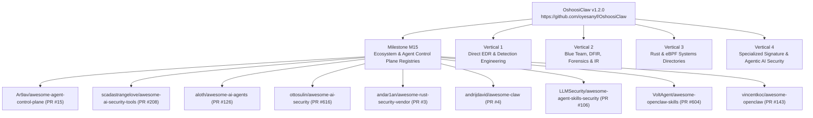

# OshoosiClaw — Curated Awesome Lists & Ecosystem Registries Tracker

This document tracks all live upstream Pull Requests and fork landing page synchronizations across **26+ curated Awesome Lists and ecosystem registries** spanning five major verticals.

---

## 1. Milestone M15: Ecosystem & Agent Control Plane Registries (All 9 Live)

All 9 target repositories have **live, open upstream Pull Requests** AND their corresponding `oyesanyf/<repo>` forks have been **committed and synchronized directly on their default branches (`main`/`master`)** to ensure immediate Google Search, Bing, and GitHub Search indexing on each fork's public landing page!

| # | Target Repository | Target Section | Upstream PR | Status | `oyesanyf` Fork (SEO Synced) | Fork Branch |
| :- | :--- | :--- | :--- | :--- | :--- | :--- |
| 1 | `Ar9av/awesome-agent-control-plane` | `## 🚧 Policy Enforcement & Runtime Control` & `## 📦 Sandboxing & Isolation` | **[PR #15](https://github.com/Ar9av/awesome-agent-control-plane/pull/15)** | `open` | [`oyesanyf/awesome-agent-control-plane`](https://github.com/oyesanyf/awesome-agent-control-plane) | `main` |
| 2 | `scadastrangelove/awesome-ai-security-tools` | `### Runtime Protection & Enforcement` | **[PR #208](https://github.com/scadastrangelove/awesome-ai-security-tools/pull/208)** | `open` | [`oyesanyf/awesome-ai-security-tools`](https://github.com/oyesanyf/awesome-ai-security-tools) | `main` |
| 3 | `aloth/awesome-ai-agents` | `### Sandboxing & Execution` | **[PR #126](https://github.com/aloth/awesome-ai-agents/pull/126)** | `open` | [`oyesanyf/awesome-ai-agents`](https://github.com/oyesanyf/awesome-ai-agents) | `main` |
| 4 | `ottosulin/awesome-ai-security` | `### Agent Runtime Security & Sandboxing` | **[PR #616](https://github.com/ottosulin/awesome-ai-security/pull/616)** | `open` | [`oyesanyf/awesome-ai-security`](https://github.com/oyesanyf/awesome-ai-security) | `main` |
| 5 | `andar1an/awesome-rust-security-vendor` | `## Threat Detection and Forensics` | **[PR #3](https://github.com/andar1an/awesome-rust-security-vendor/pull/3)** | `open` | [`oyesanyf/awesome-rust-security`](https://github.com/oyesanyf/awesome-rust-security) | `master` |
| 6 | `andrijdavid/awesome-claw` | `data/repos.json` (`openclawForks`) & `README.md` (`### OpenClaw Forks`) | **[PR #4](https://github.com/andrijdavid/awesome-claw/pull/4)** | `open` | [`oyesanyf/awesome-claw`](https://github.com/oyesanyf/awesome-claw) | `main` |
| 7 | `LLMSecurity/awesome-agent-skills-security` | `## Tools & Frameworks` (Markdown Table) | **[PR #106](https://github.com/LLMSecurity/awesome-agent-skills-security/pull/106)** | `open` | [`oyesanyf/awesome-agent-skills-security`](https://github.com/oyesanyf/awesome-agent-skills-security) | `main` |
| 8 | `VoltAgent/awesome-openclaw-skills` | `## Security Notice` -> `**Recommended tools:**` | **[PR #604](https://github.com/VoltAgent/awesome-openclaw-skills/pull/604)** | `open` | [`oyesanyf/awesome-openclaw-skills`](https://github.com/oyesanyf/awesome-openclaw-skills) | `main` |
| 9 | `vincentkoc/awesome-openclaw` | `## Alternative Architectures` | **[PR #143](https://github.com/vincentkoc/awesome-openclaw/pull/143)** | `open` | [`oyesanyf/awesome-openclaw`](https://github.com/oyesanyf/awesome-openclaw) | `main` |

---

## 2. Vertical 1: Direct EDR & Detection Engineering

| # | Target Repository | Target Section | Upstream PR | Status |
| :- | :--- | :--- | :--- | :--- |
| 10 | `shadawck/awesome-endpoint-detection-and-response` | `# Awesome Endpoint Detection and Response tools` | **[PR #4](https://github.com/shadawck/awesome-endpoint-detection-and-response/pull/4)** | `open` |
| 11 | `infosecB/awesome-detection-engineering` | `## Logging, Monitoring & Data Sources` | **[PR #55](https://github.com/infosecB/awesome-detection-engineering/pull/55)** | `open` |
| 12 | `0x4D31/awesome-threat-detection` | `### Endpoint Monitoring` | **[PR #112](https://github.com/0x4D31/awesome-threat-detection/pull/112)** | `open` |
| 13 | `threat-hunting/awesome_Threat-Hunting` | `### Tools, Dataset and Framework` | **[PR #9](https://github.com/threat-hunting/awesome_Threat-Hunting/pull/9)** | `open` |

---

## 3. Vertical 2: Blue Team, DFIR, Forensics & Incident Response

| # | Target Repository | Target Section | Upstream PR | Status |
| :- | :--- | :--- | :--- | :--- |
| 14 | `fabacab/awesome-cybersecurity-blueteam` | `### Endpoint Detection and Response (EDR)` | **[PR #150](https://github.com/fabacab/awesome-cybersecurity-blueteam/pull/150)** | `open` |
| 15 | `A-poc/BlueTeam-Tools` | `Security Monitoring` | **[PR #12](https://github.com/A-poc/BlueTeam-Tools/pull/12)** | `open` |
| 16 | `sbilly/awesome-security` | `### Anti-Virus / Anti-Malware` | **[PR #798](https://github.com/sbilly/awesome-security/pull/798)** | `open` |
| 17 | `meirwah/awesome-incident-response` | `### All-In-One Tools` | **[PR #363](https://github.com/meirwah/awesome-incident-response/pull/363)** | `open` |
| 18 | `cugu/awesome-forensics` | `### Live Forensics` | **[PR #152](https://github.com/cugu/awesome-forensics/pull/152)** | `open` |
| 19 | `wtsxDev/reverse-engineering` | `## Binary Analysis` | **[PR #59](https://github.com/wtsxDev/reverse-engineering/pull/59)** | `open` |

---

## 4. Vertical 3: Rust & eBPF Systems Directories

| # | Target Repository | Target Section | Upstream PR | Status |
| :- | :--- | :--- | :--- | :--- |
| 20 | `tylerha97/awesome-reversing` | `## Binary Analysis` | **[PR #37](https://github.com/tylerha97/awesome-reversing/pull/37)** | `open` |
| 21 | `0xflotus/awesome-rust-security` | `## Malware and Threat Detection` | **[PR #1](https://github.com/0xflotus/awesome-rust-security/pull/1)** | `open` |
| 22 | `qmonnet/awesome-ebpf` | `### Security` | **[PR #179](https://github.com/qmonnet/awesome-ebpf/pull/179)** | `open` |
| 23 | `aya-rs/awesome-aya` | `## Major Projects that Use Aya` | **[PR #25](https://github.com/aya-rs/awesome-aya/pull/25)** | `open` |

---

## 5. Vertical 4: Specialized Signature & Agentic AI Security Lists

| # | Target Repository | Target Section | Upstream PR | Status |
| :- | :--- | :--- | :--- | :--- |
| 24 | `pedramamini/awesome-yara` | `## Tools` | **[PR #83](https://github.com/pedramamini/awesome-yara/pull/83)** | `open` |
| 25 | `corca-ai/awesome-llm-security` | `## Tools` | **[PR #415](https://github.com/corca-ai/awesome-llm-security/pull/415)** | `open` |
| 26 | `machinae/awesome-claws` | `## Main Projects` | **[PR #46](https://github.com/machinae/awesome-claws/pull/46)** | `open` |

---

## Automation Scripts

- `scripts/submit_awesome_lists.py` — 4-Vertical awesome list automation and verification suite.
- `scripts/submit_m15_awesome_lists.py` — Dedicated Milestone M15 ecosystem registries PR submission and fork SEO synchronization engine.
