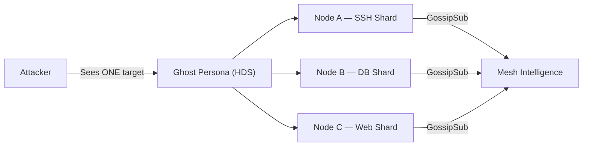
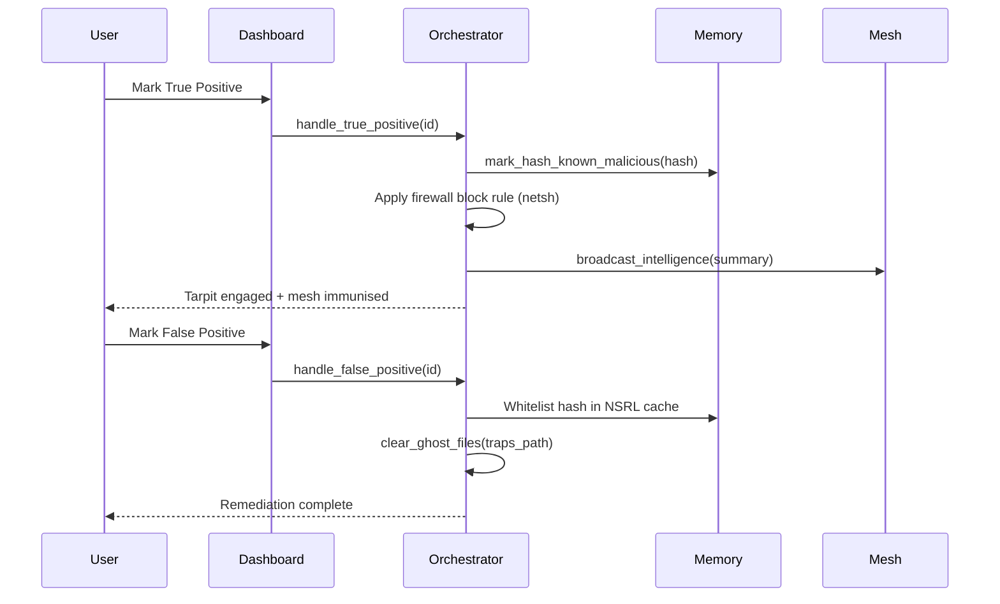
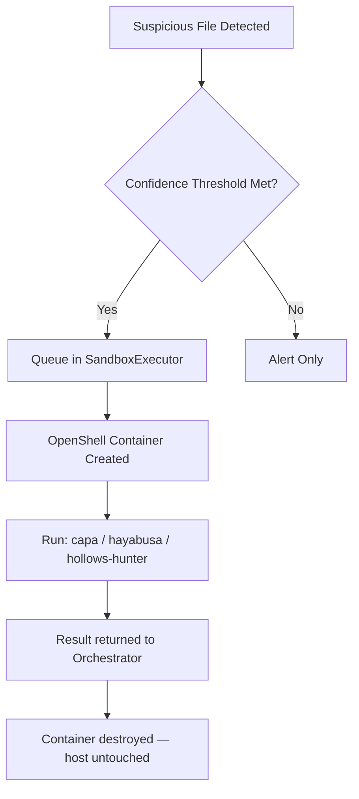
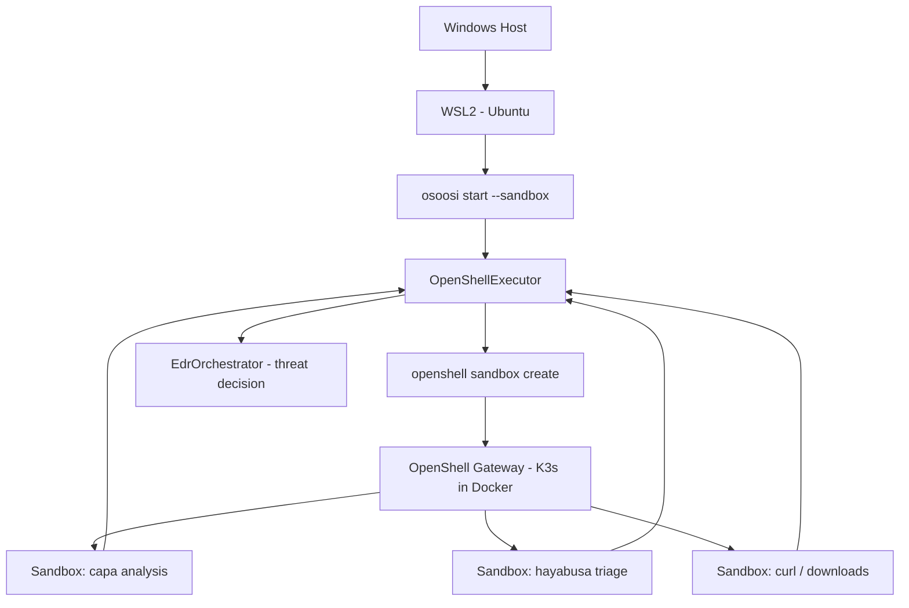
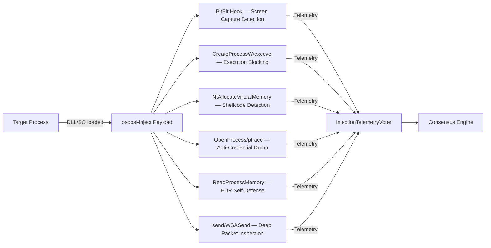
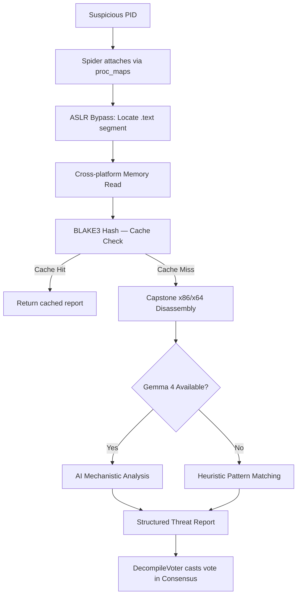
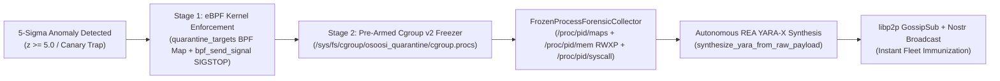
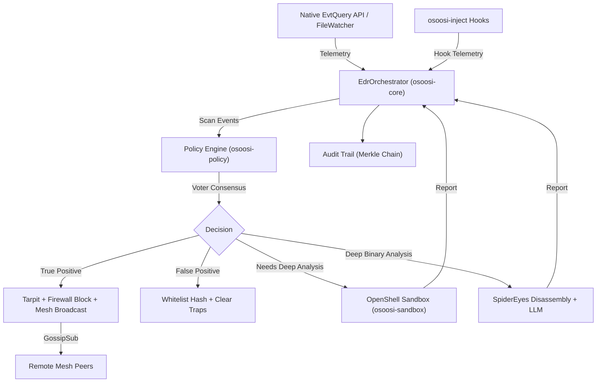
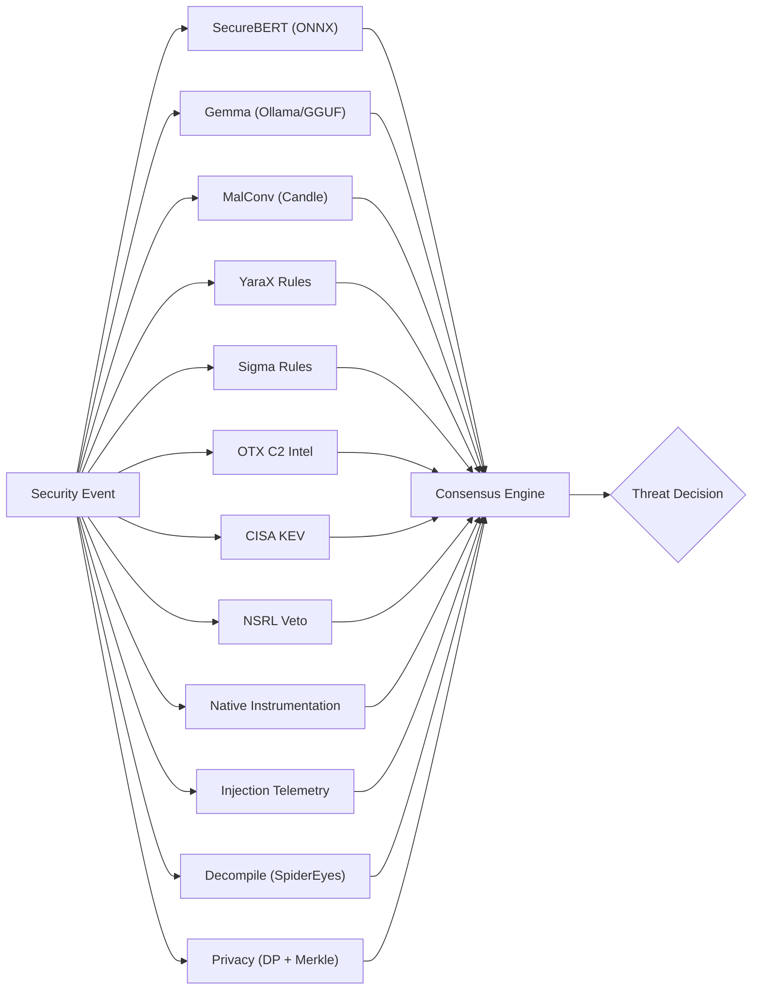

# OpenỌ̀ṣọ́ọ̀sì: The Sovereign Mesh Security Agent

> **Next-generation agentic EDR** — autonomous detection, federated intelligence, and self-healing security across Windows, Linux, and macOS.

---

## 🚀 Key Innovations

### 1. Holographic Deception Sharding (HDS)
Unlike traditional honeypots, HDS creates a **distributed hallucination** across the mesh.

- **Ghost Persona**: When an attacker is detected, the mesh generates a convincing fake environment.
- **Sharding**: The deception is split into shards — Node A simulates SSH, Node B simulates a database, Node C simulates a web server. Each shard is assigned via deterministic consensus hashing.
- **Effect**: An attacker scanning the network perceives one massive target, while their packets are processed by thousands of different nodes worldwide.



---

### 2. Einsteinian Relativistic Guard (Einstein Engine)
A temporal security engine that treats system events as a **Causal Manifold**.

- **Light-Cone Integrity**: Every event is hashed with its causal parent. Code injection without a valid causal history triggers a "Causal Decoherence" alert.
- **Temporal Dilation**: Measures the discrepancy between local system time and global mesh time — detects Sleeper Attacks and clock-skew exploits (TOCTOU).

---

### 3. Federated Reinforcement Loop
The agent learns from analyst feedback and propagates intelligence across the mesh in real-time.

| Action | Effect |
|---|---|
| **Mark True Positive** | Confirms threat → adds hash to bloom filter → firewall block applied → broadcast to all peers |
| **Mark False Positive** | Whitelists hash/process in NSRL cache → clears ghost file traps → suppresses future alerts |



---

### 4. NVIDIA OpenShell Sandboxing
High-risk forensic analysis runs inside hardware-isolated containers.



- **Isolation**: Forensic tools run inside OpenShell. If malware exploits the analysis tool, it cannot escape to the host.
- **Zero-Persistence**: All temporary files written during analysis are wiped when the container is destroyed.
- **Egress Control**: No network calls out of the sandbox unless explicitly allowed by the egress policy YAML.

#### Windows + WSL2 OpenShell Mode

NVIDIA OpenShell v0.0.36 does not publish a native Windows package. On Windows desktops, Oshoosi can launch the Linux agent inside WSL2 with `osoosi start --wsl --sandbox`.



Setup is mostly automatic from Windows:

```powershell
.\target\release\osoosi.exe start --wsl --sandbox --sandbox-name my-agent-sandbox
```

The launcher:

- Launches WSL optional-component provisioning if Windows has not enabled WSL yet.
- Installs Ubuntu when WSL exists but no distro is present.
- Installs Rust and NVIDIA OpenShell inside WSL if missing.
- Builds the Linux Oshoosi binary in WSL if missing.
- Starts the Linux agent with `OSOOSI_SECURE_RUNTIME=openshell`.

Docker Desktop with WSL2 integration for Ubuntu is still required for OpenShell's Linux sandbox runtime. If Docker is unavailable inside WSL, Oshoosi stops with a Docker-specific remediation message.

---

### 5. Native In-Process Hooking Engine (Ported from OpenEDR)

OshoosiClaw includes a **cross-platform, in-process API hooking payload** (`osoosi-inject`) that gives the agent direct visibility into what every process on the system is doing at the API level.



| Platform | Mechanism | Delivery |
|---|---|---|
| **Windows** | Detours (retour crate) — trampoline API hooking | VirtualAllocEx + CreateRemoteThread injection |
| **Linux** | LD_PRELOAD — libc symbol interposition | `/etc/ld.so.preload` or ptrace |
| **macOS** | DYLD_INSERT_LIBRARIES — dylib interposition | Environment variable on child processes |

#### Hooked APIs

| Hook | Windows API | Unix Equivalent | Detects |
|---|---|---|---|
| Screen Capture | `BitBlt` (GDI32) | N/A (X11 screenshot intercepted via sandbox) | Spyware, stalkerware, banking trojans |
| Execution | `CreateProcessW` | `execve` | Reverse shells, encoded PowerShell, cryptominers |
| Memory Allocation | `NtAllocateVirtualMemory` | `mmap` (future) | Process hollowing, shellcode injection |
| Process Handle | `OpenProcess` | `ptrace(PTRACE_ATTACH)` | Credential dumping (Mimikatz), EDR tampering |
| Memory Read | `ReadProcessMemory` | `ptrace(PTRACE_PEEKDATA)` | LSASS memory scraping, agent memory inspection |
| Network | `send` (ws2_32) | `send` (libc) | C2 beacons, DNS tunneling, darknet traffic |

---

### 6. Spider Eyes — Mechanistic Binary Analyst

SpiderEyes is Oshoosi's **live disassembly and AI reasoning engine**. It attaches to a running process, reads its executable memory segments (bypassing ASLR), disassembles the machine code with Capstone, and then feeds the assembly into a local LLM (Gemma 4) for mechanistic interpretability.



#### Heuristic Patterns (Fallback when LLM unavailable)

| Pattern | What It Detects |
|---|---|
| `JMP ESP` / `CALL ESP` / `JMP RSP` | ROP exploit gadgets |
| `AESENC` / `AESDEC` / `PXOR` | Ransomware encryption or encrypted C2 |
| `INT 0x2D` / `RDTSC` timing | Anti-debugging evasion |
| `CPUID` + comparison | VM/sandbox detection |
| `MOV CR0` / `WRMSR` / `SIDT` | Kernel rootkit / privilege escalation |
| `GetProcAddress` / `LoadLibrary` | Packed/obfuscated malware, shellcode loaders |
| Large NOP sleds (>20) | Classic exploit padding |
| `syscall` + ptrace patterns | Process injection / hollowing |
| Socket + connect sequences | C2 network beaconing |
| LSASS / SAM references | Credential harvesting |

### 7. Dual-Stage $5\sigma$ Kernel Quarantine & Autonomous REA Forensics

When an anomalous process exhibits a $5\sigma$ ($z \ge 5.0$) deviation across hardware telemetry or Axion deterministic canary traps, OpenỌ̀ṣọ́ọ̀sì executes a zero-escape **Dual-Stage Kernel Quarantine** paired with **Autonomous REA (Reverse Engineer Anything)** memory forensics:



- **Stage 1 (In-Kernel eBPF `SIGSTOP` + Hardware PMU Watchdog)**: `quarantine_targets` (`BPF_MAP_TYPE_HASH`, 10,240 entries) triggers `bpf_send_signal(SIGSTOP)` across all hot syscall entry tracepoints (`connect`, `mprotect`, `ptrace`, `mmap`, `memfd_create`) and `SEC("perf_event")` hardware PMU cycle counters (`osoosi_pmu_watchdog`), stopping threads at the kernel/CPU boundary even if they spin in user-space without issuing syscalls.
- **Stage 2 (Pre-Armed Cgroup v2 Freezer + `cgroup.events` `"frozen 1"` Verification)**: `QuarantineResponder` keeps `/sys/fs/cgroup/osoosi_quarantine/cgroup.procs` open and `cgroup.freeze` pre-armed with `"1\n"`, migrating the target TGID with a single stack-formatted `write_all` syscall and confirming `"frozen 1"` transition in `/sys/fs/cgroup/osoosi_quarantine/cgroup.events` (`cgroup_frozen_confirmed: bool`, `freeze_latency_us: u64`) while strictly enforcing the Host OS & Developer Immunity Veto (`PID <= 4`, `systemd`, `osoosi`, `sshd`, `cargo`, `rustc`).
- **All-Thread Forensic Enumeration & Full CPU Register Snapshot**: `FrozenProcessForensicCollector` enumerates every thread in `/proc/<tgid>/task/<tid>`, captures `FullCpuRegisterSnapshot` (`r15`..`r8`, `rbp`, `rbx`, `rdi`, `rsi`, `rdx`, `rcx`, `rax`, `orig_rax`, `rip`, `cs`, `eflags`, `rsp`, `ss`, `fs_base`, `gs_base` via `ptrace(PTRACE_GETREGS)` with `/proc/<tgid>/task/<tid>/stat` `kstkeip`/`kstkesp` fallback), extracts unbacked `rwxp` shellcode, synthesizes a YARA-X signature via `AutonomousReaEngine`, and broadcasts the indicator across the P2P and Nostr mesh.

---

### 8. The 10 Mathematical Laws of Zero & Two-Tier Zero-Exploit DLP Engine (`Presidio` + `GLiNER`)

OpenỌ̀ṣọ́ọ̀sì unifies ten mathematical identities where **a benign system satisfies $\mathcal{L}(x) = 0$ and any adversarial violation produces $\mathcal{L}(x) \neq 0$**:

```mermaid
flowchart TD
    subgraph LAWS["The 10 Mathematical Laws of Zero (L(x) = 0 <=> Invariant Intact)"]
        L1["Law 1: Homological Boundary Zero (∂² = 0, δ²φ = 0)<br/>Detects Confused-Deputy Circulation (H¹ ≠ 0)"]
        L2["Law 2: Vanishing Polynomial Trace (C(t(x)) mod Z_H(x) = 0)<br/>Over Mersenne Prime Field F_{2^127 - 1}"]
        L3["Law 3: Dirac-Delta Ephemeral Capability (Cap(t) = 0 outside [t0, t0+Δt])<br/>Single-Use Atomic CAS + Epoch Pinning"]
        L4["Law 4: Doob Martingale Zero-Drift (E[M_{t+1}-M_t | F_t] = 0)<br/>Ville's Inequality E-Process (E_t >= 10^6)"]
        L5["Law 5: Zero-Copy Immutable Page Projection (Δt_TOCTOU = 0)<br/>4096B VirtualProtect(PAGE_READONLY) + PinnedToolObjectBinding"]
        L6["Law 6: Ihara Zeta Non-Backtracking Cycle Zero (det(I - u B_G) = 0)<br/>Hashimoto Operator B_G on Provenance DAG"]
        L7["Law 7: CFG Hadamard Zero-Product (||T_runtime ∘ Ā_CFG||_1 = 0)<br/>Blocks ROP / JOP / Indirect Branch Transfers"]
        L8["Law 8: Zero Mutual Information Projection (I(Secret; Output) = 0)<br/>Orthogonal Subspace Scrubbing + High-Entropy Redaction"]
        L9["Law 9: Pontryagin Zero-Sum Minimax Saddle Point (min_u max_v H = 0)<br/>Optimal Honeyfile & Ghost-Node Allocation"]
        L10["Law 10: Zero-Knowledge BFT Proof & Two-Tier Zero-Exploit DLP<br/>Fast-Path Aho-Corasick + Rolling BLAKE3 + Presidio + GLiNER ONNX"]
    end
    L1 & L2 & L3 & L5 --> GATE["Multi-Ring Containment Gate (ArmContainmentRing)"]
    L4 & L6 & L7 & L9 --> CONS["Consensus Engine & Kernel/eBPF Enforcement"]
    L8 & L10 --> DLP["Zero-Leakage Egress & P2P ZK-BFT Verification (osoosi-dp)"]
```



| Law | Mathematical Identity | Implementation Module | Security Enforcement |
|:---|:---|:---|:---|
| **Law 1** | $\partial_{k-1} \circ \partial_k = 0,\quad \delta^2 \phi = 0$ | `crates/osoosi-agent-anomaly/src/mesh_guard.rs` (`HomologicalBoundaryAuditor`) | Detects cyclic confused-deputy privilege escalation loops where closed 1-cochains fail exactness ($\oint_\gamma \omega \neq 0$). |
| **Law 2** | $C(t(x), t(g\cdot x)) \equiv 0 \pmod{Z_H(x)}$ over $\mathbb{F}_{2^{127}-1}$ | `crates/osoosi-agent-anomaly/src/cedar_engine.rs` (`VanishingPolynomialTraceVerifier`) | Algebraic execution trace proof that every Dogwood/Cedar authorization step satisfied all transition constraints. |
| **Law 3** | $\operatorname{Cap}(t) = 0 \quad \forall t \notin [t_0, t_0 + \Delta t_{\text{syscall}}]$ | `crates/osoosi-agent-anomaly/src/containment_ring.rs` (`DiracDeltaCapabilityTicket`) | Zero standing privilege: single-invocation atomic `AtomicBool` consumption + nanosecond TTL + generation epoch pinning. |
| **Law 4** | $\mathbb{E}[M_{t+1} - M_t \mid \mathcal{F}_t] = 0,\quad \mathbb{P}(\sup_t E_t \ge \alpha^{-1}) \le \alpha$ | `crates/osoosi-policy/src/voters.rs` (`MartingaleZeroDriftDetector`), `crates/osoosi-dns/src/analysis.rs` (`DnsMartingaleDriftDetector`) | Catches ultra-slow APT C2 beaconing and gradual exfiltration via Ville's Inequality ($E_t \ge 10^6 \implies \text{FPR} \le 10^{-6}$). |
| **Law 5** | $\Delta t_{\text{TOCTOU}} = t_{\text{execute}} - t_{\text{verify}} = 0$ | `crates/osoosi-agent-anomaly/src/containment_ring.rs` (`ZeroCopyImmutableToolBuffer`, `PinnedToolObjectBinding`) | 4096-byte page-aligned buffer locked `PAGE_READONLY` / `PROT_READ` before policy check + `FileId`/`dev:ino`/BLAKE3 descriptor pinning. |
| **Law 6** | $\zeta_G^{-1}(u) = \det(I - u B_G) = 0$ | `crates/osoosi-agent-anomaly/src/siquery.rs` (`IharaZetaCycleDetector`) | Hashimoto non-backtracking edge operator $B_G$ detects covert process-pipe-socket feedback loops in $O(E)$. |
| **Law 7** | $\Vert T_{\text{runtime}} \circ \bar{A}_{\text{CFG}} \Vert_1 = 0$ | `crates/osoosi-audit/src/nsrl_aslr_merkle.rs` (`CfgHadamardZeroVerifier`), `crates/osoosi-core/src/rea.rs` | Bitpacked 64-bit bitwise AND verification of indirect branch edges against the binary's static Control-Flow Graph. |
| **Law 8** | $I(S; Y) = H(S) - H(S \mid Y) = 0$ | `crates/osoosi-agent-anomaly/src/breakout_defense.rs` (`ZeroMutualInformationProjector`) | Orthogonal linear projection $v_{\text{safe}} = v - \sum_i \langle v, u_i \rangle u_i$ ($\max_i \lvert \langle v_{\text{safe}}, u_i \rangle \rvert < 10^{-6}$) + secret scrubbing. |
| **Law 9** | $\min_{u \in \mathcal{U}} \max_{v \in \mathcal{V}} H(x, u, v, \lambda) = 0$ | `crates/osoosi-telemetry/src/canary.rs` (`compute_pontryagin_minimax_equilibrium`) | Computes game-theoretic saddle-point allocation across high-entropy canary honeyfiles and ghost-node tarpits. |
| **Law 10** | $\operatorname{Verify}_{\text{ZK}}(\pi, x_{\text{pub}}) = 0$ + Two-Tier DLP | `crates/osoosi-dp/src/lib.rs` (`OsoosiTwoTierDlpEngine`, `PresidioGlinerPiiZeroGuard`, `ZkBftQuarantineProof`) | Unwraps nested Base64/Hex/URL encodings (depth $\le 2$), scans Crown-Jewel 1 KB BLAKE3 chunks, scrubs PII via Presidio + GLiNER (`urchade/gliner_multi_pii-v1`), and generates zero-knowledge Schnorr-BLAKE3 BFT proofs. |

---

### 9. Formal Threat Model & Security Guarantees: Exact Algebraic Identities vs. Operational Trust Assumptions (Reviewer Issue 3)

To ensure rigorous engineering transparency and prevent conflating mathematical identities in an idealized model with empirical OS runtime behavior, OpenỌ̀ṣọ́ọ̀sì explicitly separates **(A) Exact Algebraic / Mathematical Identities in the Model** from **(B) Operational Trust Assumptions & Empirical Coverage Boundaries**:

| Subsystem / Law | (A) Exact Algebraic / Mathematical Identity in the Model | (B) Operational Trust Assumptions & Empirical Coverage Boundaries |
|:---|:---|:---|
| **Law 1 (`HomologicalBoundaryAuditor`)** | Over the finite directed communication simplicial complex $\mathcal{K}$, the coboundary operator satisfies $\delta^2 \phi = 0$, and any conservative privilege potential $\phi$ yields zero circulation $\oint_\gamma \delta \phi = 0$ around every simple cycle $\gamma$. | Assumes all inter-agent messages traverse `MeshGuard` or `ArmContainmentRing`. Direct out-of-band OS IPC (shared memory or covert timing channels bypassing the agent bus) is mitigated separately by OS sandboxing (AppContainer / Landlock), not by Law 1 alone. |
| **Law 2 (`VanishingPolynomialTraceVerifier`)** | Over the Mersenne prime field $\mathbb{F}_{2^{127}-1}$, the execution trace polynomial satisfies $C(t(x)) \equiv 0 \pmod{Z_H(x)}$ if and only if each encoded trace row satisfies the algebraic transition identity. | Soundness holds against accidental corruption or unauthenticated trace mutation; cryptographic non-forgery against an adversary with in-process memory write access additionally requires the HMAC-SHA256 trace key or out-of-process Sentinel verification (`IndependentTrustBoundaryVerifier`). |
| **Law 3 (`DiracDeltaCapabilityTicket`)** | A ticket state transitions monotonically $\text{Unconsumed (false)} \to \text{Consumed (true)}$ via `compare_exchange(false, true, SeqCst, SeqCst)` and evaluates to $0$ outside $[t_0, t_0 + \Delta t_{\text{syscall}}]$ or when `epoch != current_epoch`. | Assumes monotonic hardware clock (`std::time::Instant`) integrity and non-compromised ring-0 kernel memory. |
| **Law 4 (`MartingaleZeroDriftDetector`)** | Under the null hypothesis $H_0$ of memoryless exponential inter-arrival times, the betting martingale $E_t = \prod_{k=1}^t (1 + \lambda_k \Delta_k)$ satisfies $\mathbb{E}[E_t] = 1$ and Ville's Inequality $\mathbb{P}_{H_0}(\sup_t E_t \ge \alpha^{-1}) \le \alpha$. | If benign enterprise traffic exhibits periodic machine-generated heartbeats (e.g., NTP, fixed cron jobs), $H_0$ is violated; operational deployment pairs the martingale score with destination reputation and multi-voter consensus before blocking. |
| **Law 5 (`ZeroCopyImmutableToolBuffer` + `PinnedToolObjectBinding`)** | Once bytes are copied into the 4096-byte page-aligned buffer and `VirtualProtect(..., PAGE_READONLY)` / `mprotect(..., PROT_READ)` succeeds, user-space writes via that virtual mapping fault in hardware ($\Delta t_{\text{TOCTOU}} = 0$ on the buffer bytes). | Memory-page immutability does not by itself prevent filesystem symlink swaps if a tool re-opens a path string by name. `PinnedToolObjectBinding` closes this operational gap by verifying OS file identity (`volume_serial` + `file_index` on Windows; `st_dev` + `st_ino` on Unix) and BLAKE3 content digest at open/use time. |
| **Law 6 (`IharaZetaCycleDetector`)** | On any finite directed graph $G$, $\det(I - u B_G) = 0$ has non-trivial roots if and only if the Hashimoto non-backtracking operator $B_G$ has non-zero spectral radius ($\rho(B_G) > 0$), i.e., $G$ contains a non-backtracking cycle. | Operates on discrete snapshots of the Siquery provenance graph (`processes`, `pipes`, `sockets`). Short-lived processes that spawn and exit entirely between polling intervals require kernel ETW / eBPF ring-buffer capture rather than periodic table polling. |
| **Law 7 (`CfgHadamardZeroVerifier`)** | For a given static adjacency bitmatrix $A_{\text{CFG}}$ and observed transition matrix $T_{\text{runtime}}$, $\Vert T_{\text{runtime}} \circ \bar{A}_{\text{CFG}} \Vert_1 = 0$ holds if and only if every observed edge $(u, v)$ is present in $A_{\text{CFG}}$. | Static CFG recovery via linear/recursive disassembly over stripped binaries is an approximation of the true compiler CFG; dynamically generated JIT code or legitimate C++ vtable polymorphism not resolved statically is handled by hardware CET / Shadow Stack and confidence weighting. |
| **Law 8 (`ZeroMutualInformationProjector`)** | Given orthonormal basis vectors $\{u_1, \dots, u_k\}$ spanning the registered secret subspace $\mathcal{S}$, linear projection $v_{\text{safe}} = v - \sum_{i=1}^k \langle v, u_i \rangle u_i$ satisfies $\langle v_{\text{safe}}, u_i \rangle = 0$ up to IEEE-754 floating-point precision ($< 10^{-6}$). | Orthogonal projection removes linear correlation in the embedding space and deterministic secret tokens in text, but cannot mathematically guarantee zero semantic leakage under arbitrary non-linear paraphrases or novel steganographic encodings not captured by Tier-1/Tier-2 DLP. |
| **Kernel Quarantine & BYOVD Self-Defense (`Issue 1` & `Issue 2`)** | Kernel pre-operation callbacks (`IRP_MJ_CREATE`, `IRP_MJ_WRITE`, `IRP_MJ_SET_INFORMATION`, `IRP_MJ_ACQUIRE_FOR_SECTION_SYNCHRONIZATION`) deterministically return `STATUS_ACCESS_DENIED` for protected paths; eBPF `bpf_send_signal(SIGSTOP)` + Cgroup v2 `cgroup.freeze = 1` freezes all threads in the target TGID. | Windows minifilter protection assumes the attacker has not already loaded an unblocked ring-0 BYOVD driver prior to EDR startup (mitigated by verifying HVCI + Microsoft Vulnerable Driver Blocklist via `verify_windows_wdac_and_hvci_blocklist_state()`). On Linux, `bpf_send_signal(SIGSTOP)` is asynchronous until the thread exits a kernel syscall or hits a PMU `perf_event` interrupt (`freeze_latency_us` is measured via `cgroup.events` `"frozen 1"`). |
| **Cross-Layer Trust Boundary (`IndependentTrustBoundaryVerifier`, `Issue 5`)** | Three independent verification layers (**Layer 1**: Cedar + STARK trace; **Layer 2**: Out-of-process Sentinel over raw argument bytes; **Layer 3**: OS boundary invariant gate) must all return `true` ($\text{Allow} \iff L_1 \land L_2 \land L_3$). | Prevents circular single-process failure: even if a memory-corruption bug forces Layer 1 (`CedarAuthorizer`) to return `Allow`, Layer 2 and Layer 3 independently inspect the raw immutable buffer and OS target path/IP and veto the escape. |

---

### 10. Built-In Adversarial Red-Team Gauntlet (`osoosi redteam`) & Standardized 5-Policy RL Benchmark

OpenỌ̀ṣọ́ọ̀sì ships a deterministic, self-contained **Adversarial Red-Team Gauntlet** (`crates/osoosi-core/src/adversarial_gauntlet.rs`, CLI `osoosi redteam`, `osoosi-auditor --redteam-gauntlet`, and `scripts/adversarial_stix_owasp_redteam.py`) alongside a **Standardized 5-Policy Reinforcement Learning Benchmark** (`crates/osoosi-agent-anomaly/src/rl_controller.rs`).

#### 1. Adversarial Red-Team Gauntlet Scorecard (16 Vectors Across 4 Frameworks + Independent OS Boundary Oracle)
- **Suite 1 (`stix`)**: MITRE ATT&CK STIX 2.1, Atomic Red Team (`T1055.001/012` Process Hollowing, `T1003.001` LSASS Dump, `T1068` BYOVD + Section Sync, `T1071.004` Low-and-Slow DNS C2, `T1562.001` Self-Kill Spoofing), & MITRE CALDERA / ATLAS (`AML.T0043`).
- **Suite 2 (`agent`)**: Promptfoo & NVIDIA garak LLM probes routed through live `AgentOctopus` (`AgentjackingGuard`, `OrbWebController`, `AgentContainmentRing` HMAC-SHA256 epoch isolation, Law 1 Homological Boundary, Law 2 Vanishing Polynomial, Law 3 Dirac-Delta Capability).
- **Suite 3 (`owasp`)**: OWASP Agentic Top 10 (`ASI01–ASI10`), OWASP LLM Top 10 (`LLM01–LLM10`), & Web/API (`A01`/`A10` Path Traversal, NTFS ADS, IPv4/IPv6 SSRF (`::ffff:169.254.169.254`), and `MercuryContainmentEngine` colluding droplet passivation).
- **Suite 4 (`bypass`)**: Reviewer Bypass-Resistance Suite — `PinnedToolObjectBinding` post-verification file-ID swap block, Double-Encoded (`Hex(Base64(Secret+PII))`) DLP interception, and **Cross-Layer Escape Simulation** (`CROSS-LAYER-CEDAR-BYPASS-ESCAPE-04`, where `CedarAuthorizer` is deliberately bypassed and `IndependentTrustBoundaryVerifier` Layer 2/3 blocks the escape at the OS boundary).
- **`IndependentOsBoundaryOracle`**: Independently verifies on disk and in egress memory that canary files remain untouched, zero raw PII/secrets appear in any egress buffer, TOCTOU descriptor swaps are rejected before read, and cross-layer Cedar bypasses are blocked.

#### 2. Standardized 5-Policy RL Active Defense Benchmark (`local_synthetic_cyberbattlesim_topology_v1`)
Evaluated over $N = 20$ matched episode seeds with identical initial 12-node enterprise CyberBattleSim topologies (`RLAdaptiveController::run_standardized_5_policy_benchmark`, reporting 95% Student-$t$ Confidence Intervals $\bar{x} \pm t_{0.025, 19} \cdot \frac{s}{\sqrt{20}}$):

| Policy Name | Backend Label | Mean Cumulative Reward ($\pm 95\%\text{ CI}$) | Mean Containment Rate ($\pm 95\%\text{ CI}$) | Mean Breach Frequency ($\pm 95\%\text{ CI}$) |
|:---|:---|:---|:---|:---|
| **1. `LearnedRL` (Q-Table Active Defense)** | `local_synthetic_cyberbattlesim_topology_v1` | **`+358.13 ± 1.69`** | **`99.58% ± 0.58%`** | **`0.0000 ± 0.0000`** |
| **2. `Heuristic` (Fixed Static Thresholds)** | `local_synthetic_cyberbattlesim_topology_v1` | `+120.73 ± 6.27` | `92.50% ± 2.41%` | `0.1500 ± 0.1713` |
| **3. `NoLearning` (Frozen Uncalibrated Prior)** | `local_synthetic_cyberbattlesim_topology_v1` | `+15.14 ± 6.95` | `86.25% ± 3.12%` | `0.4500 ± 0.2804` |
| **4. `Random` (Uniform Action Selection)** | `local_synthetic_cyberbattlesim_topology_v1` | `-16.90 ± 18.88` | `66.67% ± 3.74%` | `1.5500 ± 0.5356` |
| **5. `Disabled` (Passive Unmitigated Baseline)** | `local_synthetic_cyberbattlesim_topology_v1` | `-499.43 ± 10.67` | `16.67% ± 0.00%` | `5.8000 ± 0.1920` |

```powershell
# Run the complete 17-vector Adversarial Red-Team Gauntlet + 5-Policy RL Benchmark + PQC CBOM via CLI:
.\target\release\osoosi.exe redteam --suite all

# Or run via osoosi-auditor / Python orchestrator and export octopus_exhaustive_test_report.json:
.\target\release\osoosi-auditor.exe --redteam-gauntlet
python scripts/adversarial_stix_owasp_redteam.py --all
```

#### 3. Quantum-Ready Post-Quantum Cryptography (`NIST FIPS 203 ML-KEM-768` & `FIPS 204 ML-DSA-65`) & CBOM
- **Hybrid Key Encapsulation (`osoosi-wire::pqc`, `osoosi-audit::pqc_primitives`)**: Combines classical RFC 7748 `X25519` Montgomery-ladder ECDH over $\mathbb{F}_{2^{255}-19}$ with NIST FIPS 203 `ML-KEM-768` Module-LWE encapsulation over $R_q = \mathbb{Z}_{3329}[X]/(X^{256}+1)$ ($k=3$, 1184-byte public key, 1088-byte ciphertext) and constant-time Fujisaki-Okamoto (`FO^{\not\perp}`) re-encryption verification.
- **Hybrid Digital Signatures (`HybridSignatureEnvelope`)**: Combines RFC 8032 `Ed25519` (`ed25519_dalek`) with NIST FIPS 204 `ML-DSA-65` (Dilithium) lattice Fiat-Shamir with Aborts over $R_q = \mathbb{Z}_{8380417}[X]/(X^{256}+1)$ ($\gamma_1 = 2^{17}, \gamma_2 = 95232, \tau = 39, \eta = 4$). Both classical and post-quantum equations must independently verify, blocking Quantum Shor's Algorithm classical-half forgeries (`BYPASS-PQC-SHOR-DOWNGRADE-05`).

---

## 🏗️ System Architecture



### Core Crates

| Crate | Role |
|---|---|
| `osoosi-core` | Main orchestrator: telemetry ingestion, consensus, response, maintenance |
| `osoosi-behavioral` | AI engine: Gemma 4 (ONNX), SecureBERT (ONNX), SmolLM (Candle), SpiderEyes |
| `osoosi-wire` | P2P mesh networking via `libp2p` + GossipSub |
| `osoosi-policy` | Sigma, CISA KEV, OTX TAXII, NVD feeds + LLM voter + Injection Telemetry voter |
| `osoosi-inject` | Cross-platform in-process API hooking payload (Windows DLL / Linux SO / macOS dylib) |
| `osoosi-runtime` | Active response: Tarpits, Ghost Files, Process Kill |
| `osoosi-sandbox` | NVIDIA OpenShell isolation for high-risk tasks |
| `osoosi-memory` | SQLite persistence, bloom filter, NSRL bypass cache, vacuum/prune maintenance |
| `osoosi-repair` | Autonomous CVE discovery and patch application |
| `osoosi-telemetry` | Native Win32 EvtQuery API / auditd / FileWatcher + DLL Injector |
| `osoosi-types` | Shared types, registry normalizer, self-protection path utilities |
| `osoosi-dp` | Differential privacy (Laplacian noise) for privacy-preserving detection |
| `osoosi-audit` | Merkle audit tree for tamper-proof decision logging |

---

## 🧠 AI Engine Architecture

OshoosiClaw uses a **multi-model consensus** architecture. Each model is a "voter" in the threat decision pipeline:



### All Registered Voters

| # | Voter | Source | Weight | Purpose |
|---|---|---|---|---|
| 1 | `SemanticVoter` | Semantic Engine | 0.7 | Detects command-line intent drift |
| 2 | `OtxVoter` | AlienVault OTX | 0.6–0.9 | C2 IP/hash/domain matching |
| 3 | `SigmaVoter` | Sigma Rules | 0.8 | Community detection rules |
| 4 | `GemmaVoter` | Gemma LLM (Ollama) | 0.9 | Deep reasoning about TTPs |
| 5 | `NativeVoter` | OpenEDR port | 0.5–1.0 | Self-protection, USB exfil, registry persistence |
| 6 | `NsrlVoter` | NIST NSRL | **-2.0** | Veto: suppresses known-good binaries |
| 7 | `DecompileVoter` | SpiderEyes | 0.98 | Live disassembly + AI mechanistic analysis |
| 8 | `ClamVoter` | ClamAV/YARA | 0.85 | Signature-based malware detection |
| 9 | `MalConvVoter` | MalConv ML | 0.6 | Neural network binary classification |
| 10 | `KevVoter` | CISA KEV | 0.5–0.85 | Known exploited vulnerabilities |
| 11 | `PrivacyVoter` | DP + Merkle | 0.8 | Privacy-preserving detection with audit trail |
| 12 | `InjectionTelemetryVoter` | Hook Payload | 0.7–1.0 | Screen capture, shellcode, cred dump, C2, reverse shells |

### Smart Engine Selection

The AI engine auto-selects the optimal backend based on hardware:

| Condition | Engine Selected | Why |
|---|---|---|
| CUDA GPU + CUDA Toolkit | **Native GGUF (Candle on GPU)** | In-process, fastest, no external deps |
| GPU + Ollama installed | **Ollama HTTP API** | llama.cpp backend, GPU-accelerated |
| CPU-only + Ollama | **Ollama HTTP API** | llama.cpp is 10x faster than Candle on CPU |
| CPU-only, no Ollama | **Native GGUF (Candle on CPU)** | Slow but functional, last resort |

### LLM Voter Rate Limiting

The LLM-Reasoning voter is rate-limited to prevent CPU/GPU saturation:

- **30-second cooldown** between LLM inference calls
- **Safe-process filter**: 30+ known Windows system processes (svchost, explorer, etc.) are skipped entirely
- **Minimum response check**: Responses < 10 chars are discarded (prevents phantom votes from timeouts)
- **Max 48 tokens**: Short classification output only — no essays

### Native Event Log Reading (Win32 EvtQuery API)

Windows telemetry uses the **native EvtQuery API** instead of spawning `wevtutil.exe` subprocesses:

- **Tamper-proof**: Attackers cannot bypass by renaming/blocking `wevtutil.exe`
- **Performance**: Direct API call vs subprocess spawn per poll cycle
- **Raw XML**: Events rendered directly in-process memory

---

## ⚙️ Setup and Configuration

### Prerequisites
- **Rust**: Latest stable toolchain (`rustup update stable`)
- **Sysmon**: Required on Windows — installed automatically by the agent on first run
- **Ollama** *(optional)*: Only needed if native GGUF loading fails
- **OpenShell CLI** *(optional)*: Required for sandboxed execution (`openshell` on PATH)

### Build
```bash
cargo build --release
```

### Run
```bash
# From project root (recommended — finds osoosi.toml automatically)
./target/release/osoosi start

# With hardware sandboxing
./target/release/osoosi start --sandbox --sandbox-name my-agent

# With dashboard UI
./target/release/osoosi start --dashboard
```

> **Note**: The agent now automatically finds `osoosi.toml` even when started from `target/release/`.

### Configuration (`osoosi.toml`)

All hardcoded values are now centralized. Environment variables override any value:

```toml
[ai]
reasoning_model  = "deepseek-r1:1.5b"    # Ollama/GGUF model name
llm_timeout_secs = 90                     # Kill inference after N seconds
reasoning_url    = "http://127.0.0.1:11434/v1/chat/completions"  # Ollama HTTP API
fallback_models  = ["gemma3:1b", "gemma3:4b", "qwen2.5:1.5b", "phi3:mini"]
colog_threshold  = 0.85                   # Anomaly detection threshold

[external_api]
otx_api_key = "your-alienvault-key"
nvd_api_key = "your-nvd-key"

[autonomy]
auto_quarantine_malware         = true
quarantine_confidence_threshold = 0.95
action_confidence_threshold     = 0.80

[backup]
enabled     = false
backup_type = "file_sync"
```

| Env Variable | Overrides | Default |
|---|---|---|
| `OSOOSI_REASONING_MODEL` | `ai.reasoning_model` | `deepseek-r1:1.5b` |
| `OSOOSI_LLM_TIMEOUT_SECS` | `ai.llm_timeout_secs` | `90` |
| `OSOOSI_REASONING_URL` | `ai.reasoning_url` | `http://127.0.0.1:11434/...` |
| `OSOOSI_NO_AI` | `ai.enabled` | `true` |
| `OSOOSI_DASHBOARD_PORT` | Dashboard port | `3030` |

---

## 🛡️ Sovereign Security Philosophy
OpenỌ̀ṣọ́ọ̀sì operates on the principle of **Decentralized Sovereignty**.
Threat intelligence is shared at mesh-speed across all peers, but every node remains its own Castle.
There is no central server to hack, no single point of failure. **The mesh is the security.**
